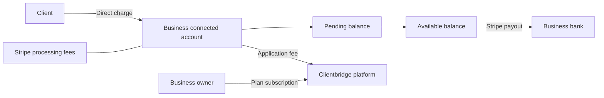

# Payments and Stripe

This is the maintained reference for merchant payments, connected accounts, payouts, platform billing,
and Stripe operations. It describes the implementation in this checkout; it is not a deployment or QA
sign-off. [Architecture](architecture.md) covers the wider system and ledger, [engineering](engineering.md)
covers development, and [operations](operations.md) covers environments, secrets and deployments.

## Account ownership and money flow

| Concept                            | Stripe owner                                                            | Local reference                                                               |
| ---------------------------------- | ----------------------------------------------------------------------- | ----------------------------------------------------------------------------- |
| Business accepting client payments | One Accounts v2 connected account per business                          | `businesses.stripe_account_id`                                                |
| Client paying that business        | A v1 Customer within that connected account                             | `clients.stripe_customer_id`                                                  |
| Client membership                  | Subscription and Price within that connected account                    | `subscriptions.provider_ref`, `items.stripe_price_id`                         |
| Business paying for Clientbridge   | Platform subscription, using the business account as `customer_account` | `businesses.stripe_subscription_id`                                           |
| Merchant payout                    | Connected account → linked bank                                         | Append-only ledger journal keyed by Stripe payout ID; live status from Stripe |

A person buying from two businesses has a separate Customer in each business's account. Saved payment
methods are scoped to that Customer/account. Platform plan billing is a separate flow from the
business's client payments and does not post to the merchant ledger.



## Merchant payments and onboarding

- **Stripe Connect** (Accounts v2 merchants, direct charges + application fee, Stripe's automatic payouts) for
  cards, Link, Tap-to-Pay/Terminal, saved cards, deposits, refunds, subscriptions, and the KYC mirror.
- **Application fee.** `services/payments.application_fee_cents` computes integer cents as
  `amount × clamp(ceiling_bps − estimated_stripe_bps, 0, max_bps) / 10000`, rounded down.
  Defaults in `core/config.py` are a 320 bps ceiling and 200 bps application-fee maximum;
  estimated Stripe percentages are 290 bps for online cards, 270 for card-present and 100 for PAD,
  with 200 extra bps for conversion. These are application configuration assumptions, not a guarantee
  of Stripe's total price: fixed charges, international-card surcharges and account-specific pricing
  can change the actual cost. The ledger records actual fees from Stripe balance transactions.
  Client membership subscriptions charge no application fee today.
- **Connected accounts** are created with `POST /v2/core/accounts`: `dashboard=none` (businesses manage
  everything through embedded components), `fees_collector=stripe` (Stripe takes its processing fee from
  the business, so the application fee is our fee alone) and `losses_collector=stripe` (Stripe owns negative
  balances, as Stripe recommends for direct charges). Both responsibilities are fixed at creation. With those
  values Stripe collects KYC itself (`requirements_collector=stripe`): onboarding is the embedded
  `account_onboarding` component, and the platform cannot accept the terms for the
  business. The merchant configuration requests `card_payments` and `link_payments`; `acss_debit_payments`
  is requested when a business first asks for a bank authorization. Every payment call (PaymentIntents,
  refunds, customers, setup intents, mandates, prices, subscriptions, balance, Terminal) stays on `/v1`
  with the `Stripe-Account` header, which Stripe supports for v2 accounts, and Account Sessions stay on
  `/v1/account_sessions`.
- **KYC mirror.** `account_status_from` reads the v2 account (merchant configuration and requirements):
  charges and payouts are the `card_payments` and `stripe_balance.payouts` capability statuses, the due
  lists are the requirement `description` codes awaiting the business grouped by
  `minimum_deadline.status`, entries awaiting Stripe are pending verification, onboarding counts as
  submitted once no `identity.attestations.terms_of_service` requirement is open, and a closed account
  or a capability only Stripe support can lift marks it disabled. The app maps the codes to catalog copy
  (`requirementCopy` in app-core) with a generic fallback. Thin `v2.core.account[requirements].updated`,
  `v2.core.account[configuration.merchant].capability_status_updated` and `v2.core.account.closed` events
  arrive through an event destination; the handler fetches the account and mirrors it.
- **Recorded by hand**: cash, cheques and e-Transfers received outside the app (`provider` manual, the
  e-Transfer method stored as `etransfer`); cash lands in the till's `cash` account, a cheque or e-Transfer
  in `bank`. There is no e-Transfer request or matching.
- **PAD/EFT**: pre-authorized debit for recurring. Staff on web or mobile send the client a payment setup link,
  and the client authorizes the bank account on Connect `pay.D/setup`.
- **Customer ownership.** Each business has one connected account. Client Customers are created with a stable business/client idempotency key and invariant creation parameters; name/email are applied in a separate update so a rolled-back creation can be retried after a rename; known-client Terminal payments attach that same Customer, while walk-ins remain customerless.
- **Clients stay v1 Customers** on the connected account. Using Accounts v2 as the customers of a connected
  account is a Stripe preview; moving to it later would change `clients.stripe_customer_id` (a schema and
  data change) and pass `customer_account` instead of `customer`.
- **No platform-held funds.** Stripe Connect custodies each provider's balance and pays it out to their
  linked bank through Stripe payouts. Clientbridge records and initiates supported operations through Stripe.
- Owners see Stripe's embedded notification banner on Getting paid and Today (web), and manage the
  account through the embedded account management component, as Stripe requires for accounts with no
  Stripe dashboard where Stripe carries losses. The React Native SDK has neither component and Stripe
  does not support Connect.js inside a WebView, so mobile links to the web page for both.
  `payments` records each attempt and Stripe object; the ledger records what each one did to the money.
- The Stripe API version is pinned (`STRIPE_API_VERSION` in `integrations/stripe.py`), and the Connect
  webhook endpoint (snapshot events) must be created with that same version, because the handlers parse
  its payload shapes. Thin events are unversioned and signed with the event destination's own secret
  (`STRIPE_THIN_WEBHOOK_SECRET`); both arrive at `/webhooks/stripe`, as do platform events (see Platform
  billing below).
  Dashboard refunds arrive as `refund.created`/`refund.updated`, and a recurring invoice's PaymentIntent
  is looked up through its invoice payments. The webhook rejects (400) a snapshot event rendered at any
  other version.
  `setup_intent.setup_failed` records a
  failed bank (PAD) setup on its link.
- Retry-safe `open_*` builders (card/booking-deposit/entitlement/terminal) are Stripe-idempotency-
  keyed + `provider_ref`-deduped, shared by the authed services and the public surfaces. A payment can be
  refunded in part, more than once, up to what is left; a gift card or package purchase, and a forfeited
  deposit, are refunded only in full (and not once the card is partly redeemed or a session is used).
  A gift card or package charged off-session whose command never committed has no row to rebuild, so an
  hour after its intent opened the webhook refunds the charge, platform fee included, and audits it
  (`payment.orphan_refunded`); inside that hour it is retried, since the command may still be committing.

## Payment lifecycle and product surfaces

| Flow                                | Implementation and completion                                                                                                                                                                            |
| ----------------------------------- | -------------------------------------------------------------------------------------------------------------------------------------------------------------------------------------------------------- |
| Invoice / public pay link           | API opens a PaymentIntent on the business account; Elements confirms it; successful settlement posts payment and fees against the invoice.                                                               |
| Booking deposit                     | Shared payment builders create the charge; settlement and booking logic collect/apply/forfeit/refund the deposit through ledger journals.                                                                |
| Order / online shop                 | Order payment settles the sale through the same payment and ledger services. Product stock and order rules remain in `services/orders.py`.                                                               |
| Saved card                          | `ensure_customer` reuses the business/client Customer; setup stores a provider reference, then an authorized server command charges it.                                                                  |
| Terminal / Tap to Pay               | API creates the connected-account card-present intent; the reader confirms it and settlement follows. Known clients attach their Customer; walk-ins do not.                                              |
| Bank authorization / PAD            | Client completes a SetupIntent through a public setup link. Mandate/setup events update local authorization state. A pending debit is not treated as settled.                                            |
| Membership renewal                  | Connected-account Billing invoice success resolves its PaymentIntent through InvoicePayments, then creates the local paid invoice/payment and journals. Subscription updates fetch current Stripe state. |
| Gift card / package sale            | Shared builders and settlement issue the entitlement and book the liability/deferred revenue; redemption/usage is a later ledger event.                                                                  |
| Cash / cheque / received e-Transfer | Recorded manually without Stripe; these do not contribute to the Stripe balance or Stripe payouts.                                                                                                       |

A browser redirect or successful UI confirmation alone does not prove local settlement. The backend
must process the provider outcome, obtain fees and commit the payment, parent state and ledger entries.
Stripe charge operations require connectivity. PowerSync distributes the resulting local records;
it does not create Stripe charges or configure payouts. Public Connect uses API reads rather than PowerSync.

### Refunds and disputes

Refund commands and Dashboard-originated refunds converge on the same local refund handling. Each
Stripe refund has its own Payment row tied to the original payment. The remaining refundable amount
and product restrictions are checked server-side; repeating a provider outcome must not post twice.
Ordinary refunds leave the original Stripe and application fees in place. Orphan-purchase compensation
explicitly requests application-fee return.

A dispute withdrawal posts the disputed amount and fee. A win reinstates funds and any fee Stripe
actually returns; a loss unwinds the sale through the ledger. An inquiry does not withdraw money until
it escalates. Late opening events cannot reopen a won/lost dispute, and an initially missing dispute
fee can be booked when a subsequent event supplies it. Embedded dispute management handles evidence;
our payment records and journals track the financial effect.

## Payouts and schedules

A payout is movement from a connected account's available Stripe balance to its linked bank. It is not
a client payment, staff-pay transfer, refund, or new revenue.

1. A charge initially contributes to pending funds, net of the applicable fees.
2. Stripe releases funds into the available balance according to the account's settlement timing.
3. Stripe initiates automatic payouts on the configured schedule, or the merchant requests a standard
   manual payout when using a manual schedule.
4. Stripe reports the payout's progress and expected arrival; failure/cancellation is handled separately.

The schedule controls when available funds are sent. It does not accelerate settlement, and a scheduled
payout day is not a guaranteed bank-arrival day. Stripe supports daily, weekly, monthly and manual
schedules subject to account/country eligibility; the embedded component determines the valid choices.
See [Stripe's schedule documentation](https://docs.stripe.com/connect/manage-payout-schedule).

### Merchant controls

Owners/admins open **Getting paid → Payouts and schedule**. The backend issues an account-scoped
session for Stripe's embedded payouts component:

| Feature                                       | Setting  | Reason                                                               |
| --------------------------------------------- | -------- | -------------------------------------------------------------------- |
| Edit payout schedule                          | Enabled  | Merchant chooses among the account's supported schedules.            |
| Standard payouts                              | Enabled  | A merchant selecting manual scheduling can withdraw available funds. |
| Instant payouts                               | Disabled | No accelerated payout product in this implementation.                |
| External account collection in this component | Disabled | Bank setup stays in onboarding/account management.                   |

Stripe stores the schedule and executes payouts. There is no local schedule column, duplicate timer,
or custom payout-creation endpoint. The existing web/mobile embedded-component integration hosts the
flow; unsupported mobile account-management components link to web as described above.

### Display and accounting

`GET /v1/connect/status` returns available and pending amounts from a single Stripe balance request.
`GET /v1/connect/payouts` is owner/admin-gated and reads current CAD payout objects from the business's
account, including all pages. The shared `usePayouts` view-model uses those provider statuses:

| Status                   | Meaning in the app                                                      |
| ------------------------ | ----------------------------------------------------------------------- |
| `pending` / `in_transit` | Payout is underway; show expected arrival, not a completed deposit.     |
| `paid`                   | Stripe reports paid; eligible for the deposited total.                  |
| `failed` / `canceled`    | Show unsuccessful/returned status; reverse the original local movement. |

The local payout journal posts `bank + / stripe −` at creation, keyed by `payout:<id>`, with the expected
arrival attached. This bank leg is an accounting movement, not independent evidence of bank receipt.
A later `payout.paid` does not book a second transfer. Failed/canceled payouts use a reversing journal;
if failure arrives first, the handler creates and reverses the original so a late creation cannot
resurrect it. Revenue reports must not count payouts as sales.

Balances, fees and charge history still use the local ledger. Live payout status requires the API and
Stripe; the payout page currently depends on that online read. No payout-status table is mirrored
through PowerSync.

## Ledger consistency and recovery

The [ledger design](architecture.md#ledger-double-entry-append-only-servicesledgerpy) uses balanced,
append-only journals in the same database transaction as the business state. A unique journal reference
prevents duplicate posting; corrections reverse prior entries. All amounts are integer cents. Actual
processing/application fees come from Stripe, and settlement retries when required fee data is not yet
available. The connected-account balance is compared with the business's Stripe account, excluding the
platform's own application-fee balance.

Stripe and Postgres cannot commit atomically. Consistency is eventual: signed webhooks provide the fast
path, nightly reconciliation repairs recognized sources, and audits expose unexplained differences.
This is not a guarantee that both balances are identical at every instant.

| Mechanism                              | Behavior                                                                                                                                                                                                                                 |
| -------------------------------------- | ---------------------------------------------------------------------------------------------------------------------------------------------------------------------------------------------------------------------------------------- |
| Provider commands                      | Stable idempotency keys and provider-reference deduplication; Customer creation also uses a business/client key.                                                                                                                         |
| Webhook application                    | Verify signature/version, dedupe by event ID, then apply state, journal and queued notification transactionally.                                                                                                                         |
| Current subscription state             | Fetch Stripe's current subscription under a local row lock instead of overwriting it with an old event snapshot.                                                                                                                         |
| `reconcile_ledger`, daily at 04:00 UTC | Enumerate connected-account balance transactions, group by source, repair recognized charge/refund/dispute/payout sources, compare source net amounts and aggregate balances, and check cached ledger balances.                          |

Older membership charges can be reconstructed through their InvoicePayments association even outside
the event history window. Recovery of a local succeeded PaymentIntent uses its charge timestamp rather
than recording an old payment as paid today. The same notification queue/deduplication rules apply to
recovery and webhooks.

Reconciliation never invents a balancing entry. Unknown adjustments, mismatched amounts or failed
repairs produce audits and the existing ledger-drift alert:

| Audit                          | Investigation                                                                                 |
| ------------------------------ | --------------------------------------------------------------------------------------------- |
| `ledger.transaction_drift`     | Source ID, balance transaction IDs and local/Stripe net cents identify the movement to trace. |
| `ledger.transaction_failed`    | Source repair failed; inspect the correlated worker exception.                                |
| `ledger.drift`                 | Aggregate business Stripe balance differs.                                                    |
| `ledger.cache_drift`           | Cached account balances differ from their immutable entries.                                  |
| `ledger.reconciliation_failed` | Business reconciliation could not complete, including provider access failures.               |

The periodic event replay and pending-payment sweep are deferred. Webhook retries remain the normal
retry path; reconciliation repairs recognized merchant balance-transaction sources. It does not
replace missed platform subscription, setup, or mandate events; those require webhook redelivery.
Nightly balance reconciliation scans complete history, and payout history uses bounded cursor pages; reconciliation
so runtime and request volume grow with usage. Unsupported movements require investigation. Existing
fixture references in demo data are not recoverable real Stripe transactions.

## Platform billing

Clientbridge charges each business for its plan through Stripe Billing on the platform account. The
business's Accounts v2 account is the billing customer: it gets the `customer` configuration next to its
`merchant` configuration, and the v1 Billing APIs take `customer_account=acct_...` in place of `customer`.
A business that subscribes before setting up payments gets an account with only the `customer`
configuration; onboarding later adds the `merchant` configuration to that same account, and until then the
KYC status reads `not_started`. Responsibilities and `dashboard=none` are fixed at account creation, so
every account we create carries ours whichever configuration it starts with.

- Prices: Premium and Team, monthly or yearly (a year costs ten months), plus a monthly seat item on
  Premium, all CAD and tax-exclusive, defined in `services/plans.py` `PLAN_PRICES` and found in Stripe by
  lookup key. A changed amount moves the key to a new price, so subscription items are named by their
  fixed product id and interval instead, and an unchanged item stays on the price it was bought at. Subscriptions use flexible billing mode so a yearly plan can carry the monthly seat item.
- Tax: plan Checkout enables Stripe automatic tax, which locates the account by its identity address. When
  the customer configuration is added to an account that has no identity address yet, the business
  address is set as its `business_details.address`; a verified address is never overwritten. The
  businesses' own sales tax engine (`services/tax.py`) is unrelated.
- Plan subscriptions live on the platform account, so their events come from a separate platform webhook
  endpoint (`connect=false`) signed with `STRIPE_PLATFORM_WEBHOOK_SECRET`. The webhook picks the secret by
  shape: thin events, snapshot events with an `account`, and snapshot events without one.
- Owners manage the payment method, invoices, billing address and cancellation in the Stripe Billing
  Portal (`STRIPE_PORTAL_CONFIGURATION`); plan switching is off there because the portal cannot manage the
  seat item.
- State: `businesses.plan`, `plan_status`, `trial_ends_at` and the server-only `stripe_subscription_id`.
  A new business is `trialing` for 14 days with no Stripe object and no card. `plans.plan_access` derives
  `trial`, `active`, `past_due` or `lapsed` (a trial past its end is lapsed at read time, so no job flips
  it); app-core `planAccess` mirrors it over the synced columns. A business that is `active` with no
  subscription is complimentary, as the demo businesses are; Checkout refuses it with `plan_active`, and the
  plan page offers it no plan to choose.
- Owner-only endpoints in `api/plans.py`: `GET /v1/plan` reads the live subscription and serves the
  prices, `POST /v1/plan/checkout` opens hosted Checkout (carrying the remaining trial when at least 48
  hours are left), `POST /v1/plan/change` swaps the plan and seat items with proration through
  `run_command`, and `POST /v1/plan/portal` opens the Billing Portal. Checkout and portal URLs are
  credentials, so they are audited but never stored as command responses.
- `customer.subscription.*` events without an `account` go to `plans.apply_subscription_event` before any
  client-membership handler. It resolves the business by `customer_account`, checks
  `metadata.business_id`, adopts a created subscription unless another live one exists, and mirrors the
  subscription it fetches from Stripe, so out-of-order deliveries end at Stripe's current state. A second
  subscription that has not ended yet has its paid invoices refunded and is then cancelled; its later
  events, including its own `deleted`, find it ended and change nothing.
- Lapsed: the business can sign in and read. `api/plans.writable` answers every other write with 402
  `plan_required`, except sign-in, the plan endpoints, devices, onboarding, staff removal and data export;
  public booking, the shop and estimate acceptance answer 409 `business_unavailable`, while invoice
  payment and webhooks keep working. Booking reminders, broadcasts, review requests and intake forms skip
  lapsed businesses (`plans.serving`).
- Seats: a member besides the owner who is active, or invited with an unexpired invite. Trial and Team
  allow `PLAN_SEAT_CAP` (50); Premium bills each seat. An invite sets the Stripe seat quantity before it
  commits, so a failed Stripe call fails the invite; removal and revocation lower it afterwards, and
  `run_sync_seats` (daily) corrects any drift and expired invites. `run_trial_reminders` emails the owner
  at the last 9:00 local before the trial ends, while it still runs, and three days earlier.
- Mobile shows the plan read-only, with no purchase button or link to buy on the web, to stay within App
  Store guideline 3.1.3(f) for companion apps. A lapsed business keeps its data indefinitely.
- Platform billing is not business money, so it posts nothing to the ledger. Stripe's invoices are the
  record.

## Local sandbox setup

Run commands from the repository root after the normal [local bring-up](engineering.md#bring-up).
Use a Stripe CLI profile for the intended sandbox and keep its API version aligned with
`STRIPE_API_VERSION`. The setup script is plan-first and refuses live mode.

```sh
make stripe-setup ARGS="--project-name <profile>"
make stripe-setup ARGS="--project-name <profile> --apply --write-db"
make stripe-setup ARGS="--project-name <profile> --show-secrets"
make stripe-setup ARGS="--project-name <profile> --listen"
```

The first command previews; the second creates/updates sandbox objects and links seeded database rows.
The secret-printing command is for local configuration only: do not paste its output into tickets or
commit it. `make stripe-listen` is the default-profile shortcut and starts snapshot and thin listeners.
Start the API and worker separately with `make dev-api` and `make worker`.

The platform products are `clientbridge_premium`, `clientbridge_team` and `clientbridge_seat`;
price lookup keys are `premium_month`, `premium_year`, `team_month`, `team_year` and `seat_month`.
The Billing Portal is identified by `metadata.clientbridge=portal`; demo accounts by
`metadata.clientbridge_demo`. The script reuses matching objects rather than creating a second set.

The script provisions demo connected accounts, platform products/prices/portal, and public endpoints
when `--webhook-url` is supplied. `--write-db` links business accounts and Terminal locations and replaces
fixture saved cards with real sandbox references. Complete embedded onboarding as each demo owner;
the script prints the test identity/bank instructions. Rerun linking after `make demo-reset`.
Seeded historic payments/subscriptions retain fixture references: create a fresh sandbox sale or
subscription to test actual refunds, cancellation and recovery.

`--link-only --apply` is the deploy-job alternative: it uses `STRIPE_SECRET_KEY` without the CLI and
only links existing demo sandbox objects. It allows `ENV=dev` or `staging` and refuses non-test keys.
Normal provisioning uses `ENV=dev` and the CLI's verified test-mode account. `--account <id>` pins the
expected platform account. The script's `blocked` steps must be resolved; a run is not successful merely
because some objects were created.

### Finishing the two demo accounts

The previously verified sandbox accounts include Birchbark (`acct_1UPnLpFGqw5ObEW5`) and Cedar Coast
(`acct_1UPnLvFGqw7Th6aZ`), and the local demo database is linked to both. Do not create replacements
just to finish onboarding. The current seed also includes Northlight Security; provisioning reads each
business's legal address and phone from `scripts/demo_context.py`. Products, prices, portal configuration
and Terminal locations already exist for the previously provisioned demos. Final API verification
showed Cedar Coast needs only agreement acceptance; Birchbark still needs its support phone, owner
title, bank and agreement. Both remain restricted until those requirements are completed.

On 2026-10-18, CLI prefilling succeeded for Cedar Coast's Canadian test bank, support phone, owner title and Stripe test
website (`https://accessible.stripe.com`). Birchbark rejected support/identity changes because an
Account Session had already started onboarding. Stripe can continue reporting pending requirements
while processing updates; a successful field update alone does not mean charges/payouts are enabled.
New demo-account creation prefills the support phone, the owner title and the business's website,
`https://<slug>.example` from `scripts/demo_context.py`; the sandbox accepted `https://inkwell.example`
when Inkwell's account was created. Existing accounts retain their identifiers, onboarding state and
the website they were created with.

Our accounts use `requirements_collector=stripe`. Stripe documents the external-bank-account API for
application-collected accounts. In this sandbox it accepted Cedar Coast's test bank before onboarding,
but rejected the same request for Birchbark after its Account Session had started. Do not rely on CLI
bank setup being available for every account. Review and accept the account agreement in Stripe
onboarding; do not fabricate an acceptance timestamp/IP in a provisioning script. See [Stripe's bank-account API](https://docs.stripe.com/api/external_account_bank_accounts/create)
and [account configuration](https://docs.stripe.com/connect/accounts-v2/connected-account-configuration).

Complete the one-time manual step for each business:

1. Sign into the local app as `hannah@birchbark.example` for Birchbark or
   `owner@cedarcoast.example` for Cedar Coast, with the seeded password `demo1234`.
2. Open **Setup → Getting paid**, then finish onboarding. Confirm the component says test/sandbox.
3. Choose **Use test phone number** in Stripe's authentication prompt; use `000000` if prompted for
   a test verification code. Review and accept the displayed agreements yourself.
4. Review the prefilled business/person details. If still requested, use title `Owner` and the demo
   support phone (`+12505550110` for Birchbark; `+16045550120` for Cedar Coast).
5. Cedar Coast already has a test bank linked; review it rather than adding a duplicate. For Birchbark,
   enter Stripe's Canadian test bank: transit `11000`, institution `000`, account `000123456789`.
   If Stripe asks for a combined routing number, use `11000-000`. These are
   [Stripe's test values](https://docs.stripe.com/connect/testing#payouts), not real bank details.
6. Finish the form, then rerun the setup/link command so Customers and seeded saved cards can be linked
   once the merchant can charge:

```sh
make stripe-setup ARGS="--project-name clientbridge --apply --write-db"
```

With `make stripe-listen` and the local API running, account events also refresh the KYC mirror. Confirm
both charges and payouts are enabled before creating fresh test charges and trying a funded payout.
Historic seed payments keep fixture provider references and must not be used for live sandbox refunds.
If you reset the local demo database later, rerun linking; you do not need to recreate the Stripe accounts.

### Credentials and runtime settings

| Setting                             | Purpose                                                                           |
| ----------------------------------- | --------------------------------------------------------------------------------- |
| `STRIPE_SECRET_KEY`                 | Backend/worker Stripe API access for this environment.                            |
| `STRIPE_WEBHOOK_SECRET`             | Connected-account snapshot endpoint signing secret.                               |
| `STRIPE_THIN_WEBHOOK_SECRET`        | Accounts v2 thin-event destination signing secret.                                |
| `STRIPE_PLATFORM_WEBHOOK_SECRET`    | Platform plan-subscription endpoint signing secret.                               |
| `STRIPE_PORTAL_CONFIGURATION`       | Platform Billing Portal configuration ID.                                         |
| `STRIPE_CONNECT_COUNTRY`            | Connected-account country; defaults to `CA`.                                      |
| `VITE_STRIPE_PUBLISHABLE_KEY`       | Local web and Connect apps.                                                       |
| `STRIPE_PUBLISHABLE_KEY`            | Mobile configuration; deployed web receives runtime configuration from the stack. |
| `clientbridge:stripePublishableKey` | Per-environment Pulumi stack setting for deployed clients.                        |

Secret and publishable keys must refer to the same mode/platform account. Local CLI signing secrets
are distinct from deployed endpoint secrets. See [secret deployment](operations.md#secrets) for Secret
Manager names, mounting and rollout behavior. Test-only E2E settings are covered below.

## Staging and production setup

Staging uses a Stripe sandbox and production the live platform account, both on API version `2026-09-30.endive` (`STRIPE_API_VERSION` in `integrations/stripe.py`). Each needs:

- A Connect webhook endpoint (`connect=true`) at `https://api.D/webhooks/stripe` for the snapshot events in `integrations/stripe.py` `PAYMENT_EVENTS` (aliased as `WEBHOOK_EVENTS` in the setup script), at the pinned API version. Its signing secret is `STRIPE_WEBHOOK_SECRET`.
- A thin event destination at the same URL for `v2.core.account[requirements].updated`, `v2.core.account[configuration.merchant].capability_status_updated` and `v2.core.account.closed`. Its secret is `STRIPE_THIN_WEBHOOK_SECRET`.
- A platform endpoint (`connect=false`) at the same URL for `customer.subscription.created`, `.updated` and `.deleted`. Its secret is `STRIPE_PLATFORM_WEBHOOK_SECRET`.
- The plan products, prices and Billing Portal configuration that `stripe_setup.py` plans (see [the demo account](engineering.md#the-demo--qa-account)); the configuration id is `STRIPE_PORTAL_CONFIGURATION`.
- Payment method domains for `app.D`, `book.D`, `pay.D` and `shop.D`, so Apple Pay, Google Pay and Link show in Elements there. We use direct charges, and Stripe requires the domain to be registered on the connected account that runs the charge (`Stripe-Account` header), not on the platform. The API registers and enables the four domains on a business's account each time its owner opens the embedded onboarding session (`POST /v1/connect/session`) when `BASE_DOMAIN` is set (`register_payment_domains` in `integrations/stripe.py`), which covers live accounts with no Dashboard step. For accounts that existed before, such as the sandbox demo accounts, `stripe_setup.py --payment-domains D` plans the same registration on each demo account and `--apply` performs it; it refuses live mode like the rest of the script. Check Apple Pay on `book.` in staging after the first deploy.
- The Dashboard-only settings `stripe_setup.py` prints (`DASHBOARD_STEPS`): Connect profile and branding, payment methods for connected accounts, Terminal, Connect and Billing emails, Smart Retries and Stripe Tax.
- `STRIPE_SECRET_KEY` (a restricted key if every call the adapter makes is covered, otherwise the secret key) and the publishable key in the stack's `stripePublishableKey`.

For staging, `stripe_setup.py` creates all of the endpoints and billing objects. It runs only with `ENV=dev` and a test-mode Stripe CLI profile, so run it from a local checkout against the staging sandbox's CLI profile, with the staging app URL for the portal's return link:

```
WEB_BASE_URL=https://app.staging.clientbridge.ca make stripe-setup \
  ARGS="--project-name <staging profile> --webhook-url https://api.staging.clientbridge.ca/webhooks/stripe --show-secrets"   # review the plan
WEB_BASE_URL=https://app.staging.clientbridge.ca make stripe-setup \
  ARGS="--apply --project-name <staging profile> --webhook-url https://api.staging.clientbridge.ca/webhooks/stripe --show-secrets"
WEB_BASE_URL=https://app.staging.clientbridge.ca make stripe-setup \
  ARGS="--apply --project-name <staging profile> --payment-domains staging.clientbridge.ca"   # once the demo accounts exist
```

The script refuses live mode, so production's endpoints, destination, products, prices and portal configuration are created in the live Dashboard (Workbench > Webhooks, choosing API version `2026-09-30.endive`) with the same event lists, product ids and price lookup keys as `stripe_setup.py`.

The webhook route picks the signing secret by the event's shape: thin events use `STRIPE_THIN_WEBHOOK_SECRET` (the event destination's secret), snapshot events with an `account` use `STRIPE_WEBHOOK_SECRET` (the Connect endpoint's secret), and snapshot events without one use `STRIPE_PLATFORM_WEBHOOK_SECRET` (the platform endpoint's secret). The snapshot listener forwards both Connect and platform events, so with our local listeners use the secrets printed for the corresponding destinations; the setup script prints the local values. `STRIPE_PORTAL_CONFIGURATION` holds the portal configuration id the script prints, and production config validation requires it and the platform secret. A sandbox renders snapshot events at its own default API version, and `stripe listen` cannot pin another. The webhook rejects snapshot events rendered at any version other than `STRIPE_API_VERSION`, which matches the Clientbridge sandbox default (`2026-09-30.endive`); when Stripe releases a newer version, we upgrade the pin and the SDK together after checking its changelog against the handlers. Thin events are unversioned and skip this check.

### Dashboard configuration

Use `DASHBOARD_STEPS` in `backend/scripts/stripe_setup.py` as the maintained checklist: Connect profile
and questionnaire; platform public details and statement descriptor; Connect branding; connected-account
payment methods; Terminal/Tap to Pay enablement and device entitlements; sandbox API version; Connect
payment/payout email settings; platform Billing emails and Smart Retries; and the platform's Stripe Tax
address and registrations. Enabling an embedded component does not perform those platform setup steps.

The business's sales taxes are calculated by our tax service. Stripe automatic tax is used for
Clientbridge plan subscriptions; these are separate tax flows. After changing plan price lookup keys,
restart the API because lookup results are cached per process. Existing subscriptions retain their
original Price unless explicitly changed.

## Testing and QA

Use the [categorized QA checklist](qa/payments.md) for scenario coverage and the
[automation plan](qa/payments-automation.md) for real-app recordings, shared sandbox isolation and CI rollout.

| Layer              | Command                                         | What it proves                                                                                                                             |
| ------------------ | ----------------------------------------------- | ------------------------------------------------------------------------------------------------------------------------------------------ |
| Backend regression | `make test-backend`                             | Product behavior, ledger invariants, duplicate/out-of-order events, recovery and tenant/role isolation with fakes and disposable Postgres. |
| Stripe contract    | `make stripe-mock`, then `make test-contract`   | Real adapter request/response shapes against stripe-mock; not provider state or Accounts v2 behavior.                                      |
| Provider E2E       | `make test-e2e`                                 | Real sandbox behavior when test keys are configured; skipped otherwise. May create provider test objects.                                  |
| Frontend           | `make test-frontend` and normal lint/type gates | Shared view-model and client checks; not proof of successful embedded-provider interaction.                                                |

E2E uses `STRIPE_TEST_SECRET_KEY` and, for existing merchant scenarios, `STRIPE_TEST_CONNECTED_ACCOUNT`;
the setup script prints the demo account ID. Follow the [test tiers](engineering.md#stripe-three-tiers-layered-by-cost)
for the complete harness and prerequisites. A green fake/contract suite is not a live payout sign-off.

Manual sandbox pass:

1. Finish onboarding; test incomplete requirements and recovery to ready on web/mobile.
2. Make a fresh invoice payment, booking deposit, shop/desk sale and known-client Terminal payment.
   Check the connected account, Customer association, fee journals and product completion.
3. Save a card; authorize a bank method; test decline/additional authentication and pending debit states.
4. Create and renew a membership; resend an older subscription event and verify current state wins.
5. Make partial/full refunds where permitted; verify duplicate deliveries, refund failure and dispute outcomes.
6. Open Payouts and schedule as owner/admin; change an available automatic schedule, reload and verify
   persistence in Stripe. Select manual scheduling and request a supported standard sandbox payout.
   Check pending/in-transit/paid/failed/canceled display without booking duplicate revenue. Verify staff denial.
7. Compare available/pending amounts with Stripe. Delay a webhook, restore delivery/recovery and verify
   one payment, one set of journals and deduplicated notifications. Verify reconciliation finds no
   unexplained movement for the fresh test transactions.
8. Exercise platform plan Checkout, portal and cancellation separately from client memberships.

Sandbox payouts do not prove actual bank delivery. Real-device Terminal and wallet tests require their
provider/device prerequisites. Keep release sign-off in [launch readiness](launch-readiness.md), rather
than treating this reference as a completed checklist.

Source reconciliation suppresses routine notifications older than one day while preserving gift-card issuance.
Standalone Stripe fee transactions post by transaction ID, including fee credits. The payout list reads
24 payouts per cursor page without fetching every historical page. The 30-day deposited figure is
derived from all applicable bank journals, independently of the visible history page. Ledger repair orchestration lives in
`services/payments.py`; journal primitives remain in `services/ledger.py`.

The [review follow-up](qa/payments-automation.md#review-follow-up) records remaining merge blockers;
these source-repair improvements do not yet make reconciliation bounded or fix payout transit accounting.

### Sandbox verification record — 2026-10-18

Verified against the authenticated Clientbridge sandbox CLI profile, using the seeded Birchbark
connected account. CLI/API checks changed its schedule to weekly Friday, monthly day 15, manual and
daily, retrieving the saved settings after each change. The original daily schedule was restored and
the Cedar Coast demo account's balance settings remained unchanged. Invalid hourly scheduling and
monthly day 32 were rejected without changing settings.

A real Account Session accepted `edit_payout_schedule=true`, `standard_payouts=true`,
`instant_payouts=false`, and `external_account_collection=false`, with Stripe user authentication
remaining enabled. The worktree's actual `StripeGateway` and web `PaymentAccount` component rendered
Stripe's sandbox payout screen in an isolated local harness. This exercised the embedded component,
not the application login/authorization flow.

At the initial check both seeded accounts had payouts disabled, no bank account and zero available funds.
Subsequent CLI setup added Cedar Coast's test bank; see [demo setup](#finishing-the-two-demo-accounts).
Stripe displayed “On hold” and withheld the schedule controls; a test payout was rejected for lack of
a CAD external account. Completing onboarding, editing the schedule through the embedded UI and
creating a funded sandbox payout remain required before signing off that browser flow. The CLI
round trips alone do not complete that QA.

## Troubleshooting

| Symptom                                        | Check                                                                                                                                                                                                             |
| ---------------------------------------------- | ----------------------------------------------------------------------------------------------------------------------------------------------------------------------------------------------------------------- |
| Cannot accept payments / payouts disabled      | Current account requirements and capabilities; finish embedded onboarding/account management. Inspect thin destination delivery and the mirrored KYC state.                                                       |
| Signature rejection                            | Correct endpoint family and signing secret, raw request body, environment/mode and local versus deployed listener.                                                                                                |
| Snapshot rejected for API version              | Compare event `api_version` with `STRIPE_API_VERSION`; align sandbox default or deployed endpoint. Upgrade SDK, fixtures and handlers together.                                                                   |
| Successful Stripe charge still pending locally | Event delivery/failed Webhook row; required fee availability; webhook redelivery or source reconciliation; associated product record and provider reference. Do not create another charge to repair bookkeeping.                         |
| Payout has not arrived                         | Stripe's live status, available versus pending funds, selected schedule and bank requirements. A local bank journal or estimated date is not proof of receipt.                                                    |
| Ledger drift                                   | Use source/transaction IDs in the audit to compare provider net movement with business-owned Stripe journal legs. Check refunds, disputes and reversals, then rerun normal reconciliation after fixing the cause. |
| Customer/payment method missing                | Verify the connected-account scope and platform/mode. After a demo reset, relink fixtures or create fresh test transactions.                                                                                      |
| Apple Pay / Google Pay / Link absent           | Verify payment method enablement and domain registration on the merchant account, then browser/device eligibility.                                                                                                |
| Plan checkout/portal fails                     | Check platform products/lookup keys, portal configuration and platform webhook secret; do not use the merchant Customer as the platform billing customer.                                                         |

Inspect webhook failures, worker errors and ledger-drift audits together; use the [operations alerts](operations.md#health-checks-and-alerts)
for deployment-specific investigation. Fix causes and replay through existing handlers rather than
editing immutable ledger rows or inserting unexplained balancing entries.

## Code map

Paths are repository-relative; shared frontend paths are under `frontend/packages/app-core/src/`.

| Responsibility                                             | Source                                                                                        |
| ---------------------------------------------------------- | --------------------------------------------------------------------------------------------- |
| Stripe adapter, API pin, event families, embedded features | `backend/src/clientbridge/integrations/stripe.py`                                             |
| Merchant commands, settlement, webhooks and recovery       | `backend/src/clientbridge/services/payments.py`                                               |
| Ledger posting, reversals and reconciliation               | `backend/src/clientbridge/services/ledger.py`                                                 |
| Plan billing and seats                                     | `backend/src/clientbridge/services/plans.py`                                                  |
| Merchant subscriptions and entitlements                    | `backend/src/clientbridge/services/entitlements.py`                                           |
| Payment / Connect routes and webhook entry                 | `backend/src/clientbridge/api/payments.py`, `backend/src/clientbridge/api/webhooks.py`        |
| Persistent payment records and output contracts            | `backend/src/clientbridge/models/payments.py`, `backend/src/clientbridge/schemas/payments.py` |
| Scheduled jobs                                             | `backend/src/clientbridge/tasks/worker.py`                                                    |
| Sandbox provisioning and account audit                     | `backend/scripts/stripe_setup.py`, `backend/scripts/payment_accounts.py`                      |
| Getting paid, payouts and embedded session view-models     | `domain/gettingPaid.ts` (including `usePaymentAccount`), `domain/payouts.ts`                  |
| Recovery and ledger regressions                            | `backend/tests/test_payments_recovery.py`, `backend/tests/test_ledger_drift.py`               |
| Provider contract and E2E tests                            | `backend/tests/contract/test_stripe_contract.py`, `backend/tests/e2e/test_stripe_e2e.py`      |

Provider references: [embedded payouts](https://docs.stripe.com/connect/supported-embedded-components/payouts),
[payout schedules](https://docs.stripe.com/connect/manage-payout-schedule),
[webhooks](https://docs.stripe.com/webhooks), [event history](https://docs.stripe.com/api/events/list),
and [balance transactions](https://docs.stripe.com/api/balance_transactions/list).


### Source findings and payout details

Automatic payouts expose bounded, cursor-paged transaction details through
`GET /v1/connect/payouts/{payout_id}/transactions?after=txn_...`. The service checks owner/admin
access and retrieves both payout and transactions in the current business's connected account.
Pending reconciliation and manual payouts have explicit states; manual payouts do not receive an
invented transaction allocation. Web and mobile render the same app-core view model.

Source mismatches are append-only audit findings. Repeated identical findings reuse their original
record. A platform administrator can acknowledge one with a reason through
`POST /admin/v1/businesses/{business_id}/drift/{finding_id}/acknowledge`; this changes no ledger entries.
A changed mismatch creates a fresh finding; a repaired source records resolution. The nightly job
reports source findings and cache corruption. An account-balance comparison subtracts already
identified source differences, so ledger-only differences remain visible without a duplicate alert for the same
source mismatch. Transient `retry_later` responses defer reconciliation until the next run.

Audited orphan collections and their refunds post to an orphan payable, with processor and application
fees taken from the provider balance transactions. They create no sale revenue or product entitlement.
Unknown fee types and inconsistent provider amounts remain errors rather than balancing adjustments.


PR #42 review follow-up: dispute fees and returned fees now post only their newly observed increments,
including after terminal dispute status, without reopening a won/lost case. History and payout-content
pagination are independent on web and mobile. The account-balance residual check uses active source
findings (including acknowledged ones) and detects ledger-only discrepancies. Durable job checkpoints
and payout-transit accounting remain pending explicit schema approval; do not merge until implemented
and validated.

Scope update: the scheduled recovery job and its event-listing adapter were removed. Reconciliation
and shared payment/webhook handlers remain. No checkpoint table or other schema change was added.
