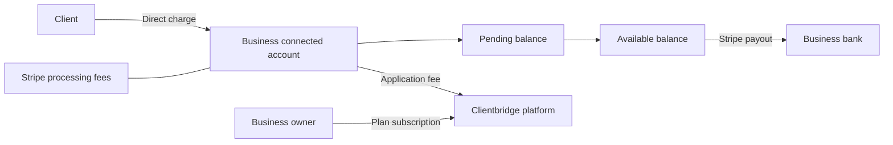

# Payments and Stripe

This is the maintained reference for merchant payments, connected accounts, payouts, platform billing,
and Stripe operations. It describes the implementation in this checkout; it is not a deployment or QA
sign-off. [Architecture](architecture.md) covers the wider system and ledger, [engineering](engineering.md)
covers development, and [operations](operations.md) covers environments, secrets and deployments.

## Account ownership and money flow

| Concept                            | Stripe owner                                                            | Local reference                                                                |
| ---------------------------------- | ----------------------------------------------------------------------- | ------------------------------------------------------------------------------ |
| Business accepting client payments | One Accounts v2 connected account per business                          | `businesses.stripe_account_id`                                                 |
| Client paying that business        | A v1 Customer within that connected account                             | `clients.stripe_customer_id`                                                   |
| Client membership                  | Subscription and Price within that connected account                    | `subscriptions.provider_ref`, `items.stripe_price_id`                          |
| Business paying for Clientbridge   | Platform subscription, using the business account as `customer_account` | `businesses.stripe_subscription_id`                                            |
| Merchant payout                    | Connected account → linked bank                                         | Append-only ledger journals keyed by Stripe payout ID; live status from Stripe |

A person buying from two businesses has a separate Customer in each business's account. Saved payment
methods are scoped to that Customer/account. Platform plan billing is a separate flow from the
business's client payments and does not post to the merchant ledger.



## Merchant payments and onboarding

- **Stripe Connect** (Accounts v2 merchants, direct charges + application fee, Stripe's automatic payouts) for
  cards, Link, Tap-to-Pay/Terminal, saved cards, deposits, refunds, subscriptions, and the KYC mirror.
- **Currency.** Every price and charge is in CAD. `SUPPORTED_CURRENCIES` in `services/ledger.py` holds
  the currencies the ledger books, and `ledger.supported()` checks it for every journal, item create and
  update (422 `unsupported_currency`), sale creation and every charge builder before Stripe is called.
  Ledger accounts are already keyed by currency, so adding one means adding it to that set and checking
  fees and reports. A Stripe object in another currency that reaches us anyway, such as a payout or a
  membership renewal, is refused once as a `payout.refused` or `payment.refused` audit and never booked.
- **Application fee.** `services/payments.application_fee_cents` computes integer cents as
  `amount × clamp(ceiling_bps − estimated_stripe_bps, 0, max_bps) / 10000`, rounded down.
  Defaults in `core/config.py` are a 320 bps ceiling and 200 bps application-fee maximum;
  estimated Stripe percentages are 290 bps for online cards, 270 for card-present and 100 for PAD,
  with 200 extra bps for conversion. These are application configuration assumptions, not a guarantee
  of Stripe's total price: fixed charges, international-card surcharges and account-specific pricing
  can change the actual cost. The ledger records actual fees from Stripe balance transactions.
  The fee applies to every transaction, tips included, so a tipped sale's fee is computed on the amount
  with its tip. Memberships carry it as the subscription's `application_fee_percent`, set at the rate a
  one-off charge with the same payment method gets (`subscription_fee_percent`: 0.3% for a card and 2%
  for PAD at the default settings), and each renewal books the fee Stripe took from its balance
  transaction. Ordinary refunds keep the fee; refunds we start ourselves return it (see
  [Refunds and disputes](#refunds-and-disputes)).
- **Connected accounts** are created with `POST /v2/core/accounts`: `dashboard=none` (businesses manage
  everything through embedded components), `fees_collector=stripe` (Stripe takes its processing fee from
  the business, so the application fee is our fee alone) and `losses_collector=stripe` (Stripe owns negative
  balances, as Stripe recommends for direct charges). Both responsibilities are fixed at creation. With those
  values Stripe collects KYC itself (`requirements_collector=stripe`): onboarding is the embedded
  `account_onboarding` component, and the platform cannot accept the terms for the
  business. The merchant configuration requests `card_payments` and `link_payments`; `acss_debit_payments`
  is requested when a business first asks for a bank authorization. Every payment call (PaymentIntents,
  refunds, customers, setup intents, mandates, prices, subscriptions, balance, Terminal) stays on `/v1`
  with the `Stripe-Account` header, which Stripe supports for v2 accounts, and Account Sessions stay on
  `/v1/account_sessions`.
- **KYC mirror.** `account_status_from` reads the v2 account (merchant configuration and requirements):
  charges and payouts are the `card_payments` and `stripe_balance.payouts` capability statuses, the due
  lists are the requirement `description` codes awaiting the business grouped by
  `minimum_deadline.status`, entries awaiting Stripe are pending verification, onboarding counts as
  submitted once no `identity.attestations.terms_of_service` requirement is open, and a closed account
  or a capability only Stripe support can lift marks it disabled. The app maps the codes to catalog copy
  (`requirementCopy` in app-core) with a generic fallback. Thin `v2.core.account[requirements].updated`,
  `v2.core.account[configuration.merchant].capability_status_updated` and `v2.core.account.closed` events
  arrive through an event destination; the handler fetches the account and mirrors it.
- **KYC phase.** `business.derive_kyc_status` reads both capabilities. `enabled` means charges and payouts
  are on with nothing past due; `payouts_paused` means charges are on but payouts are off or a requirement
  is past due; `restricted` means card payments are off while something is due; `pending` means Stripe is
  reviewing; `not_started` means details aren't submitted yet, or the account only pays for its plan; and
  `disabled` means the account is closed or only Stripe support can lift the restriction. Getting paid
  shows the finish action whenever anything is due, and a deadline that has passed uses the wording without
  a date. Errors Stripe reports on a requirement (`requirements.entries[].errors`) are mirrored into
  `stripe_requirements.requirement_errors` and shown under that requirement through `gettingPaid.reqError.*`
  copy, with a generic fallback.
- **Refresh.** `POST /v1/connect/refresh` (owners and admins) reads the account from Stripe and mirrors it,
  for when its events are late or never arrived. It calls Stripe at most six times a minute per business
  and otherwise returns the mirrored status. Getting paid's Refresh button and the return from onboarding
  use it.
- **Closed accounts.** `v2.core.account.closed` fetches the account like any account event. If Stripe can
  no longer return it, the event alone marks the business disabled (`disabled_reason: closed`, charges and
  payouts off). Reconciliation and event replay don't skip a closed account yet, and offboarding a business
  is not built.
- **Recorded by hand**: cash, cheques and e-Transfers received outside the app (`provider` manual, the
  e-Transfer method stored as `etransfer`); cash lands in the till's `cash` account, a cheque or e-Transfer
  in `bank`. There is no e-Transfer request or matching.
- **PAD/EFT**: pre-authorized debit for recurring. Staff on web or mobile send the client a payment setup link,
  and the client authorizes the bank account on Connect `pay.D/setup`. A charge on a saved bank account is
  recorded as `bank_eft` (`charge_method`) by the invoice, deposit, entitlement and sale builders, and its
  refunds copy that method. Stripe debits a saved bank account off session only when the PaymentIntent
  names both `allowed_payment_method_types: ["acss_debit"]` and the mandate, so `pad_mandate` finds the
  active mandate from the client's setup links (`mandate_ref`, confirmed with Stripe) and the builders pass
  it on; with no active mandate the charge answers 409. The setup link asks for a mandate with
  `default_for: ["invoice", "subscription"]` and no `payment_schedule` or `interval_description` (Stripe
  refuses the two together). Stripe makes it a `combined` mandate with its own wording; it covers one-off
  charges named with it and memberships, which Stripe bills under it without being told.
- **Charge gates.** Card charges, card setup and PAD setup links need card payments on
  (`stripe_charges_enabled`). Any staff member may charge a client's saved card for a sale or a deposit at
  the desk; charging a saved card against an invoice stays with owners and admins. A lapsed business can
  still collect a deposit from a client's manage link, as it can be paid on an invoice, because the booking
  already exists; new bookings stay blocked.
- **Customer ownership.** Each business has one connected account. Client Customers are created with a
  stable business/client idempotency key and invariant creation parameters; the name is applied in a
  separate update so a rolled-back creation can be retried after a rename; known-client Terminal payments
  attach that same Customer, while walk-ins remain customerless. A later edit to a client's name
  updates their Customer after the edit commits (`payments.sync_customer`). That update is best effort: a
  failure is logged and the next edit tries again. A command retried more than 24 hours after a rollback
  can create a second Customer; it holds no payment method.
- **Clients stay v1 Customers** on the connected account. Using Accounts v2 as the customers of a connected
  account is a Stripe preview; moving to it later would change `clients.stripe_customer_id` (a schema and
  data change) and pass `customer_account` instead of `customer`.
- **No platform-held funds.** Stripe Connect custodies each provider's balance and pays it out to their
  linked bank through Stripe payouts. Clientbridge records and initiates supported operations through Stripe.
- Owners see Stripe's embedded notification banner on Getting paid and Today (web), and manage the
  account through the embedded account management component, as Stripe requires for accounts with no
  Stripe dashboard where Stripe carries losses. Owners and admins can open account management and payouts.
  The React Native SDK has neither component and Stripe does not support Connect.js inside a WebView, so
  mobile links to the web page for both. `payments` records each attempt and Stripe object; the ledger
  records what each one did to the money.
- The Stripe API version is pinned (`STRIPE_API_VERSION` in `integrations/stripe.py`), and the Connect
  webhook endpoint (snapshot events) must be created with that same version, because the handlers parse
  its payload shapes. Thin events are unversioned and signed with the event destination's own secret
  (`STRIPE_THIN_WEBHOOK_SECRET`); both arrive at `/webhooks/stripe`, as do platform events (see Platform
  billing below). Dashboard refunds arrive as `refund.created`/`refund.updated`/`refund.failed`, and a
  recurring invoice's PaymentIntent is looked up through its invoice payments. The webhook rejects (400) a
  snapshot event rendered at any other version. `setup_intent.setup_failed` records a failed bank (PAD)
  setup on its link.
- **Stripe errors.** A Stripe error that escapes the adapter answers with a stable code through
  `core/errors.stripe_error_handler`: `payment_disputed` (409) for `charge_disputed`, `amount_too_small`
  (422), `idempotency_mismatch` (409) when a retry differs from the original request, `card_declined` (402),
  and `payment_provider_error` (502) for anything else. Clients render these through `failureMessage`. The
  handler logs the Stripe code and request id on the `clientbridge.stripe` logger.
- **No automatic network retries.** Each Stripe call is one 10-second attempt, because calls run while
  row and advisory locks are held and SDK retries would hold them for up to 30 seconds. A network failure
  answers `payment_provider_error`; the person tries again with the same idempotency key, which reaches
  Stripe as the same Stripe key, so the money moves once. The hourly jobs (reconciliation, missed-event
  replay, stale intent cleanup) pick up anything a failed attempt left behind.
- Retry-safe `open_*` builders (card/booking-deposit/entitlement/terminal) are Stripe-idempotency-
  keyed + `provider_ref`-deduped, shared by the authed services and the public surfaces. A payment can be
  refunded in part, more than once, up to what is left; a gift card or package purchase, and a forfeited
  deposit, are refunded only in full (and not once the card is partly redeemed or a session is used).
  A gift card or package charged off-session whose command never committed has no row to rebuild, so an
  hour after its intent opened the webhook refunds the charge, platform fee included, and audits it
  (`payment.orphan_refunded`); inside that hour it is retried, since the command may still be committing.

## Payment lifecycle and product surfaces

| Flow                                | Implementation and completion                                                                                                                                                                                                                                                                                                                |
| ----------------------------------- | -------------------------------------------------------------------------------------------------------------------------------------------------------------------------------------------------------------------------------------------------------------------------------------------------------------------------------------------- |
| Invoice / public pay link           | API opens a PaymentIntent on the business account; Elements confirms it; successful settlement posts payment and fees against the invoice.                                                                                                                                                                                                   |
| Booking deposit                     | Shared payment builders create the charge; settlement and booking logic collect/apply/forfeit/refund the deposit through ledger journals.                                                                                                                                                                                                    |
| Order / online shop                 | Order payment settles the sale through the same payment and ledger services. Product stock and order rules remain in `services/orders.py`.                                                                                                                                                                                                   |
| Saved card                          | `ensure_customer` reuses the business/client Customer; setup stores a provider reference, then an authorized server command charges it.                                                                                                                                                                                                      |
| Terminal / Tap to Pay               | API creates the connected-account card-present intent; the reader confirms it and settlement follows. Known clients attach their Customer; walk-ins do not.                                                                                                                                                                                  |
| Bank authorization / PAD            | Client completes a SetupIntent through a public setup link. Mandate/setup events update local authorization state. A pending debit is not treated as settled.                                                                                                                                                                                |
| Membership renewal                  | Connected-account Billing invoice success resolves its PaymentIntent and amount through InvoicePayments, then creates the local paid invoice/payment and journals. Subscription updates fetch current Stripe state. See [Memberships](#memberships).                                                                                         |
| Gift card / package sale            | Shared builders and settlement issue the entitlement and book the liability/deferred revenue; redemption/usage is a later ledger event. A gift card is sold untaxed: redeeming it on a sale books that redemption's share of the sale's tax, and the sale counts in taxable sales then. A manual redemption with no sale books revenue only. |
| Cash / cheque / received e-Transfer | Recorded manually without Stripe; these do not contribute to the Stripe balance or Stripe payouts.                                                                                                                                                                                                                                           |

A browser redirect or successful UI confirmation alone does not prove local settlement. The backend
must process the provider outcome, obtain fees and commit the payment, parent state and ledger entries.
Stripe charge operations require connectivity. PowerSync distributes the resulting local records;
it does not create Stripe charges or configure payouts. Public Connect uses API reads rather than PowerSync.

### Open intents

An intent that nobody will finish is cancelled rather than left confirmable, so a client can't pay twice:

- Paying an invoice again supersedes its earlier attempts and cancels both the pending and the declined
  ones.
- Completing a visit cancels its unpaid deposit intent. A deposit that still settles after the visit
  finished without it is refunded, as after a cancellation.
- The pay link sends the balance its page shows, and `POST /pay/{token}/card` refuses a different live
  balance, or an invoice that was paid or voided meanwhile, with 409 `invoice_changed`; the page then
  reloads. The response carries the amount the card will be charged, which labels the card form.
- A card payment that settles after its invoice was voided, or after the invoice was paid another way
  so it no longer owes that much, is booked and then refunded in full with our platform fee returned
  (reason `unapplied_payment`). The refund puts back only the receivable the payment credited.
  `void_invoice` checks for money and pending payments under the invoice lock that payments also take.
- `POST /v1/orders/{id}/checkout/cancel` cancels a desk sale's open card or Terminal intents so the sale
  can be edited, voided or paid in cash. It answers 409 `checkout_paid` once the card payment went
  through. The web and mobile pay sheets and the mobile reader screen offer it, and changing the tip
  supersedes the open intent instead of being refused.
- `cancel_stale_intents` (hourly at :45, `payments.run_cancel_stale_intents`) cancels staff-opened desk
  sale, gift card and package intents that are still pending a day after they opened, 200 per run,
  newest first. An intent Stripe refuses to cancel is logged and left for the next run.
- Subscription creates use the command's idempotency key as Stripe's key, so a retry with a different card
  succeeds and a quick resubscribe starts a new subscription. The no-show charge keys on the card, so a
  new default card after a decline is a new charge.

Terminal connection tokens are scoped to the business's Terminal Location. When the business address
changes, the next reader session creates a Location at the new address and the old one is deleted; a
failed delete is logged and the old Location stays unused in Stripe.

### Memberships

A membership is a Stripe Subscription on the business's connected account, created with the client's
saved card or bank account and the platform fee as `application_fee_percent`. Its metadata carries
`business_id`, `client_id` and the item's `tax_class`, and Stripe copies it to every invoice.

- Stripe charges the first invoice inside `Subscription.create`, before our row commits. An event for a
  subscription we haven't recorded yet answers `retry_later` when its metadata names one of our
  businesses on the same account, so Stripe delivers it again once the row exists. Other unknown
  subscriptions are ignored.
- Stripe statuses map to ours: `active` and `trialing` to active, `past_due`, `unpaid` and `incomplete` to
  past due, `incomplete_expired` and `canceled` to canceled, `paused` to paused.
- Each renewal takes its amount from the InvoicePayment and backs tax out at the rates and registration in
  force at the period start. A business is registered on a day when `tax_registered` is on and
  `tax_registered_on` is empty or on or before that day in the business time zone, so a renewal booked
  late for a period before the registration date is split as untaxed. Turning registration off clears the
  date, and with no date the current setting applies to every period: registering partway through a
  membership taxes the next renewal, and deregistering stops it.
- An invoice marked paid with no InvoicePayment behind it was paid outside Stripe. It is audited once
  (`subscription.paid_outside_stripe`) and books nothing.
- The past-due notice is scoped to the failing invoice, so each failed episode sends one notice while
  Smart Retries within an episode don't send more.
- Archiving a client cancels their memberships at the end of the paid period. A lost dispute on a
  membership charge cancels the membership at once and audits `subscription.cancel`.
- Changing an item's price doesn't move existing members; they keep the price they joined at, and the item
  editor says so.
- When the business's own plan lapses, its memberships keep billing. The owner can still cancel them
  (`POST /v1/subscriptions/{id}/cancel` is allowed while lapsed) and is emailed once that memberships are
  still charging.

### Refunds and disputes

Refund commands and Dashboard-originated refunds converge on the same local refund handling:
`refund.created`, `refund.updated` and `refund.failed` all go through one handler. Each Stripe refund has
its own Payment row tied to the original payment. The remaining refundable amount and product
restrictions are checked server-side, and repeating a provider outcome doesn't post twice. The refund
command requires an idempotency key and passes it to Stripe, so a rolled-back command retried with the
same key refunds once.

A payment with an open or lost dispute can't be refunded: the refund and its preview answer 409
`payment_disputed`, and a won dispute allows refunds again.

Ordinary refunds leave the original Stripe and application fees in place. Refunds we start for our own
reasons ask Stripe to return the application fee (`refund_application_fee`): an online order paid after it
expired or after its stock ran out is refunded in full this way, and `ledger.post_fee_return` books the
returned fee under `fee_return:<refund>`. Orphan-purchase compensation returns it too. Stripe doesn't put
the returned fee in the refund's balance transaction: it posts a separate `adjustment` (reporting
category `fee`, pro rata to the amount refunded) on the connected account whose source is the original
charge, so reconciliation counts the `fee_return:` journals of a charge's refunds under the charge. A client cancelling
their own online order doesn't. The fee return is booked only when Stripe reports the refund succeeded in
its first answer; a refund that succeeds later through `refund.updated` doesn't book it yet.

Money leaving a booking deposit, by refund or lost dispute, first takes back the deposit's forfeit and any
application to an invoice, then marks the deposit refunded. The forfeit reversal is keyed by the refund or
dispute. A refund that fails after it succeeded reverses the refund journal, forfeits the deposit again
(`restore_forfeit`) and restores a gift card or package the refund had voided. A held deposit goes back
on the booking's open invoice under an application keyed by the failed refund, so the invoice it reopened
is paid down again; if that invoice was paid or voided in the meantime, the deposit stays held.

A dispute withdrawal posts the disputed amount and fee. A win reinstates funds and any fee Stripe
actually returns. A loss unwinds the sale through the ledger, capped at what the sale still carries: a
refund followed by a lost dispute leaves revenue and tax at zero, and the money lost twice goes to the
business's `loss` account. Stripe can dispute the whole charge after a partial refund and, when the
dispute is lost, give the refunded part back. A positive balance transaction on a lost dispute
(`charge.dispute.funds_reinstated`) posts `dispute:<id>:reinstated` from the `loss` account to the Stripe
balance, booking only the increase on each event. This follows the dispute's documented
`balance_transactions`; the sandbox could not produce a dispute after a refund to observe it. A gift card
or package gives back only what it still holds, so the used part of
a lost purchase is booked to `loss` as well; the card or package is voided once the dispute and any refunds
cover the whole purchase. The income report counts lost-dispute reversals with refunds instead of as lower
sales.

An inquiry (`warning_needs_response`) alerts staff once and books nothing; money moves only if it
escalates. Late opening events cannot reopen a won/lost dispute, and dispute fees and returned fees post
only their newly observed increments, including after the case closed. Embedded dispute management
handles evidence; our payment records and journals track the financial effect.

Staff commission follows the money the business keeps. When a refund or a lost dispute returns part of an
invoice, sale or package, each earning on it is clawed back by the same share as a negative pending earning,
whether the earning is pending, approved or already paid. A clawback of paid pay settles with the member's next
pay. A full refund reverses pending commission outright, a returned tip settles with the tip it returns, and a
refund that fails takes its clawbacks back. The ledger rules are in
[architecture](architecture.md#ledger-double-entry-append-only-servicesledgerpy).

## Payouts and schedules

A payout is movement from a connected account's available Stripe balance to its linked bank. It is not
a client payment, staff-pay transfer, refund, or new revenue.

1. A charge initially contributes to pending funds, net of the applicable fees.
2. Stripe releases funds into the available balance according to the account's settlement timing.
3. Stripe initiates automatic payouts on the configured schedule, or the merchant requests a standard
   manual payout when using a manual schedule.
4. Stripe reports the payout's progress and expected arrival; failure/cancellation is handled separately.

The schedule controls when available funds are sent. It does not accelerate settlement, and a scheduled
payout day is not a guaranteed bank-arrival day. Stripe supports daily, weekly, monthly and manual
schedules subject to account/country eligibility; the embedded component determines the valid choices.
See [Stripe's schedule documentation](https://docs.stripe.com/connect/manage-payout-schedule).

### Merchant controls

Owners/admins open **Getting paid → Payouts and schedule**. The backend issues an account-scoped
session for Stripe's embedded payouts component:

| Feature                                       | Setting  | Reason                                                               |
| --------------------------------------------- | -------- | -------------------------------------------------------------------- |
| Edit payout schedule                          | Enabled  | Merchant chooses among the account's supported schedules.            |
| Standard payouts                              | Enabled  | A merchant selecting manual scheduling can withdraw available funds. |
| Instant payouts                               | Disabled | No accelerated payout product in this implementation.                |
| External account collection in this component | Disabled | Bank setup stays in onboarding/account management.                   |

Stripe stores the schedule and executes payouts. There is no local schedule column, duplicate timer,
or custom payout-creation endpoint. The existing web/mobile embedded-component integration hosts the
flow; unsupported mobile account-management components link to web as described above.

### Display and accounting

`GET /v1/connect/status` returns available and pending amounts from a single Stripe balance request.
`GET /v1/connect/payouts` is owner/admin-gated and reads the business's CAD payouts from Stripe, 24 per
page with a cursor for older pages. The shared `usePayouts` view-model uses those provider statuses:

| Status                   | Meaning in the app                                                      |
| ------------------------ | ----------------------------------------------------------------------- |
| `pending` / `in_transit` | Payout is underway; show expected arrival, not a completed deposit.     |
| `paid`                   | Stripe reports paid; eligible for the deposited total.                  |
| `failed` / `canceled`    | Show unsuccessful/returned status; reverse the original local movement. |

`GET /v1/connect/payouts/{payout_id}/transactions?after=txn_...` lists what an automatic payout contains,
24 balance transactions per page, read from the business's connected account after the same owner/admin
check. It answers `pending` while Stripe is still reconciling the payout and `unavailable` for a manual
payout, which has no transaction breakdown, and lists only CAD transactions. A payout id Stripe doesn't
recognize answers 404, and a malformed provider response 502. Web and mobile render the same app-core
view-model.

A payout moves through a `transit` account. `payout.created` posts `transit + / stripe −`, keyed by
`payout:<id>` and dated when Stripe created it, because Stripe's balance drops then. `payout.paid` posts
`bank + / transit −`, keyed by `payout:<id>:paid` and dated at the arrival date, so a payout counts as
deposited only once Stripe says it arrived. Stripe sends `arrival_date` as a calendar day at midnight UTC,
so the Payouts page and the payouts CSV show that day in UTC. Reports that group by month in the business
zone still place a payout arriving on the 1st in the month before, for zones west of UTC. A paid event that arrives before the creation books both, and
replays book nothing new. A failed or canceled payout reverses whichever of the two journals exist,
dated at the failure (`payout:<id>:failed` and `payout:<id>:paid:failed`); if the failure arrives first,
the handler creates and reverses the original so a late creation or paid event can't resurrect it. The
bank leg is still an accounting movement, not independent evidence of receipt. Reports, the payouts CSV
and the 30-day Deposited figure read only bank legs, so the Deposited figure counts paid payouts by
arrival date, independently of the visible history page. Revenue reports never count payouts as sales.

Balances, fees and charge history still use the local ledger. Live payout status requires the API and
Stripe; the payout page currently depends on that online read. No payout-status table is mirrored
through PowerSync.

## Ledger consistency and recovery

The [ledger design](architecture.md#ledger-double-entry-append-only-servicesledgerpy) uses balanced,
append-only journals in the same database transaction as the business state. A unique journal reference
prevents duplicate posting; corrections reverse prior entries. All amounts are integer cents. Actual
processing/application fees come from Stripe, and settlement retries when required fee data is not yet
available. The connected-account balance is compared with the business's Stripe account, excluding the
platform's own application-fee balance.

Stripe and Postgres cannot commit atomically, so consistency is eventual. Signed webhooks are the fast
path, the hourly replay job applies events Stripe couldn't deliver, hourly reconciliation repairs
recognized balance-transaction sources, and audits expose differences nothing explains. This is not a
guarantee that both balances are identical at every instant.

| Mechanism                             | Behavior                                                                                                                                                                                            |
| ------------------------------------- | --------------------------------------------------------------------------------------------------------------------------------------------------------------------------------------------------- |
| Provider commands                     | Stable idempotency keys and provider-reference deduplication; Customer creation also uses a business/client key.                                                                                    |
| Webhook application                   | Verify signature/version, dedupe by event ID, then apply state, journal and queued notification transactionally.                                                                                    |
| Current subscription state            | Fetch Stripe's current subscription under a local row lock instead of overwriting it with an old event snapshot.                                                                                    |
| `replay_missed_events`, hourly at :27 | List events Stripe couldn't deliver, re-fetch each object at the pinned version and apply the event its current state stands for.                                                                   |
| `reconcile_ledger`, hourly at :45     | Read each connected account's balance transactions since its cursor, repair recognized charge/refund/dispute/payout sources, compare source and account balances, and check cached ledger balances. |

### Webhooks

`api/webhooks.py` answers 400 to an event whose signature doesn't verify or whose snapshot is rendered at
an API version other than `STRIPE_API_VERSION`, and logs `webhook rejected ...` at `ERROR`, which raises
the webhook-rejections alert. A version-rejected event is also kept as a `failed` row in `webhooks` with
its payload.

A handler that needs Stripe or our own commit to catch up raises `retry_later` (503): the charge's fees
aren't readable yet, a refunded charge hasn't settled locally, or a membership event arrived before its
row committed. The event is kept as a `failed` row with its payload, so it outlives Stripe's retries, and
Stripe delivers it again. Any other exception also leaves a `failed` row, is logged at `ERROR` and answers
5xx. A retried `failed` row is locked (`SELECT ... FOR UPDATE`) before it is applied, so concurrent
deliveries apply it once. Failed rows don't raise an alert by age yet.

Payment notices are sent only for events less than a day old (`event.created`); an older event still
settles but sends no notice. Gift card issuance is always sent, because the client needs the code. The
same rule applies to replays and to reconciliation.

### Replaying missed events

`replay_missed_events` (`payments.run_replay_missed_events`) asks Stripe for events from the last seven
days that it couldn't deliver (`GET /v1/events?delivery_success=false`), first on the platform and then on
each connected account, up to 100 per account and 500 per run. It skips event types we don't subscribe to
(plan events on the platform, `PAYMENT_EVENTS` on connected accounts) and events already processed. For
the rest it re-fetches the object at the pinned API version and applies the event the object's current
state stands for: a PaymentIntent replays as succeeded, canceled or failed, or not at all while it's still
in progress, a payout as its current status and a SetupIntent as succeeded or failed. The event is applied
through the normal webhook path under its original id, so a later delivery of the same event changes
nothing, and its notices use the delivery queue and the one-day rule above.

Thin v2 account events don't appear in that list. `GET /v2/core/events` lists them, but it can't filter by
delivery, so the replay re-reads every account still in progress instead, and a missed KYC event also
waits for the next account event, reconciliation of the business or the Refresh button.

### Reconciliation

`reconcile_ledger` (`payments.run_reconcile_payments`) visits businesses least recently reconciled first
and stops starting new businesses after ten minutes, inside the worker's 900-second job timeout. For each
business with a merchant account it:

1. Reads the balance transactions created since its cursor, less a day of overlap. The cursor is a
   `ledger.reconciled` audit holding the newest transaction id and `created` that a run reached; each run
   writes one per business, and a business with none is read from the start of its history.
2. Adds the full history of every source with an active finding and of every refund still pending. A
   source that doesn't match within the window is compared again on its full history, since the window may
   hold only its later transactions. Stripe's `source` filter returns only a source's primary transaction,
   so the history also lists `refund_failure` and `adjustment` transactions by type from the source's
   first `created` and keeps those whose source matches. That is how a failed refund and a returned
   application fee are seen.
3. Repairs each source through the same handlers as webhooks (charges first), compares Stripe's net for the
   source with the business's Stripe legs from the journals it produced, and records or resolves a finding.
   Disputes are recognized by both `du_` and the older `dp_` ids. Standalone fees Stripe charges the account
   (`stripe_fee`, `tax_fee`, `stripe_fx_fee` and any other non-adjustment `fee` row), including fee
   credits, post once by transaction id to `processing_fee`. A refund Stripe still reports as pending is
   expected: its debit is already in Stripe's balance while the ledger books it on success, so the source
   records no finding and the balance check adds pending refunds back until they settle or fail.
4. Compares the account balance with the ledger, then checks each account's cached balance against its
   entries.

A source that answers `retry_later` is skipped until 24 hours after its first transaction's `created`, then
becomes a `ledger.transaction_drift` finding. A source whose repair raises anything else records a
`ledger.transaction_failed` finding with its Stripe net and no ledger amount.

Findings are append-only audits on the source (`entity_type` `stripe_source`). A run that finds the same
difference again writes nothing new, so it alerts once; a changed difference writes a new finding, and a
repaired source records `ledger.drift_resolved` on the active one. The account-balance check subtracts the
differences of all active source findings, failures and acknowledged findings included, and stores only
the residual as a finding on the source `balance`. The same unexplained difference therefore keeps one
finding while both balances move. Reconciliation never invents a balancing entry.

| Audit                                   | Investigation                                                                                                |
| --------------------------------------- | ------------------------------------------------------------------------------------------------------------ |
| `ledger.transaction_drift`              | Source ID, balance transaction IDs and local/Stripe net cents identify the movement to trace.                |
| `ledger.transaction_failed`             | Source repair failed; inspect the correlated worker exception.                                               |
| `ledger.transaction_drift` on `balance` | The Stripe balance differs from the ledger by `residual_cents` beyond the active findings.                   |
| `ledger.drift_resolved`                 | A later run found the source matching again.                                                                 |
| `ledger.drift_acknowledged`             | A platform admin reviewed the finding and gave a reason; no money changed.                                   |
| `ledger.reconciled`                     | The per-business cursor.                                                                                     |
| `ledger.cache_drift`                    | Cached account balances differ from their immutable entries. Written on each run that sees it.               |
| `ledger.reconciliation_failed`          | Business reconciliation could not complete, including provider access failures. Written on each failing run. |
| `payout.refused` / `payment.refused`    | A payout or renewal in a currency the ledger doesn't book. Written once per object.                          |

Each new finding, cache difference and reconciliation failure logs `ledger drift ...` at `ERROR` from
`clientbridge.services.payments`, which raises the ledger-drift alert.

Platform admins see a business's findings through `GET /admin/v1/businesses/{business_id}/drift`: the
latest finding for each source that isn't resolved, 50 per page, with its acknowledgement, shown on the
admin business page. `POST /admin/v1/businesses/{business_id}/drift/{finding_id}/acknowledge` with a reason
records `ledger.drift_acknowledged` and changes no ledger entries. It refuses a finding a newer one has
replaced (409 `finding_superseded`) and one already resolved (409 `finding_resolved`). An acknowledged
finding stays active, and still counts in the balance check, until the source matches again.

A gift card or package charge that was refunded as an orphan posts to an orphan payable, with processor
and application fees taken from the provider balance transactions. Those `orphan:` journals create no sale
revenue or entitlement, and today's revenue on the dashboard leaves them out. The business keeps the Stripe
fee on an orphan refund, since Stripe takes it from the connected account. The application fee Stripe
returns arrives as an `adjustment` on the charge and reverses the orphan's platform fee. Unknown fee types and
inconsistent provider amounts remain errors rather than balancing adjustments.

Older membership charges are reconstructed through their InvoicePayments association, and a recovered
PaymentIntent is dated at its charge rather than recorded as paid today. Existing fixture references in
demo data are not recoverable real Stripe transactions.

## Platform billing

Clientbridge charges each business for its plan through Stripe Billing on the platform account. The
business's Accounts v2 account is the billing customer: it gets the `customer` configuration next to its
`merchant` configuration, and the v1 Billing APIs take `customer_account=acct_...` in place of `customer`.
A business that subscribes before setting up payments gets an account with only the `customer`
configuration; onboarding later adds the `merchant` configuration to that same account, and until then the
KYC status reads `not_started`. Responsibilities and `dashboard=none` are fixed at account creation, so
every account we create carries ours whichever configuration it starts with.

- Prices: Premium and Team, monthly or yearly (a year costs ten months), plus a monthly seat item on
  Premium, all CAD and tax-exclusive, defined in `services/plans.py` `PLAN_PRICES` and found in Stripe by
  lookup key. A changed amount moves the key to a new price, so subscription items are named by their
  fixed product id and interval instead, and an unchanged item stays on the price it was bought at. Subscriptions use flexible billing mode so a yearly plan can carry the monthly seat item.
- Tax: plan Checkout enables Stripe automatic tax, which locates the account by its identity address. When
  the customer configuration is added to an account that has no identity address yet, the business
  address is set as its `business_details.address`; a verified address is never overwritten. The
  businesses' own sales tax engine (`services/tax.py`) is unrelated.
- Plan subscriptions live on the platform account, so their events come from a separate platform webhook
  endpoint (`connect=false`) signed with `STRIPE_PLATFORM_WEBHOOK_SECRET`. The webhook picks the secret by
  shape: thin events, snapshot events with an `account`, and snapshot events without one.
- Owners manage the payment method, invoices, billing address and cancellation in the Stripe Billing
  Portal (`STRIPE_PORTAL_CONFIGURATION`); plan switching is off there because the portal cannot manage the
  seat item.
- State: `businesses.plan`, `plan_status`, `trial_ends_at` and the server-only `stripe_subscription_id`.
  A new business is `trialing` for 14 days with no Stripe object and no card. `plans.plan_access` derives
  `trial`, `active`, `past_due` or `lapsed` (a trial past its end is lapsed at read time, so no job flips
  it); app-core `planAccess` mirrors it over the synced columns. A business that is `active` with no
  subscription is complimentary, as the demo businesses are; Checkout refuses it with `plan_active`, and the
  plan page offers it no plan to choose.
- Owner-only endpoints in `api/plans.py`: `GET /v1/plan` reads the live subscription and serves the
  prices, `POST /v1/plan/checkout` opens hosted Checkout (carrying the remaining trial when at least 48
  hours are left), `POST /v1/plan/change` swaps the plan and seat items with proration through
  `run_command`, and `POST /v1/plan/portal` opens the Billing Portal. Checkout and portal URLs are
  credentials, so they are audited but never stored as command responses.
- `customer.subscription.*` events without an `account` go to `plans.apply_subscription_event` before any
  client-membership handler. It resolves the business by `customer_account`, checks
  `metadata.business_id`, adopts a created subscription unless another live one exists, and mirrors the
  subscription it fetches from Stripe, so out-of-order deliveries end at Stripe's current state. A second
  subscription that has not ended yet has its paid invoices refunded and is then cancelled; its later
  events, including its own `deleted`, find it ended and change nothing. An event for a subscription that
  has ended and isn't the business's current one leaves the business as it is.
- A missed `customer.subscription.created` doesn't strand a paying business. When a new Checkout finds a
  completed Checkout whose subscription is billing, it adopts that subscription and answers `plan_active`;
  `GET /v1/plan` (where the Checkout return lands) does the same for a business that isn't on a live plan,
  and the portal endpoint for one with no subscription recorded.
- Lapsed: the business can sign in and read. `api/plans.writable` answers every other write with 402
  `plan_required`, except sign-in, the plan endpoints, devices, onboarding, staff removal, data export,
  refunds and cancelling a client membership; public booking, the shop and estimate acceptance answer 409
  `business_unavailable`, while invoice payment, manage-link deposits and webhooks keep working. Booking
  reminders, broadcasts, review requests and intake forms skip lapsed businesses (`plans.serving`). Client
  memberships keep billing, and when the plan lapses while any are active or past due, the owner is
  emailed once that they are still charging.
- Seats: a member besides the owner who is active, or invited with an unexpired invite. Trial and Team
  allow `PLAN_SEAT_CAP` (50); Premium bills each seat. An invite sets the Stripe seat quantity before it
  commits, so a failed Stripe call fails the invite; removal and revocation lower it afterwards, and
  `run_sync_plans` (daily) mirrors each plan from Stripe, warns of a lapse with live memberships, and corrects seat drift and expired invites. `run_trial_reminders` emails the owner
  at the last 9:00 local before the trial ends, while it still runs, and three days earlier.
- Mobile shows the plan read-only, with no purchase button or link to buy on the web, to stay within App
  Store guideline 3.1.3(f) for companion apps. A lapsed business keeps its data indefinitely.
- Platform billing is not business money, so it posts nothing to the ledger. Stripe's invoices are the
  record.

## Local sandbox setup

Run commands from the repository root after the normal [local bring-up](engineering.md#bring-up).
Use a Stripe CLI profile for the intended sandbox and keep its API version aligned with
`STRIPE_API_VERSION`. The setup script is plan-first and refuses live mode.

```sh
make stripe-setup ARGS="--project-name <profile>"
make stripe-setup ARGS="--project-name <profile> --apply --write-db"
make stripe-setup ARGS="--project-name <profile> --show-secrets"
make stripe-setup ARGS="--project-name <profile> --listen"
```

The first command previews; the second creates/updates sandbox objects and links seeded database rows.
The secret-printing command is for local configuration only: do not paste its output into tickets or
commit it. `make stripe-listen` is the default-profile shortcut and starts snapshot and thin listeners.
Start the API and worker separately with `make dev-api` and `make worker`.

The platform products are `clientbridge_premium`, `clientbridge_team` and `clientbridge_seat`;
price lookup keys are `premium_month`, `premium_year`, `team_month`, `team_year` and `seat_month`.
The Billing Portal is identified by `metadata.clientbridge=portal`; demo accounts by
`metadata.clientbridge_demo`. The script reuses matching objects rather than creating a second set.

The script provisions demo connected accounts, platform products/prices/portal, and public endpoints
when `--webhook-url` is supplied. `--write-db` links business accounts and Terminal locations and replaces
fixture saved cards with real sandbox references. Complete embedded onboarding as each demo owner;
the script prints the test identity/bank instructions. Rerun linking after `make demo-reset`.
Seeded historic payments/subscriptions retain fixture references: create a fresh sandbox sale or
subscription to test actual refunds, cancellation and recovery.

`--link-only --apply` is the deploy-job alternative: it uses `STRIPE_SECRET_KEY` without the CLI and
only links existing demo sandbox objects. It allows `ENV=dev` or `staging` and refuses non-test keys.
Normal provisioning uses `ENV=dev` and the CLI's verified test-mode account. `--account <id>` pins the
expected platform account. The script's `blocked` steps must be resolved; a run is not successful merely
because some objects were created.

### Finishing the two demo accounts

The previously verified sandbox accounts include Birchbark (`acct_1UPnLpFGqw5ObEW5`) and Cedar Coast
(`acct_1UPnLvFGqw7Th6aZ`), and the local demo database is linked to both. Do not create replacements
just to finish onboarding. The current seed also includes Northlight Security; provisioning reads each
business's legal address and phone from `scripts/demo_context.py`. Products, prices, portal configuration
and Terminal locations already exist for the previously provisioned demos. Final API verification
showed Cedar Coast needs only agreement acceptance; Birchbark still needs its support phone, owner
title, bank and agreement. Both remain restricted until those requirements are completed.

On 2026-10-18, CLI prefilling succeeded for Cedar Coast's Canadian test bank, support phone, owner title and Stripe test
website (`https://accessible.stripe.com`). Birchbark rejected support/identity changes because an
Account Session had already started onboarding. Stripe can continue reporting pending requirements
while processing updates; a successful field update alone does not mean charges/payouts are enabled.
New demo-account creation prefills the support phone, the owner title and the business's website,
`https://<slug>.example` from `scripts/demo_context.py`; the sandbox accepted `https://inkwell.example`
when Inkwell's account was created. Existing accounts retain their identifiers, onboarding state and
the website they were created with.

Our accounts use `requirements_collector=stripe`. Stripe documents the external-bank-account API for
application-collected accounts. In this sandbox it accepted Cedar Coast's test bank before onboarding,
but rejected the same request for Birchbark after its Account Session had started. Do not rely on CLI
bank setup being available for every account. Review and accept the account agreement in Stripe
onboarding; do not fabricate an acceptance timestamp/IP in a provisioning script. See [Stripe's bank-account API](https://docs.stripe.com/api/external_account_bank_accounts/create)
and [account configuration](https://docs.stripe.com/connect/accounts-v2/connected-account-configuration).

Complete the one-time manual step for each business:

1. Sign into the local app as `hannah@birchbark.example` for Birchbark or
   `owner@cedarcoast.example` for Cedar Coast, with the seeded password `demo1234`.
2. Open **Setup → Getting paid**, then finish onboarding. Confirm the component says test/sandbox.
3. Choose **Use test phone number** in Stripe's authentication prompt; use `000000` if prompted for
   a test verification code. Review and accept the displayed agreements yourself.
4. Review the prefilled business/person details. If still requested, use title `Owner` and the demo
   support phone (`+12505550110` for Birchbark; `+16045550120` for Cedar Coast).
5. Cedar Coast already has a test bank linked; review it rather than adding a duplicate. For Birchbark,
   enter Stripe's Canadian test bank: transit `11000`, institution `000`, account `000123456789`.
   If Stripe asks for a combined routing number, use `11000-000`. These are
   [Stripe's test values](https://docs.stripe.com/connect/testing#payouts), not real bank details.
6. Finish the form, then rerun the setup/link command so Customers and seeded saved cards can be linked
   once the merchant can charge:

```sh
make stripe-setup ARGS="--project-name clientbridge --apply --write-db"
```

With `make stripe-listen` and the local API running, account events also refresh the KYC mirror; the
Refresh button on Getting paid reads the account directly. Confirm both charges and payouts are enabled
before creating fresh test charges and trying a funded payout. Historic seed payments keep fixture
provider references and must not be used for live sandbox refunds. If you reset the local demo database
later, rerun linking; you do not need to recreate the Stripe accounts.

### Credentials and runtime settings

| Setting                             | Purpose                                                                                 |
| ----------------------------------- | --------------------------------------------------------------------------------------- |
| `STRIPE_SECRET_KEY`                 | Backend/worker Stripe API access for this environment.                                  |
| `STRIPE_WEBHOOK_SECRET`             | Connected-account snapshot endpoint signing secret.                                     |
| `STRIPE_THIN_WEBHOOK_SECRET`        | Accounts v2 thin-event destination signing secret.                                      |
| `STRIPE_PLATFORM_WEBHOOK_SECRET`    | Platform plan-subscription endpoint signing secret.                                     |
| `STRIPE_PORTAL_CONFIGURATION`       | Platform Billing Portal configuration ID.                                               |
| `STRIPE_CONNECT_COUNTRY`            | Connected-account country; defaults to `CA`.                                            |
| `STRIPE_PUBLISHABLE_KEY`            | Mobile configuration, and the web, Connect and admin `/config.js` in every environment. |
| `clientbridge:stripePublishableKey` | Per-environment Pulumi stack setting for deployed clients.                              |

Secret and publishable keys must refer to the same mode/platform account. `core/config.py` checks the
secret key's mode: with `ENV=prod` it must be a live key (`sk_live_` or `rk_live_`), and every other
environment, dev included, refuses a live key. Local CLI signing secrets are distinct from deployed
endpoint secrets. See [secret deployment](operations.md#secrets) for Secret Manager names, mounting and
rollout behavior. Test-only sandbox settings are covered below.

## Staging and production setup

Staging uses a Stripe sandbox and production the live platform account, both on API version `2026-09-30.endive` (`STRIPE_API_VERSION` in `integrations/stripe.py`). Each needs:

- A Connect webhook endpoint (`connect=true`) at `https://api.D/webhooks/stripe` for the snapshot events in `integrations/stripe.py` `PAYMENT_EVENTS` (aliased as `WEBHOOK_EVENTS` in the setup script), at the pinned API version. Its signing secret is `STRIPE_WEBHOOK_SECRET`. The list now includes `refund.failed`, so an endpoint created before it was added needs that event added.
- A thin event destination at the same URL for `v2.core.account[requirements].updated`, `v2.core.account[configuration.merchant].capability_status_updated` and `v2.core.account.closed`. Its secret is `STRIPE_THIN_WEBHOOK_SECRET`.
- A platform endpoint (`connect=false`) at the same URL for `customer.subscription.created`, `.updated` and `.deleted`. Its secret is `STRIPE_PLATFORM_WEBHOOK_SECRET`.
- The plan products, prices and Billing Portal configuration that `stripe_setup.py` plans (see [the demo account](engineering.md#the-demo--qa-account)); the configuration id is `STRIPE_PORTAL_CONFIGURATION`.
- Payment method domains for `app.D`, `book.D`, `pay.D` and `shop.D`, so Apple Pay, Google Pay and Link show in Elements there. We use direct charges, and Stripe requires the domain to be registered on the connected account that runs the charge (`Stripe-Account` header), not on the platform. When `BASE_DOMAIN` is set, the API registers and enables the four domains on a business's account each time its owner opens the embedded onboarding session (`POST /v1/connect/session`), after the session is issued and committed and outside the business lock (`register_payment_domains` in `integrations/stripe.py`). This covers live accounts with no Dashboard step. Registration is best effort: a failure is logged, onboarding carries on, and the next onboarding session tries again. For accounts that existed before, such as the sandbox demo accounts, `stripe_setup.py --payment-domains D` plans the same registration on each demo account and `--apply` performs it; it refuses live mode like the rest of the script. Check Apple Pay on `book.` in staging after the first deploy.
- The Dashboard-only settings `stripe_setup.py` prints (`DASHBOARD_STEPS`): Connect profile and branding, payment methods for connected accounts, Terminal, Connect and Billing emails, Smart Retries and Stripe Tax.
- `STRIPE_SECRET_KEY` (a restricted key if every call the adapter makes is covered, otherwise the secret key) and the publishable key in the stack's `stripePublishableKey`. Production refuses to start with a test key, and staging with a live one.

For staging, `stripe_setup.py` creates all of the endpoints and billing objects. It runs only with `ENV=dev` and a test-mode Stripe CLI profile, so run it from a local checkout against the staging sandbox's CLI profile, with the staging app URL for the portal's return link. `make infra-providers ENV=staging` runs the same step (see [first deploy](operations.md#first-deploy)).

```
WEB_BASE_URL=https://app.staging.clientbridge.ca make stripe-setup \
  ARGS="--project-name <staging profile> --webhook-url https://api.staging.clientbridge.ca/webhooks/stripe --show-secrets"   # review the plan
WEB_BASE_URL=https://app.staging.clientbridge.ca make stripe-setup \
  ARGS="--apply --project-name <staging profile> --webhook-url https://api.staging.clientbridge.ca/webhooks/stripe --show-secrets"
WEB_BASE_URL=https://app.staging.clientbridge.ca make stripe-setup \
  ARGS="--apply --project-name <staging profile> --payment-domains staging.clientbridge.ca"   # once the demo accounts exist
```

The script refuses live mode, so production's endpoints, destination, products, prices and portal configuration are created in the live Dashboard (Workbench > Webhooks, choosing API version `2026-09-30.endive`) with the same event lists, product ids and price lookup keys as `stripe_setup.py`. `make infra-providers ENV=prod` skips its Stripe step and reports that it did, because the setup script works on the sandbox and its secrets would overwrite the live ones.

The webhook route picks the signing secret by the event's shape: thin events use `STRIPE_THIN_WEBHOOK_SECRET` (the event destination's secret), snapshot events with an `account` use `STRIPE_WEBHOOK_SECRET` (the Connect endpoint's secret), and snapshot events without one use `STRIPE_PLATFORM_WEBHOOK_SECRET` (the platform endpoint's secret). The snapshot listener forwards both Connect and platform events, so with our local listeners use the secrets printed for the corresponding destinations; the setup script prints the local values. `STRIPE_PORTAL_CONFIGURATION` holds the portal configuration id the script prints, and production config validation requires it and the platform secret. A sandbox renders snapshot events at its own default API version, and `stripe listen` cannot pin another. The webhook rejects snapshot events rendered at any version other than `STRIPE_API_VERSION`, which matches the Clientbridge sandbox default (`2026-09-30.endive`); when Stripe releases a newer version, we upgrade the pin and the SDK together after checking its changelog against the handlers. Thin events are unversioned and skip this check.

### Dashboard configuration

Use `DASHBOARD_STEPS` in `backend/scripts/stripe_setup.py` as the maintained checklist: Connect profile
and questionnaire; platform public details and statement descriptor; Connect branding; connected-account
payment methods; Terminal/Tap to Pay enablement and device entitlements; sandbox API version; Connect
payment/payout email settings; platform Billing emails and Smart Retries; and the platform's Stripe Tax
address and registrations. Enabling an embedded component does not perform those platform setup steps.

The business's sales taxes are calculated by our tax service. Stripe automatic tax is used for
Clientbridge plan subscriptions; these are separate tax flows. After changing plan price lookup keys,
restart the API because lookup results are cached per process. Existing subscriptions retain their
original Price unless explicitly changed.

## Testing and QA

Use the [categorized QA checklist](qa/payments.md) for scenario coverage and the
[automation plan](qa/payments-automation.md) for real-app recordings, shared sandbox isolation and CI rollout.

| Layer              | Command                                         | What it proves                                                                                                                                           |
| ------------------ | ----------------------------------------------- | -------------------------------------------------------------------------------------------------------------------------------------------------------- |
| Backend regression | `make test-backend`                             | Product behavior, ledger invariants, duplicate/out-of-order events, replay, reconciliation and tenant/role isolation with fakes and disposable Postgres. |
| Stripe contract    | `make stripe-mock`, then `make test-contract`   | Real adapter request/response shapes against stripe-mock; not provider state or Accounts v2 behavior.                                                    |
| Provider sandbox   | `make test-sandbox`                             | Real sandbox behavior when test keys are configured; skipped otherwise. May create provider test objects.                                                |
| Frontend           | `make test-frontend` and normal lint/type gates | Shared view-model and client checks; not proof of successful embedded-provider interaction.                                                              |

The sandbox tier uses `STRIPE_TEST_SECRET_KEY` and, for existing merchant scenarios, `STRIPE_TEST_CONNECTED_ACCOUNT`;
the setup script prints the demo account ID. Follow the [test tiers](engineering.md#stripe-four-tiers-layered-by-cost)
for the complete harness and prerequisites. A green fake/contract suite is not a live payout sign-off.

The Stripe browser lane ([test tiers](engineering.md#stripe-four-tiers-layered-by-cost)) runs each money
flow against the sandbox's QA merchants.

Manual sandbox pass:

1. Finish onboarding; test incomplete requirements, payouts paused and recovery to ready on web/mobile,
   using Refresh to pull the change from Stripe.
2. Make a fresh invoice payment, booking deposit, shop/desk sale and known-client Terminal payment.
   Check the connected account, Customer association, fee journals and product completion.
3. Save a card; authorize a bank method; test decline/additional authentication and pending debit states.
4. Create and renew a membership; resend an older subscription event and verify current state wins.
5. Make partial/full refunds where permitted; verify duplicate deliveries, refund failure and dispute outcomes.
6. Open Payouts and schedule as owner/admin; change an available automatic schedule, reload and verify
   persistence in Stripe. Select manual scheduling and request a supported standard sandbox payout.
   Check pending/in-transit/paid/failed/canceled display without booking duplicate revenue. Verify staff denial.
7. Compare available/pending amounts with Stripe. Withhold a webhook, then let Stripe retry or run the
   replay job, and verify one payment, one set of journals and deduplicated notifications. Verify
   reconciliation finds no unexplained movement for the fresh test transactions.
8. Exercise platform plan Checkout, portal and cancellation separately from client memberships.

Sandbox payouts do not prove actual bank delivery. Real-device Terminal and wallet tests require their
provider/device prerequisites. Keep release sign-off in [launch readiness](launch-readiness.md), rather
than treating this reference as a completed checklist.

### Sandbox verification record — 2026-10-18

Verified against the authenticated Clientbridge sandbox CLI profile, using the seeded Birchbark
connected account. CLI/API checks changed its schedule to weekly Friday, monthly day 15, manual and
daily, retrieving the saved settings after each change. The original daily schedule was restored and
the Cedar Coast demo account's balance settings remained unchanged. Invalid hourly scheduling and
monthly day 32 were rejected without changing settings.

A real Account Session accepted `edit_payout_schedule=true`, `standard_payouts=true`,
`instant_payouts=false`, and `external_account_collection=false`, with Stripe user authentication
remaining enabled. The worktree's actual `StripeGateway` and web `PaymentAccount` component rendered
Stripe's sandbox payout screen in an isolated local harness. This exercised the embedded component,
not the application login/authorization flow.

At the initial check both seeded accounts had payouts disabled, no bank account and zero available funds.
Subsequent CLI setup added Cedar Coast's test bank; see [demo setup](#finishing-the-two-demo-accounts).
Stripe displayed “On hold” and withheld the schedule controls; a test payout was rejected for lack of
a CAD external account. Completing onboarding, editing the schedule through the embedded UI and
creating a funded sandbox payout remain required before signing off that browser flow. The CLI
round trips alone do not complete that QA.

### Sandbox verification record, 2026-10-27

These checks ran against the Clientbridge sandbox on Birchbark (`acct_1UPnLpFGqw5ObEW5`) at
`2026-09-30.endive`, after the October 26 review of every Stripe flow. Each mismatch they found is fixed
in the behaviour described above.

| Check                                 | Objects                                                            | Result                                                                                                                                                                                                                                                                                                                                                       |
| ------------------------------------- | ------------------------------------------------------------------ | ------------------------------------------------------------------------------------------------------------------------------------------------------------------------------------------------------------------------------------------------------------------------------------------------------------------------------------------------------------ |
| PAD refund                            | `pi_3UV9NTFGqw5ObEW50YLhtfF7`, `pyr_1UV9PsFGqw5ObEW53BnAYjve`      | A `pyr_` refund whose `payment_refund` transaction exists while the refund is still pending; reconciliation expects it until it settles.                                                                                                                                                                                                                     |
| Returned application fee              | `ch_3UV9IiFGqw5ObEW51mmgt0DW`, `txn_1UV9JLFGqw5ObEW5BTlr9sd7`      | The fee comes back pro rata as an `adjustment` whose source is the charge, and `?source=` leaves it out.                                                                                                                                                                                                                                                     |
| Failed refund                         | `re_3UV9JpFGqw5ObEW50zW5eBu7`, `txn_1UV9M1FGqw5ObEW5vp32TGxa`      | Reported only by `refund.failed`; its `refund_failure` row is also missing from `?source=`, so reconciliation lists it by type.                                                                                                                                                                                                                              |
| Dispute after a partial refund        | `du_1UV9LxFGqw5ObEW5pv72TyEY`                                      | An inquiry kept the full amount after a part refund; the reinstated part of a lost dispute is booked from the documented balance transactions, not observed.                                                                                                                                                                                                 |
| Refund during a dispute               | `du_1UV9K5FGqw5ObEW5RLrvtdnC`                                      | Refused with `charge_disputed` while disputed, allowed during an inquiry. Dispute ids are `du_`.                                                                                                                                                                                                                                                             |
| Off-session PAD charge                | `mandate_1UV9N2FGqw5ObEW5wikXrsZS`, `pi_3UV9NTFGqw5ObEW50YLhtfF7`  | Succeeds only with `allowed_payment_method_types=["acss_debit"]` and the `mandate`.                                                                                                                                                                                                                                                                          |
| PAD mandate for memberships           | `sub_1UVBMaFGqw5ObEW5OOAqbrGW`, `mandate_1UVBN7FGqw5ObEW59uyfzvwk` | An interval mandate left a membership's first invoice at `requires_confirmation`; a `default_for: ["invoice", "subscription"]` mandate took one-off charges and billed the membership unprompted. Stripe refuses `default_for` with an interval schedule.                                                                                                    |
| Undelivered events                    | `evt_3UUs9SFGqw5ObEW50HeXW0Am`                                     | `delivery_success=false` works on the platform and per account, 30 days back.                                                                                                                                                                                                                                                                                |
| Closed v2 account                     | `acct_1UV9OGFGqwSdYFTi`                                            | Retrievable with `closed: true`, which maps to `disabled_reason: closed`.                                                                                                                                                                                                                                                                                    |
| Bank change in account management     | STR-E13                                                            | Account management shows bank details only after Stripe's sign-in, which sends its code to the phone number on the Stripe account, so only the person holding that phone can change the bank. Sending the code shows an hCaptcha, so the lane checks the sign-in and that the bank accounts are unchanged, and a completed bank change stays a manual check. |
| Standalone `tax_fee` and `stripe_fee` | 18 connected accounts                                              | None exist in the sandbox; they are booked from the documented shape.                                                                                                                                                                                                                                                                                        |

The browser lane's STR-E08 made the funded manual payout the record above still needed: after switching
the QA merchant to a manual schedule in the embedded component, it paid out exactly its run's net
(`po_1UVH2kFGqw0VgMVoe6SLqkyp`, CAD 18.90). Stripe's component hides the schedule and Pay out while a
payout is on its way, so that case can run about once a day.

On 2026-10-28 STR-E08 ran end to end (`po_1UVVhCFGqw0VgMVoRgmoxIVw`, CAD 18.90): the payout went to
transit, stayed out of Deposited while in transit, then moved to the bank when Stripe marked it paid, with
transit back at zero. That run showed the Payouts page dating the payout a day before Stripe's
`arrival_date` in a zone west of UTC; the page now shows Stripe's day, matching the payouts CSV.

## Troubleshooting

| Symptom                                        | Check                                                                                                                                                                                                                                                                                                               |
| ---------------------------------------------- | ------------------------------------------------------------------------------------------------------------------------------------------------------------------------------------------------------------------------------------------------------------------------------------------------------------------- |
| Cannot accept payments / payouts disabled      | The KYC phase (`restricted`, `payouts_paused`, `disabled`), current account requirements and capabilities; finish embedded onboarding/account management. Use Refresh, then inspect thin destination delivery and the mirrored KYC state.                                                                           |
| Signature rejection                            | The webhook-rejections alert names it. Check the endpoint family and signing secret, raw request body, environment/mode and local versus deployed listener, then resend the refused events.                                                                                                                         |
| Snapshot rejected for API version              | Compare event `api_version` with `STRIPE_API_VERSION`; align sandbox default or deployed endpoint. The event is kept as a failed `webhooks` row. Upgrade SDK, fixtures and handlers together.                                                                                                                       |
| Successful Stripe charge still pending locally | A failed `webhooks` row for the event and its log line; required fee availability; Stripe's retries, the hourly replay job and source reconciliation; associated product record and provider reference. Do not create another charge to repair bookkeeping.                                                         |
| `unsupported_currency` on an item or sale      | Only CAD is supported (`SUPPORTED_CURRENCIES`).                                                                                                                                                                                                                                                                     |
| `payment_provider_error` (502)                 | Stripe refused a request we don't map. The API log `stripe error <code> ...` on `clientbridge.stripe` names Stripe's code and request id.                                                                                                                                                                           |
| Payout has not arrived                         | Stripe's live status, available versus pending funds, selected schedule and bank requirements. A payout counts as deposited only after `payout.paid`, and even then the bank journal is not proof of receipt.                                                                                                       |
| Ledger drift                                   | Open the business's drift list in admin. Use source/transaction IDs to compare provider net movement with business-owned Stripe journal legs. Check refunds, disputes, fee returns and reversals, then let the next run confirm the fix; acknowledge only a difference that is understood and will not be repaired. |
| Customer/payment method missing                | Verify the connected-account scope and platform/mode. After a demo reset, relink fixtures or create fresh test transactions.                                                                                                                                                                                        |
| Apple Pay / Google Pay / Link absent           | Verify payment method enablement and domain registration on the merchant account (a failed registration is logged when onboarding opens), then browser/device eligibility.                                                                                                                                          |
| Plan checkout/portal fails                     | Check platform products/lookup keys, portal configuration and platform webhook secret; do not use the merchant Customer as the platform billing customer.                                                                                                                                                           |

Inspect webhook failures, worker errors and ledger-drift audits together; use the [operations alerts](operations.md#health-checks-and-alerts)
for deployment-specific investigation. Fix causes and replay through existing handlers rather than
editing immutable ledger rows or inserting unexplained balancing entries.

## Code map

Paths are repository-relative; shared frontend paths are under `frontend/packages/app-core/src/`.

| Responsibility                                                     | Source                                                                                                                                                                                  |
| ------------------------------------------------------------------ | --------------------------------------------------------------------------------------------------------------------------------------------------------------------------------------- |
| Stripe adapter, API pin, event families, embedded features         | `backend/src/clientbridge/integrations/stripe.py`                                                                                                                                       |
| Merchant commands, settlement, webhooks, replay and reconciliation | `backend/src/clientbridge/services/payments.py`                                                                                                                                         |
| Ledger posting, reversals, caps and payout journals                | `backend/src/clientbridge/services/ledger.py`                                                                                                                                           |
| `transit` and `loss` account categories                            | `backend/migrations/versions/20261026_000000_transit_and_loss.py`                                                                                                                       |
| KYC phase and account mirror                                       | `backend/src/clientbridge/services/business.py`                                                                                                                                         |
| Stripe error codes                                                 | `backend/src/clientbridge/core/errors.py`                                                                                                                                               |
| Plan billing and seats                                             | `backend/src/clientbridge/services/plans.py`                                                                                                                                            |
| Merchant subscriptions and entitlements                            | `backend/src/clientbridge/services/entitlements.py`                                                                                                                                     |
| Desk checkout cancel                                               | `backend/src/clientbridge/services/orders.py`                                                                                                                                           |
| Payment / Connect routes and webhook entry                         | `backend/src/clientbridge/api/payments.py`, `backend/src/clientbridge/api/webhooks.py`                                                                                                  |
| Admin drift list and acknowledgement                               | `backend/src/clientbridge/api/admin.py`, `backend/src/clientbridge/services/admin.py`                                                                                                   |
| Persistent payment records and output contracts                    | `backend/src/clientbridge/models/payments.py`, `backend/src/clientbridge/schemas/payments.py`                                                                                           |
| Scheduled jobs                                                     | `backend/src/clientbridge/tasks/worker.py`                                                                                                                                              |
| Alerts for ledger drift and webhook rejections                     | `infra/pulumi/cloud/observability.py`                                                                                                                                                   |
| Sandbox provisioning and account audit                             | `backend/scripts/stripe_setup.py`, `backend/scripts/payment_accounts.py`                                                                                                                |
| Getting paid, payouts and embedded session view-models             | `domain/gettingPaid.ts` (including `usePaymentAccount`), `domain/payouts.ts`                                                                                                            |
| Webhook, replay, recovery and reconciliation regressions           | `backend/tests/test_webhooks.py`, `test_webhooks_replay.py`, `test_payments_recovery.py`, `test_ledger_drift.py`, `test_ledger_jobs.py`, `test_ledger_migration.py`                     |
| Refund, dispute, fee and error regressions                         | `backend/tests/test_payments_refunds.py`, `test_payments_disputes.py`, `test_payments_fees.py`, `test_payments_errors.py`, `test_orders_tips.py`                                        |
| Charge lifecycle, Connect and membership regressions               | `backend/tests/test_orders_cancel.py`, `test_payments_stale_intents.py`, `test_payments_terminal.py`, `test_payments_connect.py`, `test_entitlements_subscriptions.py`, `test_plans.py` |
| Provider contract and sandbox tests                                | `backend/tests/contract/test_stripe_contract.py`, `backend/tests/sandbox/test_stripe_sandbox.py`                                                                                        |

Provider references: [embedded payouts](https://docs.stripe.com/connect/supported-embedded-components/payouts),
[payout schedules](https://docs.stripe.com/connect/manage-payout-schedule),
[webhooks](https://docs.stripe.com/webhooks), [event history](https://docs.stripe.com/api/events/list),
and [balance transactions](https://docs.stripe.com/api/balance_transactions/list).
