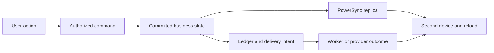

# Comprehensive product and end to end testing brief

Implementation and validation now continue in the [E2E execution](../../executions/e2e/README.md); this brief remains the source-audit reference.

This brief combines fifteen separately delegated category audits with a review of the shared test harness and CI. It describes the implemented product, credits existing assertions, identifies uncertain behavior to reproduce, and defines the evidence needed for dependable end to end testing. The detailed category sections include source references and concrete scenarios with setup, actions, expected results and execution tiers.

The central conclusion is that Clientbridge has substantial business-rule and concurrency coverage, but incomplete evidence that the actual web, Connect and native interfaces produce the intended durable and asynchronous results. Strengthening the suite should preserve the existing lower-level tests and close those missing boundaries. Several initial product assumptions also need correction before tests are written.

Read the summary, corrections, reproduction priorities and rollout first. Use the category navigation for the deeper reference material: implementation rules, named existing assertions, concrete scenarios, fixture requirements and unresolved decisions. The detailed sections intentionally retain the evidence needed to turn this review into implementation work without repeating the audit.

## Scope and evidence

Reviewed source snapshot: `2a5441aff0b2a9c791bf75b63cffc6884cb8fceb`, 23 October 2026. The review changed documentation only. No full application suite, browser journey, database transaction scenario or live provider transaction was executed. Focused schema, arithmetic and isolated route-validation checks are identified alongside their findings; they do not certify the whole user flow.

A static inventory found **214 decorated API handlers** in `backend/src/clientbridge/api` and **2,050 backend test function declarations in 161 files**. The API count excludes dynamically registered health/readiness and sync routes; test parametrization is not expanded. There are 8 web E2E files, 4 Connect E2E files, 6 sync E2E files and 11 top-level native flows. These are scope counts, not passing-test totals or coverage percentages.

The compiled category catalogue contains **302 uniquely identified proposed scenarios**. Many should reuse or extend named existing tests. Each scenario can expand into parameter cases; none is counted as newly implemented or executed by this review.

Use the following evidence labels throughout:

| Label | Meaning |
| --- | --- |
| Implemented behavior | A rule traced through current code; it may be intentional even when surprising |
| Existing test evidence | Assertions read in an existing test; no claim that the current suite was executed successfully |
| Reproduced focused check | A local schema/helper/router check produced the stated result, with its boundary named |
| Source-supported candidate | Code suggests a defect or inconsistency; a controlled reproduction is still required |
| Coverage gap | The reviewed tests do not establish the claimed behavior at the required boundary |
| Product decision | Expected behavior needs a decision before a test can serve as a reliable oracle |

## How the product behaves across boundaries

Provider web and mobile use shared view models but separate renderers and platform APIs. Most provider reads come from an authorized local SQLite replica. Commands write to PostgreSQL through FastAPI; WAL replication through PowerSync eventually updates each device. Connect uses public slug/token HTTP endpoints and does not have a replica. Platform administration and the marketing site have separate entry points and authorization/routing concerns.

`run_command` protects selected database mutations, audits and stored responses. It does not cover every write, and it cannot atomically commit a database transaction together with Stripe or an email provider. Notes/subjects, some catalog/configuration actions and onboarding illustrate why each write path must be inspected rather than assuming universal idempotency.

Weekly hours are the implemented durable offline command path, with revisions, predecessor dependencies and explicit conflict handling. Booking, charging and other authority-sensitive operations cannot be treated as arbitrary offline edits. A test that writes directly into SQLite bypasses the product's write contract.

The minimal meaningful success chain is:

Not every feature touches every node, but each test should name the nodes it proves. A toast, an HTTP 200, a provider acceptance and a final customer-visible result are different observations.

## Material corrections to the initial product map

The earlier E2E coverage plan remains useful as an initial outline; this brief supersedes its broad assumptions. The most important corrections are below. Detailed evidence appears in the corresponding category sections.

| Area | Correct testing contract |
| --- | --- |
| Roles | Stored business roles are owner, admin, staff and contractor. “Manager” is a capability grouping, and platform admin is separate. |
| Platform plans | Plan purchase/management is owner-only and implemented on web; native Plans is read-only. `past_due` retains access, and lapsed access has explicit write exceptions. |
| Revocation | Current database membership, cached provider identity and permitted offline access have different enforcement timelines. |
| Inventory | Manual sales may go below zero, but should respect competing payment holds. Public online stock rules are stricter. |
| Refund stock | Reviewed order flows restore stock on full refund, not every partial refund; do not invent a configurable per-line restock feature. |
| Check-in | Outstanding form/signature/deposit needs can be warnings with an audited override, rather than hard admission gates. |
| Cancellation | Manual cancellation can retain a deposit; public/series cancellation can refund it. These require separate expectations. |
| Recurrences and staff removal | Some operations return partial outcomes or unresolved visits. Do not require atomic success for every occurrence or silent reassignment of all work. |
| Client merge | A source with financial history can be rejected. Direction matters; merging into a financial target is a different case. |
| Billing | Invoice operational status is partly ledger-derived. Ordinary payment refund credits can preserve remaining debt; deposit reversal can reopen it. |
| Estimates | Provider and public answer transitions differ; sent estimates can be editable, and conversion does not necessarily require public acceptance. |
| Earnings | Refund reversal rules depend on pending/approved/paid state; approved or paid earnings intentionally remain in the reviewed implementation. |
| Memberships | Stored included-visit/discount fields are not proof that checkout enforces those benefits. Treat unenforced fields as a capability gap to resolve. |
| Submitted forms | Submission/snapshots exist, but the reviewed provider Forms UI exposes counts/editing rather than a complete historical answers/signature viewer. Define that product surface before promising its browser happy path. |
| Tax operations | Remittance records are local accounting evidence, not an external tax filing or bank-transfer integration. |
| Report metrics | Recognized revenue, cash receipts and gross taxable base are distinct metrics. Their exports and screen totals are not universally equal. Current ledger currency is CAD; unsupported currency should be rejected. |
| Delivery | Durable queue guarantees apply to migrated paths. Other sends remain direct; provider acceptance and confirmed delivery are distinct. |
| Messaging | Inbound SMS and email delivery callbacks are different features. Broadcast quiet hours do not govern every message; push routing currently handles message threads rather than every record type. |
| History and smoke tests | Successful fetches and opened dialogs do not prove complete old-history rendering or submitted transactions. |
| Operations | Admin delivery history covers admin-test emails, not every business notification. SMS assignment/drift acknowledgement are API capabilities without reviewed UI controls. Admin “edition” means industry/subject configuration. Readiness checks the database, not the whole worker/provider chain. |

## Findings to reproduce before relying on the expanded suite

The category sections retain the full findings and their classifications. Prioritize the following because they can invalidate the test oracle, bypass a financial constraint or make existing green results misleading.

| Finding | Evidence level | First verification |
| --- | --- | --- |
| Deposit summary differs from backend rounding/cap | Arithmetic reproduced: 101 cents at 50% previews 51 versus backend 50; fixed 200 on price 101 previews 101 versus backend 200 | Configure through UI, book, compare preview/request/charged amount and decide the canonical rounding/cap policy |
| Optional estimate add-on with document discount | Production pricing helper reproduced a 190-dollar pre-tax preview calculation versus 180-dollar acceptance calculation | Open real Connect estimate, select add-on, accept, compare rendered and saved totals |
| Nonpositive recurrence count | Schema/helper reproduced acceptance and inconsistent output by frequency | Exercise HTTP validation; require the agreed rejection and absence of persisted work |
| Two sandbox refund assertions omit mandatory idempotency header | Isolated production-router validation returns 422 before the intended 409/404 checks | Repair requests and run strict sandbox lane; verify those assertions actually reach refund logic |
| Editing a booking-derived invoice may discard booking/staff references | Source-supported candidate | Edit an unrelated field, send, inspect deposit application, visit linkage and staff attribution |
| Fully gift-funded sale may bypass another order's stock hold | Source-supported candidate | Reserve final online unit, settle competing desk order with gift value, inspect both orders and stock |
| Two existing tickets may concurrently link the same visit | Source-supported candidate | Separate committed sessions with deterministic barrier, then assert one intended billable relationship |
| Replay/delivery guarantees differ by operation | Confirmed code boundaries; duplicate/lost-send outcomes require reproduction | Lost response after commit, same-key replay, provider failure and recovery; count document/payment and delivery effects separately |
| Client status PATCH may bypass archive permissions | Source-supported candidate | Staff/contractor PATCH versus manager-only archive/restore; compare authorization and archive metadata |
| Pending shop checkout identity may be lost on reload | Confirmed in-memory state boundary; end-user consequences unexecuted | Drop response after order accepted, reload, retry; inspect orders, intents and stock holds |
| Financial period boundaries differ between consumers | End-of-day helper exclusion and UTC-prefix YTD arithmetic demonstrated; full query/UI effects unexecuted | Place records at exact local midnight/year-end and compare each report against its defined metric |
| Partial date-range filing may mark a full calendar period filed | Source-supported candidate | Record an ended one-day range and inspect remaining month status and next-due computation |
| Consent may change after a broadcast snapshot or queued text | Source-supported timing gap | Enqueue, apply STOP/withdrawal, then dispatch; decide and assert current-consent versus snapshot policy |
| HTTP success may conceal a failed manual message | Source-supported UI candidate | Return `status=failed`, inspect retained draft, error state, retry identity and eventual conversation state |
| Lapsed plan blocks some actions that stop external activity | Confirmed gate scope; intended policy unresolved | Attempt valid customer-subscription cancellation and Google disconnect after lapse; decide which recovery actions remain available |
| Platform status refresh may not heal a missed webhook | Source-supported candidate | Withhold cancellation/unpaid event, refresh status and run reconciliation, then verify access follows the agreed authoritative state |

These are a reproduction backlog, not a claim that every listed scenario fails today. Do not turn an accidental implementation behavior into a golden assertion without resolving its intended product contract.

## Existing evidence and harness improvements

Preserve `test_flows_*`, ledger/tax/stock/capacity race tests, genuine auth journeys and the sync service tests. Some concurrency suites explicitly use committed throwaway businesses and separate sessions, so it would be inaccurate to call all backend tests isolated uncommitted mocks. Conversely, the shared API fixture replaces identity, payment, notification, storage and rate-limit dependencies and uses in-process ASGI transport. Assertions from that fixture have a precise boundary: [fixture](../../../backend/tests/conftest.py#L771).

The default backend marker selection excludes provider/contract/Kratos tiers and disables randomized order by default. An ordinary backend pass cannot stand in for those lanes: [configuration](../../../backend/pyproject.toml#L56). The existing disposable database runner is a useful foundation, not something to rebuild: [fresh database runner](../../../backend/scripts/fresh_database.py#L33).

Web and Connect default CI projects test production bundles, while pseudo-locale projects run a development server. Browser jobs install Chromium and run two workers. Preserve the production offline-shell test; add WebKit/Firefox for storage, authentication, navigation and payment risk rather than blindly tripling every case. Add `forbidOnly` and an expected-scenario manifest so accidental discovery reduction cannot look like success: [web configuration](../../../frontend/apps/web/playwright.config.ts#L7).

Existing Android CI builds a release APK, uses three separate emulator/stack shards and retains logs. Extend that infrastructure with submitted transactions and native lifecycle cases. A browser phone viewport cannot validate SecureStore, native SQLite, push taps or Terminal collection: [native CI](../../../.github/workflows/ci.yml#L500).

The browser/native jobs do not explicitly start an arq worker; the Compose worker is in the app profile. Add worker startup/heartbeat and deterministic job invocation before claiming background delivery completion. Preserve a separate scheduler smoke test so direct invocation alone does not hide a broken schedule.

Accessibility evidence is scoped too: the shared axe helper filters serious/critical findings, and focus/hover helpers add targeted checks. Add keyboard completion, error announcements and native accessibility checks on the important transaction paths; this suite is not a full accessibility certification: [helper](../../../frontend/packages/config/e2e/accessibility.ts#L4).

## Journeys across product areas that should anchor the suite

| Journey | Required observations |
| --- | --- |
| FLOW01 Visit through money | Connect request/deposit → provider approval → intake/check-in → checkout → receipt → second-device state → earnings/tax → refund/cancellation. Distinguish cancellation channels and overridden requirements. |
| FLOW02 Estimate through collection | Optional selection/discount preview → acceptance → draft conversion → unrelated edit → issue → partial payment/refund. Preserve references and reconcile amounts independently. |
| FLOW03 Shop and stock | Two clients compete for final stock → pending payment/hold → success or expiry → pickup → full/partial refund. Compare cash/card/gift/Terminal behavior where supported. |
| FLOW04 Client lifecycle | Create and verify returning contact → subject/note/photo → booking/history → permitted merge or financial-source refusal → archive/reload. Prove the actual old timeline, not only the fetch. |
| FLOW05 Documents and evidence | Create/send form or contract → customer opens actual captured link → edit/publish while open → submit/sign → persisted evidence retains the exact historical definition/version. Verify contract viewing; treat the missing provider form-response viewer as a capability decision before adding that UI assertion. |
| FLOW06 Communication recovery | Schedule eligible broadcast or transactional notice → consent changes/outage → worker attempt/recovery → inbound callback → user-visible delivery status. Never infer delivery from an accepted send. |
| FLOW07 Entitlement lifecycle | Purchase → settlement → eligible redemption/final-session race → refund/expiry/renewal. Assert actual enforced benefits separately from catalog metadata. |
| FLOW08 Team and plan | Invite/accept/change/remove → seat reconciliation → plan lapse/recovery → server/UI/public access. Verify unresolved staff work and billing side effects. |
| FLOW09 Device lifecycle | Write on A → observe on B → offline edit supported hours → terminate/reopen → reconnect/replay → change role/account. Assert both visible state and replica isolation. |
| FLOW10 Operations and deployment | Actual deployed origins/auth → customer transaction → reconciliation/audit inspection through the supported admin surfaces. Inspect worker and business-delivery failures through test diagnostics; a general admin retry console is a separate capability decision. Include site contact and embedded entry points. |

These journeys complement focused scenarios below. Avoid one enormous scenario that makes every feature depend on the success of a previous feature; use explicit fixtures and independently runnable slices.

## Implementation plan and release gates

1. **Repair the oracle and evidence inventory.** Reproduce the focused findings; resolve product-policy questions; repair broken test requests. Map every API operation, public handler, worker, UI action and state transition to existing evidence or a named gap. Counts must distinguish scenario families, parameter cases and executed results.
2. **Build the committed-stack harness.** Reuse disposable database patterns; provision per-shard stacks and test-owned businesses, users, contacts and provider objects. Run API/auth/PowerSync/storage/Redis/worker, correlate captured notifications, and expose scoped diagnostic reads. Keep rollback tests for fast rules; do not use their uncommitted fixture for a separate-process E2E journey.
3. **Close financial and isolation boundaries first.** Implement FLOW01–03, authorization negatives and SYNC observation, with independent ledger/stock/capacity oracles. Use deterministic barriers for contention; overlapping requests alone are not proof that a race was exercised.
4. **Complete the remaining product actions.** Add CRM, documents, consent/messages, reports/remittances, entitlements, plans/team, reviews, administration and site flows from the category catalogue. Require both success and actionable rejection/recovery for each mutation family.
5. **Expand provider and native evidence.** Keep strict Stripe sandbox execution separate from deterministic PR tests. Add a small actual Stripe.js/native collection bridge, genuine callbacks to a running committed application, and supported subscription simulations. Extend Android transactions and add scheduled iOS/device checks.
6. **Measure confidence.** Run new tests alone, shuffled and alongside unrelated cases; record first-attempt outcomes, flakes and diagnostics. Deliberately break representative invariants in disposable changes to prove tests detect them. Require a current release-candidate result on the exact commit and explicit acceptance of any remaining external/device limitation.

Suggested CI lanes: deterministic rules/contracts/build and a small critical committed-stack suite on every PR; broader scenarios and browser/device matrices on schedule; protected provider tests on main/schedule/release candidates; deployed smoke after staging deployment. The current `stripe-qa` workflow is manual/main-only, so ordinary CI does not imply that it executed.

The Stripe runner already supports a local CLI profile and environment-scoped CI credentials, two reserved connected merchants, test-mode checks, cleanup and strict no-skip results. The workflow names `stripe-sandbox`; actual GitHub environment protection settings, secret availability and merchant readiness were not inspected. Reuse the runner, repair its request drift, and add a genuine browser-to-running-app bridge. Stripe Billing test clocks control supported provider resources, not the application's clock, auth TTL, browser time or native offline expiry. Keep those clocks separate. Reference: [Stripe simulations](https://docs.stripe.com/billing/testing/test-clocks), [webhooks](https://docs.stripe.com/webhooks), [Terminal testing](https://docs.stripe.com/terminal/references/testing).

Every required scenario should have: acceptance rule, role/state/time dimensions, fixture, action, expected and forbidden effects, test path, tier, dependencies, exact evidence commit, run result and known limitation. No silent prerequisite skip, `.only`, stale successful run or retry-only success should be counted as clean critical coverage.

A finite suite cannot prove every possible combination. The defensible goal is complete traceability of agreed capabilities and transitions, strong coverage of high-risk interactions, independent financial/security assertions, and current evidence at every external and platform boundary. The following fifteen category sections provide the detailed implementation and test catalogue for that work.

## Category navigation

1. [Identity access and business onboarding](#1-identity-access-and-business-onboarding)
2. [Business configuration catalog and team](#2-business-configuration-catalog-and-team)
3. [Scheduling classes and visit lifecycle](#3-scheduling-classes-and-visit-lifecycle)
4. [Client records subjects notes history and returning customers](#4-client-records-subjects-notes-history-and-returning-customers)
5. [Estimates invoices and public payment documents](#5-estimates-invoices-and-public-payment-documents)
6. [Sales desk online shop inventory and pickup](#6-sales-desk-online-shop-inventory-and-pickup)
7. [Payments and Stripe Connect](#7-payments-and-stripe-connect)
8. [Gift cards packages and customer subscriptions](#8-gift-cards-packages-and-customer-subscriptions)
9. [Ledger tax staff earnings reports and remittances](#9-ledger-tax-staff-earnings-reports-and-remittances)
10. [Messages broadcasts consent notifications and delivery workers](#10-messages-broadcasts-consent-notifications-and-delivery-workers)
11. [Forms contracts and files](#11-forms-contracts-and-files)
12. [Reviews and Google Business integration](#12-reviews-and-google-business-integration)
13. [Clientbridge platform plans and seat billing](#13-clientbridge-platform-plans-and-seat-billing)
14. [Sync offline access and device lifecycle](#14-sync-offline-access-and-device-lifecycle)
15. [Platform administration marketing site embedding and deployment](#15-platform-administration-marketing-site-embedding-and-deployment)

## 1 Identity access and business onboarding

- Identity has four business roles (owner/admin/staff/contractor) and separate platform-admin authorization; baseline missed contractor and used manager as if it were a role.
- Real auth browser tests already prove signup/verification, recovery, password revocation at provider level, TOTP enable/login and invite identity; preserve them.
- Backup codes, web security keys, profile/email editing, Google reauthentication and native MFA are implemented but lack equivalent complete UI evidence in reviewed E2E files.
- Source suggests concurrent onboarding slug handling and concurrent invite acceptance deserve immediate committed-stack reproductions; these are not runtime-confirmed defects.
- Immediate DB membership revocation, up-to-30-second ordinary identity cache and seven-day offline access are different enforcement policies and must be tested separately.

### Implemented capabilities

**Session and identity bridge**

Web HttpOnly session cookie or native X-Session-Token is sent to Kratos. Explicit token wins over cookie. Cookie mutations require the configured provider web Origin; token writes do not. Plain Bearer auth and PowerSync JWTs are not accepted as sessions. Current/fresh identity dependencies separate cached ordinary requests from immediately fresh verification/admin/me checks.

Sources: [core/deps.py:54](../../../backend/src/clientbridge/core/deps.py#L54); [core/deps.py:80](../../../backend/src/clientbridge/core/deps.py#L80); [api/auth.py:10](../../../backend/src/clientbridge/api/auth.py#L10)

**Local user provisioning and relinking**

First request inserts a unique local identity-linked user, synchronizes name/email and throttles last_seen to five minutes. Existing email can relink to a recreated identity only when verified and the old identity no longer exists. X-Expected-User protects a replica from receiving another account response.

Sources: [services/auth.py:24](../../../backend/src/clientbridge/services/auth.py#L24); [services/auth.py:53](../../../backend/src/clientbridge/services/auth.py#L53); [core/deps.py:108](../../../backend/src/clientbridge/core/deps.py#L108)

**Membership authorization**

Actual roles are owner, admin, staff, contractor. is_manager means owner/admin; manager is not a stored role. Only active memberships form a Principal. Zero memberships is 403, multiple memberships without business header is business_ambiguous/400, foreign selected business is 403. Owner/admin may act on another staff schedule; staff/contractor cannot. Platform admin is an independent configured identity allowlist plus verified email, not the business admin role.

Sources: [models/business.py:26](../../../backend/src/clientbridge/models/business.py#L26); [core/deps.py:158](../../../backend/src/clientbridge/core/deps.py#L158); [core/deps.py:189](../../../backend/src/clientbridge/core/deps.py#L189); [core/deps.py:90](../../../backend/src/clientbridge/core/deps.py#L90)

**Signup and verification**

Password signup creates a Kratos session then verification UI; code delivery goes through auth hook. Frontend remembers a pending session across reload. Verified email is required to create a business or accept an invite for that email, rather than for every ordinary authenticated read.

Sources: [auth/kratos.yml:84](../../../infra/auth/kratos.yml#L84); [lib/auth.ts:24](../../../frontend/apps/web/src/lib/auth.ts#L24); [services/business.py:382](../../../backend/src/clientbridge/services/business.py#L382); [services/staff.py:194](../../../backend/src/clientbridge/services/staff.py#L194)

**Business onboarding and selection**

Onboarding inserts business then active owner/payee membership and commits. Default zone is America/Toronto, province and subject are validated. Slug is unique. Selection waits for actual synchronized business rows before concluding onboarding is needed; ambiguous membership needs selection. The service permits a verified user to create more than one business; one-business-per-account is not a valid test invariant.

Sources: [services/business.py:382](../../../backend/src/clientbridge/services/business.py#L382); [models/business.py:59](../../../backend/src/clientbridge/models/business.py#L59); [domain/business.ts:617](../../../frontend/packages/app-core/src/domain/business.ts#L617); [domain/business.ts:1067](../../../frontend/packages/app-core/src/domain/business.ts#L1067)

**Account security**

Profile/name/email edit, password change, TOTP enable/disable, backup-code reveal/regenerate/confirm/disable, WebAuthn security-key register/remove/login (when web adapter is available), and password/Google re-authentication are implemented. WebAuthn is configured as second factor, not passwordless. Settings privileged window is 15 minutes; expired flow restarts and reauth retries intended operation.

Sources: [domain/auth.ts:774](../../../frontend/packages/app-core/src/domain/auth.ts#L774); [domain/auth.ts:914](../../../frontend/packages/app-core/src/domain/auth.ts#L914); [lib/webauthn.ts:29](../../../frontend/apps/web/src/lib/webauthn.ts#L29); [auth/kratos.yml:49](../../../infra/auth/kratos.yml#L49); [auth/kratos.yml:109](../../../infra/auth/kratos.yml#L109)

**Recovery and session lifetime**

Recovery email code leads to privileged settings and only finished password save signs in. Expired privilege resets the form instead of claiming success. Kratos recovery and password-change hooks revoke active sessions. Configured session lifespan is 30 days, extension within 24 hours, application maximum sign-in age 90 days, identity cache default 30 seconds. Cached calls can outlive provider revocation until freshness/TTL; membership role itself is read from DB each request.

Sources: [domain/auth.ts:459](../../../frontend/packages/app-core/src/domain/auth.ts#L459); [auth/kratos.yml:102](../../../infra/auth/kratos.yml#L102); [integrations/kratos.py:79](../../../backend/src/clientbridge/integrations/kratos.py#L79); [core/config.py:75](../../../backend/src/clientbridge/core/config.py#L75)

**Offline identity and replacement**

checkSession times out after eight seconds and retains remembered user only with nonfuture last verification under seven days. Missing/future/old timestamps lock offline access. Network/5xx preserve credentials; a current-generation 401 clears them except second-factor-required, which initiates step-up. Epochs abort stale requests and ignore a late old-session 401. Web storage events notify tabs; mobile SecureStore serializes writes and tears down replica on replacement.

Sources: [domain/auth.ts:75](../../../frontend/packages/app-core/src/domain/auth.ts#L75); [src/session.ts:71](../../../frontend/packages/api-client/src/session.ts#L71); [lib/auth.ts:90](../../../frontend/apps/web/src/lib/auth.ts#L90); [lib/auth.ts:38](../../../frontend/apps/mobile/src/lib/auth.ts#L38)

**Invitations**

Owner/admin invite permitted non-owner roles. Token stored hashed; invite reserves/bills a seat and is emailed before DB commit with compensation if later failure. Accept requires invited address among verified_emails, checks active existing membership and current seat availability, can reactivate removed member, writes audit. Resend rotates token; expiry boundary uses invited_at+TTL < now.

Sources: [services/staff.py:116](../../../backend/src/clientbridge/services/staff.py#L116); [services/staff.py:172](../../../backend/src/clientbridge/services/staff.py#L172); [services/staff.py:194](../../../backend/src/clientbridge/services/staff.py#L194); [services/staff.py:288](../../../backend/src/clientbridge/services/staff.py#L288)

### Existing test evidence

**test_onboard_creates_business_owner_and_taxes; test_onboard_duplicate_slug_409_no_partial**

Sources: [tests/test_business_onboarding.py:18](../../../backend/tests/test_business_onboarding.py#L18),77

**Proves:** Owner role, business fields, exact derived province rates and sequential duplicate slug yields one row.

**Boundary:** Fake identity and transaction fixture; no concurrent slug race or UI retry after lost response.

**test_no_membership_forbidden; test_multi_business_requires_header; test_foreign_business_header_forbidden**

Sources: [tests/test_auth_principal.py:14](../../../backend/tests/test_auth_principal.py#L14),23,49

**Proves:** Actual API principal resolution and team result scoping with two businesses.

**Boundary:** Fake identity, representative endpoint only; not all capabilities or business picker UI.

**test_cookie_writes_need_an_allowed_origin; test_production_cookie_writes_come_only_from_the_web_app; test_the_token_wins_over_the_cookie; test_expected_user_mismatch_401**

Sources: [tests/test_auth.py:161](../../../backend/tests/test_auth.py#L161),196,224,233

**Proves:** Explicit Origin policy, session priority, expected-user mismatch stable error.

**Boundary:** HTTPX request headers/config monkeypatch, not real deployed browser cookie attributes/origins.

**test_whoami_is_cached_unless_fresh; test_a_session_older_than_the_maximum_age_is_refused_and_ended; test_a_session_near_expiry_is_extended; test_outages_are_503**

Sources: [tests/test_auth_kratos.py:125](../../../backend/tests/test_auth_kratos.py#L125),141,181,111

**Proves:** Adapter cached/fresh behavior, lifetime checks, extension and failures through mocked HTTP transport.

**Boundary:** Only marker-gated test_contract_against_local_kratos and test_a_browser_sign_in_cookie_reaches_whoami use actual local auth; do not classify entire file as live Kratos.

**sign up, confirm the email with the mailed code, then open a business**

Sources: [e2e/auth.e2e.ts:161](../../../frontend/apps/web/e2e/auth.e2e.ts#L161)

**Proves:** Real signup form, captured verification code, business creation, synchronized business menu appears.

**Boundary:** Does not independently assert exact business/member count, stored settings, second-device state or reload persistence.

**recover a forgotten password with an emailed code, staying signed in only here; changing the password signs out every other device**

Sources: [e2e/auth.e2e.ts:170](../../../frontend/apps/web/e2e/auth.e2e.ts#L170),199

**Proves:** Real code/password flow, token-session invalidation through auth service; password-change page survives reload.

**Boundary:** Other device is a programmatically created token, not a running native UI or already cached API request.

**turn on an authenticator app, then sign in with its code**

Sources: [e2e/auth.e2e.ts:216](../../../frontend/apps/web/e2e/auth.e2e.ts#L216)

**Proves:** Reads real setup secret, computes code, enables TOTP and completes password+TOTP login.

**Boundary:** Not disable, wrong/reused code, backup codes, hardware key or native MFA.

**['an invite joins the account that signs up with the invited email', 'an invite refuses an account with a different email', 'reloading while confirming the email keeps the new account signed in', 'an account whose identity was recreated confirms its email instead of looping', 'an invitee who skipped confirming the email verifies, then joins', 'an invitee who verifies from the emailed link in a new tab lands back on the invite']**

Sources: [e2e/auth.e2e.ts:242](../../../frontend/apps/web/e2e/auth.e2e.ts#L242),268,296,304,336,369

**Proves:** Real UI invitation and verification routing regressions.

**Boundary:** New-tab test rewrites a verification redirect (line 383); no concurrent accept or fully deployed origin proof.

**browser tabs observe account replacement, bind replicas to their user and sign out**

Sources: [e2e/auth.e2e.ts:3](../../../frontend/packages/sync/e2e/auth.e2e.ts#L3)

**Proves:** Real browser storage events and expected-user binding.

**Boundary:** Requests to /auth-test are intercepted, remembered users are set directly; not real password/logout flow.

**live renames reach the replica; downgrade, deletion and removal purge its data**

Sources: [e2e/revocation.e2e.ts:15](../../../frontend/packages/sync/e2e/revocation.e2e.ts#L15)

**Proves:** Real PowerSync propagation removes prohibited columns/rows after scripted committed source changes.

**Boundary:** Direct mutation script and fixture token, not team-management UI or actual revoked session.

**Password recovery native flow**

Sources: [e2e/11-recovery.yaml:1](../../../frontend/apps/mobile/e2e/11-recovery.yaml#L1)

**Proves:** Actual app mails/uses recovery code and reaches onboarding after password save.

**Boundary:** Does not submit onboarding, prove old-session native UI invalidation or verify new-password login after logout.

**auth hook and session tests**

Sources: [domain/auth.test.ts:71](../../../frontend/packages/app-core/src/domain/auth.test.ts#L71),114,172,346,397,419,448; [src/session.test.ts:139](../../../frontend/packages/api-client/src/session.test.ts#L139)

**Proves:** Offline age policy, password-save outcome, step-up, one settings flow under strict effects, saved-email reauth, native Google token retention and wrong-account rejection, late-401 generation safety.

**Boundary:** Mock identity/session transport and hook harness; vital unit evidence rather than E2E.

### Implementation findings

**ID-F1**

confirmed source behavior · coverage correction

Baseline omitted contractor and misnamed the stored admin role as manager. Role matrix must explicitly include all four roles plus independent platform-admin entitlement.

Sources: [models/business.py:26](../../../backend/src/clientbridge/models/business.py#L26); [core/deps.py:189](../../../backend/src/clientbridge/core/deps.py#L189)

**ID-F2**

confirmed source behavior · coverage correction

Security keys and backup codes are implemented but absent from baseline scenario specificity and browser E2E inventory. Google is configured with unset default credentials; unavailable-button behavior is not real OIDC integration coverage.

Sources: [domain/auth.ts:936](../../../frontend/packages/app-core/src/domain/auth.ts#L936); [lib/webauthn.ts:29](../../../frontend/apps/web/src/lib/webauthn.ts#L29); [auth/kratos.yml:65](../../../infra/auth/kratos.yml#L65)

**ID-F3**

suspected defect requiring concurrency reproduction · P1

Onboarding performs SELECT slug then INSERT/flush without run_command/idempotency or local IntegrityError mapping. Two concurrent same-slug requests may yield an unhandled uniqueness failure rather than one success/one controlled conflict. Sequential test does not cover this. Lost response retry with same slug returns conflict, with no saved-response recovery.

Sources: [services/business.py:382](../../../backend/src/clientbridge/services/business.py#L382); [api/business.py:27](../../../backend/src/clientbridge/api/business.py#L27); [clientbridge/main.py:57](../../../backend/src/clientbridge/main.py#L57); [tests/test_business_onboarding.py:77](../../../backend/tests/test_business_onboarding.py#L77)

**ID-F4**

suspected race requiring reproduction · P1

Invite accept reads pending state and existing membership before taking business lock; no re-read/lock of invite state after serialization is visible. Concurrent accepts of the same invite may both proceed from stale state and duplicate accept audit or surface a DB error. Sequential double-accept test proves only sequential rejection.

Sources: [services/staff.py:194](../../../backend/src/clientbridge/services/staff.py#L194); [tests/test_staff.py:168](../../../backend/tests/test_staff.py#L168)

**ID-F5**

confirmed source boundary requiring policy acceptance · P1

Ordinary whoami cache defaults to 30 seconds, so immediate provider session revocation is not necessarily immediate for already cached application calls. Fresh /v1/me differs from cached commands; current browser revocation assertion queries provider session rather than an already-cached business mutation.

Sources: [integrations/kratos.py:79](../../../backend/src/clientbridge/integrations/kratos.py#L79); [core/config.py:75](../../../backend/src/clientbridge/core/config.py#L75); [e2e/auth.e2e.ts:199](../../../frontend/apps/web/e2e/auth.e2e.ts#L199)

**ID-F6**

confirmed provider consistency boundary · P1

Invitation email and seat sync occur before transaction commits; on error a compensation sync is attempted. Tests must cover provider acceptance followed by DB failure and failed compensation, rather than treating invitation+email+billing as atomic.

Sources: [services/staff.py:144](../../../backend/src/clientbridge/services/staff.py#L144); [services/staff.py:166](../../../backend/src/clientbridge/services/staff.py#L166)

### Concrete test scenarios

**ID01**

P0 · browser real stack

**Prerequisites:** Fresh unique identity and Mailpit correlation, no memberships

**Actions:** Signup, validate wrong code then actual verification code, onboard selected province/industry, reload, login second context

**Assertions:** One local linked user and requested business; one active owner/payee; exact timezone/subject and initial trial state; both UI replicas resolve business; no transient onboarding for existing business.

**ID02**

P0 · browser+API

**Prerequisites:** Two businesses, owner/admin/staff/contractor identities and removed member

**Actions:** Switch businesses via UI; send each role representative read/mutate commands with missing/foreign header and foreign IDs

**Assertions:** All four roles match endpoint rules; ambiguous 400, unauthorized 403; zero foreign data or side effects; business picker binds subsequent commands; contractor-specific own-schedule boundary.

**ID03**

P0 · browser/native real auth

**Prerequisites:** One user in running web+native contexts, warm API identity cache

**Actions:** Change password or recover from fresh context, attempt old-session business action immediately and after TTL, reload devices

**Assertions:** Provider invalidation occurs; precisely measured application enforcement matches agreed maximum revocation delay; no stale UI write succeeds beyond policy; active recovery session works.

**ID04**

P1 · browser real auth

**Prerequisites:** Own disposable identity with TOTP

**Actions:** Enable TOTP, wrong/correct login, generate/confirm backup codes, use one, reuse it, regenerate, test old code, disable/re-enable

**Assertions:** MFA required; consumed/old codes refused; correct state persists after reload; disable requires appropriate assurance/reauth; secrets absent from logs/artifacts.

**ID05**

P1 · browser real auth with virtual authenticator; physical smoke

**Prerequisites:** WebAuthn-enabled browser/origin and disposable account

**Actions:** Register named key, password+key login, cancel prompt, remove key, retry removed credential

**Assertions:** Registered credential reaches Kratos, AAL2 achieved, canceled prompt recovers without success, removed key cannot authenticate; key is second factor rather than passwordless.

**ID06**

P1 · browser+native

**Prerequisites:** Existing account and second device; expired privileged settings flow

**Actions:** Edit name/email, trigger password/Google reauth using saved identity, confirm new email; attempt email collision and wrong-account Google return

**Assertions:** Local user/profile and all devices update only after valid save; no cross-account token replacement; existing membership retained; email verification state accurately blocks protected actions.

**ID07**

P0 · browser+committed API concurrency

**Prerequisites:** Invite with reserved seat, verified matching user, separate sessions

**Actions:** Accept from two simultaneous requests; retry sequentially; revoke/resend then try old URL; accept with wrong/unverified email; expire at boundary

**Assertions:** One active membership and accepted audit, controlled duplicate response, rotated/revoked links unusable, no seat oversubscription, exact TTL semantics; source race finding resolved.

**ID08**

P1 · API concurrency + browser recovery

**Prerequisites:** Two users and same desired slug

**Actions:** Synchronize two onboarding requests before insert; separately lose successful response and retry from UI

**Assertions:** One business+owner, losing request controlled conflict without 500; no partial records; UI recovers existing created business instead of looping. Product decision needed on idempotent retry response.

**ID09**

P0 · browser+native lifecycle

**Prerequisites:** Account A with replica and pending hours, account B, delayed request

**Actions:** Switch account while request in flight; deliver old 401/success; sign out another tab; force-stop native during SecureStore replacement

**Assertions:** Late response cannot clear/change B; A replica never renders to B; pending work follows declared keep/discard rules; storage and selected business remain consistent after restart.

**ID10**

P1 · browser/native clock+network

**Prerequisites:** Remembered verified account and production shell

**Actions:** Auth outage/timeout at under-seven-days, exactly-seven-days, missing/future timestamp; restore connectivity

**Assertions:** Valid cached access retained without destructive logout; expired/clock-rollback access locks while preserving replica; fresh verification unlocks; 401 behavior distinct from 503.

**ID11**

P1 · real auth contract/browser

**Prerequisites:** Configurable local auth lifetime/clock seam

**Actions:** Login/registration/code flow expiry, resend cooldown, recovery privilege lapse, maximum session age, extend failure

**Assertions:** No false password-saved/sign-in result; recoverable restart; max-age denied even if provider revoke fails; valid session survives best-effort extend failure.

**ID12**

P0 · deployed staging browser

**Prerequisites:** Actual app/api/book/pay/admin hosts and HTTPS cookie policy

**Actions:** Legitimate app mutation, cross-origin public-page mutation attempt, no-Origin request, foreign return URL, native token call

**Assertions:** HttpOnly/host cookie attributes correct; only app-origin credentialed mutations succeed; token behavior intentional; unauthorized redirects/admin access denied.

**ID13**

P1 · provider-boundary fault integration

**Prerequisites:** Seat-billed invite, inspectable email and payment doubles

**Actions:** Fail email after seat update; fail DB commit after email accepted; fail compensation; rerun repair

**Assertions:** No active phantom invite/duplicate email promise; billed seats converge or actionable failure remains; generated link state matches committed invite; no swallowed error counted as success.

**ID14**

P1 · native release E2E

**Prerequisites:** Disposable app identity and Mailpit, authentic SecureStore build

**Actions:** Signup+verification+onboard, TOTP and backup-code login, recovery then signout/new-password login, account reauth

**Assertions:** Token flows work without browser-cookie assumptions; keyboard/sheets/deep links complete; session survives restart and old password/session fails.

**ID15**

P1 · credentialed OIDC smoke + deterministic contract

**Prerequisites:** Dedicated Google test identity/approved credentials, isolated callback origin

**Actions:** Sign up/login/reauth; deny consent; close native auth session; wrong account callback; expired flow

**Assertions:** Verified provider identity links correctly; callback only accepted for expected account, user can retry cancellation, no tokens exposed in navigation/logging. Local unset Google credentials do not satisfy this obligation.

### Fixture and CI requirements

- Keep unique auth identities per test, clean them by explicit test-owned IDs; business/identity cleanup should not reset shared seed accounts.
- Run actual Kratos, auth email hook and Mailpit for login/verification/recovery E2E. Correlate code by recipient plus flow; never latest global mail.
- Use committed database and independent HTTP sessions for onboarding/accept races; rollback single-session fixtures cannot reproduce real transaction contention.
- Role fixture must include contractor and business admin plus separately allowed platform identity. Include two-business same-user fixture.
- Use actual running second app for revocation/cache tests; a token checked directly against Kratos proves provider revocation but not cached app enforcement.
- Virtual authenticator browser tests can establish WebAuthn adapter/flow wiring; retain a physical key/platform smoke for native browser behavior.
- Use test clock seam for client offline thresholds and adapter lifetime tests but actual wall-clock TOTP/provider signature behavior in real auth lane.
- Record auth settings, cache TTL, run commit, correlation IDs and sanitized failure traces; do not retain codes, MFA secrets or session tokens.

### Corrections to the initial product map

- Replace owner/manager/staff matrix with owner/admin/staff/contractor and separate platform admin.
- Explicitly add security keys, backup codes, profile/email changes and settings reauthentication.
- Distinguish current DB membership revocation from cached provider session revocation and seven-day offline access policy.
- Do not describe all sync auth tests as real identity flows; auth.e2e.ts uses intercepted requests, while revocation tests exercise actual service replication with direct data mutation.
- Onboarding is not wrapped by run_command and currently has no request idempotency key; ordinary duplicate-slug test is sequential only.
- One business created by one onboarding attempt is an invariant; one business per user is not.

### Review limitations

- No tests executed; suspected concurrency defects need controlled committed-stack reproduction before being called confirmed bugs.
- No live credentials/providers accessed.
- Detailed per-domain capability permissions must be compiled with each category audit; this audit establishes identity/principal layer and representative endpoints.

### Coverage gaps

- Missing real browser backup-code lifecycle and WebAuthn registration/login/removal.
- No reviewed real UI proof for profile/email changes, identity collision and expired settings reauthentication.
- Provider-session revocation test does not exercise an already warm application identity cache or second running app.
- No concurrent same-slug onboarding or same-invite acceptance test identified; sequential duplicates are covered.
- Native recovery exists, but native signup/onboarding/MFA/security/account replacement lifecycle remains much thinner.
- Business picker and complete owner/admin/staff/contractor authorization require category-level API/UI matrices.
- Production cookie/origin and real Google callback configuration need deployed/provider smoke distinct from local mocked tests.

## 2 Business configuration catalog and team

Configuration is a cross-domain control plane: business address/tax/public settings, six catalog kinds, publication policy, team lifecycle/pay and revisioned hours determine downstream booking/payment behavior. Backend coverage is extensive and includes meaningful races, idempotency and refusal assertions. Existing browser/native setup tests mostly prove controls and cancel forms. The highest-value additions are product creation plus opening-stock failure recovery, partial multi-invite recovery, removal with unresolved future work, publication-to-Connect propagation and second-device hours/role observation. Two baseline assumptions must change: manual sales can intentionally take stock negative, and staff removal can succeed while leaving clashing visits assigned to the removed member.

### Implementation findings

**CFG-F01 — Roles and read topology**

Actual business roles are owner, admin, staff and contractor. Owner/admin can mutate business/catalog/team configuration. Team names/profile come from the replica; manager-only emails and activity come from GET /v1/staff/team. Staff/contractors do not receive invite list or teammate emails from that endpoint. A generic manager fixture must map to admin, not a nonexistent role string.

Sources: [services/staff.py:232](../../../backend/src/clientbridge/services/staff.py#L232); [domain/staff.ts:27](../../../frontend/packages/app-core/src/domain/staff.ts#L27); [domain/staff.ts:115](../../../frontend/packages/app-core/src/domain/staff.ts#L115)

**CFG-F02 — Settings partial update**

PATCH /v1/business preserves required settings on explicit null, clears optional fields, merges brand keys and removes keys with null. Name/timezone/billing email and brand/address are separate UI concerns. Form sends changed address/brand keys to reduce stale-form overwrites, but settings have no expected revision. Supported timezone is server validated. Province is locked after any taxed issued invoice/estimate/non-void order or tax ledger leg, not merely after any document exists.

Sources: [services/business.py:237](../../../backend/src/clientbridge/services/business.py#L237); [services/business.py:299](../../../backend/src/clientbridge/services/business.py#L299); [domain/business.ts:295](../../../frontend/packages/app-core/src/domain/business.ts#L295)

**CFG-F03 — Legal address and provider side effects**

Postal code normalization and first-letter province check are enforced, including shared X prefix for NT/NU. Changing legal address clears cached Terminal location. After committing settings, a plan-only Stripe account gets the address update; a payment-enabled account retains its Stripe-verified address. Provider update failure is logged and the local address remains saved until another change triggers a retry. This is deliberately non-atomic and needs visible/evidenced eventual consistency.

Sources: [schemas/business.py:183](../../../backend/src/clientbridge/schemas/business.py#L183); [services/business.py:224](../../../backend/src/clientbridge/services/business.py#L224); [services/business.py:270](../../../backend/src/clientbridge/services/business.py#L270); [services/business.py:366](../../../backend/src/clientbridge/services/business.py#L366)

**CFG-F04 — Public configuration**

Brand includes logo, primary color, tagline, cover, about, address/contact/website, neighborhood, up to 12 gallery URLs, selected public team and pickup preparation/hold/capacity. Logo must be uploaded, business-owned and purpose logo. Public staff must be active in business. URL schemes restrict to HTTP(S) without username. Pickup ranges are preparation 0..10080 minutes, hold 1..30 days, capacity 1..100. Public contact address is distinct from legal Stripe address.

Sources: [schemas/business.py:80](../../../backend/src/clientbridge/schemas/business.py#L80); [services/business.py:285](../../../backend/src/clientbridge/services/business.py#L285); [services/business.py:330](../../../backend/src/clientbridge/services/business.py#L330); [domain/business.ts:71](../../../frontend/packages/app-core/src/domain/business.ts#L71)

**CFG-F05 — Catalog kinds and publication**

Six kinds: service, class, product, package, subscription, gift. Services/classes default bookable online. Only products track stock/sell online/be add-ons. Packages cover a tenant-owned service/class; subscription-only fields include repeat interval/frequency and perks; gift suggested amounts are positive, sorted and deduplicated. Archiving is active=false, retaining old records. Kind change from service to product automatically disables online booking unless explicitly supplied. Ordinary create/update commits directly; only bulk tax-class change uses audited idempotent run_command.

Sources: [services/catalog.py:69](../../../backend/src/clientbridge/services/catalog.py#L69); [services/catalog.py:118](../../../backend/src/clientbridge/services/catalog.py#L118); [services/catalog.py:204](../../../backend/src/clientbridge/services/catalog.py#L204); [models/catalog.py:23](../../../backend/src/clientbridge/models/catalog.py#L23)

**CFG-F06 — Products and variants**

SKU is unique per business, not globally. Variant must belong to an active standalone product in same tenant and currency, have a label, not self-parent or nest. A parent with children cannot change kind/become child/change currency incompatible with children. Tracked opening stock initializes zero and frontend creates inventory in a second restock call. Negative manual stock is explicitly permitted when no competing payment hold blocks it; online stock rules are stricter. Tender-specific protection of competing holds is analyzed in the sales section.

Sources: [services/catalog.py:134](../../../backend/src/clientbridge/services/catalog.py#L134); [models/catalog.py:57](../../../backend/src/clientbridge/models/catalog.py#L57); [domain/catalog.ts:617](../../../frontend/packages/app-core/src/domain/catalog.ts#L617); [tests/test_catalog_products.py:302](../../../backend/tests/test_catalog_products.py#L302)

**CFG-F07 — Online booking and reminders settings**

Separate owner/admin service updates policy plus service/staff publication atomically and audits it. Policy limits: lead 0..168 hours, horizon 1..365 days, step 15/30/60 or service length, approve-new-clients, self-service, cancel/reschedule cutoff 0..168h, max moves 1..99, auto-complete. Add-ons are products with optional same-business service/class targeting; empty targeting means all. Reminders screen is mainly preview, sent count and closing outstanding visits; it is not a generic editable reminder scheduler.

Sources: [schemas/bookings.py:289](../../../backend/src/clientbridge/schemas/bookings.py#L289); [services/bookings.py:2143](../../../backend/src/clientbridge/services/bookings.py#L2143); [services/bookings.py:2215](../../../backend/src/clientbridge/services/bookings.py#L2215); [services/bookings.py:2253](../../../backend/src/clientbridge/services/bookings.py#L2253); [domain/reminders.ts:57](../../../frontend/packages/app-core/src/domain/reminders.ts#L57)

**CFG-F08 — Invitations and seat coupling**

Invites hash their opaque token, reserve seats, call seat billing before sending email and committing, and use optional command idempotency. Failure after billed creation compensates seat count. Acceptance requires verified invited email, rechecks plan capacity, reuses a removed member row, and audits. Resend rotates token and renews seven days; revoke deletes invite then releases seat. Release failure is logged for daily sync recovery. Owner cannot be invited.

Sources: [services/staff.py:116](../../../backend/src/clientbridge/services/staff.py#L116); [services/staff.py:172](../../../backend/src/clientbridge/services/staff.py#L172); [services/staff.py:194](../../../backend/src/clientbridge/services/staff.py#L194); [services/staff.py:288](../../../backend/src/clientbridge/services/staff.py#L288); [services/staff.py:349](../../../backend/src/clientbridge/services/staff.py#L349)

**CFG-F09 — Member changes and removal**

Owner/admin cannot change their own role or remove themselves, nor change/remove owner. Title/color can be edited for self/owner without role change. Removal without future-work decision returns 409 with visits and series. Cancel refunds collected deposits/cancels pending intents and releases slots. Reassign locks staff/bookings and picks named or first available member; conflicting visits are LEFT assigned to removed member and explicitly reported while removal succeeds. Series follows most common taker, otherwise ends/cancels. API sends reassignment/cancel notifications only on fresh removal, so idempotent replay does not notify again. Session itself remains; business access is revoked through membership checks/sync.

Sources: [services/staff.py:373](../../../backend/src/clientbridge/services/staff.py#L373); [services/staff.py:419](../../../backend/src/clientbridge/services/staff.py#L419); [services/staff.py:566](../../../backend/src/clientbridge/services/staff.py#L566); [services/staff.py:604](../../../backend/src/clientbridge/services/staff.py#L604); [api/staff.py:120](../../../backend/src/clientbridge/api/staff.py#L120); [tests/test_staff_removal.py:216](../../../backend/tests/test_staff_removal.py#L216)

**CFG-F10 — Pay settings**

Owner/admin changes payee, percent/fixed/hourly service rate and retail commission. Percent uses basis points, fixed/hourly cents; changing basis clears unused unit and sending wrong unit is rejected. Row is locked and audit recorded. These settings feed future earnings and must be tested against historical earnings, not just saved labels.

Sources: [services/staff.py:68](../../../backend/src/clientbridge/services/staff.py#L68); [services/staff.py:89](../../../backend/src/clientbridge/services/staff.py#L89); [tests/test_staff.py:425](../../../backend/tests/test_staff.py#L425)

**CFG-F11 — Hours**

Staff/contractor may edit own week; owner/admin any active member in tenant. Week replacement validates business, reserves receipt, locks hours and staff, checks expected revision and preserves row IDs. Accepted replay reports original revision with current stranded visits. Split working days are rejected rather than flattened. Missing recurring day allows unrestricted hours server-side, while editor seeds missing weekdays 9–5/weekends closed; saving a first week changes this implicit availability. Date-specific rows override recurring rows.

Sources: [services/hours.py:29](../../../backend/src/clientbridge/services/hours.py#L29); [services/hours.py:92](../../../backend/src/clientbridge/services/hours.py#L92); [services/bookings.py:1885](../../../backend/src/clientbridge/services/bookings.py#L1885); [services/bookings.py:1916](../../../backend/src/clientbridge/services/bookings.py#L1916); [domain/hours.test.ts:32](../../../frontend/packages/app-core/src/domain/hours.test.ts#L32)

### Existing test evidence

**test_owner_updates_account_settings; test_partial_update_leaves_other_fields; test_brand_merges_and_clears**

Sources: [tests/test_business.py:23](../../../backend/tests/test_business.py#L23)

**Proves:** API updates persist and unrelated fields remain; brand update merges and null clears. Does not prove both UIs, sync observation or public brand rendering.

**test_a_taxed_document_locks_the_province**

Sources: [tests/test_business_province.py:81](../../../backend/tests/test_business_province.py#L81)

**Proves:** Parametrized invoices/orders/estimates produce tax then reject province change with province_locked and leave address unchanged. Untaxed/draft tests permit move.

**test_a_stripe_failure_leaves_the_address_saved; test_a_payments_account_keeps_its_stripe_verified_address**

Sources: [tests/test_business.py:352](../../../backend/tests/test_business.py#L352)

**Proves:** Fake gateway failure leaves local change; merchant address is not forwarded. No real Stripe or Terminal location recreation.

**test_bulk_tax_class_is_audited_and_idempotent**

Sources: [tests/test_catalog.py:124](../../../backend/tests/test_catalog.py#L124)

**Proves:** Two item classes change; repeated key returns count=2 and exactly two audits. Separate guards reject foreign/missing IDs and staff.

**test_item_editor_fields_round_trip; test_product_fields_and_duplicate_sku_409**

Sources: [tests/test_catalog_products.py:443](../../../backend/tests/test_catalog_products.py#L443)

**Proves:** API round trips editor fields and SKU uniqueness. Does not submit actual UI or prove opening-stock two-call failure recovery.

**test_restock_adds_once_per_key; test_selling_past_zero_is_allowed**

Sources: [tests/test_catalog_products.py:208](../../../backend/tests/test_catalog_products.py#L208)

**Proves:** Restock deduplication and explicit manual oversell policy (one in stock, sell three, stock=-2).

**test_staff_rate_is_held_in_the_unit_of_its_basis**

Sources: [tests/test_staff.py:425](../../../backend/tests/test_staff.py#L425)

**Proves:** 4250bps percent -> 2400c hourly clears bps; wrong-unit and rate-without-basis reject.

**test_a_visit_that_clashes_is_left_in_place_and_listed**

Sources: [tests/test_staff_removal.py:216](../../../backend/tests/test_staff_removal.py#L216)

**Proves:** Removal returns moved free visit and left overlap; clashing visit remains confirmed on removed member. Important product behavior, not automatic all-or-nothing reassignment.

**test_a_repeated_removal_replays_without_notifying_again; test_canceling_a_removed_members_visits_refunds_their_deposits**

Sources: [tests/test_staff_removal.py:313](../../../backend/tests/test_staff_removal.py#L313)

**Proves:** Command replay and fake-provider deposit outcome/notification idempotency; no actual browser resolution flow or signed external outcomes.

**test_week_replay_conflict_and_stable_rows; test_concurrent_empty_week_edits_have_one_winner; test_a_booking_racing_an_hours_change_is_refused_or_stranded**

Sources: [tests/test_hours.py:50](../../../backend/tests/test_hours.py#L50)

**Proves:** Revision increment, exact replay, preserved IDs, stale revision rejection and API/DB race invariant. Sync suite adds real replay/WAL; native editor submission remains separate.

**test_an_invite_on_premium_bills_its_seat_before_it_is_sent; test_an_invite_that_fails_after_billing_its_seat_gives_the_seat_back**

Sources: [tests/test_plans_seats.py:64](../../../backend/tests/test_plans_seats.py#L64)

**Proves:** Fake provider call ordering and compensation, not actual Stripe billing or delivery.

**owner: setup sections and their dialogs**

Sources: [e2e/web.e2e.ts:787](../../../frontend/apps/web/e2e/web.e2e.ts#L787)

**Proves:** Setup routing and editor/control presence. Restock explicitly cancels (line 832); team invite opens/closes, so successful configuration mutations lack E2E proof.

**business.test.ts; catalog.test.ts; staff.test.ts; hours.test.ts**

Sources: [domain/business.test.ts:113](../../../frontend/packages/app-core/src/domain/business.test.ts#L113)

**Proves:** Mocked hooks/pure formatting cover changed-address payload, kind payload, profile submit/error, split-day display and rebase; no real transport or rendered platform controls.

### Risks requiring reproduction

**CFG-R01**

Strong source-derived failure hypothesis, not runtime reproduced · high

Creating product with opening stock is two independent requests. Item create is not idempotent; if restock fails after creation, form retains create mode. Retry can create another SKU-less item or hit duplicate SKU instead of resuming stock setup.

Sources: [domain/catalog.ts:617](../../../frontend/packages/app-core/src/domain/catalog.ts#L617); [api/catalog.py:23](../../../backend/src/clientbridge/api/catalog.py#L23); [services/catalog.py:181](../../../backend/src/clientbridge/services/catalog.py#L181)

**CFG-R02**

Strong source-derived failure hypothesis, not runtime reproduced · high

Multi-email invite form submits sequentially, sets sent results only after whole loop, and inviteStaff supplies no idempotency key. Failure on second email can hide first success; retry repeats first invite and may bill/resend another seat. Backend idempotency support alone does not protect this UI.

Sources: [domain/staff.ts:510](../../../frontend/packages/app-core/src/domain/staff.ts#L510); [domain/staff.ts:619](../../../frontend/packages/app-core/src/domain/staff.ts#L619); [src/session.ts:165](../../../frontend/packages/api-client/src/session.ts#L165)

**CFG-R03**

Confirmed expression mismatch; end-user effect needs targeted reproduction · medium

Editor deposit preview uses Math.round and caps at item price; backend deposit_cents uses Python round for percent and no cap for fixed. Example price=101c percent=50 yields preview=51c versus backend=50c. Fixed deposit exceeding price can preview capped while server returns larger deposit. Tests should define desired rounding/cap policy explicitly.

Sources: [domain/catalog.ts:738](../../../frontend/packages/app-core/src/domain/catalog.ts#L738); [services/catalog.py:239](../../../backend/src/clientbridge/services/catalog.py#L239)

**CFG-R04**

Source-derived UX hypothesis · medium

useTeam.act sets busyId before request but clears only on success; returned busyId is not masked by action.busy. A rejected role/resend/revoke action may leave row controls busy indefinitely.

Sources: [domain/staff.ts:186](../../../frontend/packages/app-core/src/domain/staff.ts#L186); [domain/staff.ts:206](../../../frontend/packages/app-core/src/domain/staff.ts#L206)

**CFG-R05**

Validation/error-contract weakness from source, no request executed · medium

ItemUpdate allows explicit null for DB non-null fields; update applies null directly. _save maps every IntegrityError to duplicate-SKU Conflict, so a null name/price/etc may misleadingly return SKU conflict instead of validation. This must be separated from legitimate optional-field clearing.

Sources: [schemas/catalog.py:72](../../../backend/src/clientbridge/schemas/catalog.py#L72); [services/catalog.py:118](../../../backend/src/clientbridge/services/catalog.py#L118); [services/catalog.py:181](../../../backend/src/clientbridge/services/catalog.py#L181)

### Concrete test scenarios

**CFG01 — Catalog opening-stock recovery**

P0 · web + API

**Setup and actions:** Create tracked SKU-less product with opening count; force second restock request failure after item create; retry/reload.

**Expected and forbidden effects:** Exactly one intended item; stock movement once; UI exposes saved item and recoverable missing stock. No duplicate item or hidden stock loss.

**CFG02 — Batch invite partial success**

P0 · web + API

**Setup and actions:** Enter two unique emails; first invite succeeds, second fails at email or seat adapter; retry.

**Expected and forbidden effects:** First success is visible and not duplicated; only intended reserved seats; old successful token remains explainable; failed invite has no unowned seat.

**CFG03 — Catalog publication propagation**

P0 · web + Connect + replica

**Setup and actions:** Create service/class, publish and hide; change price/buffers/deposit; customer opens cached draft; archive.

**Expected and forbidden effects:** New selection reflects settings; stale submit revalidates; old booked/issued amounts preserved; staff replica updates; archived item cannot be newly chosen.

**CFG04 — All kind and variant constraints**

P1 · API + representative UI

**Setup and actions:** Create all six kinds; toggle wrong-kind fields; link foreign/nested/self variant; change parent currency; duplicate SKU in same/other tenant.

**Expected and forbidden effects:** Valid definitions persist; invalid edits atomically reject; same-tenant SKU conflicts only; parent/child integrity retained.

**CFG05 — Deposit amount parity**

P0 · web + API

**Setup and actions:** Use 101-cent service with 50 percent deposit and fixed deposit greater than price.

**Expected and forbidden effects:** Editor/public quote/API/booked deposit agree under a decided rounding/cap rule; no customer sees different authorized amount.

**CFG06 — Business partial/stale edits**

P1 · web + API

**Setup and actions:** A opens settings; B changes brand/address; A changes name and saves; explicit empty/null fields; invalid timezone/postal province.

**Expected and forbidden effects:** Unchanged fields retained; normalization shown; required fields not nulled; errors actionable; define conflict behavior for same-field concurrent edits.

**CFG07 — Province lock**

P0 · web + reports + API

**Setup and actions:** Fresh untaxed business changes BC to ON with valid address; issue taxable estimate/invoice/order then try move again.

**Expected and forbidden effects:** Allowed move records audit and resets Terminal location; locked attempt leaves all address/tax fields unchanged; issued tax reports remain same.

**CFG08 — Brand/profile/pickup effects**

P1 · web + Connect

**Setup and actions:** Upload business logo, set color/contact/gallery/public staff/pickup rules; clear one key; attempt foreign file/member.

**Expected and forbidden effects:** Public page and communications reflect only valid merged settings; legal address unchanged by public display address; wrong ownership rejected.

**CFG09 — Address/provider asymmetry**

P1 · API + protected sandbox smoke

**Setup and actions:** Update legal address for no-account, plan-only and merchant accounts; inject provider outage.

**Expected and forbidden effects:** Local settings remain committed; Terminal location invalidated; only plan-only account address forwarded; retry/operational visibility specified.

**CFG10 — Removal reassignment partial outcome**

P0 · web/native + two replicas

**Setup and actions:** Remove member with one free/one clashing visit and series, select named/any reassignment.

**Expected and forbidden effects:** 409 before decision; afterward free visit/addons transfer, clash listed and retained, series owner/status correct, removed member access revoked, owner sees follow-up warning.

**CFG11 — Removal cancellation and retry**

P0 · web + adapter + API

**Setup and actions:** Remove member with collected/pending deposits using cancel; lose response then retry same key.

**Expected and forbidden effects:** Bookings canceled; deposit refund/cancel exactly appropriate; slots released; result stable; no duplicate notifications; seat release eventually reconciles.

**CFG12 — Role/profile/privacy**

P0 · web + API

**Setup and actions:** Owner/admin edit roles and profile; staff/contractor attempts direct endpoints; owner/self changes; viewer downgraded mid-session.

**Expected and forbidden effects:** Owner/self role protected; profile-only owner edit allowed; no teammate emails/activity/invites leaked; rendered controls reflect current authorization.

**CFG13 — Pay unit changes**

P1 · web + earnings

**Setup and actions:** Set percent then hourly/fixed plus retail commission; settle visits/products before and after; change payee.

**Expected and forbidden effects:** Unused unit clears, wrong-unit request rejects, displayed summaries match expected cents/bps, historical earned amounts remain according to snapshot policy.

**CFG14 — Hours revision and first-week semantics**

P0 · web/native + real sync

**Setup and actions:** Start member with missing hours; edit first week; second device edits; offline proposal replays; conflict resolution; split legacy day.

**Expected and forbidden effects:** Availability changes deliberately, row IDs/revisions correct, only own week for staff, split week cannot flatten, stranded future visits listed, stale proposal not silently overwriting.

**CFG15 — Online policy/add-on effect**

P1 · web + Connect

**Setup and actions:** Change lead/horizon/step/self-service/cutoff/max moves/approval/auto-completion; target product add-on to one service; hide staff.

**Expected and forbidden effects:** Public availability/management honor exact boundaries; invalid foreign service/staff batch rolls back; hidden members/add-ons absent; existing links revalidate current policy.

**CFG16 — Configuration failed-action recovery**

P1 · web/native fault UI

**Setup and actions:** Fail team resend/revoke/role save and retry; fail catalog save; disconnect while settings save pending.

**Expected and forbidden effects:** Busy state ends, error maps correctly, form preserves input, retry succeeds and refreshed server/replica state matches.

**CFG17 — Null and shape error contract**

P1 · API

**Setup and actions:** Send explicit null to each required catalog field and clear each optional field.

**Expected and forbidden effects:** Required null produces intentional stable validation error rather than false duplicate-SKU error; optional clearing works; no partial persisted mutation.

**CFG18 — Invitation lifecycle**

P1 · web + Mailpit + API

**Setup and actions:** Create as owner/admin, verify link, resend, old token reject, expire at exact boundary, revoke, re-invite removed member; fail seat and email operations.

**Expected and forbidden effects:** One intended membership; only verified correct address joins; renewal/expiry rules agree UI/API; compensation and retry reconcile seats; email sent-state corresponds to persisted invite.

### Corrections to the initial product map

- Use owner/admin/staff/contractor role matrix; manager is a predicate for owner/admin, not role value.
- Specify online stock reservation versus deliberately permitted negative manual stock.
- Staff removal can succeed with unresolved visits left on removed member; E2E must verify warning/outcome and follow-up management.
- Settings and catalog create/update are not uniformly audited/idempotent commands.
- Reminders setup is preview and outstanding-visit actions, not customizable delivery schedule.
- Province locks after taxed documents/entries; untaxed and drafts alone do not lock it.
- Name source is linked user account; profile edits concern title/color and invitation email fallback, not a standalone mutable staff name.

### Fixture and CI requirements

- Two businesses with owner/admin/staff/contractor sessions, second browser observer and CAD fixtures; test unsupported-currency rejection separately; use committed data for UI/PowerSync tests.
- Untaxed fresh business plus issued-tax business, valid BC/ON and NT/NU addresses, uploaded logo and foreign/incomplete logo.
- Catalog fixtures for all six kinds, tracked/untracked product, parent/variant, SKU-less and unique SKU; opening-stock provider/API failure seam.
- Staff fixtures active/invited/expired/removed, future free/clashing/recurring/class visits, collected/pending deposits, old earnings.
- Frozen application clock for exact invite expiry and hours changes; a real Mailpit capture for invite links; adapter failures for billing/email sequencing.
- Keep existing API rules tests, add small actual web/native mutation journeys, and reuse sync hours replay suite instead of duplicating its internals.
- Fault injection must target request loss after real server commit when validating replay; a fulfilled fake success does not prove persistence.
- No sandbox credentials required for most PR tests; add targeted Stripe account-address/seat assertions to protected sandbox lane.

### Review limitations

- Source audit only; no test pass claims.
- Frontend screens and hooks were traced by their imports/actions; not every visual branch was exercised.
- Race/failure hypotheses need targeted reproduction before being labeled defects.
- Catalog/payment stock and deposit assertions cross category boundaries and need reconciliation with sales/payments agents.

### Coverage gaps

P0

**Gap:** Actual setup mutations through web/mobile followed by committed database and PowerSync assertions. Existing setup tour cancels editors.

Sources: [e2e/web.e2e.ts:787](../../../frontend/apps/web/e2e/web.e2e.ts#L787)

P0

**Gap:** UI multi-request operations lack complete retry proof: item create then opening restock; multiple invites sent sequentially. Backend endpoint idempotency tests do not cover caller key/lifecycle behavior.

Sources: [domain/catalog.ts:617](../../../frontend/packages/app-core/src/domain/catalog.ts#L617); [domain/staff.ts:510](../../../frontend/packages/app-core/src/domain/staff.ts#L510)

P0

**Gap:** Removal result including left visits needs rendered follow-up, customer notification, deposit and access revocation proof on actual devices.

Sources: [tests/test_staff_removal.py:216](../../../backend/tests/test_staff_removal.py#L216)

P0

**Gap:** Deposit preview and collected amount parity at fractional-cent/fixed-above-price boundaries.

Sources: [domain/catalog.ts:738](../../../frontend/packages/app-core/src/domain/catalog.ts#L738); [services/catalog.py:239](../../../backend/src/clientbridge/services/catalog.py#L239)

P1

**Gap:** Admin and contractor role paths are less visible in end-to-end tours than owner/staff; parameterize actual role values and API privacy.

Sources: [domain/staff.ts:27](../../../frontend/packages/app-core/src/domain/staff.ts#L27); [services/staff.py:232](../../../backend/src/clientbridge/services/staff.py#L232)

P1

**Gap:** Public rendering and booking/pickup behavior after settings changes, including stale drafts and invalid foreign references.

Sources: [services/bookings.py:2215](../../../backend/src/clientbridge/services/bookings.py#L2215)

P1

**Gap:** Cross-system failures after settings commit (plan-only address update), seat billing compensation, native offline hours editing, and a failed team action resetting controls.

Sources: [services/business.py:270](../../../backend/src/clientbridge/services/business.py#L270); [services/staff.py:166](../../../backend/src/clientbridge/services/staff.py#L166); [domain/staff.ts:186](../../../frontend/packages/app-core/src/domain/staff.ts#L186)

## 3 Scheduling classes and visit lifecycle

- Scheduling already has substantial rule and committed concurrency coverage. Preserve it and add transactional provider/Connect/native/sync journeys; do not describe all races as missing.
- The model separates shared staff-time slots from per-client bookings and independent deposit state. Financial consequences differ by cancellation channel.
- Check-in deliberately permits outstanding forms/signatures/deposits and records their IDs in audit. It is a warning/override flow, not an enforced intake gate.
- Identified one locally reproduced schema/helper defect: recurrence count zero/negative is accepted and produces inconsistent frequencies. Three additional source-level concerns warrant focused regressions before calling them confirmed defects.

### Implementation findings

**SCH-F01 — Slot and booking are distinct state machines**

Slot states are scheduled/canceled/completed; booking states pending/confirmed/completed/canceled/no_show/waitlisted. Deposits are none/pending/collected/applied/forfeited/refunded. Multiple class bookings share a slot. Seat count excludes canceled, waitlisted and deleted bookings, so completed/no-show still count as occupied history. A waiting person also closes remaining seats to newly arriving customers. Release cancels the slot only after its final non-canceled/non-deleted booking disappears.

Sources: [models/scheduling.py:25](../../../backend/src/clientbridge/models/scheduling.py#L25); [services/bookings.py:149](../../../backend/src/clientbridge/services/bookings.py#L149); [services/bookings.py:167](../../../backend/src/clientbridge/services/bookings.py#L167); [services/bookings.py:493](../../../backend/src/clientbridge/services/bookings.py#L493)

**SCH-F02 — Roles use owner and admin as managers**

assert_can_act_as permits owner/admin to act for any member; other roles only for their staff ID. Time off for oneself is permitted; whole-business closure requires owner/admin. Online settings require manager privileges. Do not create a fictional manager role in fixtures.

Sources: [core/deps.py:185](../../../backend/src/clientbridge/core/deps.py#L185); [services/bookings.py:2381](../../../backend/src/clientbridge/services/bookings.py#L2381)

**SCH-F03 — Availability has deliberate manual/public differences**

Date-specific hours override recurring hours; an unavailable date row with no start closes the day. Manual booking treats a day with no hours as unconstrained; public availability emits no slots because it lacks a grid. Explicit windows require same local start/end date. Exceptions overlap actual visit duration; conflict checks include buffers on both visits. Public default grid interval is duration+before+after; policy may choose 15/30/60 minutes. Buffer time need not itself fit inside the working window.

Sources: [services/bookings.py:1885](../../../backend/src/clientbridge/services/bookings.py#L1885); [services/bookings.py:1916](../../../backend/src/clientbridge/services/bookings.py#L1916); [services/bookings.py:1266](../../../backend/src/clientbridge/services/bookings.py#L1266); [services/bookings.py:256](../../../backend/src/clientbridge/services/bookings.py#L256)

**SCH-F04 — Concurrency serializes per staff**

Advisory locks order staff IDs, then booking row locks and slots. Core creation rechecks hours/capacity and has database exclusion-constraint backstop. Public any-staff selection picks the first eligible member ordered by created_at/id; it is not load balancing. A race can invalidate a selected member, producing conflict instead of automatically trying every other staff member.

Sources: [services/bookings.py:373](../../../backend/src/clientbridge/services/bookings.py#L373); [services/bookings.py:457](../../../backend/src/clientbridge/services/bookings.py#L457); [services/public.py:496](../../../backend/src/clientbridge/services/public.py#L496); [services/public.py:515](../../../backend/src/clientbridge/services/public.py#L515)

**SCH-F05 — Online rules and approval**

Public booking validates active/online item, eligible staff, exact offered grid, serving plan, subject/add-on constraints, and lead/horizon. Bounds include exact earliest/latest instants. Policy: lead 0–168 hours; horizon 1–365 days; self-service default true; cancel/move cutoff default 24 hours and range 0–168; move cap default 2 and range 1–99. First-time clients may become pending while capacity is reserved; payment does not itself approve them.

Sources: [schemas/bookings.py:273](../../../backend/src/clientbridge/schemas/bookings.py#L273); [services/public.py:303](../../../backend/src/clientbridge/services/public.py#L303); [services/public.py:645](../../../backend/src/clientbridge/services/public.py#L645); [tests/test_public_booking_online.py:258](../../../backend/tests/test_public_booking_online.py#L258); [tests/test_bookings_completion.py:280](../../../backend/tests/test_bookings_completion.py#L280)

**SCH-F06 — Provider moves and terminal state rules**

Terminal bookings reject changes except resetting same status. Pending/confirmed may move; resizes require at least 5 minutes. Changed starts cannot be past; manual creation itself has no analogous past check in create_booking_core. Individual class attendees cannot move/resize/reassign their shared slot. Moves propagate starts_at to bookings, reset reminded_at and propagate staff to add-ons. Completion/no-show only once start <= now.

Sources: [services/bookings.py:682](../../../backend/src/clientbridge/services/bookings.py#L682); [services/bookings.py:814](../../../backend/src/clientbridge/services/bookings.py#L814); [services/bookings.py:444](../../../backend/src/clientbridge/services/bookings.py#L444); [services/bookings.py:508](../../../backend/src/clientbridge/services/bookings.py#L508)

**SCH-F07 — Public manage policy**

Move/cancel needs pending/confirmed, except waitlisted cancellation is allowed regardless of cutoff while self-service stays enabled. Exact cutoff equality is permitted because rejection uses less-than. Public move keeps the same member and disallows classes, inactive member, cap exhaustion, unoffered grid and lapsed plan. Row refresh after lock detects changed staff and returns visit_changed. Same-key replay is scoped to booking/body and cannot consume another move.

Sources: [services/public.py:823](../../../backend/src/clientbridge/services/public.py#L823); [services/public.py:977](../../../backend/src/clientbridge/services/public.py#L977); [services/public.py:1021](../../../backend/src/clientbridge/services/public.py#L1021)

**SCH-F08 — Deposit consequences differ by action**

Manual cancellation clears pending payment but retains a collected deposit for an explicit staff refund; public cancellation and series cancellation refund collected deposits. No-show forfeits held money or attempts default saved-card collection; declined/action-required collection leaves no-show standing with deposit pending. Existing active deposit prevents another collection. Late payment after cancellation is handled by payment recovery/refund logic.

Sources: [services/bookings.py:744](../../../backend/src/clientbridge/services/bookings.py#L744); [services/bookings.py:1087](../../../backend/src/clientbridge/services/bookings.py#L1087); [services/public.py:914](../../../backend/src/clientbridge/services/public.py#L914); [services/bookings.py:1762](../../../backend/src/clientbridge/services/bookings.py#L1762); [tests/test_bookings.py:881](../../../backend/tests/test_bookings.py#L881); [tests/test_bookings_deposits.py:250](../../../backend/tests/test_bookings_deposits.py#L250)

**SCH-F09 — Waitlist fairness and limits**

Waitlist order is (created_at,id). Before class starts, freeing a held seat automatically seats earliest waiters under staff+slot locks and queues a seat-opened notice. At/after start automatic promotion stops. New bookings cannot bypass a waiting person. Explicit roster promote accepts any selected waiter if capacity exists, so this is a manual override, not FIFO enforcement. Roster add accepts sessions up to 12 hours after start; completed slots are not explicitly rejected by _session unless canceled.

Sources: [services/bookings.py:190](../../../backend/src/clientbridge/services/bookings.py#L190); [services/bookings.py:215](../../../backend/src/clientbridge/services/bookings.py#L215); [services/bookings.py:1936](../../../backend/src/clientbridge/services/bookings.py#L1936); [services/bookings.py:1993](../../../backend/src/clientbridge/services/bookings.py#L1993); [services/bookings.py:2110](../../../backend/src/clientbridge/services/bookings.py#L2110)

**SCH-F10 — Arrival and departure are timestamps, not booking statuses**

Check-in writes first timestamp once and audits outstanding needs; undo requires an open unpaid checked-in booking. Current form requirement is client/form-level: any submitted response clears it, not a response per visit. Current-version contract signature supersedes older pending requests. Departure queues one notice; shared UI shows On my way only for place subjects, open individual visits, before check-in. API departure has broader guards than UI.

Sources: [services/bookings.py:904](../../../backend/src/clientbridge/services/bookings.py#L904); [services/bookings.py:939](../../../backend/src/clientbridge/services/bookings.py#L939); [services/bookings.py:1393](../../../backend/src/clientbridge/services/bookings.py#L1393); [services/bookings.py:1016](../../../backend/src/clientbridge/services/bookings.py#L1016); [domain/today.ts:923](../../../frontend/packages/app-core/src/domain/today.ts#L923); [domain/bookings.ts:2594](../../../frontend/packages/app-core/src/domain/bookings.ts#L2594)

**SCH-F11 — Recurrences are finite materialized visits**

Creation requires count or until and caps expanded occurrences at 60; interval 1–52. Monthly date clamps to month length; fifth weekday falls back to fourth when absent. Local wall time is reattached for each date across DST. Skip/shift exceptions max 60 and conflicts are isolated in savepoints and returned as skipped. Change scope one/following/all only affects future pending/confirmed visits; clashing visits stay put. Series cancellation uses business-local from-date and becomes ended when earlier future visits remain, otherwise canceled.

Sources: [schemas/bookings.py:159](../../../backend/src/clientbridge/schemas/bookings.py#L159); [services/bookings.py:1498](../../../backend/src/clientbridge/services/bookings.py#L1498); [services/bookings.py:1572](../../../backend/src/clientbridge/services/bookings.py#L1572); [services/bookings.py:1684](../../../backend/src/clientbridge/services/bookings.py#L1684); [services/bookings.py:1836](../../../backend/src/clientbridge/services/bookings.py#L1836)

**SCH-F12 — Estimates and add-ons bind visits to billing**

An accepted same-client estimate may contribute selected product lines. Staff cannot access estimate-based booking; invoiced/already-booked estimates reject. Canceled/deleted booking frees the estimate; completed visit still holds it. Add-ons follow staff reassignment and join invoice/sale; removal is constrained after billing.

Sources: [services/bookings.py:965](../../../backend/src/clientbridge/services/bookings.py#L965); [services/bookings.py:1147](../../../backend/src/clientbridge/services/bookings.py#L1147); [tests/test_bookings_estimates.py:67](../../../backend/tests/test_bookings_estimates.py#L67); [tests/test_bookings_estimates.py:292](../../../backend/tests/test_bookings_estimates.py#L292)

**SCH-F13 — Reaper is conditional, not blanket pending cancellation**

Online future booking older than 30 minutes, deposit amount > 0, actual deposit Payment exists, no succeeded deposit, and nonterminal/nonwaitlisted status is eligible. It rechecks/cancels provider intents and skips payment already through. Manual bookings and online bookings lacking a deposit attempt are untouched. This matters when merchant cannot take cards or a newly promoted waiter has not opened payment.

Sources: [services/bookings.py:2419](../../../backend/src/clientbridge/services/bookings.py#L2419); [services/bookings.py:2423](../../../backend/src/clientbridge/services/bookings.py#L2423); [services/public.py:523](../../../backend/src/clientbridge/services/public.py#L523)

**SCH-F14 — Overnight completion and reminders**

At business-local midnight confirmed ended visits become completed; unapproved unpaid pending visits cancel; pending with collected deposit stays for staff; waiting class participants cancel after ended local day even if auto_complete is disabled. Reminders target confirmed visits in (now, now+24h], serving businesses, unset reminded_at; successful/skipped outcome sets marker, failed outcome retries. These jobs are direct function-tested; real scheduling process is another boundary.

Sources: [services/bookings.py:2477](../../../backend/src/clientbridge/services/bookings.py#L2477); [services/bookings.py:2507](../../../backend/src/clientbridge/services/bookings.py#L2507); [services/bookings.py:2543](../../../backend/src/clientbridge/services/bookings.py#L2543); [services/bookings.py:2604](../../../backend/src/clientbridge/services/bookings.py#L2604)

**SCH-F15 — Provider shell is replica-driven, actions need separate proof**

Schedule SQL reads slot/bookings/subjects and computes needs-close/move flags; local move checks preflight user feedback but server is authoritative. Composer uses attemptKey for booking/series creation. Web tour manipulates drafts and opens reschedule dialog but does not persist most changes. Connect real booking/cancel is stronger, with other errors explicitly intercepted.

Sources: [domain/bookings.ts:270](../../../frontend/packages/app-core/src/domain/bookings.ts#L270); [domain/bookings.ts:2196](../../../frontend/packages/app-core/src/domain/bookings.ts#L2196); [e2e/web.e2e.ts:315](../../../frontend/apps/web/e2e/web.e2e.ts#L315); [e2e/connect.e2e.ts:111](../../../frontend/apps/connect/e2e/connect.e2e.ts#L111)

### Existing test evidence

**test_two_connections_racing_for_one_public_slot_book_it_once**

**File:** [tests/test_public_booking_slots.py:134](../../../backend/tests/test_public_booking_slots.py#L134)

**Proves:** Independent SessionLocal connections + asyncio barrier yield one booking and one Conflict, one live slot; committed cleanup.

**Boundary:** Calls PublicBookingService directly, fake gateway, no real HTTP/browser/sync.

**test_two_cancellations_at_once_seat_the_waiting_client_once**

**File:** [tests/test_bookings_waitlist.py:382](../../../backend/tests/test_bookings_waitlist.py#L382)

**Proves:** Two committed cancellations promote one waiter exactly once, single seat audit and booked_count 1.

**Boundary:** Service-level fake gateway; does not observe delivered notification or browser replica.

**test_two_connections_rescheduling_at_the_limit_move_the_visit_once**

**File:** [tests/test_public_manage.py:451](../../../backend/tests/test_public_manage.py#L451)

**Proves:** Committed multi-connection race enforces move limit.

**Boundary:** No actual public browser concurrency or stale UI recovery.

**test_open_times_and_accepted_starts_agree_across_daylight_saving**

**File:** [tests/test_public_booking_slots.py:88](../../../backend/tests/test_public_booking_slots.py#L88)

**Proves:** Advertised starts agree with server validity around daylight saving candidates; fixed zones/days.

**Boundary:** Does not establish native/browser rendering or recurrence ambiguous-local-time policy.

**test_weekly_series_holds_local_time_across_dst**

**File:** [tests/test_bookings_recurrences.py:150](../../../backend/tests/test_bookings_recurrences.py#L150)

**Proves:** Weekly occurrence wall time across DST.

**Boundary:** Needs nonexistent/ambiguous local-time policy cases and UI display.

**test_checking_in_past_an_owed_form_is_audited**

**File:** [tests/test_bookings_check_in.py:287](../../../backend/tests/test_bookings_check_in.py#L287)

**Proves:** 200 check-in plus outstanding form ref in Audit.changes.

**Boundary:** No sheet warning/confirmation or synced arrival assertion.

**test_online_booking_from_deposit_to_t4a**

**File:** [tests/test_flows_booking.py:41](../../../backend/tests/test_flows_booking.py#L41)

**Proves:** 2750 deposit held/applied; $110 service+$29 addon invoice; balance paid; $44 earning approved/paid; bank and T4A delta.

**Boundary:** Provider and webhook settlement helpers are fake; no Connect checkout or actual messages.

**test_a_visit_is_checked_in_past_its_form_and_paid_with_gift_card_and_card**

**File:** [tests/test_flows_visits.py:84](../../../backend/tests/test_flows_visits.py#L84)

**Proves:** Audited arrival override, package consumption, gift card/card split, completed visit and earning.

**Boundary:** Direct seeded entitlements and fake settle; no UI/provider bridge.

**test_a_deposit_that_settles_after_the_cancel_is_refunded**

**File:** [tests/test_bookings_deposits.py:250](../../../backend/tests/test_bookings_deposits.py#L250)

**Proves:** Late settlement reversal behavior.

**Boundary:** Fake gateway/event rather than genuine Stripe cancellation race.

**test_canceling_keeps_a_collected_deposit**

**File:** [tests/test_bookings.py:881](../../../backend/tests/test_bookings.py#L881)

**Proves:** Manual cancel retains collected value.

**Boundary:** Must not generalize to public cancel.

**test_cancel_refunds_a_paid_deposit_once**

**File:** [tests/test_public_manage.py:199](../../../backend/tests/test_public_manage.py#L199)

**Proves:** Public cancel refund and repeated-call protection.

**Boundary:** Fake provider does not prove refund status eventuality.

**test_create_replays_on_the_same_key**

**File:** [tests/test_bookings_recurrence_changes.py:367](../../../backend/tests/test_bookings_recurrence_changes.py#L367)

**Proves:** One Recurrence ID/row after retry.

**Boundary:** email fixture is present but no email count assertion; external notification replay unproven.

**test_a_visit_left_open_yesterday_is_completed_and_asked_for_a_review**

**File:** [tests/test_bookings_completion.py:111](../../../backend/tests/test_bookings_completion.py#L111)

**Proves:** Completion to review request rule via direct job functions.

**Boundary:** Real cron/worker, delivery transport and device refresh absent.

### Coverage gaps

- Provider web/native successful create, resize, reassignment, arrival, no-show and completion with replica convergence/reload; existing tours primarily stop at draft/dialog.
- Class waitlist multi-browser promotion with queued notification and real manage/deposit link; native roster batch actions.
- One committed public deposit checkout through real Stripe UI/webhook and later provider checkout/refund; existing detailed flow is fake-settlement integration.
- Scheduled reminders/reaper/overnight completion driven by actual worker process against controlled time and delivery sink.
- Exact policy boundaries and cross-channel differences need named traceability rows; many already have API assertions and should not be duplicated blindly.
- Recurrence zero/negative count, zero-occurrence outcome, ambiguous/nonexistent wall time, replayed notices and stale concurrent lifecycle operations need focused regressions.
- Newly promoted class seat with deposit owed but no Payment attempt has no current 30-minute reaper eligibility; whether intentional requires an explicit policy decision.

### Reproduced checks and risks requiring reproduction

**SCH-D01**

P1 · reproduced schema/helper inconsistency; no HTTP/database run

RecurrenceCreate accepts count=0 and -1. expand_occurrences produces [] for day/month but one date for week.

**Reproduction:** Used backend/.venv/bin/python importing RecurrenceCreate and expand_occurrences, with 2027-01-04 UTC, interval 1, no until/byday. All six schema creations accepted.

Sources: [schemas/bookings.py:181](../../../backend/src/clientbridge/schemas/bookings.py#L181); [services/bookings.py:1521](../../../backend/src/clientbridge/services/bookings.py#L1521)

**Needed test:** Assert nonpositive counts reject 422 for all frequencies and no recurrence/slot/audit is persisted.

**SCH-D02**

P1 · source-supported risk; unexecuted

Recurrence create router invokes direct Notifier after a replayed service result. on_series_booked has no dedupe marker and sends directly. An identical-key retry appears able to repeat series/each confirmation even though DB creation is idempotent.

Sources: [api/bookings.py:211](../../../backend/src/clientbridge/api/bookings.py#L211); [services/notifications.py:1560](../../../backend/src/clientbridge/services/notifications.py#L1560); [tests/test_bookings_recurrence_changes.py:367](../../../backend/tests/test_bookings_recurrence_changes.py#L367)

**Needed test:** Repeat same request/key with fake mail counter; assert one intended notification. Repeat after failed provider acceptance and define desired recovery.

**SCH-D03**

P2 · source-policy inconsistency; unexecuted

Generic check_in rejects terminal states but allows waitlisted; roster check_in requires confirmed. Generic depart also allows waitlisted and broader subjects than UI. May be unintended bypass; product contract should decide.

Sources: [services/bookings.py:904](../../../backend/src/clientbridge/services/bookings.py#L904); [services/bookings.py:1016](../../../backend/src/clientbridge/services/bookings.py#L1016); [services/bookings.py:1993](../../../backend/src/clientbridge/services/bookings.py#L1993)

**Needed test:** Call generic endpoints for pending/waitlisted/class bookings and compare roster/UI intended eligibility; assert agreed policy.

**SCH-D04**

P1 · concurrency risk hypothesis; unexecuted

Check-in/depart check lifecycle before run_command and do not take the booking/staff locks used by patch. A concurrent cancellation may leave timestamps on a newly terminal booking or duplicate first-event audit depending on transaction order.

Sources: [services/bookings.py:904](../../../backend/src/clientbridge/services/bookings.py#L904); [services/bookings.py:1016](../../../backend/src/clientbridge/services/bookings.py#L1016); [services/bookings.py:704](../../../backend/src/clientbridge/services/bookings.py#L704)

**Needed test:** Barrier-controlled separate sessions racing check-in/depart with cancellation; check final state/audit/notification invariants.

### Concrete test scenarios

**SCH01 — Provider visit through second-device observation**

P0 · committed API plus browser

**Setup:** Dedicated business, owner+staff contexts, service with explicit hours, customer/subject.

**Actions:** Create via provider composer; reload; move and resize; change member as owner.

**Assertions:** One booking/slot; starts mirror slot; add-ons follow staff; new device sees values; old staff access disappears after reassignment; no duplicate notice on retry.

**Existing evidence:** 

**SCH02 — Online request and approval**

P0 · committed API plus browser

**Setup:** Approval enabled, new client, no deposit and then deposit variant.

**Actions:** Connect book; owner approves; customer opens manage link.

**Assertions:** Pending capacity reservation; request notice once; no reminder before approval; confirmed timestamp/notice once; provider/customer agree.

**Existing evidence:** test_a_pending_request_is_acknowledged_then_confirmed_on_approval

**SCH03 — Last available slot through competing browsers**

P0 · committed API plus browser

**Setup:** One slot; two isolated client contexts plus observer.

**Actions:** Both select same time then submit simultaneously.

**Assertions:** Exactly one survives; losing context recovers with slot unavailable; one slot/audit; no orphan client payment; observer sees winner.

**Existing evidence:** test_two_connections_racing_for_one_public_slot_book_it_once

**SCH04 — Boundaries of availability**

P1 · committed API plus browser

**Setup:** Split recurring hours, date override, closure, staff time off, adjacent buffered visits.

**Actions:** Probe UI/API at touching edge, +/-1 minute, minimum resize 5 minutes; compare manual no-hours vs public no-hours.

**Assertions:** Touching nonoverlap allowed, buffer overlap rejected, exact open-end fit allowed, no public times for unset hours; no misleading success from local preflight.

**Existing evidence:** 

**SCH05 — Online policy cutoff matrix**

P1 · committed API plus browser

**Setup:** lead/horizon/cancel/move cutoffs configured; clock control.

**Actions:** At boundary and epsilon either side book/cancel/move; hit maximum reschedules; retry same key and changed-body key.

**Assertions:** Inclusive lead/horizon and equality cutoff; move counter increments once; blocked operation changes nothing; correct actionable UI reason.

**Existing evidence:** 

**SCH06 — Class FIFO promotion and manual override**

P0 · committed API plus browser

**Setup:** Capacity 2; two confirmed plus two ordered waiters; deposit required.

**Actions:** Cancel seat before start; observe first waiter notification/link; manually promote selected remaining waiter if space.

**Assertions:** One automatic promotion oldest first; manual choice is allowed override; no bypass by newcomer; owed deposit but no pre-promotion charge.

**Existing evidence:** test_two_cancellations_at_once_seat_the_waiting_client_once

**SCH07 — Class lifecycle boundaries**

P1 · API exhaustive plus native roster bridge

**Setup:** Class at start and +12h boundary; full/empty/canceled/completed variants.

**Actions:** Add roster, check in all, undo, no-show, cancel seat and attempt promotion.

**Assertions:** No auto-promotion at/after start; agreed late/completed-slot policy; one attendance timestamp; forbidden state unchanged.

**Existing evidence:** 

**SCH08 — Paid deposit from booking through checkout**

P0 · real Stripe committed stack plus UI

**Setup:** Sandbox-ready merchant, service deposit and taxable add-on, staff commission.

**Actions:** Customer books and pays deposit; provider completes/charges remaining via actual UI.

**Assertions:** Held deposit exactly once then applied; remainder correct; inventory/earning/tax/receipt match independent arithmetic; customer and second provider device converge.

**Existing evidence:** test_online_booking_from_deposit_to_t4a

**SCH09 — Channel-specific cancellation**

P0 · committed API plus browser

**Setup:** Three equivalent collected-deposit bookings.

**Actions:** Cancel one manually, one via manage link, one via series cancellation.

**Assertions:** Manual keeps held value pending explicit refund; public/series refund once; status reflects pending/refund failure accurately; slot released; terminal states not reopened.

**Existing evidence:** 

**SCH10 — Payment versus reaper cancellation race**

P0 · controlled API race plus small Stripe scenario

**Setup:** Online booking with payment attempt at 30-minute threshold.

**Actions:** Hold event; settle provider while reaper attempts cancellation; then deliver event twice.

**Assertions:** No lost money; either paid booking retained or late payment refunded under current policy; one final settlement/refund, no duplicate notice/seat.

**Existing evidence:** 

**SCH11 — No-show forfeit branches**

P0 · API matrix plus browser no-show branch

**Setup:** Collected/pending/no deposit; default method success/decline/action-required; before and after start.

**Actions:** Mark no-show, repeat, replay webhook; refund forfeited amount.

**Assertions:** Before start rejects; held deposit moves correctly; no second charge; failure preserves no-show with owed status; full refund reverses forfeit exactly once.

**Existing evidence:** 

**SCH12 — Arrival override and undo**

P0 · committed API plus browser

**Setup:** Open booking with missing form/signature/deposit; owner and assigned staff.

**Actions:** Open check-in sheet, send need links, check in despite outstanding requirements, undo then pay.

**Assertions:** Needs visible; check-in succeeds and audit stores refs; first timestamp stable; unpaid undo works; paid/terminal undo refused; other staff forbidden.

**Existing evidence:** test_checking_in_past_an_owed_form_is_audited

**SCH13 — On my way and concurrent closure**

P1 · API concurrency plus web/mobile and message sink

**Setup:** Place subject with address, customer SMS destination; separate sessions.

**Actions:** Depart twice; then race depart/check-in with cancel on fresh booking; SMS STOP variant.

**Assertions:** One departure time/message; correct place link; stopped contact not texted; lifecycle invariant agreed and enforced after race.

**Existing evidence:** 

**SCH14 — Finite recurring series around calendar edges**

P1 · committed API plus browser

**Setup:** Business/device different zones; monthly 31st, fifth weekday, weekly DST interval.

**Actions:** Create with count/until and skip/shift exceptions; edit one/following/all; create conflict.

**Assertions:** At most 60 occurrences; correct wall time/date clamps; each conflict stays/skips explicitly; no partial duplicate series; 61 and nonpositive count reject after policy fix.

**Existing evidence:** 

**SCH15 — Recurrence retry notices**

P1 · API regression first then UI lost-response recovery

**Setup:** Series confirmation each/series/none and fake message sink.

**Actions:** Lose creation response; resend same key; repeat after notification transport failure.

**Assertions:** Same series/visits and exactly intended notices; failed delivery recoverable with visible state; none sends nothing.

**Existing evidence:** 

**SCH16 — Estimate products and visit billing exclusivity**

P0 · committed API plus browser

**Setup:** Accepted estimate with selected/unchecked optional products; owner/staff contexts.

**Actions:** Book once; repeat; invoice conversion races booking; cancel and try conversion.

**Assertions:** One live booking holds estimate; selected products only; staff denied; completed still holds; canceled frees; sale/invoice cannot both bill visit.

**Existing evidence:** test_booking_an_accepted_estimate_adds_its_chosen_products; test_a_visit_is_billed_on_a_sale_or_an_invoice_not_both

**SCH17 — Worker-driven overnight outcomes**

P1 · real worker process plus API assertions

**Setup:** Confirmed/pending unpaid/pending paid/waitlisted visits; two business zones; auto_complete toggled.

**Actions:** Advance isolated app clock across local midnight; run actual worker; run again.

**Assertions:** Confirmed complete, unpaid pending cancel, paid pending remain, waitlists close independently of switch; own midnight respected; no second audit/delivery.

**Existing evidence:** 

**SCH18 — Reminder reschedule and provider failure**

P1 · worker integration, then one message-link browser bridge

**Setup:** Confirmed visit at 24h edge; inspected mail/SMS sinks.

**Actions:** Run reminder; reschedule; rerun; fail one transport; recover; two-worker/crash variants.

**Assertions:** Only eligible confirmed serving-business visits; starts move resets reminder; failed outcome follows actual retry policy; no unnoticed duplicate channels or lost intent.

**Existing evidence:** 

**SCH19 — Closure and time off from UI**

P1 · committed API plus browser

**Setup:** Staff/owner, future bookings crossing a closure and unaffected neighbors.

**Actions:** Staff adds own time off; owner adds business closure; move affected visits; delete exception.

**Assertions:** Affected IDs/needs_move accurate; no silent cancellation; unauthorized closure forbidden; public availability reflects changes after commit; concurrent booking revalidates.

**Existing evidence:** 

**SCH20 — Historical visits and denied access**

P1 · committed API plus browser

**Setup:** Visits outside replica window, same timestamp IDs, another tenant and another staff.

**Actions:** Paginate history; open current/deleted/moved records via deep links.

**Assertions:** Stable cursor ordering/no missing duplicates; own-only history/needs; foreign IDs 404/403 without content; reload and timezone maintain exact visit identity.

**Existing evidence:** 

**SCH21 — Reaper policy for promoted deposit seat**

P1 · policy review plus backend test

**Setup:** Waiter promoted to confirmed with pending deposit, but no Payment record.

**Actions:** Advance >30min without opening manage payment; then start a payment and let it expire.

**Assertions:** Document and assert intended hold expiry; current source does not reap first case, does after eligible attempt; product decision recorded rather than hidden in test.

**Existing evidence:** 

**SCH22 — Nonexistent and repeated local times**

P1 · pure/API matrix and representative UI

**Setup:** Business DST zone, recurrence at transition 02:30 spring and 01:30 fall, explicit offset candidates.

**Actions:** Expand/create series and show provider/public/native times.

**Assertions:** Choose explicit product policy for gap/fold; no silent wall-time drift or duplicate identical labels without offset distinction; availability and final write agree.

**Existing evidence:** 

### Fixture and CI requirements

- Per-test business/staff/service/hours/client factories; avoid seeded shared calendar collisions. Isolated committed stacks for browser/sync/worker tests, retaining rollback fixtures for rule tests.
- Independent owner, assigned staff, other staff and customer contexts plus scoped DB observer. Actual roles owner/admin/staff, not manager literal.
- Injectable application clock per stack and business/device timezones; no global real-Stripe clock freezing. Stripe Billing clocks do not advance application booking deadlines.
- Inspectable email/SMS and durable deliveries state; collect exact link by booking/run ID; seed/trigger genuine provider signature only in dedicated Stripe lane.
- Barrier-controlled concurrency tests can retain existing real SessionLocal patterns; extend through HTTP only where it establishes additional boundary.
- Real arq process for completion/reaper/reminder scheduling smoke plus direct jobs for comprehensive date matrices; assert WAL replication and revision/entity-specific waits, not sleep.
- Native transactional lane for actual date picker, drag/resize accessibility, check-in sheet, roster actions and offline restrictions. General bookings are online commands.

### Corrections to the initial product map

- Replace required-intake/check-in enforcement language with warnings plus audited override; exact form semantics are once per client/form, not per visit.
- Distinguish manual cancel retaining collected deposit from public/series cancellation refund.
- Explicitly credit existing committed concurrency tests for slot racing, waitlist double cancellation, reschedule caps and unlocked insert exclusion constraint.
- Manager is a capability label for owner/admin roles, not a stored role value.
- Automatic class promotion stops at class start and generic reminder targets confirmed only; pending approval does not get confirmed reminder.
- Reaper threshold is older than 30 minutes plus actual deposit attempt, not all pending deposits; promoted unpaid seat policy needs clarity.
- Manual unset hours permit scheduling while public unset hours list no openings; this is intentional documented code behavior.
- Series changes are partially successful (skipped clashes), not all-or-nothing scheduling across all occurrences.

### Review limitations

- No claim that existing suites pass on this checkout: only assertions inspected.
- Pure recurrence validation was executed without API/database/provider; duplicate notifications and lifecycle races remain source-supported hypotheses until reproduced.
- No exhaustive route/property Cartesian coverage; scenario records identify high-risk equivalence classes and concrete bridges. Parent should reconcile overlaps with payments, documents, CRM, sync and configuration agents.

## 4 Client records subjects notes history and returning customers

- CRM writes are unevenly protected: client commands carry optional idempotency/audit, while subjects and notes commit directly without these protections.
- Merge is deliberately directional and excludes a source with any payment record, client ledger account or saved method. A successful nonfinancial merge moves references, combines same-channel conversations, and soft-deletes the source.
- Archive is not deletion: it sets inactive plus archived_at; merged clients and removed subjects use deleted_at; notes are physically deleted.
- Returning-customer proof is substantially tested at the API layer, but no real browser email/SMS proof-to-booking journey was found.
- Existing CRM browser/native coverage chiefly opens editors, cancels destructive confirmations and renders seeded records. SQL tests validate projections but do not prove actual mutation-to-replica behavior.
- Important follow-ups are the status PATCH permission boundary, client-history completeness beyond the replica window, retry behavior for note/subject creation, and backend/frontend validation parity.

### Implementation findings

**CRM-F01 — Capabilities and roles**

confirmed source behavior

Client create/update/tag operations have no manager-only service gate. Archive/restore/bulk archive/merge require owner or admin. Every business member receives nondeleted clients/subjects and notes through the member sync stream. Notes can be changed/deleted by owner/admin or their author; client notes, subject notes and booking notes are distinct parent types.

Sources: [services/clients.py:71](../../../backend/src/clientbridge/services/clients.py#L71); [services/clients.py:152](../../../backend/src/clientbridge/services/clients.py#L152); [services/clients.py:213](../../../backend/src/clientbridge/services/clients.py#L213); [services/clients.py:244](../../../backend/src/clientbridge/services/clients.py#L244); [services/notes.py:32](../../../backend/src/clientbridge/services/notes.py#L32); [powersync/sync-rules.yaml:18](../../../infra/powersync/sync-rules.yaml#L18)

**CRM-F02 — Client command semantics**

confirmed source behavior

Create accepts optional first subject and marketing consent in one run_command transaction; tags are whitespace-collapsed, lowercased and deduplicated. Create trims name, but update assigns supplied values directly. Client create/update/tag/archive/merge accept Idempotency-Key and bind replay to request content; same-key replay does not overwrite a later edit.

Sources: [services/clients.py:56](../../../backend/src/clientbridge/services/clients.py#L56); [services/clients.py:71](../../../backend/src/clientbridge/services/clients.py#L71); [services/clients.py:116](../../../backend/src/clientbridge/services/clients.py#L116); [tests/test_clients.py:370](../../../backend/tests/test_clients.py#L370); [tests/test_clients.py:384](../../../backend/tests/test_clients.py#L384)

**CRM-F03 — Archive versus delete**

confirmed source behavior

Archive makes status inactive and records archived_at; restore makes active and clears timestamp only if archived_at indicates a transition. Repeated matching lifecycle commands are no-ops. Bulk IDs accept 1–200 entries, check every distinct ID before mutation, and count distinct loaded clients. The UI treats any nonactive status as archived, regardless of archived_at. soft_delete=True in scoped() excludes deleted rows despite the misleading load_client docstring.

Sources: [services/clients.py:149](../../../backend/src/clientbridge/services/clients.py#L149); [services/clients.py:175](../../../backend/src/clientbridge/services/clients.py#L175); [schemas/clients.py:63](../../../backend/src/clientbridge/schemas/clients.py#L63); [core/scoping.py:6](../../../backend/src/clientbridge/core/scoping.py#L6); [domain/clients.ts:181](../../../frontend/packages/app-core/src/domain/clients.ts#L181)

**CRM-F04 — Merge permissions and rejection**

confirmed source behavior

Both clients are locked in stable ID order. Self-merge conflicts. The source is rejected for any Payment record (including pending/failed/history), any client-owned Account (even zero balance), or any PaymentMethod (not only preferred/active). The kept record can retain financial history; reversing merge direction changes eligibility. Foreign or deleted source/target is 404.

Sources: [services/clients.py:241](../../../backend/src/clientbridge/services/clients.py#L241); [services/clients.py:301](../../../backend/src/clientbridge/services/clients.py#L301); [tests/test_clients.py:263](../../../backend/tests/test_clients.py#L263); [tests/test_clients.py:418](../../../backend/tests/test_clients.py#L418)

**CRM-F05 — What merge preserves**

confirmed source behavior

Only name/phone/email receive explicit side choices or empty-target fallback. Tags union. CLIENT_REFS repoints bookings, recurrences, estimates, invoices, orders, payments, subjects, review requests, form responses, signatures, packages, subscriptions, gift-card purchaser and consents. Client-level notes repoint; subject notes follow moved subject. Same-channel threads consolidate messages and delete source thread, otherwise source thread changes client. Source is soft-deleted and records merged_into in its custom_fields. Target custom_fields/preferred_channel/user_id/Stripe customer are not merged.

Sources: [services/clients.py:38](../../../backend/src/clientbridge/services/clients.py#L38); [services/clients.py:263](../../../backend/src/clientbridge/services/clients.py#L263); [services/clients.py:327](../../../backend/src/clientbridge/services/clients.py#L327)

**CRM-F06 — Consent after merge**

confirmed source behavior

Consent events are repointed without rewriting timestamps/source. Effective latest per-channel consent is ordered by created_at then ID, so the combined history determines the resulting state. In-person consent sets both channels only when effective status changes and cannot override SMS STOP; only customer START can lift STOP. Merge tests do not currently assert conflicting consent provenance/effective results.

Sources: [services/clients.py:52](../../../backend/src/clientbridge/services/clients.py#L52); [services/consents.py:49](../../../backend/src/clientbridge/services/consents.py#L49); [services/consents.py:78](../../../backend/src/clientbridge/services/consents.py#L78); [tests/test_clients.py:220](../../../backend/tests/test_clients.py#L220)

**CRM-F07 — Subjects and typed details**

confirmed source behavior

Business kind can be pet, student, property, site or vehicle; no-subject businesses reject adding one. Known attributes are validated by kind, unknown keys are retained to survive later kind changes. Constraints include pet weight >0 and <200, ten pickup contacts, 100 site equipment entries, vehicle year 1900–2100 and plate length 12. Subject update replaces attributes with validated supplied object; UI must preserve unrelated existing keys. Delete only stamps deleted_at.

Sources: [services/subjects.py:36](../../../backend/src/clientbridge/services/subjects.py#L36); [services/subjects.py:50](../../../backend/src/clientbridge/services/subjects.py#L50); [services/subjects.py:81](../../../backend/src/clientbridge/services/subjects.py#L81); [schemas/subjects.py:12](../../../backend/src/clientbridge/schemas/subjects.py#L12); [schemas/subjects.py:95](../../../backend/src/clientbridge/schemas/subjects.py#L95); [tests/test_subjects.py:251](../../../backend/tests/test_subjects.py#L251)

**CRM-F08 — Notes and retries**

confirmed source behavior

Notes validate parent ownership and author/manager permission; bodies are stripped, pinned state controls ordering. Subject and note create/update/delete use direct commits without run_command, audit or idempotency header. The UI composer also posts without an attempt key. Retry after an accepted but lost create response therefore needs an explicit product/recovery policy rather than assuming one note/subject.

Sources: [services/subjects.py:81](../../../backend/src/clientbridge/services/subjects.py#L81); [services/notes.py:42](../../../backend/src/clientbridge/services/notes.py#L42); [domain/clients.ts:889](../../../frontend/packages/app-core/src/domain/clients.ts#L889)

**CRM-F09 — Returning proof and privacy**

confirmed source behavior

Request normalizes email/phone, locks business+destination, limits three requests in rolling 15 minutes, and creates a 10-minute six-digit HMAC-hashed challenge. It always sends a code for unknown/ambiguous contacts; only a unique active nondeleted client is attached. Verify row-locks challenge; five attempts maximum, used/expired invalid; successful proof yields hashed 30-minute session token and a minimal profile. Re-resolve checks current active contact, so contact changes/deletion invalidate proof. Returned profile contains contacts, subject ID/names and latest completed visit, not custom_fields.

Sources: [services/returning.py:59](../../../backend/src/clientbridge/services/returning.py#L59); [services/returning.py:131](../../../backend/src/clientbridge/services/returning.py#L131); [services/returning.py:166](../../../backend/src/clientbridge/services/returning.py#L166); [services/returning.py:218](../../../backend/src/clientbridge/services/returning.py#L218)

**CRM-F10 — Returning delivery and UI state**

confirmed source behavior

Missing business SMS number gives 503 before challenge creation. Challenge commits before direct email/SMS send, so provider failure can consume a request quota slot without successful delivery. UI resets proof when contact/channel changes and uses generation checks to ignore stale async results after slug changes. Existing service forbids subject IDs outside the verified client. Client-only business ignores old subject data when applying proof.

Sources: [services/returning.py:67](../../../backend/src/clientbridge/services/returning.py#L67); [services/returning.py:122](../../../backend/src/clientbridge/services/returning.py#L122); [services/returning.py:205](../../../backend/src/clientbridge/services/returning.py#L205); [domain/publicReturning.ts:67](../../../frontend/packages/app-core/src/domain/publicReturning.ts#L67); [domain/publicReturning.ts:184](../../../frontend/packages/app-core/src/domain/publicReturning.ts#L184)

**CRM-F11 — Search, duplicate warnings and history**

confirmed source behavior

Directory searches accent-folded name/subject, email, tags and phone digits (at least three digits); active versus archived segments derive from status. Pickers and global search use narrower matching. Duplicate client detection is a UI warning that can be ignored, not a database uniqueness constraint. Global booking search is upcoming-only and caps its query at 300. Record counts fetch older visit aggregates; timeline filters/grouping operate on local replica entries and Show older reveals additional already-loaded months.

Sources: [domain/clients.ts:200](../../../frontend/packages/app-core/src/domain/clients.ts#L200); [domain/clients.ts:570](../../../frontend/packages/app-core/src/domain/clients.ts#L570); [domain/clients.ts:489](../../../frontend/packages/app-core/src/domain/clients.ts#L489); [domain/clients.ts:991](../../../frontend/packages/app-core/src/domain/clients.ts#L991); [domain/clients.ts:1159](../../../frontend/packages/app-core/src/domain/clients.ts#L1159); [domain/search.ts:43](../../../frontend/packages/app-core/src/domain/search.ts#L43)

**CRM-F12 — Merge preview is less strict than server**

confirmed source discrepancy

The UI footprint blocks a source with ledger accounts or saved methods but does not count Payment rows. A pending or failed payment without ledger accounts can appear mergeable then receive server 409. Safe server refusal is present; the missing piece is accurate preview and useful recovery.

Sources: [domain/clients.ts:1399](../../../frontend/packages/app-core/src/domain/clients.ts#L1399); [domain/clients.ts:1486](../../../frontend/packages/app-core/src/domain/clients.ts#L1486); [services/clients.py:301](../../../backend/src/clientbridge/services/clients.py#L301)

### Risks requiring reproduction

**CRM-R01 — Client status PATCH bypasses manager archive/restore boundary**

P1 · Source-supported candidate; no HTTP/DB reproduction performed

ClientUpdate exposes status; ClientService.update applies it without manager role gate. Staff can appear able to PATCH inactive or active even though archive/restore endpoints reject staff. UI classifies by status and active pickers/returning proof depend on status; this can also leave archived_at inconsistent. Decide whether status editing is intentionally public to members; if not, add role/state enforcement.

Sources: [schemas/clients.py:40](../../../backend/src/clientbridge/schemas/clients.py#L40); [services/clients.py:119](../../../backend/src/clientbridge/services/clients.py#L119); [services/clients.py:152](../../../backend/src/clientbridge/services/clients.py#L152); [domain/clients.ts:188](../../../frontend/packages/app-core/src/domain/clients.ts#L188)

**CRM-R02 — Historical timeline may omit visits outside replica window**

P1 · Source-supported candidate; no UI reproduction performed

useEarlierVisits requests limit=1 and consumes count/last_completed_at. useClientHistory only reads local CLIENT_VISITS_SQL and never merges older API rows. The existing browser history test asserts HTTP 200, not visible historical visit. If full history is intended, add real old-visit rendering/pagination; otherwise label the window explicitly.

Sources: [domain/clients.ts:489](../../../frontend/packages/app-core/src/domain/clients.ts#L489); [domain/clients.ts:991](../../../frontend/packages/app-core/src/domain/clients.ts#L991); [domain/clients.ts:1159](../../../frontend/packages/app-core/src/domain/clients.ts#L1159); [e2e/history.e2e.ts:15](../../../frontend/apps/web/e2e/history.e2e.ts#L15)

**CRM-R03 — Backend validation is looser than UI**

P2 · Pure schema acceptance reproduced; persistence/error behavior not executed

Standalone schema probes accepted whitespace-only client/subject/note text, malformed client email, explicit null client name and status inactive. Creation trims whitespace to empty; update directly assigns nullable fields even when underlying column is NOT NULL. UI rejects blank name/contact and malformed email. Test HTTP status and atomicity before classifying exact failure mode.

Sources: [schemas/clients.py:16](../../../backend/src/clientbridge/schemas/clients.py#L16); [schemas/clients.py:40](../../../backend/src/clientbridge/schemas/clients.py#L40); [schemas/subjects.py:105](../../../backend/src/clientbridge/schemas/subjects.py#L105); [schemas/notes.py:9](../../../backend/src/clientbridge/schemas/notes.py#L9); [services/clients.py:85](../../../backend/src/clientbridge/services/clients.py#L85); [services/clients.py:121](../../../backend/src/clientbridge/services/clients.py#L121); [domain/clients.ts:606](../../../frontend/packages/app-core/src/domain/clients.ts#L606)

**CRM-R04 — Client-photo and supplemental merge policy is unspecified**

P2 · Source-supported gap; not a confirmed defect

Files with client parent references are not in CLIENT_REFS nor repointed explicitly, and target custom_fields/preferred_channel remain unchanged. Define which source photo/details should survive merge and add assertion. Do not promise every relationship moves based on CLIENT_REFS comment.

Sources: [services/clients.py:38](../../../backend/src/clientbridge/services/clients.py#L38); [services/clients.py:263](../../../backend/src/clientbridge/services/clients.py#L263); [services/files.py:185](../../../backend/src/clientbridge/services/files.py#L185)

### Existing test evidence

**Tests:** backend/tests/test_clients.py::test_create_with_first_pet_consent_and_channel; backend/tests/test_clients.py::test_update_records_consent_only_on_change

**Proves:** First subject, normalized tags/phone, preferred channel and consent changes persist in integration transaction.

**Boundary:** Faked identity/providers; no browser form or sync observer.

**Tests:** backend/tests/test_clients.py::test_archive_many_is_idempotent_and_audited; backend/tests/test_clients.py::test_archive_many_refuses_a_key_reused_for_other_clients; backend/tests/test_clients.py::test_archive_and_restore_without_a_key_change_nothing_twice; backend/tests/test_clients.py::test_bulk_endpoints_scope_by_business

**Proves:** No-op/replay audit count, body binding, cross-business batch rejection.

**Boundary:** Status PATCH bypass and parallel lifecycle updates not covered by these assertions.

**Tests:** backend/tests/test_clients.py::test_merge_moves_records_and_threads

**Proves:** Chosen name, fallback phone, tag union, moved subject/client note, messages consolidated onto target thread, source soft-delete and same-key replay.

**Boundary:** Does not instantiate/assert every CLIENT_REFS table, conflicting consent, source photo/custom fields or committed concurrency.

**Tests:** backend/tests/test_clients.py::test_merge_refuses_self_money_and_saved_methods_409; backend/tests/test_clients.py::test_merge_refuses_pending_money_even_before_ledger_posting

**Proves:** Self, account/method history and pending payment refusal; pending-money source remains not deleted.

**Boundary:** UI pending-payment preview does not model full server predicate; no proof of simultaneous payment-versus-merge behavior.

**Tests:** backend/tests/test_clients.py::test_create_replays_the_same_client_for_a_retried_attempt; backend/tests/test_clients.py::test_client_update_replays_without_overwriting_a_later_edit

**Proves:** Stable client ID and changed-key-body 422; replayed old response does not reapply stale mutation.

**Boundary:** No actual lost transport response, browser retry or synced displayed-value assertion.

**Tests:** backend/tests/test_clients_phones.py::test_numbers_become_e164_or_are_refused; backend/tests/test_clients_phones.py::test_a_client_stored_as_typed_is_found_by_its_e164_number; backend/tests/test_clients.py::test_public_contact_matching_refuses_two_different_clients

**Proves:** Phone normalization and legacy-number matching; conflicting email/phone match refuses rather than picks wrong client.

**Boundary:** No browser duplicate-warning branch or concurrent same-contact booking test in reviewed CRM module.

**Tests:** backend/tests/test_subjects.py::test_add_edit_and_remove_a_pet; backend/tests/test_subjects.py::test_each_kind_stores_its_own_details; backend/tests/test_subjects.py::test_invalid_details_for_the_kind_422; backend/tests/test_subjects.py::test_changing_the_kind_keeps_existing_subjects_and_details

**Proves:** Staff subject lifecycle, kind-specific serialization/validation, no-subject refusal, stored details survive business kind switch.

**Boundary:** No full UI roundtrip for every kind, retry duplication or old booking rendering after deletion.

**Tests:** backend/tests/test_notes.py::test_staff_change_only_their_own_notes_403; backend/tests/test_notes.py::test_staff_change_only_their_own_booking_notes_403; backend/tests/test_notes.py::test_foreign_note_404_by_scoping

**Proves:** Author versus manager restrictions and tenant scope; correct forbidden statuses.

**Boundary:** No UI author attribution, pin propagation, lost-response retry or concurrent edit evidence.

**Tests:** backend/tests/test_returning.py::test_mailbox_proof_reveals_only_verified_profile; backend/tests/test_returning.py::test_unknown_and_ambiguous_addresses_have_same_request_response; backend/tests/test_returning.py::test_bad_codes_lock_after_five_and_expired_codes_fail; backend/tests/test_returning.py::test_destination_limit_is_case_insensitive_and_input_is_validated

**Proves:** Hashed secrets, minimal profile, used code refusal, unknown/ambiguous null profile, five attempts, request cap and input checks.

**Boundary:** Fake email/SMS; no real Connect proof journey, exact expiry boundary or concurrent fourth request.

**Tests:** backend/tests/test_returning.py::test_verified_booking_binds_client_and_pet_not_forged_contact; backend/tests/test_returning.py::test_challenge_and_session_are_tenant_bound; backend/tests/test_returning.py::test_changed_or_archived_identity_invalidates_proof; backend/tests/test_returning.py::test_phone_only_regular_verifies_by_sms_and_phone_normalizes

**Proves:** Verified identity controls booking despite forged contact; foreign challenge/session rejected; changed email and deleted client revoke proof; normalized SMS proof.

**Boundary:** Test named changed_or_archived actually sets deleted_at for second phase, not archived_at/status; add true archive state coverage.

**Tests:** [src/sql.test.ts:1830](../../../frontend/packages/app-core/src/sql.test.ts#L1830)

**Proves:** Replica SQL returns client facts, live subjects, note authors, payments/methods/plans and merge footprint under fixture data.

**Boundary:** SQL-only test; cannot prove WAL delivery or async hook/render interaction.

**Tests:** [e2e/web.e2e.ts:449](../../../frontend/apps/web/e2e/web.e2e.ts#L449); frontend/apps/mobile/e2e/05-client-record.yaml; frontend/apps/mobile/e2e/regressions/client-editor.yaml

**Proves:** Seeded record rendering and editor/dialog reachability; merge/delete confirmation canceled in broad tour.

**Boundary:** No full CRUD/merge outcome; native client-editor regression excluded from default shared suite per native README.

**Tests:** [e2e/history.e2e.ts:15](../../../frontend/apps/web/e2e/history.e2e.ts#L15); [domain/publicReturning.test.ts:12](../../../frontend/packages/app-core/src/domain/publicReturning.test.ts#L12)

**Proves:** Older-history API 200 and mocked returning hook applies no subject to client-only business.

**Boundary:** Does not assert old history records rendered or actual challenge delivery/verification in browser.

### Coverage gaps

- Full web/native client create/edit/subject/note/archive/merge transactions with post-reload and second-device assertions.
- Exact manager-only status-change boundary, including alternate PATCH path and contractor role.
- Complete merge reference matrix, consent provenance/effective outcome, source photo/custom fields, and payment-versus-merge races.
- Actual returning customer proof via captured delivery into Connect, expired-session recovery and stale response after business/contact switch.
- Historical timeline values beyond replica window, not just successful aggregate request.
- Transport ambiguity for unaudited/non-idempotent subject/note creates and direct OTP delivery failure.
- Large-directory filtering, accent/phone differences between directory/pickers/global search, and UI validation parity.

### Concrete test scenarios

**CRM-E01 — Create client and first subject**

P0 · web + API + sync; native representative

**Setup:** Fresh business of pet kind, two owner devices

**Actions:** Create with padded name, formatted phone, duplicate tags, first pet and consent; reload and open on B

**Expected:** One client and subject; E164 phone; normalized tags; expected two-channel consent; same ID/details in both replicas; stable retry key prevents duplicate client

Sources: [services/clients.py:71](../../../backend/src/clientbridge/services/clients.py#L71); [domain/clients.ts:691](../../../frontend/packages/app-core/src/domain/clients.ts#L691)

**CRM-E02 — Edit with lost response and later edit**

P0 · web + API + sync

**Setup:** Client exists; B editable

**Actions:** A edit commits but response is dropped; B makes newer edit; A retries original key

**Expected:** Replay does not overwrite newer server/replica state; UI recovers without presenting stale response as final truth

Sources: [tests/test_clients.py:384](../../../backend/tests/test_clients.py#L384)

**CRM-E03 — Duplicate warning and public contact ambiguity**

P1 · web + Connect + API

**Setup:** Two clients sharing normalized name/contact combinations

**Actions:** Show duplicate warning; ignore to create allowed duplicate; then public request email of A plus phone of B

**Expected:** Manual duplicates are allowed when explicitly continued; public ambiguous contact refuses; no silent merge/reassignment

Sources: [domain/clients.ts:570](../../../frontend/packages/app-core/src/domain/clients.ts#L570); [services/clients.py:364](../../../backend/src/clientbridge/services/clients.py#L364)

**CRM-E04 — Archive and restore role/state matrix**

P0 · API + web + native representative

**Setup:** Owner/admin/staff/contractor and active/inactive/archived clients

**Actions:** Archive/restore repeatedly through endpoint and status PATCH; revisit pickers and returning proof

**Expected:** Manager lifecycle policy enforced on every path; timestamps/audits correct; no partial bulk changes; active visibility consistent. Characterize PATCH discrepancy first

Sources: [services/clients.py:116](../../../backend/src/clientbridge/services/clients.py#L116); [services/clients.py:149](../../../backend/src/clientbridge/services/clients.py#L149)

**CRM-E05 — Bulk atomicity and limits**

P1 · API + browser

**Setup:** 200 owned clients plus foreign/deleted IDs

**Actions:** Tag/add/remove normalized variants; archive duplicates; try empty and 201 IDs and mixed foreign batch

**Expected:** 1–200 validation; distinct count correct; all-or-nothing scope rejection; repeated key one audit per target

Sources: [schemas/clients.py:63](../../../backend/src/clientbridge/schemas/clients.py#L63); [services/clients.py:175](../../../backend/src/clientbridge/services/clients.py#L175)

**CRM-E06 — Permitted merge across every nonfinancial relationship**

P0 · web + API + sync

**Setup:** Two nonfinancial clients with permitted referenced entities, notes and both same/different channel threads

**Actions:** Choose target and each field side; merge; reload both devices

**Expected:** Reference matrix moves once; tag union and chosen/fallback contacts exact; source disappears; messages remain complete; target settings follow agreed policy

Sources: [services/clients.py:38](../../../backend/src/clientbridge/services/clients.py#L38); [services/clients.py:241](../../../backend/src/clientbridge/services/clients.py#L241)

**CRM-E07 — Financial-source merge rejection and reverse direction**

P0 · API + web

**Setup:** Sources with pending/failed/settled Payment, zero-balance Account and detached/nonpreferred method, separately

**Actions:** Attempt merge each as source, then use eligible duplicate as source into financial target

**Expected:** Each prohibited source gets 409 without mutation; permitted direction works; UI explains pending-only payment rejection and restores usable controls

Sources: [services/clients.py:301](../../../backend/src/clientbridge/services/clients.py#L301); [domain/clients.ts:1399](../../../frontend/packages/app-core/src/domain/clients.ts#L1399)

**CRM-E08 — Merge concurrent with payment creation or another merge**

P0 · committed API race + UI recovery

**Setup:** Source/target clients and separate real DB connections

**Actions:** Race source merge against payment/customer setup and conflicting merge directions

**Expected:** Exactly supported outcome; no orphan provider method/payment/client reference; lock conflicts recover; no financial data moved contrary to policy

Sources: [services/clients.py:249](../../../backend/src/clientbridge/services/clients.py#L249)

**CRM-E09 — Merge consent and supplemental identity policy**

P1 · API + web

**Setup:** Clients with conflicting dated grants/withdrawals/STOP/START, custom fields and photos

**Actions:** Merge in each direction and query effective channel permissions, target photo/details and old links

**Expected:** History/provenance retained; effective policy explicit and safe; source photo/custom-field handling documented rather than silently assumed

Sources: [services/clients.py:267](../../../backend/src/clientbridge/services/clients.py#L267); [services/consents.py:49](../../../backend/src/clientbridge/services/consents.py#L49)

**CRM-E10 — Subject types and kind changes**

P1 · parameterized API + web/native examples

**Setup:** Businesses for all five kinds and client-only mode

**Actions:** Create/update kind attributes; exercise boundary lengths/counts/year/weight; change kind and edit again

**Expected:** Known invalid values rejected; foreign-kind keys survive; 10 pickups/100 equipment limits; client-only create 409; unrelated attributes not erased

Sources: [schemas/subjects.py:12](../../../backend/src/clientbridge/schemas/subjects.py#L12); [services/subjects.py:36](../../../backend/src/clientbridge/services/subjects.py#L36)

**CRM-E11 — Subject deletion and historical references**

P1 · web + API + sync

**Setup:** Subject attached to past/future booking and note

**Actions:** Delete subject, reload history, attempt new booking by old ID and stale editor update

**Expected:** New use rejects deleted subject; history does not expose wrong subject or crash; note/history retention policy visible; second device removes active subject

Sources: [services/subjects.py:106](../../../backend/src/clientbridge/services/subjects.py#L106); [tests/test_returning.py:195](../../../backend/tests/test_returning.py#L195)

**CRM-E12 — Note lifecycle and ownership**

P1 · web/native + API

**Setup:** Owner note and staff note on each parent kind

**Actions:** Create/pin/edit/unpin/delete as author, another staff, admin; inspect booking panel and client history

**Expected:** Author/admin permission exact; foreign parent/note 404; one visible latest body; pinned note propagated; deleted note absent on reload

Sources: [services/notes.py:19](../../../backend/src/clientbridge/services/notes.py#L19); [domain/clients.ts:889](../../../frontend/packages/app-core/src/domain/clients.ts#L889)

**CRM-E13 — Note and subject accepted-response loss**

P1 · API + browser fault injection

**Setup:** Fresh subject/note form and committed API

**Actions:** Drop response after successful create; retry; refresh midway

**Expected:** Characterize present duplicate risk; agreed solution prevents silent duplicates or provides explicit reconciliation. Do not assert generic idempotency currently exists

Sources: [services/subjects.py:81](../../../backend/src/clientbridge/services/subjects.py#L81); [services/notes.py:42](../../../backend/src/clientbridge/services/notes.py#L42)

**CRM-E14 — Returning email/SMS proof to actual booking**

P0 · Connect + API + captured provider

**Setup:** Unique active customer, two subjects and completed visit; Mailpit/SMS sink

**Actions:** Request code, retrieve by scenario, verify, choose usual service/subject, book; forge contact fields in controlled API variant

**Expected:** Minimal verified profile; original customer/subject bound; one new booking; contact untouched; no sensitive custom data; stored code/token hashed

Sources: [services/returning.py:59](../../../backend/src/clientbridge/services/returning.py#L59); [tests/test_returning.py:153](../../../backend/tests/test_returning.py#L153)

**CRM-E15 — Returning threshold and concurrent verification**

P0 · API clock/race + Connect recovery

**Setup:** Known customer and deterministic clock

**Actions:** Request 3 then 4 codes; at exactly 15-minute boundary; 5 wrong attempts; verify at 10 minutes; session use at 30 minutes; concurrent verifies

**Expected:** Exact inclusive/exclusive boundaries match code; one verification consumes challenge; no extra request beyond cap; UI provides coherent retry path

Sources: [services/returning.py:77](../../../backend/src/clientbridge/services/returning.py#L77); [services/returning.py:131](../../../backend/src/clientbridge/services/returning.py#L131)

**CRM-E16 — Returning privacy and revoked proof**

P0 · Connect + API

**Setup:** Unknown/ambiguous contact, foreign tenant, existing verified client

**Actions:** Compare public request shapes; change contact/archive/delete/merge client before and after verification; use old/foreign token and foreign subject

**Expected:** No profile for unknown/ambiguous; invalid proof fails without another client leak; true archived status tested separately from deleted_at

Sources: [services/returning.py:91](../../../backend/src/clientbridge/services/returning.py#L91); [services/returning.py:166](../../../backend/src/clientbridge/services/returning.py#L166)

**CRM-E17 — Returning outage and stale UI responses**

P1 · provider fault + browser

**Setup:** Controlled email/SMS sink and two business slugs

**Actions:** Fail send after challenge commit; recover/retry; switch contact/channel/business while request/verify in flight

**Expected:** Quota consumption/recovery documented; no stale profile/token applied to new business; no unbounded resend or privacy leak

Sources: [services/returning.py:122](../../../backend/src/clientbridge/services/returning.py#L122); [domain/publicReturning.ts:67](../../../frontend/packages/app-core/src/domain/publicReturning.ts#L67)

**CRM-E18 — Directory search and global search boundaries**

P1 · web/native + SQL

**Setup:** Unicode/accent names, subjects/tags, mixed phone formats, archived clients, >300 upcoming visits

**Actions:** Search directory, picker and global search; switch business; select result

**Expected:** Each supported matching mode correct; active filtering and selected business enforced; 300 global booking cap and past-visit navigation explicitly understood

Sources: [domain/clients.ts:200](../../../frontend/packages/app-core/src/domain/clients.ts#L200); [domain/search.ts:43](../../../frontend/packages/app-core/src/domain/search.ts#L43)

**CRM-E19 — Old history content and count reconciliation**

P0 · web/native + API + sync

**Setup:** Completed visits/messages on both sides of historyStart and at boundaries

**Actions:** Open client timeline, load older content, change filter, refresh/offline/reconnect

**Expected:** Counts and last visit correct without double-count; actual required old records visible, not merely HTTP 200; unavailable/offline history clear

Sources: [domain/clients.ts:489](../../../frontend/packages/app-core/src/domain/clients.ts#L489); [domain/clients.ts:991](../../../frontend/packages/app-core/src/domain/clients.ts#L991); [e2e/history.e2e.ts:15](../../../frontend/apps/web/e2e/history.e2e.ts#L15)

**CRM-E20 — Server validation parity and atomic failure**

P1 · API + form UI

**Setup:** Fresh client/subject/note forms

**Actions:** Submit whitespace, malformed email, explicit null required values, >4000 note body, invalid typed attributes

**Expected:** Defined 422 errors and no partial row/consent/subject creation; distinguish optional null-clearing from prohibited null state; server rules agree with UI where intended

Sources: [schemas/clients.py:16](../../../backend/src/clientbridge/schemas/clients.py#L16); [schemas/notes.py:9](../../../backend/src/clientbridge/schemas/notes.py#L9); [domain/clients.ts:606](../../../frontend/packages/app-core/src/domain/clients.ts#L606)

### Fixture and CI requirements

- Per-test committed businesses/client records for browser and sync cases; two real role sessions/devices and a foreign business. Avoid modifying seeded financial clients for happy-path merge.
- Factories that enumerate each CLIENT_REFS entity and separate source financial disqualifiers, including a pending/failed Payment with no ledger account.
- Capture OTP email/SMS by unique recipient/scenario; use app clock for exact thresholds and true committed concurrent sessions for row/advisory locks.
- Photo fixture in object storage and conflicting consent histories to make merge policy observable.
- A dataset spanning historyStart with exact boundary timestamps, historical aggregate counts and visible timeline assertions.
- Run core client create/update/archive/nonfinancial merge/returning proof on PR browser lane; type/bulk/validation/authorization matrices in backend; representative typed subject/note transactions in Android and scheduled iOS.

### Corrections to the initial product map

- Do not describe financial-source merge as a supported happy path. Test permitted direction into a financial target and rejection in reverse.
- Do not equate archived, inactive and soft-deleted state; direct status editing currently differs from archive endpoint.
- Subject kinds are five concrete business-specific types, not generic person/pet/place; client-only mode forbids new subjects.
- Not every mutation is a run_command with replay/audit: note and subject writes are direct commits.
- History HTTP success is not proof of complete old timeline rendering.
- Duplicates are warning/ambiguous-contact workflows; manual client create does not enforce unique email/phone.
- Returning test named changed_or_archived sets deleted_at in its second phase; true status archive needs a separate assertion.

### Review limitations

- No full application/browser/backend suite executed. Existing test assertions were read, not rerun.
- Suspected HTTP authorization/error/history behavior requires isolated reproduction before classifying as a confirmed runtime defect.
- Financial method/entitlement details, file authorization and consent-delivery policies are owned by adjacent category audits; this report covers their CRM interfaces.

### Additional source references

**Focused check:** Ran pure Pydantic model_validate probes with uv run python, importing schemas only; no database/network/provider mutations. ClientCreate whitespace name/malformed email, ClientUpdate status inactive/name None, SubjectCreate whitespace name and NoteCreate whitespace body were all accepted.

**Source snapshot:** 2a5441aff0b2a9c791bf75b63cffc6884cb8fceb

## 5 Estimates invoices and public payment documents

- Billing mutations are owner/admin-only. Invoice stored states are draft/sent/void; partial/paid/refunded/overdue are ledger-derived. Sent estimates remain editable, and provider accept/decline can change an already answered estimate; public answers are sent-only.
- Preserve existing API flows for estimate-to-invoice-to-partial-payment/refund, selected add-ons, issued tax, booking deposits, tenant references and payment retry. Browser/native billing coverage is primarily navigation/composition, not submitted document lifecycle.
- Pure pricing reproduction confirms a public estimate preview mismatch with percent document discount and newly selected optional add-on: $190 preview versus $180 accepted pre-tax for two $100 lines and 10% discount.
- Highest-risk source findings: editing a booking-derived invoice rebuilds lines without booking/staff references; idempotent create-and-send replay invokes external notifications again outside run_command; document row transition races need committed multi-session reproductions.
- Refunding an ordinary partial invoice payment reduces both collection and the credited invoice value, leaving remaining debt unchanged; refunding an applied booking deposit can instead reopen the invoice. These require separate oracles.

### Implemented capabilities

**Invoice creation and issue**

Create accepts zero or more lines as a draft; create(send=true) requires at least one line. Invoice defaults CAD. Issue assigns next per-business invoice number under advisory lock, issue date, 16-byte URL-safe pay token and default due date; recalculates tax, posts receivable journal, applies booking deposits, associates/completes eligible visits. Draft-only updates rebuild/prices lines; resending an issued non-void invoice records resend without replacing token in ordinary sequential flow.

Sources: [services/billing.py:62](../../../backend/src/clientbridge/services/billing.py#L62); [services/billing.py:126](../../../backend/src/clientbridge/services/billing.py#L126); [services/billing.py:523](../../../backend/src/clientbridge/services/billing.py#L523)

**Invoice void and financial display**

Void rejects derived paid/partial/refunded/void and any pending payment. Void reverses journal and unapplies deposits. Draft balance is total; issued balance is receivable subject balance. amount_paid is net collected cash, not deposits. Financial state is SQL-derived; overdue marker is set by worker, while frontend derives overdue display from dates.

Sources: [services/billing.py:172](../../../backend/src/clientbridge/services/billing.py#L172); [services/billing.py:578](../../../backend/src/clientbridge/services/billing.py#L578); [services/ledger.py:352](../../../backend/src/clientbridge/services/ledger.py#L352); [services/ledger.py:416](../../../backend/src/clientbridge/services/ledger.py#L416); [domain/billing.ts:416](../../../frontend/packages/app-core/src/domain/billing.ts#L416)

**Estimate lifecycle and optional choices**

Draft/sent/accepted/declined stored; expired derived only for sent when valid_until is before business-local today (valid through deadline date). Draft or sent can edit. Send numbers/mints token/defaults validity; accepted/declined/expired cannot resend. Provider can accept/decline sent, accepted or declined. Public locks estimate row, requires sent, validates selected IDs subset of optional lines, reprices tax at acceptance and commits.

Sources: [services/billing.py:217](../../../backend/src/clientbridge/services/billing.py#L217); [services/billing.py:255](../../../backend/src/clientbridge/services/billing.py#L255); [services/billing.py:382](../../../backend/src/clientbridge/services/billing.py#L382); [services/billing.py:571](../../../backend/src/clientbridge/services/billing.py#L571); [services/public.py:1667](../../../backend/src/clientbridge/services/public.py#L1667)

**Conversion and visit billing**

Sent or accepted estimate converts to draft, only included lines, preserving item/tax/staff/discount details. hold_estimate disallows already converted or live booked estimate; cancel/deletion releases booking path as tested. From-booking creates one intended draft with service and add-ons and stores booking.invoice_id; nonvoid previous invoice is rejected.

Sources: [services/billing.py:320](../../../backend/src/clientbridge/services/billing.py#L320); [services/billing.py:414](../../../backend/src/clientbridge/services/billing.py#L414); [tests/test_bookings_estimates.py:292](../../../backend/tests/test_bookings_estimates.py#L292)

**Pricing and historical tax**

Quantity×unit cents rounds HALF_UP. Per-line discounts precede document discount; fixed/percent discounts cap at line/document base, and largest-remainder allocation preserves exact cents. Optional unselected lines are excluded from document discount allocation/totals. Only estimates permit optional lines; gift-card/package/subscription items cannot be ordinary lines. Issued invoice tax uses recorded line tax at issue; open estimate uses current rates and accepted estimate uses acceptance snapshot.

Sources: [services/lines.py:29](../../../backend/src/clientbridge/services/lines.py#L29); [services/lines.py:75](../../../backend/src/clientbridge/services/lines.py#L75); [services/lines.py:96](../../../backend/src/clientbridge/services/lines.py#L96); [services/lines.py:161](../../../backend/src/clientbridge/services/lines.py#L161); [services/public.py:1608](../../../backend/src/clientbridge/services/public.py#L1608)

**Public pay and printing**

Pay-token credential exposes document, fixed tax, credits, contact/branding, balance and tip recipients. Card intent uses current amount owed and connected account; tip cannot exceed amount owed or be assigned to retail-only invoice. Public receipts are desk-order receipts, while provider printedReceipt uses invoice payment context. Print modal and native printing must be exercised separately from download button presence. Pay/estimate tokens have no explicit TTL field; estimate business validity is separate.

Sources: [services/public.py:1485](../../../backend/src/clientbridge/services/public.py#L1485); [services/public.py:1534](../../../backend/src/clientbridge/services/public.py#L1534); [services/public.py:1769](../../../backend/src/clientbridge/services/public.py#L1769); [models/billing.py:64](../../../backend/src/clientbridge/models/billing.py#L64); [models/billing.py:88](../../../backend/src/clientbridge/models/billing.py#L88); [domain/billing.ts:939](../../../frontend/packages/app-core/src/domain/billing.ts#L939)

**Shared document composer**

Web/mobile use useDocComposer, including custom/catalog lines, per-line/document discounts, optional estimates, preview, save and send. New creates use attemptKey; existing send is PATCH then POST /send. Terms default to d14; composer builds due dates at business-local midnight. docDraft represents a subset of persisted fields.

Sources: [domain/billing.ts:1448](../../../frontend/packages/app-core/src/domain/billing.ts#L1448); [domain/billing.ts:1549](../../../frontend/packages/app-core/src/domain/billing.ts#L1549); [domain/billing.ts:1620](../../../frontend/packages/app-core/src/domain/billing.ts#L1620); [components/DocEditor.tsx:1](../../../frontend/apps/web/src/components/DocEditor.tsx#L1); [components/DocEditor.tsx:1](../../../frontend/apps/mobile/src/components/DocEditor.tsx#L1)

### Implementation findings

**BILL-F01**

P1 · pure helper reproduction plus source UI arithmetic

Optional estimate selection and document-wide percent discount produce inconsistent preacceptance preview. With required 10000c and optional 10000c, 10% document discount produces stored amounts [9000,10000] while optional unselected. Public hook sums these when ticking optional => 19000. Acceptance calls price_lines with selected true => [9000,9000], total 18000. Production price_lines helper was executed on transient ORM objects to reproduce both values; no browser was executed.

Sources: [services/lines.py:75](../../../backend/src/clientbridge/services/lines.py#L75); [domain/publicEstimate.ts:107](../../../frontend/packages/app-core/src/domain/publicEstimate.ts#L107); [services/public.py:1689](../../../backend/src/clientbridge/services/public.py#L1689)

**Validation:** Add pure pricing parity test then actual Connect tick/accept assertion; exact preview equals accepted values including mixed tax and capped fixed discount.

**BILL-F02**

P0 · source-supported suspected defect, not executed

docDraft and composer body omit booking_id and staff_id; saving an invoice from a booking deletes/rebuilds lines with these fields null. _bookings joins via Line.booking_id, so later issue can lose deposit application/visit close and tip/commission attribution. Plain line editing also drops staff assignment.

Sources: [domain/billing.ts:1429](../../../frontend/packages/app-core/src/domain/billing.ts#L1429); [domain/billing.ts:1463](../../../frontend/packages/app-core/src/domain/billing.ts#L1463); [domain/billing.ts:1624](../../../frontend/packages/app-core/src/domain/billing.ts#L1624); [services/lines.py:107](../../../backend/src/clientbridge/services/lines.py#L107); [services/billing.py:201](../../../backend/src/clientbridge/services/billing.py#L201)

**Validation:** Create draft from deposited booking, open editor, alter notes only, save/send; assert original booking_id/staff_id relationships and financial effects persist.

**BILL-F03**

P1 · confirmed source boundary, runtime outcome unexecuted

Invoice/estimate create-and-send wraps data in run_command but router invokes Notifier after service returns even on stored-response replay. Thus command idempotency does not deduplicate external send. These notification methods directly call _to_client, unlike explicitly queued paths elsewhere. Provider failure after commit also lacks durable intent on this path.

Sources: [api/billing.py:43](../../../backend/src/clientbridge/api/billing.py#L43); [api/billing.py:123](../../../backend/src/clientbridge/api/billing.py#L123); [services/notifications.py:1237](../../../backend/src/clientbridge/services/notifications.py#L1237); [services/notifications.py:1263](../../../backend/src/clientbridge/services/notifications.py#L1263)

**Validation:** Same key/body repeated after response loss must create one document and match explicit intended notification semantics; assert captured send count and durable state during outage.

**BILL-F04**

P1 · source-supported validation inconsistency, not runtime-reproduced

create(send=true) rejects empty invoice or estimate without included line. Separate send_invoice/_issue_invoice and send_estimate/_issue_estimate do not repeat these checks, permitting a potentially empty saved draft or optional-only estimate through /send. UI composer validation alone does not cover direct API or corrupted/stale draft.

Sources: [services/billing.py:83](../../../backend/src/clientbridge/services/billing.py#L83); [services/billing.py:126](../../../backend/src/clientbridge/services/billing.py#L126); [services/billing.py:239](../../../backend/src/clientbridge/services/billing.py#L239); [services/billing.py:282](../../../backend/src/clientbridge/services/billing.py#L282)

**Validation:** Create empty draft, POST send; assert agreed consistent validation policy and no numbering/journal/notification on rejection.

**BILL-F05**

P0 · source-supported suspected transition races

Invoice/estimate fetch helpers and from-booking fetch do not lock rows. Number allocation is locked but document state checked before acquiring that lock. Concurrent sends or edit/send can therefore use stale draft state; concurrent from-booking creates with different keys may both observe no prior invoice. Unique business number prevents duplicate numbers, not multiple transitions of the same document.

Sources: [services/billing.py:99](../../../backend/src/clientbridge/services/billing.py#L99); [services/billing.py:126](../../../backend/src/clientbridge/services/billing.py#L126); [services/billing.py:414](../../../backend/src/clientbridge/services/billing.py#L414); [services/billing.py:489](../../../backend/src/clientbridge/services/billing.py#L489); [services/billing.py:548](../../../backend/src/clientbridge/services/billing.py#L548)

**Validation:** Reproduce with committed separate sessions and deterministic barrier; assert one stable issued number/token/journal and one intended nonvoid draft per booking. Do not label confirmed until run.

**BILL-F06**

P1 · confirmed source mismatch requiring UI reproduction

Clearing notes sends null (blankToNull), but update_invoice/update_estimate only change notes when non-null, so clear cannot persist. Existing editor defaults terms to d14 and does not retain prior due/validity fields. Document discount is omitted from DocDraft and initialized null, so unchanged saved document discount can remain server-side while preview lacks it.

Sources: [domain/billing.ts:1448](../../../frontend/packages/app-core/src/domain/billing.ts#L1448); [domain/billing.ts:1559](../../../frontend/packages/app-core/src/domain/billing.ts#L1559); [domain/billing.ts:1634](../../../frontend/packages/app-core/src/domain/billing.ts#L1634); [services/billing.py:106](../../../backend/src/clientbridge/services/billing.py#L106); [services/billing.py:262](../../../backend/src/clientbridge/services/billing.py#L262)

**Validation:** Open saved draft with notes/custom deadline/document discount; edit unrelated field then save and reload; compare preserved fields and preview/server totals; explicitly clear notes.

**BILL-F07**

P1 · coverage/semantic correction

A normal payment refund credits invoice value pro rata and does not increase debt. Deposit refund is different and can reopen a previously covered invoice. Also converted is a frontend projection over converted_invoice_id, not a stored estimate status. Public estimate can remain sent after provider converts a sent estimate; define desired public behavior for late answer after conversion.

Sources: [tests/test_flows_billing.py:56](../../../backend/tests/test_flows_billing.py#L56); [tests/test_bookings_deposits.py:182](../../../backend/tests/test_bookings_deposits.py#L182); [domain/billing.ts:1018](../../../frontend/packages/app-core/src/domain/billing.ts#L1018); [services/billing.py:366](../../../backend/src/clientbridge/services/billing.py#L366); [services/public.py:1710](../../../backend/src/clientbridge/services/public.py#L1710)

**BILL-F08**

P2 · source-supported worker/UI mismatch to clarify

Overdue sweep selects only ledger-derived sent invoices at 7am business time. A partial invoice can display overdue in frontend date logic but is not selected by this sweep. Direct notification runs have no row lease in this function; two worker executions can race before overdue_notified_at commits.

Sources: [services/billing.py:628](../../../backend/src/clientbridge/services/billing.py#L628); [domain/billing.ts:409](../../../frontend/packages/app-core/src/domain/billing.ts#L409); [domain/billing.ts:416](../../../frontend/packages/app-core/src/domain/billing.ts#L416); [tests/test_jobs.py:71](../../../backend/tests/test_jobs.py#L71)

**Validation:** Explicitly define partial-overdue notification policy; concurrently invoke controlled job on eligible invoices and inspect actual notice count.

### Existing test evidence

**test_create_invoice_computes_tax; test_send_assigns_number_and_emails; test_only_draft_is_editable; test_create_and_send_needs_a_line**

Sources: [tests/test_billing_invoices.py:28](../../../backend/tests/test_billing_invoices.py#L28),43,69,187

**Proves:** Exact invoice totals, number/email on send, draft-only edits and single-call empty-line rejection.

**Boundary:** Fake notification/identity and ordinary transaction fixtures; no editor submission or separate send-empty case.

**test_idempotent_create_replays**

Sources: [tests/test_billing_invoices.py:117](../../../backend/tests/test_billing_invoices.py#L117); [tests/test_billing_estimates.py:112](../../../backend/tests/test_billing_estimates.py#L112)

**Proves:** Repeated key for draft creation returns same ID.

**Boundary:** Does not assert notification count on create-and-send replay.

**test_accept_then_convert; test_cannot_convert_twice; test_convert_keeps_tax_class_and_skips_unticked_addons**

Sources: [tests/test_billing_estimates.py:41](../../../backend/tests/test_billing_estimates.py#L41),63,259

**Proves:** Sequential state transitions, duplicate convert conflict, selected line/tax mapping.

**Boundary:** No simultaneous edit/accept/convert race or real UI.

**test_page_shows_lines_and_unticked_addons; test_accept_with_an_addon_ticked; test_only_offered_addons_can_be_ticked**

Sources: [tests/test_public_estimate.py:38](../../../backend/tests/test_public_estimate.py#L38),53,108

**Proves:** Public required/optional totals, selection validation, accepted optional line conversion and fake provider notice.

**Boundary:** No document-discount selection preview parity through React.

**test_answered_estimate_cannot_be_answered_again; test_expired_estimate_cannot_be_accepted; test_draft_has_no_public_link**

Sources: [tests/test_public_estimate.py:87](../../../backend/tests/test_public_estimate.py#L87),96,125

**Proves:** Public terminal rejection, date-derived expiration, draft token absence.

**Boundary:** Does not test valid-until midnight exact boundary, provider answer reversal or post-conversion public answer.

**test_estimate_tax_is_labelled_at_the_rates_its_amounts_use; test_staff_accept_quotes_tax_registered_after_the_estimate_was_sent; test_pay_page_shows_the_tax_issued_on_the_invoice**

Sources: [tests/test_public_estimate.py:142](../../../backend/tests/test_public_estimate.py#L142),165; [tests/test_tax_issued.py:61](../../../backend/tests/test_tax_issued.py#L61)

**Proves:** Estimate current/acceptance rate versus invoice fixed-issue tax semantics.

**Boundary:** Not actual edit/preview/print consistency across both UIs.

**test_estimate_to_invoice_partial_pay_and_refund**

Sources: [tests/test_flows_billing.py:56](../../../backend/tests/test_flows_billing.py#L56)

**Proves:** 11200c invoice, 5000c payment => 6200 debt; 2000 refund => 3000 net collection and same 6200 debt; remaining payment and full refunds.

**Boundary:** Fake payment gateway and synthetic settlement helper, no Stripe.js or replicas.

**test_sending_the_invoice_applies_the_deposit; test_deposit_settled_after_the_invoice_is_applied; test_voiding_the_invoice_returns_the_deposit_to_held; test_refunding_an_applied_deposit_reopens_the_invoice; test_void_with_a_payment_in_progress_409**

Sources: [tests/test_bookings_deposits.py:145](../../../backend/tests/test_bookings_deposits.py#L145),157,170,182,200

**Proves:** Correct deposit/issue/refund/void interactions in API/database path.

**Boundary:** Composer editing can bypass linkage by dropping fields; that path is not covered here.

**test_sending_an_invoice_for_a_started_visit_completes_and_links_it; test_a_visit_is_billed_on_a_sale_or_an_invoice_not_both**

Sources: [tests/test_bookings_completion.py:311](../../../backend/tests/test_bookings_completion.py#L311),324

**Proves:** Visit linkage/automatic completion and sale versus invoice mutual exclusion.

**Boundary:** No actual browser editing of generated draft.

**test_an_estimate_with_a_booked_visit_is_not_converted; test_cancelling_the_visit_lets_the_estimate_convert; test_a_completed_visit_still_holds_the_estimate**

Sources: [tests/test_bookings_estimates.py:292](../../../backend/tests/test_bookings_estimates.py#L292),304,324

**Proves:** Live booking holds conversion, canceled releases, completed still holds.

**Boundary:** No provider UI plus customer observation.

**test_card_double_submit_is_idempotent; test_card_tip_change_supersedes_the_live_attempt; test_card_attempt_refused_while_the_payer_already_confirmed**

Sources: [tests/test_public_pay.py:143](../../../backend/tests/test_public_pay.py#L143),210,226

**Proves:** Intent reuse/supersession and processing guard against fake gateway.

**Boundary:** Real iframe confirmation/3DS and delayed settlement belong to Stripe bridge.

**test_overdue_sweep_is_idempotent; test_a_failed_overdue_notice_is_sent_on_a_later_morning; test_overdue_sweep_waits_for_each_business_morning**

Sources: [tests/test_jobs.py:86](../../../backend/tests/test_jobs.py#L86),98,113

**Proves:** Sequential repeated sweep, failed notice next-morning retry, business timezone selection.

**Boundary:** Does not prove concurrent worker single-delivery or actual scheduler dispatch.

**draft documents; documentRates; estimateTotals; estimateCanConvert; estimateCanBook**

Sources: [domain/billing.test.ts:111](../../../frontend/packages/app-core/src/domain/billing.test.ts#L111),316,345,369,390

**Proves:** Pure mapping, printing tax, display rates and action eligibility.

**Boundary:** No mounted useDocComposer submit/lost-response flow identified; mapper test currently encodes fields that omit booking/staff IDs.

**a client opens an invoice and sees how to pay it; a client reads an estimate and a receipt**

Sources: [e2e/connect.e2e.ts:242](../../../frontend/apps/connect/e2e/connect.e2e.ts#L242),253

**Proves:** Document/card entry and estimate/receipt presentation.

**Boundary:** Does not complete acceptance/payment/print output; native payments flow is also a tour.

### Coverage gaps

- No reviewed full provider composer→captured message→Connect accept→convert→issue→pay→replica→print journey.
- Generated draft edit must preserve visit/staff relationships and deposited-value application.
- Document-wide discount combined with optional choices needs shared expected-value oracle and actual preview parity.
- Exact cross-session document transition races, as opposed to payment ledger races, need deterministic committed harness.
- Lost create response and replay must assert both document uniqueness and delivery effects; send after successful PATCH but lost send response needs recovery.
- Draft null-clearing, custom due-date/document-discount preservation, zero-price versus zero-discount totals and dynamic business-local deadlines need UI/API parity.
- Public token links, stale tabs, post-conversion answers and provider answer reversal need explicit policy-aware cases.
- Print/download needs output content assertions and native sharing evidence, not control presence.

### Concrete test scenarios

**BILL01**

P0 · browser real stack

**Prerequisites:** Owner, fresh client, mixed-tax catalog lines and mail sink

**Actions:** Compose/save/reopen/send estimate; customer follows captured URL, selects optional line and accepts; owner converts, issues invoice; customer pays; observe second owner context

**Assertions:** Exact lines/discount/tax, one converted invoice, selected add-ons only, correct public link and notices, paid balance after sync/reload; journal and provider evidence agree.

**BILL02**

P0 · browser plus API

**Prerequisites:** Booking with collected deposit and assigned staff, draft created from booking

**Actions:** Open generated invoice editor, change notes only, save and send

**Assertions:** Line booking_id/staff_id preserved; held deposit applies once; eligible visit closes; staff/tip attribution and invoice balance unchanged by unrelated edit.

**BILL03**

P1 · Connect browser plus calculation

**Prerequisites:** Required and optional $100 exempt lines, 10% document discount; then mixed-tax/fixed-discount variants

**Actions:** Open estimate, tick optional, read preview, accept and reload

**Assertions:** Preview and accepted total identical; expected baseline 18000 cents with both chosen, never 19000; document discount allocated once across selected lines.

**BILL04**

P1 · browser plus captured notification

**Prerequisites:** Fresh document create-and-send, stable request body/key

**Actions:** Drop response after commit, retry identical operation

**Assertions:** One document/number/token/audit transition and explicit one-send policy; no duplicate external notification due to replay; failure produces recoverable delivery status.

**BILL05**

P0 · committed API race

**Prerequisites:** One draft invoice, independent connections

**Actions:** Race two /send calls, then send versus edit; inspect all resulting rows

**Assertions:** One stable issued document number/token/tax/journal; no stale edit after issue; errors are controlled conflicts with usable UI recovery.

**BILL06**

P0 · committed API race

**Prerequisites:** Booking without invoice; different keys and connections

**Actions:** Race two from-booking creates and invoice issue versus sale attachment

**Assertions:** At most one intended nonvoid billing path; no duplicate draft or lost deposit; loser sees controlled conflict.

**BILL07**

P1 · API contract plus UI

**Prerequisites:** Empty invoice draft and optional-only estimate draft

**Actions:** Compare create(send=true) and separate create→send

**Assertions:** Consistent validation policy; rejected path creates no issue journal/number/send; UI names missing line.

**BILL08**

P1 · web and mobile composer

**Prerequisites:** Draft with custom deadline, notes, document discount and line staff IDs

**Actions:** Reopen, modify one description, save/reload; explicitly clear notes

**Assertions:** Unchanged deadline/discount/relationship fields preserved; notes cleared; preview matches server; no silently reset fourteen-day deadline.

**BILL09**

P1 · clock/API plus Connect

**Prerequisites:** Sent estimate valid_until business-local today

**Actions:** Open before midnight, accept at boundary/after; keep browser in different timezone

**Assertions:** Valid through local deadline date, expired after; no mutation when expired; correct displayed date and decline reason length/trim behavior.

**BILL10**

P1 · API plus provider/customer UI

**Prerequisites:** Sent/accepted/declined/converted estimates

**Actions:** Exercise public second answer, provider reversal, sent conversion then late public answer

**Assertions:** Actual allowed transition matrix agreed and asserted; no contradictory invoice/estimate states or repeated acceptance effects.

**BILL11**

P0 · browser plus ledger

**Prerequisites:** 11200-cent invoice, 5000 partial payment

**Actions:** Refund 2000, pay rest, refund remaining collections

**Assertions:** Net collected 3000 and still 6200 due after first refund; credit note/tax exact; eventual paid/refunded status and no reopened ordinary debt.

**BILL12**

P0 · API/provider bridge

**Prerequisites:** Invoice covered partly/fully by booking deposit

**Actions:** Settle deposit before and after issue; void unpaid invoice; refund applied deposit

**Assertions:** Deposit applies once, void returns held balance, deposit refund reopens invoice as defined; pending-payment void blocked.

**BILL13**

P1 · API matrix and small UI

**Prerequisites:** Role/tenant matrix with item, booking, client, staff references

**Actions:** Create/edit/send/void/convert with foreign/deleted IDs and staff/contractor actors

**Assertions:** 403/404/422 contract, no rows/audit/provider calls; no hidden-control-only authorization assertion.

**BILL14**

P1 · API arithmetic with UI parity

**Prerequisites:** Fractional quantities, one-cent prices, 100% and capped amount discounts, standard/federal_only/exempt taxes

**Actions:** Create/edit/issue and compare independently calculated amounts

**Assertions:** Exact HALF_UP and largest-remainder sum; no negative totals; optional lines rejected on invoice; entitlement catalog items use own checkout.

**BILL15**

P1 · clock plus UI/API

**Prerequisites:** Invoice issued before rate/registration change, open and accepted estimates

**Actions:** Change allowed tax setup/date, view/print/accept/convert/issue

**Assertions:** Issued invoice retains amounts, open estimate reprices, acceptance snapshot preserved, new invoice issue uses its own issue policy; displayed rate labels match cents.

**BILL16**

P1 · worker/clock

**Prerequisites:** Sent unpaid and partial invoices in two business zones; mail outage adapter

**Actions:** Run before/at 7am, repeat and race workers; restore provider next morning

**Assertions:** Only policy-eligible invoices notified, explicit partial-overdue behavior; no accidental duplicate notice; failed send remains retryable; UI status agrees with stated semantics.

**BILL17**

P1 · browser Stripe bridge

**Prerequisites:** Pay link with partial balance and eligible service versus retail-only invoice

**Actions:** Double-submit, change tip, confirm/authenticate, lose network, refresh and retry

**Assertions:** Correct amount owed plus permissible tip; one successful collection; pending/settling shown until authoritative outcome; retail-only tips rejected.

**BILL18**

P1 · browser print and native export

**Prerequisites:** Issued paid/partial/refunded invoice, estimate with optional selection, order receipt

**Actions:** Open print/download/export/share; inspect document content

**Assertions:** Number, tax labels, payment/deposit credits, balance, branding and selected lines correct; no payment secret exposed; PDF/print layout usable.

**BILL19**

P1 · browser recovery

**Prerequisites:** Existing saved draft with valid content

**Actions:** Send performs PATCH successfully then /send succeeds but response is lost; retry from editor

**Assertions:** Editor discovers sent state and offers resend/recovery rather than unrecoverable draft-only PATCH error; no duplicate issue or false unsent state.

**BILL20**

P2 · browser/history

**Prerequisites:** Old invoice outside sync window, missing/unknown token, void/paid/refunded links

**Actions:** Search older history, reopen direct link, reload, navigate back

**Assertions:** History fallback supplies correct record; invalid token has safe terminal state; settled/void documents offer no collection action; links and print do not expose another document.

### Fixture and CI requirements

- Isolated owner/admin/staff/contractor businesses and real mail sink; capture invoice/estimate links by scenario correlation.
- Committed database and two independent owner/customer browser contexts; assert WAL/sync observation and reload.
- Fixtures with deposited booking, per-staff lines, accepted estimate with optional product, fixed/percent discount, issued-rate history and pending payment.
- Clock control around 7am reminders, business-local validity boundary, DST and browser timezone; provider-signature tests retain wall clock.
- Local fake payment adapter for broad deterministic matrix; small real Stripe browser bridge for payment success/auth/decline/refund.
- Race barriers for send/send, edit/send, accept/edit, convert/book and from-booking/from-booking, preserving committed final state for inspection.
- Print renderer/native export capture plus semantic amounts/tokens/credits assertions; visual format only on representative fixtures.

### Corrections to the initial product map

- Use owner/admin rather than a stored manager role; contractor and staff cannot manage billing.
- Sent estimates may be edited; provider can reverse accepted/declined status, unlike public sent-only response.
- Converted is a projection, not a stored enum; sent estimates can convert without customer acceptance.
- Normal payment refunds do not reopen original debt, whereas applied deposit refund can.
- Estimate validity is a business-date rule; do not assume pay/estimate tokens have a time TTL.
- Invoice issue fixes tax; estimate acceptance may recalculate current tax; conversion creates a draft and issue can recalculate again.
- Notification delivery guarantees on payment settlement do not automatically apply to invoice/estimate send paths.

### Review limitations

- No full pytest/browser/native suite was run. Existing coverage claims describe inspected source assertions, not recent pass evidence.
- Only optional-discount arithmetic was executed using production pure helper on transient objects. Suspected persistence/concurrency/delivery issues require isolated reproductions.
- Financial behavior described is application implementation; this audit does not assert external tax/legal compliance.
- Payment provider details, ledger internals and full sales receipts overlap other specialist categories; this review concentrates document integration boundaries.

## 6 Sales desk online shop inventory and pickup

- Backend has strong exact-money, stock/refund, public-order and committed last-unit race tests; existing browser sale/shop coverage mostly stops before real submission or stubs checkout.
- Manual below-zero stock is intentional only absent competing holds; online availability remains strict. Full refund restocks; partial refund does not. Pickup progress may skip stages.
- Highest-value new evidence is actual web/native sale→settlement→inventory/earnings/receipt/second-device chains, and tender/race parity for reserved stock and visit linkage.
- Six source-derived risks require reproduction, especially gift-only stock hold bypass, parallel existing-ticket visit linkage, reload-lost checkout identity and zero-value sale closure.

### Implementation findings

**SALE-F01 — Desk authorization and lifecycle**

confirmed source behavior

Any authenticated business principal can ring a sale, apply discounts and take tenders. Owner/admin alone may void. Stored order state is open/void; paid/refunded is ledger-derived. Nonempty lines are required at payment. Card/Terminal payment startup prevents editing and voiding. Open desk tickets are fetched via API so restricted staff do not need full financial sync rows.

Sources: [services/orders.py:79](../../../backend/src/clientbridge/services/orders.py#L79); [services/orders.py:114](../../../backend/src/clientbridge/services/orders.py#L114); [services/orders.py:147](../../../backend/src/clientbridge/services/orders.py#L147); [services/orders.py:351](../../../backend/src/clientbridge/services/orders.py#L351); [services/orders.py:459](../../../backend/src/clientbridge/services/orders.py#L459); [services/ledger.py:482](../../../backend/src/clientbridge/services/ledger.py#L482)

**SALE-F02 — Prices and document contents**

confirmed source behavior

Desk input includes free text or catalog lines, quantities, line/document discounts, staff attribution, client or walk-in, and held note. Catalog line currency controls sale currency; mixed currencies reject and free text defaults CAD. Entitlements use separate sale flows rather than ordinary order lines. Public shop builds lines from server catalog prices, merges duplicate item IDs, validates product publication and rejects parents with selectable variants.

Sources: [services/orders.py:507](../../../backend/src/clientbridge/services/orders.py#L507); [services/public.py:1992](../../../backend/src/clientbridge/services/public.py#L1992); [services/public.py:2072](../../../backend/src/clientbridge/services/public.py#L2072); [tests/test_catalog_products.py:146](../../../backend/tests/test_catalog_products.py#L146)

**SALE-F03 — Tenders and tips**

confirmed source behavior

Cash records a succeeded payment for due plus tip and returns change; short cash rejects. Saved card requires a named client and scoped method; walk-in uses a new card. Terminal issues a card_present intent and connection location. UI disables tap on web. Tips are outside tax and split by service weighting or specified staff. Gift card applies up to due, can settle entire sale, and UI refuses gift-card application while a tip is selected.

Sources: [services/orders.py:170](../../../backend/src/clientbridge/services/orders.py#L170); [services/orders.py:207](../../../backend/src/clientbridge/services/orders.py#L207); [services/orders.py:254](../../../backend/src/clientbridge/services/orders.py#L254); [services/orders.py:308](../../../backend/src/clientbridge/services/orders.py#L308); [domain/pos.ts:1285](../../../frontend/packages/app-core/src/domain/pos.ts#L1285); [domain/pos.ts:1360](../../../frontend/packages/app-core/src/domain/pos.ts#L1360)

**SALE-F04 — Visit linkage and deposits**

confirmed source behavior

An order line can link a visit, apply held deposits, and mark started confirmed visits complete once paid. Package-paid/already-charged visits and visits on a nonvoid invoice or other sale reject. Void or removing line releases booking.order_id. The database booking pointer is authoritative for payment-to-visit completion; lines and pointer must remain consistent.

Sources: [services/orders.py:485](../../../backend/src/clientbridge/services/orders.py#L485); [services/orders.py:561](../../../backend/src/clientbridge/services/orders.py#L561); [services/payments.py:2196](../../../backend/src/clientbridge/services/payments.py#L2196); [services/payments.py:2224](../../../backend/src/clientbridge/services/payments.py#L2224)

**SALE-F05 — Stock policy has two parts**

confirmed source behavior

Tracked stock moves out once on paid and back once only on fully refunded. Partial refunds do not restock. Manual sale may intentionally sell below zero when no competing payment holds exist; however assert_parent_stock protects outstanding holds even for manual sales. Online orders enforce available stock strictly. Pending, failed and unposted succeeded payments hold quantities until cancellation or stock movement. Fractional desk line quantities round half-up to integer stock units.

Sources: [services/inventory.py:67](../../../backend/src/clientbridge/services/inventory.py#L67); [services/inventory.py:164](../../../backend/src/clientbridge/services/inventory.py#L164); [tests/test_catalog_products.py:270](../../../backend/tests/test_catalog_products.py#L270); [tests/test_catalog_products.py:290](../../../backend/tests/test_catalog_products.py#L290); [tests/test_catalog_products.py:302](../../../backend/tests/test_catalog_products.py#L302)

**SALE-F06 — Shop and cart**

confirmed source behavior

Only active online products are listed; private cost/SKU omitted. Variants use own price/stock and require published parent. Client-side cart/draft are per business slug; quantity selector caps at 20. API requires idempotency key and validates full request. Initial totals are estimates; after placing order the UI uses server subtotal/tax/total. Checkout result includes status token and Stripe account/secret.

Sources: [services/public.py:1960](../../../backend/src/clientbridge/services/public.py#L1960); [services/public.py:2072](../../../backend/src/clientbridge/services/public.py#L2072); [schemas/public.py:280](../../../backend/src/clientbridge/schemas/public.py#L280); [domain/publicShop.ts:128](../../../frontend/packages/app-core/src/domain/publicShop.ts#L128); [domain/publicShop.ts:205](../../../frontend/packages/app-core/src/domain/publicShop.ts#L205)

**SALE-F07 — Pickup capacity and transition rules**

confirmed source behavior

Pickup windows span seven business-local days, one-hour windows within active staff hours, excluding closures/time off; default preparation lead is 60 minutes and capacity 10. Selection is optional (ASAP). Explicit window reservation serializes under business-scoped advisory lock and counts pending/failed checkout holds. Paid online order enters unfulfilled; preparation/ready/picked_up must move forward but may skip stages. Pending refund blocks preparation. API polling refreshes customer status every 15 seconds.

Sources: [services/orders.py:387](../../../backend/src/clientbridge/services/orders.py#L387); [services/orders.py:677](../../../backend/src/clientbridge/services/orders.py#L677); [services/public.py:2084](../../../backend/src/clientbridge/services/public.py#L2084); [services/payments.py:2158](../../../backend/src/clientbridge/services/payments.py#L2158); [domain/publicOrder.ts:71](../../../frontend/packages/app-core/src/domain/publicOrder.ts#L71)

**SALE-F08 — Public cancellation and expiry**

confirmed source behavior

Public cancel requires paid and unfulfilled; stable command key replays one refund. Pending refund disables cancellation and pickup progress. Unpaid online orders at least 30 minutes old are voided only after pending/failed provider intents cancel successfully; provider cancellation refusal retains hold. Late success on a voided or now-out-of-stock order records payment and initiates refund rather than fulfillment.

Sources: [services/public_orders.py:33](../../../backend/src/clientbridge/services/public_orders.py#L33); [services/public_orders.py:76](../../../backend/src/clientbridge/services/public_orders.py#L76); [services/orders.py:745](../../../backend/src/clientbridge/services/orders.py#L745); [services/payments.py:1982](../../../backend/src/clientbridge/services/payments.py#L1982)

**SALE-F09 — Receipt and notification semantics**

confirmed source behavior

Desk receipt endpoint sets recipient/channel/sent timestamp and token, commits, then router dispatches notification. Cash router calls payment notification after command result including idempotent replay. Ready notifications occur after state mutation. Ready orders older than one day are reminded at business-local 9am and audit suppresses repeated runs. notify_sms=false restricts ready/reminder to email; provider acceptance and actual delivery remain separate.

Sources: [services/orders.py:359](../../../backend/src/clientbridge/services/orders.py#L359); [services/orders.py:628](../../../backend/src/clientbridge/services/orders.py#L628); [api/orders.py:74](../../../backend/src/clientbridge/api/orders.py#L74); [api/orders.py:103](../../../backend/src/clientbridge/api/orders.py#L103); [api/orders.py:142](../../../backend/src/clientbridge/api/orders.py#L142); [services/notifications.py:1152](../../../backend/src/clientbridge/services/notifications.py#L1152)

**SALE-F10 — Refund and commission coupling**

confirmed source behavior

Payment synchronization derives order status, adjusts stock, accrues/reverses product commissions and visit earnings, reverses gift redemptions on full refund/void, and updates pickup lifecycle. Part refund leaves status paid and stock out, while tip refund is pro-rata and final remainder returns all cents. Picked-up timestamp/state is preserved after refund; uncollected refunded order exits pickup queue.

Sources: [services/payments.py:2158](../../../backend/src/clientbridge/services/payments.py#L2158); [services/ledger.py:492](../../../backend/src/clientbridge/services/ledger.py#L492); [tests/test_orders_tips.py:85](../../../backend/tests/test_orders_tips.py#L85); [tests/test_catalog_products.py:315](../../../backend/tests/test_catalog_products.py#L315)

**SALE-F11 — UI attempt management**

confirmed source behavior

Register caches successful save result by request fingerprint and uses request-derived idempotency keys for create/cash/card/tap/gift operations. Existing order edits are PATCH without idempotency key. Register state is in memory; explicit Hold persists ticket and Resume restores it. Public shop persists cart/contact draft but not pending order or attempt key. Cancel-payment UI merely hides current order result; it does not cancel provider intent.

Sources: [domain/pos.ts:789](../../../frontend/packages/app-core/src/domain/pos.ts#L789); [domain/pos.ts:1082](../../../frontend/packages/app-core/src/domain/pos.ts#L1082); [domain/pos.ts:1440](../../../frontend/packages/app-core/src/domain/pos.ts#L1440); [domain/publicShop.ts:216](../../../frontend/packages/app-core/src/domain/publicShop.ts#L216); [domain/publicShop.ts:337](../../../frontend/packages/app-core/src/domain/publicShop.ts#L337)

### Existing test evidence

**test_cash_pays_the_sale_and_gives_change; test_cash_is_idempotent**

Sources: [tests/test_orders_desk.py:25](../../../backend/tests/test_orders_desk.py#L25); [tests/test_orders_desk.py:45](../../../backend/tests/test_orders_desk.py#L45)

**Proves:** Staff cash payment rejects short tender, returns exact change, derives paid state; same-key retry has same payment ID.

**Boundary:** Fake identity/provider; cash balance uses >= rather than exact delta; notification replay count not asserted.

**test_discounted_taxed_sale_with_a_cash_tip_books_every_part; test_a_part_refund_returns_the_tip_pro_rata_and_the_last_returns_the_rest**

Sources: [tests/test_orders_tips.py:46](../../../backend/tests/test_orders_tips.py#L46); [tests/test_orders_tips.py:85](../../../backend/tests/test_orders_tips.py#L85)

**Proves:** Exact line allocations, tax, cash/tip legs, tip staff shares, partial refund split and full refund zeroing.

**Boundary:** Excellent deterministic accounting evidence; no browser/native input, replication or provider ledger.

**test_a_visit_on_the_sale_carries_its_deposit_and_reads_charged; test_a_visit_on_one_sale_cannot_join_another_409; test_voiding_a_sale_frees_its_visit**

Sources: [tests/test_orders_desk.py:79](../../../backend/tests/test_orders_desk.py#L79); [tests/test_orders_desk.py:356](../../../backend/tests/test_orders_desk.py#L356); [tests/test_orders_desk.py:151](../../../backend/tests/test_orders_desk.py#L151)

**Proves:** Deposit applies at payment and visit charged state updates; sequential second-ticket linkage refused; void releases visit.

**Boundary:** Does not race updates of two already-created tickets or cover resumed UI removing deposit-bearing visit.

**test_paid_sale_moves_stock_once_and_full_refund_restores; test_partial_refund_keeps_stock_out; test_selling_past_zero_is_allowed**

Sources: [tests/test_catalog_products.py:270](../../../backend/tests/test_catalog_products.py#L270); [tests/test_catalog_products.py:290](../../../backend/tests/test_catalog_products.py#L290); [tests/test_catalog_products.py:302](../../../backend/tests/test_catalog_products.py#L302)

**Proves:** Exact stock 5→3→5, duplicate webhook no extra movement, one sale/refund movement each; partial refund holds stock out; manual stock may reach -2.

**Boundary:** Fake settlement; must not replace these policies with generic no-negative-stock expectations.

**test_pending_checkouts_hold_stock_until_the_intent_is_canceled; test_two_connections_cannot_reserve_the_same_last_unit**

Sources: [tests/test_public_shop.py:388](../../../backend/tests/test_public_shop.py#L388); [tests/test_public_shop.py:418](../../../backend/tests/test_public_shop.py#L418)

**Proves:** Pending and failed payment reserve last unit until canceled; independent committed sessions obtain exactly one reservation.

**Boundary:** Concurrency test calls stock service and inserts Payment manually; no simultaneous browser/API checkout or actual provider intent.

**test_order_is_online_for_pickup_and_taxed; test_order_replay_returns_the_same_order; test_order_needs_an_idempotency_key_422; test_variants_use_their_own_price_and_cannot_be_bought_as_parent**

Sources: [tests/test_public_shop.py:85](../../../backend/tests/test_public_shop.py#L85); [tests/test_public_shop.py:100](../../../backend/tests/test_public_shop.py#L100); [tests/test_public_shop.py:115](../../../backend/tests/test_public_shop.py#L115); [tests/test_public_shop.py:330](../../../backend/tests/test_public_shop.py#L330)

**Proves:** Server order pricing/source/pickup, idempotent order replay, required key and variant selection semantics.

**Boundary:** In-process API with fake provider; no persisted retry key across reload.

**test_cancel_order_refunds_once_and_releases_stock; test_pending_refund_blocks_cancellation_and_preparation**

Sources: [tests/test_public_orders.py:80](../../../backend/tests/test_public_orders.py#L80); [tests/test_public_orders.py:149](../../../backend/tests/test_public_orders.py#L149)

**Proves:** One refund record and replay response, new key rejected after full refund; pending refund hides cancel and rejects preparation.

**Boundary:** First test name claims stock release but body shown asserts refund count/status, not stock delta; inventory evidence comes from separate stock tests.

**test_pickup_windows_validate_and_enforce_capacity; test_pickup_windows_use_a_bounded_number_of_queries**

Sources: [tests/test_public_orders.py:107](../../../backend/tests/test_public_orders.py#L107); [tests/test_public_orders.py:267](../../../backend/tests/test_public_orders.py#L267)

**Proves:** Sequential capacity-one refusal and past-window refusal, note/alert persistence; bounded query count.

**Boundary:** Need committed simultaneous last-window submission and UI refresh after stale window.

**test_unpaid_order_expires_only_after_intent_cancellation; test_late_settlement_of_a_void_order_is_recorded_and_refunded; test_stock_corrected_after_checkout_refunds_without_fulfilling**

Sources: [tests/test_public_orders.py:178](../../../backend/tests/test_public_orders.py#L178); [tests/test_public_orders.py:236](../../../backend/tests/test_public_orders.py#L236); [tests/test_public_orders.py:295](../../../backend/tests/test_public_orders.py#L295)

**Proves:** Expiry respects provider cancellation refusal, pending/failed cancellation, late success recovery, out-of-stock-at-settlement refund.

**Boundary:** Direct job call/fake gateway, not actual arq schedule or genuine provider event sequence.

**test_pos_sale_moves_stock_pays_commission_and_refunds**

Sources: [tests/test_flows_sales.py:44](../../../backend/tests/test_flows_sales.py#L44)

**Proves:** Integrated API journey with stock, product commission, itemized email, replay and refund reversal.

**Boundary:** Strong reusable scenario; fake email/Stripe, no actual front desk/browser.

**test_a_gift_card_pays_part_of_a_sale_and_cash_pays_the_rest; test_editing_a_sale_gives_its_gift_card_credit_back**

Sources: [tests/test_entitlements_gift_cards.py:477](../../../backend/tests/test_entitlements_gift_cards.py#L477); [tests/test_entitlements_gift_cards.py:564](../../../backend/tests/test_entitlements_gift_cards.py#L564)

**Proves:** Split tender, full gift settlement, void/refund return, same-key redemption and edit reversal.

**Boundary:** No evidence identified for gift-only tender competing with stock already held by online payment.

**owner: payments desk, records and their dialogs / sales: ticket, discount and charge**

Sources: [e2e/web.e2e.ts:648](../../../frontend/apps/web/e2e/web.e2e.ts#L648)

**Proves:** Product added, discount/charge dialog opens, order/history details render.

**Boundary:** Charge dialog canceled; does not submit a sale/payment or observe persistence.

**the shop adds from the grid, changes quantities and checks out in steps**

Sources: [e2e/navigation.e2e.ts:121](../../../frontend/apps/connect/e2e/navigation.e2e.ts#L121)

**Proves:** Cart quantity, step validation, form focus, outgoing checkout payload and server totals presentation.

**Boundary:** POST /shop/orders is fulfilled with stub order/account/client_secret; does not prove inventory reservation, provider payment or merchant pickup.

### Risks requiring reproduction

**SALE-R01**

P0 · source-derived hypothesis, not runtime reproduced

Gift-only desk settlement bypasses assert_parent_stock: apply_gift_card redeems and calls sync_order directly. Unlike cash/card/Terminal, this may consume a unit reserved by an online pending payment. Manual negative-stock allowance does not negate the intended protection of competing holds.

Sources: [services/orders.py:308](../../../backend/src/clientbridge/services/orders.py#L308); [services/orders.py:269](../../../backend/src/clientbridge/services/orders.py#L269); [services/inventory.py:164](../../../backend/src/clientbridge/services/inventory.py#L164)

**Reproduce:** Reserve final tracked unit via online pending intent, then settle same product desk ticket fully with gift card. Assert intended hold protection and no loss of reserved fulfillment.

**SALE-R02**

P0 · source-derived race hypothesis, not runtime reproduced

Two already-created orders can be patched to contain the same booking while each locks only its own Order. _link_visits reads Booking without FOR UPDATE; both may pass other-ticket check before the booking pointer is overwritten. Order create is serialized by business numbering, so reproduction must use existing tickets.

Sources: [services/orders.py:114](../../../backend/src/clientbridge/services/orders.py#L114); [services/orders.py:485](../../../backend/src/clientbridge/services/orders.py#L485); [services/payments.py:2224](../../../backend/src/clientbridge/services/payments.py#L2224)

**Reproduce:** Patch two open tickets in separate committed sessions to add same visit behind a barrier; assert one wins and losing order retains no billable link/line.

**SALE-R03**

P1 · source-confirmed durability gap, user impact requires reproduction

Public cart/contact are stored, but pending order and attempt key are useState/useRef only. Reload after accepted order or lost create response loses recovery identity, may create second stock hold, and cannot resume original intent through normal UI. cancelPayment hides result without canceling provider intent.

Sources: [domain/publicShop.ts:216](../../../frontend/packages/app-core/src/domain/publicShop.ts#L216); [domain/publicShop.ts:227](../../../frontend/packages/app-core/src/domain/publicShop.ts#L227); [domain/publicShop.ts:337](../../../frontend/packages/app-core/src/domain/publicShop.ts#L337)

**Reproduce:** Accept order then drop response/reload before payment; submit unchanged cart. Count order/intent/hold and require explicit resume/expiry UX policy.

**SALE-R04**

P1 · source-derived UI-state hypothesis

Resume stores aggregate deposits under out.id while removeLine removes deposit by booking_id, leaving stale deposit preview when a resumed deposit-bearing visit is removed. Server recalculates saved due, preventing trusting the stale amount but creating UI/payment mismatch.

Sources: [domain/pos.ts:1221](../../../frontend/packages/app-core/src/domain/pos.ts#L1221); [domain/pos.ts:1444](../../../frontend/packages/app-core/src/domain/pos.ts#L1444)

**Reproduce:** Hold visit+product with collected deposit, resume, remove visit, verify deposit and due clear before requesting cash/card payment.

**SALE-R05**

P1 · source-derived notification reliability gap

Cash endpoint calls on_payment_succeeded after every returned command response including idempotent replay; Notifier sends directly and has no replay gate. Receipt endpoint records receipt_sent_at before dispatch and ready reminder audits are committed even when safe send swallows provider failure.

Sources: [api/orders.py:74](../../../backend/src/clientbridge/api/orders.py#L74); [services/notifications.py:1152](../../../backend/src/clientbridge/services/notifications.py#L1152); [services/orders.py:359](../../../backend/src/clientbridge/services/orders.py#L359); [services/orders.py:628](../../../backend/src/clientbridge/services/orders.py#L628)

**Reproduce:** Replay cash with same key and inspect email/push count; fail receipt/ready transport, recover and verify visible delivery status plus retry policy rather than assuming timestamp means delivered.

**SALE-R06**

P1 · source-derived boundary hypothesis

A zero-total sale can pass _chargeable and record zero cash; ledger status requires covered>0 to call sale paid. This may leave a payment-success UI and active succeeded payment with order still open. No zero-total sale completion assertion found in reviewed suites.

Sources: [services/orders.py:459](../../../backend/src/clientbridge/services/orders.py#L459); [services/orders.py:254](../../../backend/src/clientbridge/services/orders.py#L254); [services/ledger.py:492](../../../backend/src/clientbridge/services/ledger.py#L492)

**Reproduce:** 100% discount or free-item sale, tender zero, inspect state, stock, receipt and ability to close/retry. Define explicit free-sale semantics.

### Coverage gaps

- No reviewed complete browser cash sale with exact accounting/stock/receipt assertions.
- No reviewed genuine Stripe.js online shop-to-merchant pickup journey; navigation checkout is intercepted.
- Existing last-unit race proves service locking but not full API/provider/client bridge; gift-only stock reservation parity untested.
- Existing visit duplicate test is sequential, not concurrent updates to existing tickets.
- Order attempt recovery across reload, resumed deposit removal, zero-total completion and two-command sale-to-invoice failure lack focused UI coverage.
- Delivery failure and replay assertions do not accompany cash idempotency tests; notification direct paths differ from durable payment webhook dispatch.
- No native transaction proof for card/tap/cash/receipt or actual background worker pickup expiry/reminder in browser lanes.

### Concrete test scenarios

**SALE01**

P0 · web and native real stack

**Prerequisites:** Fresh client or walk-in, two taxable products, configured staff shares

**Actions:** Add products, line/document discount, tip, exact then excess cash; send receipt

**Assertions:** Exact independently calculated subtotal/taxes/tip/change, one payment/journal/movement, correct staff earnings; no open held ticket; reload and second authorized device agree.

**SALE02**

P0 · browser real stack plus Stripe sandbox

**Prerequisites:** Card-ready connected merchant and published product

**Actions:** Public shop choose variant/contact/window, pay real test card, open status/receipt and merchant queue

**Assertions:** Server price not browser-supplied; one stock hold→sale movement, paid then unfulfilled, actual receipt/status links, correct account and no cross-tenant visibility.

**SALE03**

P0 · committed API race plus browser recovery

**Prerequisites:** One tracked unit, two independent clients

**Actions:** Race final-unit online checkouts; repeat losing UI selection

**Assertions:** One intent-backed reservation, loser gets out_of_stock, no orphan successful side effects; canceled intent releases exactly once.

**SALE04**

P0 · committed API boundary

**Prerequisites:** Manual product stock=1; independent online hold scenario

**Actions:** Sell 3 manually with no holds; repeat manual cash/card/gift-only with last unit held online

**Assertions:** First deliberately reaches -2; competing-hold operations respect policy across every tender; gift-only bypass candidate is reproduced or refuted.

**SALE05**

P0 · committed API race

**Prerequisites:** Two preexisting desk tickets, one unpaid visit

**Actions:** Simultaneously patch both tickets to add visit then try paying winners

**Assertions:** Exactly one ticket owns/bills visit; losing command cannot leave stray line, deposit claim or earnings. Separate from already-covered sequential linkage.

**SALE06**

P0 · web real stack

**Prerequisites:** Started confirmed visit with collected deposit and add-on

**Actions:** Ring visit, apply gift part, pay remaining cash/card, reload visit

**Assertions:** Deposit applied once, correct due and gift balance, visit charged/completed once, stock/earnings/receipt reconcile.

**SALE07**

P1 · web/native hook and journey

**Prerequisites:** Deposit-bearing visit plus product

**Actions:** Hold ticket, resume on same and second device, remove visit, change quantity/discount, pay

**Assertions:** Preview and authoritative due agree; removing visit clears deposit; holding/resuming keeps note/client/discount; explicit clear/void policy tested.

**SALE08**

P0 · provider and committed job

**Prerequisites:** Online pending order older than 30 minutes

**Actions:** Run expiry with cancel success/refusal, then deliver late signed success

**Assertions:** Hold remains on refusal; successful cancel voids; late payment booked/refunded without pickup fulfillment, stock consumption or duplicated receipt.

**SALE09**

P0 · committed API/provider

**Prerequisites:** Paid unfulfilled online order

**Actions:** Customer cancels while merchant prepares; provider returns pending refund then final success/failure

**Assertions:** One consistent winner; pending refund disables both repeat cancel/preparation; final state and stock/restoration match, refund not duplicated.

**SALE10**

P1 · web/Connect real stack

**Prerequisites:** Online paid order

**Actions:** Advance unfulfilled→preparing→ready→picked_up; also skip directly forward and attempt backward/repeat

**Assertions:** Forward jumps follow actual policy; backward/repeat conflict; 15-second customer polling catches final state, ready notification and timestamps correct.

**SALE11**

P1 · committed API clock/race

**Prerequisites:** Capacity-one pickup window, business timezone and closures

**Actions:** Two clients reserve same window; boundary prep time/DST/time off; invalid stale selection

**Assertions:** One explicit-window reservation; exact local starts/ends; unavailable choice refreshes; ASAP behavior distinct; bounded query performance preserved.

**SALE12**

P1 · worker integration

**Prerequisites:** Ready order older than 24h, 9am local, SMS alert opt-out

**Actions:** Run scheduled reminder twice with failing then recovered provider

**Assertions:** Exactly intended per-channel behavior, visible failure/recovery evidence; audit alone must not be mistaken for delivery; no reminder after pickup.

**SALE13**

P0 · web/provider API

**Prerequisites:** Paid product/tipped sale with known stock and earnings

**Actions:** Partial refund then remaining full refund, replay each event/request

**Assertions:** Partial refund leaves stock out and status paid; exact tip/account allocation; full restores stock once and reverses earnings/gift credits; picked-up history preserved.

**SALE14**

P1 · web real stack

**Prerequisites:** Gift card partially used on open ticket

**Actions:** Edit line or discount, void, apply card again, refund residual cash

**Assertions:** Redemption reversal once, gift balance restored correctly, no unexpected fresh payment; gift-before-tip restriction shown clearly.

**SALE15**

P1 · browser fault injection at transport

**Prerequisites:** Public cart with persisted contact and payment attempt

**Actions:** Lose response after order creation, reload/back/cancel payment and retry

**Assertions:** Recover original order/intent or clearly communicate outstanding hold; no silent duplicate hold/charge; unrelated business draft isolated.

**SALE16**

P1 · web/native real stack

**Prerequisites:** Desk sale with all tenders enabled

**Actions:** Save succeeds then payment response lost; retry same/different body; change method/cancel/reopen

**Assertions:** Stable attempt on exact retry; changed request key separated, one actual payment, pending payment blocks edit/void; UI recovers from rejected state.

**SALE17**

P1 · API and browser

**Prerequisites:** Free item or 100%-discount order

**Actions:** Complete with zero cash or gift-only covered order

**Assertions:** Explicit agreed zero-total completion semantics; no UI success with stranded open order, no duplicate payment/movement on retry.

**SALE18**

P1 · API plus browser

**Prerequisites:** Published variant product, untracked/tracked stock, mixed currencies

**Actions:** Tamper price/item ID/quantity; duplicate item lines; hidden parent; foreign item; stale price and out-of-stock

**Assertions:** Server derives price, merged quantities constrained appropriately, no SKU/cost leakage; variant chosen, mixed currency rejected atomically; current trusted totals displayed.

**SALE19**

P0 · API auth matrix plus UI

**Prerequisites:** owner/admin/staff/contractor and foreign business

**Actions:** Create/pay/discount/held/receipt/pickup as each; void/restock as nonmanager; substitute IDs

**Assertions:** Permitted desk operations succeed, owner/admin void/restock only; financial sync restriction preserved; no foreign data/mutation.

**SALE20**

P1 · web and native provider lane

**Prerequisites:** Supported native Terminal simulator and known customer

**Actions:** Collect/cancel/disconnect/retry with tip split; web shows disabled tap

**Assertions:** Right connected account/location; one succeeded charge and exact tips after signed settlement; no hardware claim from intent-only test.

**SALE21**

P1 · web transport fault plus delivery sink

**Prerequisites:** Cash paid order with receipt destination

**Actions:** Same-key cash retry, email/SMS receipt send failure and retry, ready notification failure

**Assertions:** One financial result; duplicate notifications detected, timestamps/status distinguish attempted/accepted/delivered; stable user recovery and inspectable delivery failure.

**SALE22**

P1 · browser real stack

**Prerequisites:** Held ticket for named client with visit/deposit

**Actions:** Send as invoice, fail invoice step after ticket void then retry

**Assertions:** No duplicated invoice, visit linkage and deposit move consistently, no stranded void-ticket UX; preserve atomicity limits of two-command conversion.

### Fixture and CI requirements

- Use committed per-test businesses/products/orders and independently captured before/after balances; reuse test_orders_tips exact known cents as oracle.
- Use two sessions/browser contexts with barriers for inventory, pickup and existing-ticket linkage races; API setup may prepare fixtures, but mutation under test must pass actual UI for journey lane.
- Provide inspectable email/SMS/push sinks and run arq worker with controlled business clock; include actual scheduler smoke beyond direct run_* calls.
- Real sandbox shop lane needs connected account, genuine Stripe.js input, signed webhook forwarding to running app, fresh provider customer and bounded cleanup of intents/holds.
- Keep native simulated Terminal lane distinct from physical Tap to Pay hardware qualification; web can only validate disabled capability and card/cash.
- Persist test-owned IDs and keep traces on failure; fault injection should drop real command response after commit rather than replace successful mutations with fabricated JSON.

### Corrections to the initial product map

- Manual sale may go negative, but existing competing payment holds still constrain manual tenders.
- Stock returns automatically only on full refund; there is no configurable per-line restock choice in reviewed order/refund surface.
- Pickup is forward-only but stages may be skipped; do not require preparing before ready.
- Public cancellation applies only to paid unfulfilled orders, not arbitrary order states.
- Shop refresh persistence covers cart/contact, not pending order/intent identity.
- Some strong race and exact-cent backend coverage already exists and should be extended rather than recreated.

### Review limitations

- No full test suite, browser, device, DB mutation or provider request was executed.
- Risks are source-derived hypotheses, not confirmed runtime failures.
- The audit sampled representative existing assertions across related files and traced core execution paths; absence means no corresponding assertion found in reviewed paths, not a mathematically exhaustive proof.

## 7 Payments and Stripe Connect

- Backend payment coverage is substantial and must be retained; genuine sandbox events cover selected invoice/refund/recovery paths, while browser/native SDK settlement remains largely unproven.
- Found and reproduced a sandbox request-contract mismatch: two refund-negative requests omit the now-required idempotency header, receiving 422 before their intended 409/404 condition. This is not a whole-suite run.
- PAD authorization is carefully scoped and asynchronous, but sandbox PAD/Terminal tests only create setup/intents. Full debit/reader outcomes require new lanes.
- Additional source-supported targets are old-payment refund reachability, known-object wrong-account webhook guards, native collection cancellation and saved-bank payment labeling.

### Implementation findings

**PAY-F01 — Merchant setup and authorization**

Payment management is owner/admin-only, but staff may obtain Terminal connection tokens for staff-operated checkout. Account onboarding reuses an existing v2 account/customer configuration and adds merchant configuration where required. Merchant create uses a stable business key; account-session credentials are newly minted, no-store and deliberately excluded from command-response storage. Onboarding registers wallet domains on the connected account.

Sources: [services/payments.py:144](../../../backend/src/clientbridge/services/payments.py#L144); [services/payments.py:176](../../../backend/src/clientbridge/services/payments.py#L176); [services/payments.py:733](../../../backend/src/clientbridge/services/payments.py#L733); [api/payments.py:42](../../../backend/src/clientbridge/api/payments.py#L42); [tests/test_payments_terminal.py:40](../../../backend/tests/test_payments_terminal.py#L40)

**PAY-F02 — Payment representation**

Payments have kind payment/deposit/refund, provider stripe/manual, and status pending/succeeded/failed/canceled. Refunds reference a parent; an individual payment cannot settle both invoice and order. Provider references are globally unique in the local payments table. Dispute state is separate from collection state.

Sources: [models/payments.py:21](../../../backend/src/clientbridge/models/payments.py#L21); [models/payments.py:32](../../../backend/src/clientbridge/models/payments.py#L32)

**PAY-F03 — Interactive versus saved-method collection**

Interactive card collection creates a pending payment and returns client_secret for Stripe.js/native SDK confirmation; the webhook posts settlement. Saved method collection asks Stripe to confirm off-session immediately, translating decline/authentication-required to application errors. Pending payment room and provider idempotency prevent concurrent overcollection; closed attempts generate new keys. Superseding tip changes cancel earlier pending intents.

Sources: [services/payments.py:366](../../../backend/src/clientbridge/services/payments.py#L366); [services/payments.py:1087](../../../backend/src/clientbridge/services/payments.py#L1087); [integrations/stripe.py:1320](../../../backend/src/clientbridge/integrations/stripe.py#L1320); [domain/checkout.ts:39](../../../frontend/packages/app-core/src/domain/checkout.ts#L39)

**PAY-F04 — Manual invoice payment**

Cash/e-transfer/cheque recording posts a succeeded manual payment with ledger and stock consequences. Cash tendered must cover the amount; dates cannot be future; earlier received dates are stored at noon in business timezone. Manual refund only records money returned outside Stripe.

Sources: [services/payments.py:298](../../../backend/src/clientbridge/services/payments.py#L298); [services/payments.py:1453](../../../backend/src/clientbridge/services/payments.py#L1453)

**PAY-F05 — Saved cards and bank methods**

Customer creation is scoped to connected account and stable client identity. Only the correct business/client method can be selected. Default bank method and explicit bank-method selection require active mandate. SetupIntent saving is separately idempotent when a caller key is supplied; detach/default management uses scoped commands. Web/native SDK completion still needs method attachment events and replica observation.

Sources: [services/payments.py:413](../../../backend/src/clientbridge/services/payments.py#L413); [services/payments.py:511](../../../backend/src/clientbridge/services/payments.py#L511); [services/payments.py:829](../../../backend/src/clientbridge/services/payments.py#L829); [services/payments.py:991](../../../backend/src/clientbridge/services/payments.py#L991)

**PAY-F06 — PAD link state machine**

PAD link issuance requires connected merchant and client email; it requests debit capability, revokes older links, stores only token hash and returns token in URL fragment. Link initially expires in 24 hours; starting setup extends expiry by ten days. Merely viewing a fresh link does not start an intent. Activation requires fetched SetupIntent success, matching account/customer/method, and fetched active mandate. Processing/microdeposit verification is not active authorization; revoked link cannot activate unfinished setup.

Sources: [services/payments.py:440](../../../backend/src/clientbridge/services/payments.py#L440); [services/payments.py:2890](../../../backend/src/clientbridge/services/payments.py#L2890); [services/payments.py:2977](../../../backend/src/clientbridge/services/payments.py#L2977)

**PAY-F07 — Refund policy**

Refund endpoint requires Idempotency-Key with minimum length eight. It locks parent payment, blocks a second refund while one is pending, rejects over-refund, and numbers credit notes on success. Gift-card/package purchases only refund in full and reject after use/expiry. Forfeited or invoice-applied deposits have full-refund restrictions. Pending refunds post only upon success; later failure reverses posted refund effects and preserves credit-note history. Invoice refunds credit the invoice rather than automatically recreating debt.

Sources: [api/payments.py:130](../../../backend/src/clientbridge/api/payments.py#L130); [services/payments.py:572](../../../backend/src/clientbridge/services/payments.py#L572); [services/payments.py:700](../../../backend/src/clientbridge/services/payments.py#L700); [services/payments.py:1475](../../../backend/src/clientbridge/services/payments.py#L1475); [services/payments.py:1699](../../../backend/src/clientbridge/services/payments.py#L1699)

**PAY-F08 — Fee policy**

Application fee is floor(amount × bounded remaining basis points / 10000). It differs for ordinary card, card-present and ACSS debit and is clamped against configured fee ceiling/max; converted currency reduces available room. Saved cards are deliberately priced as domestic cards. Ordinary application refund leaves refund_application_fee at gateway default false; QA cleanup separately requests true. Tests must not impose a universal fee-refund assumption.

Sources: [services/payments.py:1049](../../../backend/src/clientbridge/services/payments.py#L1049); [services/payments.py:1062](../../../backend/src/clientbridge/services/payments.py#L1062); [services/payments.py:1475](../../../backend/src/clientbridge/services/payments.py#L1475); [integrations/stripe.py:1367](../../../backend/src/clientbridge/integrations/stripe.py#L1367); [e2e/conftest.py:120](../../../backend/tests/e2e/conftest.py#L120)

**PAY-F09 — Webhook trust and atomicity**

One HTTP route verifies raw bytes using separate Connect snapshot, platform snapshot and thin-event secrets. Snapshot API version must match pinned 2026-09-30.endive. Webhook ID dedupe and transaction encompass settlement/audit state and durable notification intent; failed deliveries can retry, processed payload is cleared. Unknown owned intents defer until local state can be reconstructed; old abandoned entitlement purchases can be refunded.

Sources: [integrations/stripe.py:51](../../../backend/src/clientbridge/integrations/stripe.py#L51); [integrations/stripe.py:1517](../../../backend/src/clientbridge/integrations/stripe.py#L1517); [services/payments.py:1565](../../../backend/src/clientbridge/services/payments.py#L1565); [api/webhooks.py:46](../../../backend/src/clientbridge/api/webhooks.py#L46)

**PAY-F10 — Reconciliation and payouts**

Reconciliation retrieves provider sources, repairs charges/refunds/disputes/payouts and standalone fees, compares net source movement with Stripe-category journal entries, and records/resolves drift. Per-source failures roll back and become observable findings; retry_later defers. Payout API is authoritative/paginated; manual/unallocated payouts explicitly return unavailable contents, incomplete reconciliation returns pending, completed automatic payout returns transactions.

Sources: [services/payments.py:235](../../../backend/src/clientbridge/services/payments.py#L235); [services/payments.py:3124](../../../backend/src/clientbridge/services/payments.py#L3124); [services/payments.py:3353](../../../backend/src/clientbridge/services/payments.py#L3353); [services/payments.py:3466](../../../backend/src/clientbridge/services/payments.py#L3466)

**PAY-F11 — Native and web confirmation boundaries**

Web uses PaymentElement plus ExpressCheckoutElement and redirect-if-required confirmation. Native card collection uses CardField/confirmPayment; native Terminal separately initializes/discovers/connects a Tap to Pay reader, retrieves intent, collects and confirms. SDK success invokes local completion but is not itself proof of webhook settlement or replica convergence.

Sources: [web/CardForm.tsx:92](../../../frontend/packages/ui/src/web/CardForm.tsx#L92); [mobile/CardForm.tsx:52](../../../frontend/packages/ui/src/mobile/CardForm.tsx#L52); [components/Terminal.tsx:32](../../../frontend/apps/mobile/src/components/Terminal.tsx#L32)

**PAY-F12 — Sandbox scope**

Strict runner requires two designated CAD merchants, correct platform, QA metadata, test mode and enabled charges/payouts; it refuses skipped tests and CLI profiles in CI. Main-only manual workflow serializes shared merchants. Genuine events are captured by a CLI listener then deliberately posted into in-process API fixtures; this does not run browser SDKs, deployed ingress, real worker or replica. Gateway PAD test only creates setup; Terminal test only creates intent; subscription test verifies period field but does not advance a clock.

Sources: [scripts/stripe_qa.py:20](../../../backend/scripts/stripe_qa.py#L20); [workflows/stripe-qa.yml:1](../../../.github/workflows/stripe-qa.yml#L1); [e2e/conftest.py:191](../../../backend/tests/e2e/conftest.py#L191); [e2e/test_stripe_e2e.py:49](../../../backend/tests/e2e/test_stripe_e2e.py#L49); [e2e/test_stripe_e2e.py:67](../../../backend/tests/e2e/test_stripe_e2e.py#L67); [e2e/test_stripe_e2e.py:107](../../../backend/tests/e2e/test_stripe_e2e.py#L107)

### Existing test evidence

**test_invoice_signed_webhook_replay_and_partial_refunds**

Sources: [e2e/test_payments_e2e.py:91](../../../backend/tests/e2e/test_payments_e2e.py#L91)

**Proves:** Genuine provider success, unchanged pre-webhook balance, invalid signature rejection, duplicate event single journal, provider net/fee match, refund retry and full reversal.

**Boundary:** Two requests elsewhere in sandbox file omit now-required refund header; suite was not executed.

**test_decline_leaves_invoice_due_then_retry_settles_once**

Sources: [e2e/test_payments_e2e.py:149](../../../backend/tests/e2e/test_payments_e2e.py#L149)

**Proves:** Real declined PaymentMethod event leaves invoice due; fresh attempt succeeds once.

**Boundary:** No UI or authentication-required challenge.

**test_withheld_webhook_is_repaired_from_the_owned_charge; test_external_refund_arrives_through_a_genuine_event**

Sources: [e2e/test_payments_e2e.py:175](../../../backend/tests/e2e/test_payments_e2e.py#L175)

**Proves:** Repair twice then late event remains single collection; external refund event duplicate yields one refund row.

**Boundary:** Recovery helper invoked directly, not scheduled worker.

**test_cross_business_refund_does_not_touch_stripe**

Sources: [e2e/test_payments_e2e.py:220](../../../backend/tests/e2e/test_payments_e2e.py#L220)

**Proves:** Intended cross-business 404 and unchanged provider refunded amount.

**Boundary:** Request misses required key, so isolated validation predicts 422 before domain authorization assertion.

**test_customers_and_methods_cannot_cross_connected_accounts**

Sources: [e2e/test_stripe_e2e.py:158](../../../backend/tests/e2e/test_stripe_e2e.py#L158)

**Proves:** Actual provider refuses customer/method retrieval on second connected merchant.

**Boundary:** Provider isolation, not every application event/reference boundary.

**test_pad_setup_has_a_scoped_customer; test_terminal_intent_allows_card_present**

Sources: [e2e/test_stripe_e2e.py:49](../../../backend/tests/e2e/test_stripe_e2e.py#L49)

**Proves:** Real setup intent method/customer scope and Terminal intent amount/application fee/card_present declaration.

**Boundary:** No authorized mandate, debit settlement or reader collection.

**test_setup_before_attached_is_safe_and_old_mandate_event_cannot_activate; test_setup_wrong_account_customer_or_mandate_does_not_activate**

Sources: [tests/test_payments_pad.py:211](../../../backend/tests/test_payments_pad.py#L211)

**Proves:** Fetched inactive mandate stays revoked after reordered events; wrong-account/customer/method cannot activate.

**Boundary:** Fake provider state and in-process HTTP.

**test_microdeposit_verification_and_processing_never_claim_active; test_started_link_survives_microdeposit_delay**

Sources: [tests/test_payments_pad.py:261](../../../backend/tests/test_payments_pad.py#L261)

**Proves:** Public status withholds secret while processing and supports prolonged started setup.

**Boundary:** No actual Connect form or bank-provider verification.

**test_customer_survives_a_database_rollback_without_provider_duplication; test_cannot_use_another_clients_saved_card**

Sources: [tests/test_payments_saved_cards.py:444](../../../backend/tests/test_payments_saved_cards.py#L444)

**Proves:** Stable customer creation after DB rollback and wrong-client method rejection.

**Boundary:** Fake gateway; no SDK attachment/redirect.

**test_pending_refund_posts_only_when_succeeded; test_a_refund_that_fails_later_retains_its_credit_note_and_tells_the_client**

Sources: [tests/test_payments_refunds.py:481](../../../backend/tests/test_payments_refunds.py#L481)

**Proves:** No premature pending refund accounting; late failure reverses effects and retains numbered evidence.

**Boundary:** Fake Stripe events and notification sender.

**test_refund_requires_a_retry_key_before_calling_provider**

Sources: [tests/test_payments_refunds.py:651](../../../backend/tests/test_payments_refunds.py#L651)

**Proves:** Missing key yields 422 and gateway refund count unchanged.

**Boundary:** Confirms the sandbox test-contract drift; not live provider execution.

**test_each_kind_of_event_needs_its_own_secret; test_a_platform_event_needs_the_platform_secret; test_rejects_a_stale_timestamp**

Sources: [tests/test_webhooks_signing.py:45](../../../backend/tests/test_webhooks_signing.py#L45)

**Proves:** Real adapter cryptographic verification of signed fixture bytes, secret separation and timestamp rejection.

**Boundary:** Locally generated signatures, not external delivery/ingress.

**test_reconciliation_repairs_charge_and_identifies_exact_unmatched_movement; test_payout_contents_do_not_invent_an_allocation; test_repaired_source_records_resolution_and_reopens_later_drift**

Sources: [tests/test_payments_recovery.py:49](../../../backend/tests/test_payments_recovery.py#L49)

**Proves:** Repair/mismatch distinction, unavailable payout allocation and reopenable drift tracking.

**Boundary:** Fake provider data; worker scheduling and UI bridge missing.

**payment account entrypoints preserve navigation when payment tools are offline; payout contents paginate and clear when switching to a manual payout**

Sources: [e2e/paymentAccount.e2e.ts:4](../../../frontend/apps/web/e2e/paymentAccount.e2e.ts#L4)

**Proves:** Actual browser navigation/recovery and pagination display.

**Boundary:** Stripe JS aborted and provider-facing API responses intercepted.

**a recorded payment holds the invoice until its new balance reaches this device**

Sources: [e2e/catchUp.e2e.ts:6](../../../frontend/apps/web/e2e/catchUp.e2e.ts#L6)

**Proves:** Settling UI locks/late recovery when replica never receives a payment.

**Boundary:** Mutation response is fulfilled with no actual database write; not settlement replication.

**test_staff_can_get_connection_token; test_connection_token_mints_and_reuses_terminal_location**

Sources: [tests/test_payments_terminal.py:40](../../../backend/tests/test_payments_terminal.py#L40)

**Proves:** Staff collection permission and cached business location reused.

**Boundary:** Fake token/location, no reader connection.

### Coverage gaps

- Real Stripe.js/React Native SDK checkout and attachment with committed API→webhook→worker→replica observation.
- Full PAD mandate verification and subsequent debit outcomes; API-only setup success is insufficient.
- Terminal actual collect/confirm/interruption lifecycle; physical-device authorization and connectivity remain distinct.
- Strict sandbox requests must match latest required header contract before their expected negatives can be trusted.
- Known-object event account mismatches and older-than-200 refund access need explicit tests.
- Scheduled recovery/notification worker evidence, rather than direct helper invocation and in-process captured event delivery.
- All tender/refund restrictions, provider side fee treatment, and pending/failed reversals need browser display evidence.

### Risks requiring reproduction

**PAY-R01**

P0 harness · Reproduced route-validation mismatch; sandbox suite not executed

Over-refund sandbox request has no Idempotency-Key but expects 409; cross-business request has no key but expects 404. Production endpoint requires key. Isolated real payments_router with dependencies replaced by None returned 422 missing header, without invoking endpoint/DB/provider. Existing backend test already asserts this requirement.

Sources: [api/payments.py:146](../../../backend/src/clientbridge/api/payments.py#L146); [e2e/test_payments_e2e.py:135](../../../backend/tests/e2e/test_payments_e2e.py#L135); [e2e/test_payments_e2e.py:234](../../../backend/tests/e2e/test_payments_e2e.py#L234); [tests/test_payments_refunds.py:651](../../../backend/tests/test_payments_refunds.py#L651)

**Next step:** Supply distinct valid keys in intended domain-negative sandbox requests; keep separate missing-key test. Then run strict suite before relying on prior green claims.

**PAY-R02**

P1 · Source-supported trust-boundary hypothesis; unexecuted

_settle_payment checks event account ownership when reconstructing unknown intent, but existing Payment lookup by provider_ref proceeds without an explicit account check. Failure/refund/dispute branches also locate provider references without threading event.account. Current wrong-account success test covers an unrecorded intent only. Genuine Stripe IDs are globally scoped and signatures reduce exploitability; nevertheless validate exact wrong-account behavior for existing records rather than claiming a tested invariant.

Sources: [services/payments.py:1946](../../../backend/src/clientbridge/services/payments.py#L1946); [services/payments.py:1888](../../../backend/src/clientbridge/services/payments.py#L1888); [tests/test_webhooks.py:541](../../../backend/tests/test_webhooks.py#L541)

**Next step:** Signed fixture for existing owned provider_ref but mismatched account should have zero ledger/state/notification effect under agreed trust policy.

**PAY-R03**

P1 · Confirmed query limit; user recovery impact requires browser reproduction

Refund desk selects only newest 200 succeeded payment/deposit rows and filters/searches in memory. Selected initial ID is resolved only in this truncated set. An otherwise refundable older payment may be unreachable even through direct selection. No API fallback/pagination appears in useRefundDesk.

Sources: [domain/refunds.ts:35](../../../frontend/packages/app-core/src/domain/refunds.ts#L35); [domain/refunds.ts:158](../../../frontend/packages/app-core/src/domain/refunds.ts#L158)

**Next step:** Seed >200 succeeded payments and open/search oldest refundable payment; define supported history contract and add retrieval/paging if required.

**PAY-R04**

P1 native · Source-supported lifecycle risk; unexecuted

Terminal cleanup cancels discovery but does not call a collection cancellation method when unmounted during collectPaymentMethod. active guards stop subsequent JS confirmation, but outstanding SDK collection may remain active and affect next checkout; retry is disabled after charge starts.

Sources: [components/Terminal.tsx:74](../../../frontend/apps/mobile/src/components/Terminal.tsx#L74); [components/Terminal.tsx:137](../../../frontend/apps/mobile/src/components/Terminal.tsx#L137)

**Next step:** Simulated reader: dismiss/background/unmount during collection and reconnect; assert documented SDK cancellation/recovery and no unintended confirmation.

**PAY-R05**

P2 · Source-supported classification mismatch; unexecuted

Saved-method resolver permits active bank_eft and fee calculation detects ACSS, but open_card_payment unconditionally stores method=card. If invoice saved-bank charging is intended through this helper, displayed history/receipts may label a debit as card.

Sources: [services/payments.py:845](../../../backend/src/clientbridge/services/payments.py#L845); [services/payments.py:1062](../../../backend/src/clientbridge/services/payments.py#L1062); [services/payments.py:1140](../../../backend/src/clientbridge/services/payments.py#L1140)

**Next step:** Charge an authorized saved bank through each intended entry point and assert stored method, receipt label, pending state and refund behavior.

### Concrete test scenarios

**PAY-E01 — Invoice card payment across customer and provider**

P0 · sandbox browser + committed stack

**Setup:** Owned test merchant, fresh invoice, customer Connect browser and owner replica

**Actions:** Pay through Stripe.js; delay then release real signed event; reload both contexts

**Assertions:** One provider intent/charge/local payment/journal; pending until event; fee/net independent reconciliation; paid UI and one durable receipt intent.

**PAY-E02 — Decline then retry**

P0 · sandbox browser

**Setup:** Fresh payable invoice and owned customer

**Actions:** Use decline then valid test method without resetting whole scenario

**Assertions:** Decline does not reduce balance; retry succeeds once; error clears; provider and local amounts agree.

**PAY-E03 — Authentication required and redirect recovery**

P0 · sandbox browser/native

**Setup:** Challenge-required test card; same invoice in second device

**Actions:** Complete/cancel challenge; return/reload/back during confirmation

**Assertions:** No premature settled balance; cancellation stays recoverable; redirect secrets removed where required; genuine event settles once.

**PAY-E04 — Lost response after provider acceptance**

P0 · committed API + fault injection

**Setup:** Controlled gateway accepts then response lost before local commit

**Actions:** Retry same key/body, then changed body same key

**Assertions:** One provider attempt/customer; local recovery converges; changed payload refused; no second collection.

**PAY-E05 — Concurrent partial collection and cancellation**

P0 · committed API + two browsers

**Setup:** Invoice with pending intent and two payers

**Actions:** Race cash/saved card/public new-card collections and old-intent cancellation

**Assertions:** No collection above permitted balance; canceled attempt frees room only when provider cancellation confirmed; UI refreshes conflict.

**PAY-E06 — Partial/full refund and no-skip harness**

P0 · sandbox API + browser

**Setup:** Succeeded payment; valid distinct request keys

**Actions:** Partial refund, same-key retry, excessive refund, final refund; rerun strict sandbox

**Assertions:** One provider refund per key; correct credit notes/ledger/tax; correct 409 excess with key; zero silent skips.

**PAY-E07 — Pending and late-failed refund**

P0 · provider fixture + committed stack

**Setup:** Provider refund initially pending or later fails

**Actions:** Observe pending, send success, duplicate and late failure events

**Assertions:** No pending money reversal; success exactly once; late failure restores affected state while retaining credit note and failure notice.

**PAY-E08 — Account and event isolation**

P0 · API + signed fixtures

**Setup:** Two businesses/merchants plus existing payments and methods

**Actions:** Substitute wrong business/method/customer; signed wrong-account event for known and unknown IDs

**Assertions:** No external mutation, local postings, state change or notification in other business; appropriate error/no-op.

**PAY-E09 — Webhook signature/version matrix**

P0 · API cryptographic + deployed smoke

**Setup:** Separate thin/Connect/platform secrets and pinned fixtures

**Actions:** Tamper raw bytes, stale timestamp, wrong secret/version, duplicated/concurrent delivery

**Assertions:** Invalid inputs refused; correct destination accepted; one processed event/journal/notice; reverse proxy preserves raw body.

**PAY-E10 — Withheld webhook reconciliation**

P0 · committed worker + sandbox

**Setup:** Real successful charge with delivery withheld

**Actions:** Run actual scheduled recovery, repeat, deliver event late

**Assertions:** Correct repaired amount/net and one intent/journal; no duplicate receipt; drift absent/resolved; worker execution evidence.

**PAY-E11 — Save default detach method**

P1 · browser/native + sandbox

**Setup:** Fresh client and two methods scoped to merchant

**Actions:** Save through SDK, wait attachment sync, switch default, detach, select stale method

**Assertions:** Correct brand/last4/default persists; no charge during setup; detached method unusable; wrong-client method rejected.

**PAY-E12 — Concurrent default method changes**

P1 · committed concurrency

**Setup:** One client with multiple cards and active/pending bank method

**Actions:** Attach first two methods concurrently; set different defaults concurrently

**Assertions:** At most one intended preferred method; explicit bank pending cannot default; deadlock/conflict recoverable rather than hidden UI success.

**PAY-E13 — PAD complete authorization**

P0 · Connect + sandbox

**Setup:** Capability-enabled merchant, email client and fresh bank link

**Actions:** Open link without starting, start, complete verification, wait setup/mandate events

**Assertions:** No intent on passive view; 24-hour initial and ten-day started lifecycle; active only after validated mandate; raw token not stored.

**PAY-E14 — PAD revocation and reordered events**

P0 · API + Connect

**Setup:** Started bank setup and older/replaced links

**Actions:** Revoke/replace, finish old setup, reorder attached/setup/mandate events

**Assertions:** Old or wrong account/customer/method cannot activate; pending remains unchargeable; explicit recovery shown.

**PAY-E15 — PAD debit settlement**

P0 · sandbox API + UI

**Setup:** Authorized saved bank and payable document

**Actions:** Start supported bank charge; observe processing; deliver success/failure and retry

**Assertions:** Setup success is not funds success; correct stored payment method/fee; no premature paid state or duplicated settlement.

**PAY-E16 — Merchant account restrictions**

P1 · browser + provider fixture

**Setup:** Unconfigured, onboarding, restricted and enabled merchant states

**Actions:** Open account components and refresh status; provider temporarily unavailable

**Assertions:** Only owner/admin management; staff denied management but permitted own Terminal operation; new single-use secrets; failed balance read shown unavailable, not zero.

**PAY-E17 — Tap to Pay collection**

P1 · native simulated Terminal + sandbox

**Setup:** Native release/dev build with simulated reader and configured location

**Actions:** Initialize/discover/connect/retrieve/collect/confirm; wait webhook and sync

**Assertions:** One intent amount/application fee/card_present; location reused; paid sale only after authoritative settlement.

**PAY-E18 — Terminal interruption**

P1 · native simulated and physical release lane

**Setup:** Reader collecting an owned test intent

**Actions:** Dismiss/background/kill app or disconnect reader, then retry/reopen

**Assertions:** Collection canceled or visibly recoverable according to SDK; no ghost confirmation; reconnect works; hardware evidence separate from intent-only test.

**PAY-E19 — Dispute lifecycle**

P1 · sandbox API + browser

**Setup:** Succeeded owned payment

**Actions:** Inquiry, escalation, funds withdrawn, won/lost, reordered duplicate events

**Assertions:** Inquiry does not withdraw; correct journals/fees/case labels; restoration/writeoff once; alerts reference correct payment.

**PAY-E20 — Payout authority and pagination**

P1 · API/browser + sandbox where supported

**Setup:** Automatic completed/in-progress and manual payouts across pages

**Actions:** Page forward/back and switch selected payouts; fail/cancel payout

**Assertions:** Pending/unavailable contents distinguished; no invented allocation; provider currency/net and ledger agree; foreign payout rejected.

**PAY-E21 — Historical refund access**

P1 · browser committed stack

**Setup:** More than 200 succeeded payments with oldest still refundable

**Actions:** Search oldest and open direct refund selection; execute allowed refund

**Assertions:** Older payment remains reachable under agreed retention contract; no silent absence caused by latest-200 selection.

**PAY-E22 — Manual payment and whole-only refund boundaries**

P1 · API/browser

**Setup:** Cash/e-transfer/cheque invoice, unused/used/expired entitlement purchases, applied/forfeited deposits

**Actions:** Record past/today/future received dates and tender; exercise permitted/refused refund amounts

**Assertions:** No Stripe call for manual refund; correct date zone/change; used entitlement refuses; whole-only contexts reject partial and preserve all state.

### Fixture and CI requirements

- Retain strict make test-stripe-qa runner; configure protected main CI environment with explicit platform and two reserved CAD merchants. No credentials in fork PR jobs.
- Keep fake-provider deterministic PR matrix and small actual Stripe sandbox bridge. Do not load-test sandbox; test races against controllable adapters.
- Create per-scenario owned customer/intent/refund namespace; preserve provider IDs without client secrets in artifacts; cleanup and refund/archive owned resources only.
- Use real application listener target in committed-stack browser lane; capture forwarding readiness and correct webhook API version/signing secret. Keep current capture/replay harness for precise event order tests.
- Run actual worker plus controlled time for reconciliation/delivery; poll authoritative state and replica rows, not arbitrary sleeps.
- Native simulated reader lane requires build flag/config and terminal location; physical Tap to Pay remains separate release evidence.
- Store JUnit and detailed failure evidence as well as current results.json; fail missing prerequisites and unexpected skips; shared-merchant lock/concurrency already exist.

### Corrections to the initial product map

- Do not count 13 sandbox tests as passing based on existence; source review uncovered header drift in two scenarios.
- Separate snapshot Connect, platform and thin account event destinations/secrets.
- No universal application-fee refund expectation: ordinary create_refund currently retains default false, whereas test cleanup requests true.
- PAD link is 24 hours initially, ten days after start; valid setup+active mandate required.
- Financial management owner/admin and staff-operated Terminal are different role permissions.
- Refund desk source contains a hard newest-200 cap; claim of complete historical refund access needs verification.

### External references

[Stripe webhook documentation](https://docs.stripe.com/webhooks)

**Supports:** Separate thin/snapshot destinations and local CLI forwarding; actual signature/transport handling must be exercised.

[Stripe Terminal testing](https://docs.stripe.com/terminal/references/testing)

**Supports:** Use simulated reader for SDK flow plus physical test-card hardware validation; Terminal test-mode mobile wallets are not supported.

### Review limitations

- No database integration suite, browser/native run, sandbox preflight or Stripe transaction performed.
- Only focused validation executed: production payments_router in isolated FastAPI with dependencies stubbed; missing Idempotency-Key returned 422.
- Candidate source issues require targeted runtime reproduction and product policy decisions; globally unique Stripe IDs and verified signatures constrain account-mismatch threat.
- Customer and platform subscription lifecycle details delegated to entitlement/plan categories.

## 8 Gift cards packages and customer subscriptions

- Entitlements have strong database/API coverage, including separate-connection last-balance/session races, purchase activation, full-only refunds, gift tender reversal and stale subscription events. Browser/native coverage largely opens forms without selling or consuming.
- Gift cards are monetary liabilities; packages are session-counted deferred revenue; subscriptions are recurring billing records. Membership visits-per-period and member-discount settings are stored but no enforcement/automatic benefit application was found.
- Package cover is a staff-owned visit workflow and differs from manager-only generic session consumption. Cover enforces timestamp expiry while generic consumption relies on the sweeper-updated status.
- Priority reproduction targets are expiry-before-sweep usage, cancel-and-resell provider idempotency, cancellation lost-response recovery, cash gift notification parity, and package historical tax/price changes before settlement.

### Implementation findings

**ENT-F01 — Gift purchase and activation**

Owner/admin purchases require exactly one positive amount or gift item and a purchaser client. Gift face value is CAD and untaxed at purchase. Cash and saved-card arguments are mutually exclusive; cash requires no connected merchant and creates succeeded manual payment immediately. Card purchase creates pending gift/payment and activation occurs on settlement. Code is 12 base32 characters unique within business. The recipient is a string, not an assigned ownership relation.

Sources: [services/entitlements.py:44](../../../backend/src/clientbridge/services/entitlements.py#L44); [services/entitlements.py:101](../../../backend/src/clientbridge/services/entitlements.py#L101); [services/entitlements.py:196](../../../backend/src/clientbridge/services/entitlements.py#L196); [models/catalog.py:150](../../../backend/src/clientbridge/models/catalog.py#L150)

**ENT-F02 — Gift value and redemption**

Balance is the negative owned gift-card liability. A stored active card with zero balance is presented as redeemed; redeemed is not a stored GiftCardStatus. Generic redeem locks the card, requires owner/admin, and posts liability-to-revenue without linking an invoice/order. Desk gift tender is a different operation, links redemption to the order, and can combine with cash/card remainder. The public shop is not an entitlement storefront.

Sources: [services/entitlements.py:167](../../../backend/src/clientbridge/services/entitlements.py#L167); [services/ledger.py:1117](../../../backend/src/clientbridge/services/ledger.py#L1117); [services/ledger.py:1128](../../../backend/src/clientbridge/services/ledger.py#L1128); [services/ledger.py:1151](../../../backend/src/clientbridge/services/ledger.py#L1151); [domain/entitlements.ts:300](../../../frontend/packages/app-core/src/domain/entitlements.ts#L300)

**ENT-F03 — Package purchase and session accounting**

Owner/admin buys a package item with session_count. Tax is charged on purchase; pretax value is deferred. sessions_total and expires_at are copied at purchase, with expiry based on purchase time rather than payment activation. Sessions used count distinct consumption journals. Each session recognizes integer-divided original prepaid value and the last takes remainder; zero-valued journals still count.

Sources: [services/entitlements.py:306](../../../backend/src/clientbridge/services/entitlements.py#L306); [services/ledger.py:641](../../../backend/src/clientbridge/services/ledger.py#L641); [services/ledger.py:1210](../../../backend/src/clientbridge/services/ledger.py#L1210); [services/ledger.py:1220](../../../backend/src/clientbridge/services/ledger.py#L1220)

**ENT-F04 — Generic consume versus visit cover**

Generic consume is owner/admin only, row-locks the package, accepts active status with remaining sessions, and marks used on the final one. Cover locks package and booking, permits the assigned staff via assert_can_act_as, and requires a confirmed started visit, same client, matching covers_item_id unless unrestricted, no live invoice/order/charged marker, and no collected deposit. It checks expires_at <= now. Pending deposit intent is canceled and refuses if just paid. Successful cover completes booking and potentially slot, links package, and records one consumption with booking source.

Sources: [services/entitlements.py:377](../../../backend/src/clientbridge/services/entitlements.py#L377); [services/entitlements.py:406](../../../backend/src/clientbridge/services/entitlements.py#L406); [services/entitlements.py:475](../../../backend/src/clientbridge/services/entitlements.py#L475)

**ENT-F05 — Entitlement purchase refunds and reversals**

Gift/package purchase refunds are whole-only. Gift with lower-than-initial balance or expired status is blocked; package with consumed sessions or expired status is blocked. A successful reversal voids pending/active gift or cancels pending/active package. Failed refund can reactivate void/canceled entitlement. Open dispute does not immediately cancel package; lost dispute does. Order refund/void/edit reverses linked gift redemptions under the order rules, separate from refunding original gift purchase.

Sources: [services/payments.py:700](../../../backend/src/clientbridge/services/payments.py#L700); [services/entitlements.py:279](../../../backend/src/clientbridge/services/entitlements.py#L279); [services/entitlements.py:535](../../../backend/src/clientbridge/services/entitlements.py#L535); [services/ledger.py:1151](../../../backend/src/clientbridge/services/ledger.py#L1151)

**ENT-F06 — Expiry and breakage**

Worker expires active gifts/packages only where expires_at < now, locks them, and recognizes unused liability as revenue. Fully spent active gifts are skipped. Purchase schema has no gift expiry field and purchase does not populate gift expires_at; gift expiry tests seed it directly. Package validity comes from catalog validity_days. APIs and UI must not be assumed to enforce timestamp expiry uniformly before the scheduled sweep.

Sources: [services/entitlements.py:730](../../../backend/src/clientbridge/services/entitlements.py#L730); [schemas/entitlements.py:15](../../../backend/src/clientbridge/schemas/entitlements.py#L15); [services/ledger.py:1191](../../../backend/src/clientbridge/services/ledger.py#L1191); [domain/entitlements.ts:300](../../../frontend/packages/app-core/src/domain/entitlements.ts#L300)

**ENT-F07 — Subscription creation and cancellation**

Owner/admin creates from subscription item with interval/frequency and saved method belonging to client/business; bank EFT mandate must be active. Provider customer and tax-inclusive recurring Price are ensured; cached Price is replaced when terms change or disappear. Local status maps provider active/trialing to active, past_due/unpaid/unknown to past_due, paused to paused, canceled to canceled. Cancellation calls provider immediately and marks local canceled; there is no pause or retry-declined UI action.

Sources: [services/entitlements.py:562](../../../backend/src/clientbridge/services/entitlements.py#L562); [services/entitlements.py:632](../../../backend/src/clientbridge/services/entitlements.py#L632); [services/entitlements.py:693](../../../backend/src/clientbridge/services/entitlements.py#L693); [services/payments.py:1017](../../../backend/src/clientbridge/services/payments.py#L1017); [services/payments.py:2525](../../../backend/src/clientbridge/services/payments.py#L2525); [domain/entitlements.ts:584](../../../frontend/packages/app-core/src/domain/entitlements.ts#L584)

**ENT-F08 — Recurring settlement and stale events**

Subscription update/failure handlers retrieve current provider subscription under row lock rather than trusting event payload status, preventing old active/failure events overwriting current state. Paid invoice resolves its PaymentIntent, retries with 503 if positive payment is not yet visible, and deduplicates by provider payment ref. It creates local invoice/payment, preserves provider paid/period dates, uses historical tax metadata, posts fees, and refuses non-CAD recurring charges.

Sources: [services/payments.py:2572](../../../backend/src/clientbridge/services/payments.py#L2572); [services/payments.py:2629](../../../backend/src/clientbridge/services/payments.py#L2629); [services/payments.py:2686](../../../backend/src/clientbridge/services/payments.py#L2686); [services/payments.py:2703](../../../backend/src/clientbridge/services/payments.py#L2703)

**ENT-F09 — Membership benefit scope**

Catalog contains visits_per_period and member_discount_bps, but repository search found references only in models/schemas/catalog persistence/editor, not booking or checkout enforcement. The current membership UI explicitly says pausing and retrying a declined card are unavailable, suggesting cancel and sell again. Treat recurring billing as implemented; benefit redemption/automatic discount is an unimplemented or undefined product obligation, not a testable existing happy path.

Sources: [models/catalog.py:91](../../../backend/src/clientbridge/models/catalog.py#L91); [services/catalog.py:226](../../../backend/src/clientbridge/services/catalog.py#L226); [domain/catalog.ts:584](../../../frontend/packages/app-core/src/domain/catalog.ts#L584); [locales/en-CA.json:2507](../../../frontend/packages/app-core/locales/en-CA.json#L2507)

**ENT-F10 — Frontend attempt and wallet behavior**

Sale form supports cash/new/saved card for gift/package and saved method only for membership. UI gift range is 500–100000 cents, while API amount schema only requires >0. Checkout retains attempt key in memory across retries, not full application restart; a saved-method response completes UI before webhook activation is necessarily observed. Wallet derives balance/session usage from replica ledger but package next-session display uses current item price. Cancellation helper does not send the attempt key calculated by the wallet action caller.

Sources: [domain/entitlements.ts:147](../../../frontend/packages/app-core/src/domain/entitlements.ts#L147); [domain/entitlements.ts:531](../../../frontend/packages/app-core/src/domain/entitlements.ts#L531); [domain/entitlements.ts:610](../../../frontend/packages/app-core/src/domain/entitlements.ts#L610); [domain/entitlements.ts:628](../../../frontend/packages/app-core/src/domain/entitlements.ts#L628); [domain/entitlements.ts:666](../../../frontend/packages/app-core/src/domain/entitlements.ts#L666); [domain/checkout.ts:69](../../../frontend/packages/app-core/src/domain/checkout.ts#L69); [schemas/entitlements.py:15](../../../backend/src/clientbridge/schemas/entitlements.py#L15)

### Existing test evidence

**test_cash_package_is_active_with_its_value_deferred; test_cash_gift_card_is_active_with_its_balance; test_cash_and_card_together_are_refused**

Sources: [tests/test_entitlements_cash_sales.py:18](../../../backend/tests/test_entitlements_cash_sales.py#L18); [tests/test_entitlements_cash_sales.py:41](../../../backend/tests/test_entitlements_cash_sales.py#L41); [tests/test_entitlements_cash_sales.py:54](../../../backend/tests/test_entitlements_cash_sales.py#L54)

**Proves:** Cash purchase works without merchant, returns null secret, records succeeded manual cash, posts taxed cash and pretax deferred package value; gift balance equals face; mixed tender args reject.

**Boundary:** In-process app/database; gift cash test does not assert recipient notification.

**test_settle_redelivery_activates_once_and_notifies_once**

Sources: [tests/test_entitlements_gift_cards.py:109](../../../backend/tests/test_entitlements_gift_cards.py#L109)

**Proves:** Different event IDs for the same intent activate once and produce one recipient email containing code/amount.

**Boundary:** Fake gateway and email; not genuine Stripe SDK/event transport or device propagation.

**test_redeem_replays_on_the_same_key; test_redeem_partial_then_balance; test_redeem_to_zero_marks_redeemed**

Sources: [tests/test_entitlements_gift_cards.py:255](../../../backend/tests/test_entitlements_gift_cards.py#L255); [tests/test_entitlements_gift_cards.py:286](../../../backend/tests/test_entitlements_gift_cards.py#L286); [tests/test_entitlements_gift_cards.py:436](../../../backend/tests/test_entitlements_gift_cards.py#L436)

**Proves:** Partial drawdown, derived redeemed status, replayed response and remaining balance.

**Boundary:** No user-entry/reload or timestamp-expiry-before-sweep proof.

**test_two_redemptions_of_one_card_cannot_overspend_it; test_two_consumes_of_a_one_session_package_use_it_once**

Sources: [tests/test_ledger_races.py:154](../../../backend/tests/test_ledger_races.py#L154); [tests/test_ledger_races.py:209](../../../backend/tests/test_ledger_races.py#L209)

**Proves:** Separate committed database sessions serialize last-balance and final-session competition, with exact final gift balance and one successful consume.

**Boundary:** Service-level races with fake gateway, not browser/native or mixed consume/cover/expiry actors.

**test_a_package_covers_a_started_visit_and_completes_it; test_covering_replays_and_refuses_a_second_use; test_a_package_cannot_cover_a_billed_visit_or_one_with_a_paid_deposit**

Sources: [tests/test_entitlements_packages.py:417](../../../backend/tests/test_entitlements_packages.py#L417); [tests/test_entitlements_packages.py:431](../../../backend/tests/test_entitlements_packages.py#L431); [tests/test_entitlements_packages.py:482](../../../backend/tests/test_entitlements_packages.py#L482)

**Proves:** Final-session cover completes booking/slot, same key consumes once, fresh duplicate refuses, billed/collected-deposit visits reject.

**Boundary:** No full check-in→package UI→other-device rendering; no timestamp exact-expiry race shown.

**test_staff_cover_only_their_own_visits**

Sources: [tests/test_entitlements_packages.py:464](../../../backend/tests/test_entitlements_packages.py#L464)

**Proves:** Staff attempting another member's visit gets 403.

**Boundary:** Despite name, body does not positively prove staff can cover own visit; add positive role case.

**test_refund_partially_redeemed_gift_card_blocked; test_a_lost_chargeback_cancels_the_package; test_a_refund_that_fails_restores_the_package**

Sources: [tests/test_entitlements_gift_cards.py:410](../../../backend/tests/test_entitlements_gift_cards.py#L410); [tests/test_entitlements_packages.py:304](../../../backend/tests/test_entitlements_packages.py#L304); [tests/test_entitlements_packages.py:321](../../../backend/tests/test_entitlements_packages.py#L321)

**Proves:** Consumed gift purchase full refund refuses; open versus lost dispute distinction; failed refund restores package.

**Boundary:** Synthetic callbacks; consumed-package external dispute and failed-refund expiry interactions need dedicated assertions.

**test_a_gift_card_pays_part_of_a_sale_and_cash_pays_the_rest; test_refunding_the_rest_gives_the_gift_card_balance_back; test_editing_a_sale_gives_its_gift_card_credit_back**

Sources: [tests/test_entitlements_gift_cards.py:477](../../../backend/tests/test_entitlements_gift_cards.py#L477); [tests/test_entitlements_gift_cards.py:506](../../../backend/tests/test_entitlements_gift_cards.py#L506); [tests/test_entitlements_gift_cards.py:564](../../../backend/tests/test_entitlements_gift_cards.py#L564)

**Proves:** Gift-plus-cash settlement and reversal/restitution on refund/edit; other cases assert gift-only full settlement and idempotent application.

**Boundary:** No real UI mixed-tender progression or held-stock collision; coordinate sales audit.

**test_same_idempotency_key_creates_one_subscription; test_duplicate_active_subscription_conflicts**

Sources: [tests/test_entitlements_subscriptions.py:192](../../../backend/tests/test_entitlements_subscriptions.py#L192); [tests/test_entitlements_subscriptions.py:220](../../../backend/tests/test_entitlements_subscriptions.py#L220)

**Proves:** One local/provider fake subscription for repeated app key, duplicate live creation returns409.

**Boundary:** Does not exercise cancel/resell with same provider key or real provider retention/parameter checks.

**test_invoice_payment_succeeded_records_payment; test_a_renewal_books_what_was_charged_when_price_tax_class_or_registration_changed; test_a_renewal_is_issued_and_taxed_at_the_period_stripe_billed**

Sources: [tests/test_entitlements_subscriptions.py:425](../../../backend/tests/test_entitlements_subscriptions.py#L425); [tests/test_entitlements_subscriptions.py:777](../../../backend/tests/test_entitlements_subscriptions.py#L777); [tests/test_entitlements_subscriptions.py:807](../../../backend/tests/test_entitlements_subscriptions.py#L807)

**Proves:** Recurring payment creates paid invoice once despite new event ID; provider paid date and historical tax/period terms preserved.

**Boundary:** Fake gateway; no test-clock-generated real renewal and browser wallet convergence.

**test_stale_subscription_update_cannot_restore_canceled_membership; test_old_failed_invoice_does_not_mark_recovered_subscription_past_due**

Sources: [tests/test_entitlements_subscriptions.py:834](../../../backend/tests/test_entitlements_subscriptions.py#L834); [tests/test_entitlements_subscriptions.py:851](../../../backend/tests/test_entitlements_subscriptions.py#L851)

**Proves:** Current provider status wins over stale event payload; obsolete failure sends no email.

**Boundary:** Fake provider object retrieval; live cancel/resell and concurrent failure/renewal remain separate obligations.

**test_expired_card_unspent_balance_becomes_revenue; test_expired_package_unused_deferred_becomes_revenue; test_breakage_posts_once**

Sources: [tests/test_ledger_breakage.py:118](../../../backend/tests/test_ledger_breakage.py#L118); [tests/test_ledger_breakage.py:134](../../../backend/tests/test_ledger_breakage.py#L134); [tests/test_ledger_breakage.py:149](../../../backend/tests/test_ledger_breakage.py#L149)

**Proves:** Unspent liability becomes revenue, status expires, repeating breakage is idempotent.

**Boundary:** Direct worker/function invocation with seeded expiry; not scheduler or exact timestamp admission policy.

**web owner payments tour gift cards and sales entitlement dialogs; native payments walkthrough; app-core packages helper tests**

Sources: [e2e/web.e2e.ts:640](../../../frontend/apps/web/e2e/web.e2e.ts#L640); [e2e/web.e2e.ts:662](../../../frontend/apps/web/e2e/web.e2e.ts#L662); [e2e/03-payments.yaml:29](../../../frontend/apps/mobile/e2e/03-payments.yaml#L29); [domain/entitlements.test.ts:17](../../../frontend/packages/app-core/src/domain/entitlements.test.ts#L17)

**Proves:** Forms/details open; package status/count helpers and stable consume key are asserted.

**Boundary:** Neither browser nor native tour completes purchase, redemption, consumption or cancellation.

### Coverage gaps

- Real browser/native entitlement sales, pending-to-active observations, consumption and mixed-tender gift checkout are missing from reviewed E2E tours.
- No reviewed sandbox customer-subscription lifecycle through test-clock renewal, failure/recovery, cancel/resell and synced wallet.
- Expiry admission differs by operation; exact timestamp, delayed sweeper and settlement-after-expiry combinations need explicit product rules and tests.
- Cancellation and process-restart idempotency need UI evidence, not only service replay assertions.
- Membership included-visit/member-discount terms need product scope decision; automatic benefits are not implemented in the traced checkout/booking paths.
- Cash gift-card recipient delivery, package display after catalog edits, and package tax terms changing between purchase and settlement lack equivalent assertions.
- Existing role negatives do not substitute for positive own-visit staff/contractor package-cover journeys.

### Risks requiring reproduction

**ENT-R01**

P1 · Source-supported inconsistency; no database reproduction

Generic package consume and generic gift redemption check stored active state but not expires_at. Package cover checks <=now; sweeper uses <now. Usage can therefore differ at/after expiry before sweep. Late-settled package can activate with expired timestamp. Decide uniform policy then verify all entrypoints and worker races.

Sources: [services/entitlements.py:167](../../../backend/src/clientbridge/services/entitlements.py#L167); [services/entitlements.py:377](../../../backend/src/clientbridge/services/entitlements.py#L377); [services/entitlements.py:444](../../../backend/src/clientbridge/services/entitlements.py#L444); [services/entitlements.py:730](../../../backend/src/clientbridge/services/entitlements.py#L730)

**ENT-R02**

P1 · Source-supported provider-idempotency risk; no provider execution

Customer subscription provider key is fixed per business/client/item, ignoring new app attempt. Cancel-and-sell-again is explicitly suggested by UI, but a new sale can replay prior provider create result or disagree on changed payment method parameters while that key is retained, then collide on unique provider_ref. Add a real or realistic fake provider contract test.

Sources: [services/entitlements.py:596](../../../backend/src/clientbridge/services/entitlements.py#L596); [models/catalog.py:126](../../../backend/src/clientbridge/models/catalog.py#L126); [locales/en-CA.json:2507](../../../frontend/packages/app-core/locales/en-CA.json#L2507)

**ENT-R03**

P2 · Source-supported recovery gap; no browser reproduction

Wallet action computes attempt key but cancelSubscription drops it. Lost response after successful cancel followed by retry gets already-canceled conflict instead of replaying success. UI can show error despite committed cancellation until sync catches up.

Sources: [domain/entitlements.ts:147](../../../frontend/packages/app-core/src/domain/entitlements.ts#L147); [domain/entitlements.ts:610](../../../frontend/packages/app-core/src/domain/entitlements.ts#L610); [services/entitlements.py:641](../../../backend/src/clientbridge/services/entitlements.py#L641)

**ENT-R04**

P1 · Confirmed different notification call paths; intended parity needs decision

Cash gift purchase activates through _settle_cash but discards activated gift ID and does not enqueue gift-issued notification. Card webhook activation returns ID to notification path. Cash recipient delivery is not asserted in existing cash test.

Sources: [services/entitlements.py:86](../../../backend/src/clientbridge/services/entitlements.py#L86); [services/entitlements.py:156](../../../backend/src/clientbridge/services/entitlements.py#L156); [services/payments.py:1902](../../../backend/src/clientbridge/services/payments.py#L1902); [tests/test_entitlements_cash_sales.py:41](../../../backend/tests/test_entitlements_cash_sales.py#L41)

**ENT-R05**

P1 · Source-supported historical tax risk; not reproduced

Package purchase payment stores charged amount but _package_tax later reads current item price/tax_class, infers registration by matching total and otherwise backs tax out using current class. Changing item tax_class/price before delayed settlement may misallocate original charge between tax and deferred revenue. Existing test covers registration change, not every catalog term change.

Sources: [services/entitlements.py:320](../../../backend/src/clientbridge/services/entitlements.py#L320); [services/ledger.py:670](../../../backend/src/clientbridge/services/ledger.py#L670); [tests/test_entitlements_packages.py:358](../../../backend/tests/test_entitlements_packages.py#L358)

**ENT-R06**

P2 · Source-supported display mismatch; not reproduced in browser

Package wallet next-session value uses current item.price_cents divided by sessions, while ledger consumption uses purchased prepaid value and last-session remainder. Changing catalog price or final odd-cent remainder can make displayed next-session amount disagree with accounting.

Sources: [domain/entitlements.ts:531](../../../frontend/packages/app-core/src/domain/entitlements.ts#L531); [services/ledger.py:1238](../../../backend/src/clientbridge/services/ledger.py#L1238)

**ENT-R07**

P2 · Validation policy mismatch requiring explicit contract

UI gift purchases limit $5–$1000, API accepts any positive integer. Direct purchase loaders also do not check active item or client inactive status, although UI offerings/pickers filter them. Decide whether these are deliberate API capabilities or enforcement gaps before writing expected failures.

Sources: [domain/entitlements.ts:628](../../../frontend/packages/app-core/src/domain/entitlements.ts#L628); [schemas/entitlements.py:15](../../../backend/src/clientbridge/schemas/entitlements.py#L15); [services/entitlements.py:230](../../../backend/src/clientbridge/services/entitlements.py#L230); [services/entitlements.py:486](../../../backend/src/clientbridge/services/entitlements.py#L486)

### Concrete test scenarios

**ENT01 — Cash gift purchase without merchant**

P0 · web and API

**Setup:** Fresh purchaser, no connected merchant, gift face5000c

**Actions:** Sell gift for cash with recipient; reload and open second owner context

**Assertions:** One succeeded manual5000c payment, active gift5000c liability, no tax/Stripe call; define/assert recipient delivery parity and no duplicate on retry.

**ENT02 — Card gift pending to active**

P0 · web plus sandbox bridge

**Setup:** Ready merchant, fresh purchaser and recipient sink

**Actions:** Sell with new card; hold then deliver genuine settlement; repeat event under same/different ID

**Assertions:** Pending gift cannot redeem; one activation/liability and intended recipient notification; second replica balance and code converge; no duplicate charge.

**ENT03 — Decline and ambiguous purchase retry**

P0 · web with provider seam

**Setup:** Saved card that declines or accepts before response loss

**Actions:** Attempt purchase; retry unchanged request, change amount/method; then reload during uncertainty

**Assertions:** Stable key replays unchanged attempt; changed payload starts explicit new attempt; no accidental duplicate gift/package. Reload must recover or visibly require resolution rather than assume safe new purchase.

**ENT04 — Gift redemption balances and roles**

P0 · API matrix plus browser

**Setup:** Active5000c gift, other-business gift, owner/admin/staff/contractor

**Actions:** Redeem2000c then3000c; try zero/negative/overbalance, lower-case code, other business and each role

**Assertions:** Balance3000 then0; derived redeemed, unique journals; only allowed roles succeed; no cross-business effects; code normalization contract explicit.

**ENT05 — Last gift balance race**

P0 · committed API race plus two UI contexts

**Setup:** Gift1000c with two independent sessions

**Actions:** Compete two700c redemptions; repeat same key

**Assertions:** One succeeds, other refuses, balance300; reuse existing committed race, add UI recovery and replica observation.

**ENT06 — Gift and cash mixed tender restitution**

P0 · web/native journey

**Setup:** Gift3000c and taxable sale exceeding balance

**Actions:** Apply gift, cash remainder, refund remainder fully; independently test void/edit before full settlement

**Assertions:** Exact gift credit/order balance, no extra cash; restoration once under replay; accounting/tax and stock follow sales rules.

**ENT07 — Gift-only sale and reserved stock**

P0 · committed API race plus web

**Setup:** Another online payment holds final product; active gift can fund desk sale

**Actions:** Settle desk order wholly by gift while hold remains

**Assertions:** Enforce agreed hold protection consistently with card/cash; no taking reserved unit. Reuse sales agent reproduction for suspected missing stock check.

**ENT08 — Unused gift purchase refund**

P0 · API/browser refund

**Setup:** Unused settled gift and partially redeemed counterpart

**Actions:** Preview/full refund; attempt partial original-purchase refund, used gift and expired gift refund

**Assertions:** Whole-only unused refund voids; blocked paths make no provider mutation; failed refund restores correct liability/state once.

**ENT09 — Cash package with odd-cent value**

P0 · web and independent ledger oracle

**Setup:** 3-session taxed package with pretax10001c; no merchant

**Actions:** Sell cash, consume3 sessions with reload each time

**Assertions:** Tax/cash/deferred exact; consumption3333/3333/3335c; sessions1/2/3 and finalused; UI next-session display agrees with original purchase.

**ENT10 — Package cover complete visit**

P0 · web/native plus second device

**Setup:** Own assigned confirmed started visit, eligible active package

**Actions:** Check in then use package; retry same request; try fresh repeat

**Assertions:** One consumption, package booking link and completed booking/slot; no duplicate invoice/card payment; own staff positive path verified.

**ENT11 — Package cover rejection matrix**

P0 · API parametrized

**Setup:** Different client/service/business; future visit; billed/order/charged visit; collected/pending deposit

**Actions:** Attempt cover in each state; race pending deposit settlement with cover

**Assertions:** Wrong relations/state refuse without consumption; pending deposit canceled only if unpaid; just-paid deposit wins safely; no lost money or double cover.

**ENT12 — Final session competing paths**

P0 · committed API race

**Setup:** One-session package and two eligible visits

**Actions:** Race generic consume against cover; two covers; expiry against cover

**Assertions:** One permitted consumption, no two completed visits for one session; exact ledger and auditable losing result; reuse existing consume race pattern.

**ENT13 — Expiry boundary before sweep**

P1 · clock-controlled API and UI

**Setup:** Active gift/package with expiryT and pending package settling afterT

**Actions:** AtT-epsilon,T,T+epsilon redeem/consume/cover; invoke sweep twice

**Assertions:** Document agreed timestamp policy; current inconsistent guards reproduced; breakage once only; no post-expiry benefit by entrypoint bypass.

**ENT14 — Package purchase refund and disputes**

P0 · API provider seam and browser

**Setup:** Unused, partly used, fully used and expired package

**Actions:** Full/partial refund attempts; open/won/lost dispute; failed refund after expiry

**Assertions:** Unused whole refund only; no benefit after valid cancellation/loss; restored state honors expiry and consumed sessions; accounting reversals once.

**ENT15 — Catalog changes after package purchase**

P1 · API with delayed settlement plus wallet

**Setup:** Pending card package purchased under known standard tax and price

**Actions:** Change item price/tax_class/registration/covers_item_id before settling, then after purchase before use

**Assertions:** Original purchase tax/deferred/next-session value remain correct; define whether eligibility follows current covers_item_id or snapshot; totals reconcile.

**ENT16 — Create membership and true renewal**

P0 · sandbox API/browser bridge

**Setup:** Ready merchant, saved card, taxable subscription plan and provider test clock if supported

**Actions:** Sell membership; process actual initial payment and renewal; view wallet/invoice/report

**Assertions:** One provider subscription and local row; periods, fees, tax, paid-at and invoice source agree; no extra initial/renewal record on event replay.

**ENT17 — Membership failure recovery and stale events**

P0 · provider seam plus selected sandbox

**Setup:** Active membership

**Actions:** Fail renewal, recover provider status, deliver older failure/active events; hide paid intent temporarily

**Assertions:** Pastdue/recovery reflect current provider; no obsolete notice, positive invoice retried until intent visible, exactly one financial posting.

**ENT18 — Cancel and resell same membership**

P0 · realistic provider contract and sandbox

**Setup:** Active subscription for same client/item

**Actions:** Cancel then sell again immediately with same and different saved methods/new request key

**Assertions:** New legitimate provider/local subscription, not replay of canceled create; no unique-ref error or second live duplicate; exposes fixed provider key risk.

**ENT19 — Lost cancellation response**

P1 · web fault injection after real commit

**Setup:** Live membership

**Actions:** Cancel; discard response after server/provider success; retry without reload then reload

**Assertions:** UI converges to canceled without misleading durable failure; no repeated provider side effect; requires passing stable key or explicit already-canceled recovery.

**ENT20 — Membership unavailable benefits and controls**

P1 · UI/product contract

**Setup:** Catalog membership configured with visits_per_period and discount

**Actions:** Inspect wallet, book and checkout; attempt pause/retry controls

**Assertions:** UI accurately states unsupported actions; do not claim visits/discount apply unless implemented. Product decision and tracked coverage obligation for future benefits.

**ENT21 — Validation and availability parity**

P1 · API schema matrix plus browser

**Setup:** Inactive item/client, foreign client/method, pending bank mandate, gift amounts1/499/500/100000/100001c

**Actions:** Submit directly and through UI across roles

**Assertions:** Agreed API policy explicit, no invalid/foreign charge or benefit; distinguish UI range from backend >0 and prevent unintended inactive sales if prohibited.

**ENT22 — Wallet history and price changes**

P1 · two-device browser/native

**Setup:** Gift/package/subscription with payments/redemptions/refunds and later catalog price edit

**Actions:** Open combined wallet, filter holder/type/status, inspect details/timeline, reload/offline/reconnect

**Assertions:** Historical paid amounts and ledger balances persist independently of current catalog; no stale enabled use/refund action after state change; membership history limitation represented honestly.

### Fixture and CI requirements

- Create separate business/client/catalog fixtures with exact prepaid values (including amount not divisible by session count), active versus unready merchant, and owner/admin/staff/contractor identities.
- Use real committed rows and second app/device replica for wallet balance, session status, booking completion and refund observations; retain existing rollback and committed race suites.
- Deterministic provider seam should support pending/succeeded/failed intents, external refund, failed-refund reversal, dispute and current-subscription retrieval; collect delivery intents and per-channel outputs.
- Use controllable app clock around expiry plus a real worker smoke; do not wait for overnight cron in every test.
- Protect sandbox lifecycle lane, isolate provider customers/prices/subscriptions per run, and include cancellation cleanup; use supported Stripe Billing clock mechanisms through payment audit recommendations.
- Capture attempt key, entitlement/payment/provider IDs, journal references and replica revisions, with provider secrets and gift codes redacted in shared diagnostics where appropriate.
- Keep gift-tender inventory/visit races coordinated with sales tests rather than duplicating full fixture orchestration.

### Corrections to the initial product map

- Customer membership billing/status exists; included visits and automatic retail discounts were not found implemented. Do not mark them as functioning entitlements.
- Gift and package purchase refund is whole-only before use; arbitrary partial refunds are not an allowed happy path.
- Gift redeemed is a derived state, not stored status; package used is stored.
- Generic consume is manager-only, but cover_visit permits assigned staff and completes visit after start; not every package action shares the same role or expiry guard.
- Gift expiry model/sweep support does not imply user-configurable gift expiry in purchase API.
- Existing real committed redemption/session races already exist and should be retained; missing bridge is UI/provider/device propagation.
- Current membership UI explicitly excludes pause and declined-card retry; a comprehensive suite should assert unavailable behavior or track future implementation rather than invent controls.

### Review limitations

- Source and actual assertion review only. No database/browser/native/provider executions were performed; all candidate failure outcomes require reproduction.
- Current external Stripe test-clock capability and key retention behavior were not independently queried; provider-specific automation should follow the payments audit and verified Stripe documentation.

## 9 Ledger tax staff earnings reports and remittances

- Financial behavior is ledger-derived, with application balancing plus deferred database balance/append-only guards and trigger-maintained account totals. Preserve the substantial exact-amount and committed race tests already present.
- Tax is a date-effective per-jurisdiction calculation using exact fractions and half-up rounding, while service earnings use Python round and retail commission floors integer division. These are different policies to specify explicitly.
- Refunding ordinary invoice payments issues proportional credits rather than reopening receivables; applied deposit refunds differ. Pending earnings can reverse, but approved/paid earnings stand deliberately.
- Reports do not all measure the same thing: income CSV is money collected, summary income is recognized revenue, sales-by-item separates only fully refunded documents, and provincial taxable base is gross even where tax collected is net.
- Staff payment and tax remittance actions record ledger facts; they do not initiate bank transfers or submit tax filings externally.
- The biggest missing evidence is committed browser/native approval, remittance and export workflows reconciled with independent expected journals and a second device. One exact end-of-day helper inconsistency was reproduced without a DB; several additional report/UI candidates need targeted reproduction.

### Implementation findings

**FIN-F01 — Journal and account invariants**

ledger.post only accepts CAD, drops zero legs unless keep_zero, refuses a nonzero journal sum, and replays an existing business-scoped ref. It upserts then locks account rows, writes immutable entry legs, and flushes. DB has deferred journal-balance and UPDATE/DELETE rejection triggers; balance fields change through entry insertion trigger only. A repeated internal ref returns original journal without comparing new legs; public command request hashing is a separate boundary.

Sources: [services/ledger.py:56](../../../backend/src/clientbridge/services/ledger.py#L56); [services/ledger.py:224](../../../backend/src/clientbridge/services/ledger.py#L224); [versions/20261010_000000_baseline.py:2262](../../../backend/migrations/versions/20261010_000000_baseline.py#L2262); [versions/20261012_000100_account_balance_triggers.py:16](../../../backend/migrations/versions/20261012_000100_account_balance_triggers.py#L16)

**FIN-F02 — Money, revenue and liabilities are distinct**

Invoice issue posts receivable/revenue/tax, payment reduces receivable and increases money, booking deposits remain a deposit liability, packages retain deferred pre-tax value and gift cards retain value liability. Cash is till cash; cheque/e-transfer/EFT recorded manually map to bank. Cash received is not identical to revenue recognized.

Sources: [services/ledger.py:329](../../../backend/src/clientbridge/services/ledger.py#L329); [services/ledger.py:614](../../../backend/src/clientbridge/services/ledger.py#L614); [services/ledger.py:641](../../../backend/src/clientbridge/services/ledger.py#L641)

**FIN-F03 — Refund allocation and fee treatment**

Refund legs unwind revenue/tax/deposit/deferred/gift-card credits proportionally with prior returns/disputes considered; the final refund clears cent remainders. Ordinary invoice receivable is not among unwound credit categories. Tips are proportionally returned through separate tip journals. Processing/platform fee costs remain recorded rather than automatically reversed with principal. Failed previously-succeeded refunds write reversing journals.

Sources: [services/ledger.py:33](../../../backend/src/clientbridge/services/ledger.py#L33); [services/ledger.py:800](../../../backend/src/clientbridge/services/ledger.py#L800); [services/ledger.py:855](../../../backend/src/clientbridge/services/ledger.py#L855); [services/ledger.py:874](../../../backend/src/clientbridge/services/ledger.py#L874); [services/ledger.py:923](../../../backend/src/clientbridge/services/ledger.py#L923)

**FIN-F04 — Tax calculation and immutable issued amounts**

Tax tables are effective-dated by province and business-local supply date. Tax classes standard/federal_only/exempt and registration determine components. Fraction-based cent rounding avoids binary floating loss; QST retains 9.975% calculation although presentation basis points round to 998. Inclusive pure calculation backs out each component; issued_tax splits already-fixed line taxes using issue-date rates and does not recalculate from registration changes. The ordinary tax_for_lines path calls exclusive tax_breakdown; do not assume pure inclusive support means a configurable inclusive invoice workflow exists.

Sources: [services/tax.py:84](../../../backend/src/clientbridge/services/tax.py#L84); [services/tax.py:99](../../../backend/src/clientbridge/services/tax.py#L99); [services/tax.py:127](../../../backend/src/clientbridge/services/tax.py#L127); [services/tax.py:167](../../../backend/src/clientbridge/services/tax.py#L167); [services/tax.py:186](../../../backend/src/clientbridge/services/tax.py#L186); [services/tax.py:264](../../../backend/src/clientbridge/services/tax.py#L264)

**FIN-F05 — Earning accrual and approval policy**

Service earning accrues from booked lines when invoice/order is paid, using the staff pay setting at accrual. Percent uses round(line cents*bps/10000), hourly uses slot duration, fixed uses cents. Retail commission uses product-line sum times bps with integer floor. Each accrual is a journal; reversed earning can accrue anew. Only pending earnings reverse automatically; approved and paid obligations stand.

Sources: [services/earnings.py:212](../../../backend/src/clientbridge/services/earnings.py#L212); [services/earnings.py:243](../../../backend/src/clientbridge/services/earnings.py#L243); [services/earnings.py:279](../../../backend/src/clientbridge/services/earnings.py#L279); [services/earnings.py:290](../../../backend/src/clientbridge/services/earnings.py#L290)

**FIN-F06 — Batch earnings are atomic recorded payments**

Owner/admin can approve pending or mark approved earnings paid. IDs dedupe, wrong-state/foreign/missing ID rejects all, and source booking/order is locked while advancing. Approval moves pending payable to approved; pay debits approved payable and credits bank. No bank provider call occurs. Tips use same approval/pay stages; negative tip adjustments need explicit UI/state cases.

Sources: [services/earnings.py:54](../../../backend/src/clientbridge/services/earnings.py#L54); [services/earnings.py:136](../../../backend/src/clientbridge/services/earnings.py#L136); [domain/earnings.ts:238](../../../frontend/packages/app-core/src/domain/earnings.ts#L238)

**FIN-F07 — Report definitions intentionally differ**

income_summary and income.csv aggregate payment/refund/dispute money legs by method. summary income aggregates revenue legs and reports received separately. sales_by_item includes paid/refunded documents, uses order paid time but invoice issue time, and records full refunded line amounts only when document state is refunded. Provincial taxable base sums taxable standard lines, including refunded states, while tax collected is ledger-net; existing tests assert this gross-base/net-tax combination.

Sources: [services/reports.py:100](../../../backend/src/clientbridge/services/reports.py#L100); [services/reports.py:180](../../../backend/src/clientbridge/services/reports.py#L180); [services/reports.py:349](../../../backend/src/clientbridge/services/reports.py#L349); [services/reports.py:382](../../../backend/src/clientbridge/services/reports.py#L382); [tests/test_reports_summary.py:112](../../../backend/tests/test_reports_summary.py#L112)

**FIN-F08 — Report periods and export scope**

ReportService allows owner/admin only and scopes entry/line queries to business. General report periods are supplied inclusive dates converted to business-zone instants. T4A reads staff payments in business-local calendar year; summary chooses end.year for T4A and year-to-date bars regardless of selected start. Exports dedupe selected kinds and emit ZIP of CSVs. No direct tax authority submission exists. CSV uses ordinary csv.writer quoting.

Sources: [services/reports.py:45](../../../backend/src/clientbridge/services/reports.py#L45); [services/reports.py:145](../../../backend/src/clientbridge/services/reports.py#L145); [services/reports.py:296](../../../backend/src/clientbridge/services/reports.py#L296); [services/reports.py:453](../../../backend/src/clientbridge/services/reports.py#L453); [api/reports.py:104](../../../backend/src/clientbridge/api/reports.py#L104)

**FIN-F09 — Remittance is full derived-period settlement**

Owner/admin records an ended date range, optional federal/provincial family, confirmation/date and federal ITC. The server locks the business, rejects same-family overlaps, requires positive tax owed, rejects provincial ITCs and ITCs above federal collected, then moves all computed owed tax less ITC to bank. There is no partial payment amount input. Filed rows reconstruct from immutable entry metadata. API confirmation is optional although UI requires it.

Sources: [services/remittances.py:59](../../../backend/src/clientbridge/services/remittances.py#L59); [services/remittances.py:106](../../../backend/src/clientbridge/services/remittances.py#L106); [schemas/payments.py:137](../../../backend/src/clientbridge/schemas/payments.py#L137); [domain/remittances.ts:242](../../../frontend/packages/app-core/src/domain/remittances.ts#L242)

**FIN-F10 — Filing dashboard bounds**

Filing periods use monthly/quarterly/annual calendar ranges and show at most two calendar years from first tax day. next_due looks for oldest ended period not covered by a federal/all-family return; tax unregistered returns no next due. UI displays separate federal/provincial state, set-aside balances and recorded returns. The computed dates are application behavior, not a certification of legal filing obligations.

Sources: [services/remittances.py:159](../../../backend/src/clientbridge/services/remittances.py#L159); [services/remittances.py:172](../../../backend/src/clientbridge/services/remittances.py#L172); [services/reports.py:66](../../../backend/src/clientbridge/services/reports.py#L66); [domain/remittances.ts:164](../../../frontend/packages/app-core/src/domain/remittances.ts#L164)

**FIN-F11 — Reconciliation repairs and audits**

Reconciliation groups Stripe balance transactions by source, repairs known sources and allowed orphan transactions, posts Stripe fees, compares exact source net against business Stripe legs, and resolves/deduplicates drift evidence. It commits per source, rolls back failed source and continues; one merchant outage should not stop others. Cached balance reconciliation sums entries and audits drift. Provider/account ownership checks remain payment-domain responsibility.

Sources: [services/payments.py:3353](../../../backend/src/clientbridge/services/payments.py#L3353); [services/payments.py:3426](../../../backend/src/clientbridge/services/payments.py#L3426); [services/payments.py:3470](../../../backend/src/clientbridge/services/payments.py#L3470); [services/ledger.py:1376](../../../backend/src/clientbridge/services/ledger.py#L1376)

**FIN-F12 — UI evidence remains mostly observational**

Staff-pay UI derives status from replicated journal existence and preserves an attempt key for retry while open. Reports/remittances use remote endpoints. Existing web tour opens export and tax filing dialogs then closes them, and opens payee detail without approving/paying; native Payments tour similarly checks navigation. These do not prove saved financial transitions, downloadable numeric content or cross-device convergence.

Sources: [domain/earnings.ts:28](../../../frontend/packages/app-core/src/domain/earnings.ts#L28); [domain/earnings.ts:238](../../../frontend/packages/app-core/src/domain/earnings.ts#L238); [e2e/web.e2e.ts:684](../../../frontend/apps/web/e2e/web.e2e.ts#L684); [e2e/03-payments.yaml:56](../../../frontend/apps/mobile/e2e/03-payments.yaml#L56)

### Existing test evidence

**test_post_writes_balanced_legs_and_caches_balances; test_unbalanced_journal_is_rejected; test_entries_are_append_only; test_database_rejects_an_unbalanced_journal**

Sources: [tests/test_ledger.py:34](../../../backend/tests/test_ledger.py#L34)

**Proves:** Exact leg sums/cached totals, application rejection and database enforcement; retains strong low-level invariant evidence.

**Boundary:** Service/database tests; not browser command, worker or provider evidence.

**test_two_posts_on_one_ref_write_one_journal**

Sources: [tests/test_ledger_races.py:118](../../../backend/tests/test_ledger_races.py#L118)

**Proves:** Two separate committed sessions produce exactly one journal/balance 100; one writer receives IntegrityError.

**Boundary:** Proves DB safety, not both requests returning successful idempotent HTTP responses.

**test_two_redemptions_of_one_card_cannot_overspend_it; test_two_consumes_of_a_one_session_package_use_it_once**

Sources: [tests/test_ledger_races.py:154](../../../backend/tests/test_ledger_races.py#L154)

**Proves:** Real contention preserves scarce gift/session entitlement.

**Boundary:** Do not duplicate as a new supposedly missing race; add UI recovery/replication bridge.

**test_bc_exclusive; test_qc_qst_is_precise; test_qc_small_amount_rounds_half_up; test_inclusive_backs_out_tax; test_mixed_classes_on_one_bc_bill**

Sources: [tests/test_tax.py:15](../../../backend/tests/test_tax.py#L15)

**Proves:** Independent golden cents including BC 10000 ->500 GST+700 PST; QC 100000 ->9975 QST and mixed/exempt classes.

**Boundary:** Pure calculator, no proof every UI exposes inclusive pricing.

**test_each_province_charges_its_published_rates; test_nova_scotia_hst_dropped_to_14_on_april_1_2025; test_date_of_supply_is_the_business_calendar_date**

Sources: [tests/test_tax_rates.py:54](../../../backend/tests/test_tax_rates.py#L54)

**Proves:** Every implemented province and date boundary plus business-local supply date.

**Boundary:** Asserts repository rate policy, not independently current legal correctness.

**test_sale_paid_after_registration_change_books_the_tax_it_charged; test_pay_page_shows_the_tax_issued_on_the_invoice; test_package_settled_after_a_price_change_books_the_tax_in_what_was_paid**

Sources: [tests/test_tax_issued.py:39](../../../backend/tests/test_tax_issued.py#L39)

**Proves:** Issued/sale/payment tax survives later registration/price changes.

**Boundary:** API/service with adapter fakes; add real UI public document comparison.

**test_discounted_taxed_sale_with_a_cash_tip_books_every_part; test_a_part_refund_returns_the_tip_pro_rata_and_the_last_returns_the_rest**

Sources: [tests/test_orders_tips.py:46](../../../backend/tests/test_orders_tips.py#L46)

**Proves:** Sale/tax/tip/account legs and cumulative refund remainder behavior.

**Boundary:** Strong independent financial fixture to reuse in a browser transaction.

**test_approve_then_pay_moves_payable_to_bank; test_refund_reverses_pending_earning; test_refund_leaves_approved_earning**

Sources: [tests/test_earnings.py:257](../../../backend/tests/test_earnings.py#L257)

**Proves:** Pending->approved->paid account movement and deliberate pending-only refund reversal policy.

**Boundary:** No real bank transfer, no UI confirmation or synced staff observation.

**test_one_not_ready_moves_none_409; test_replayed_approval_posts_once; test_repeated_ids_count_once; test_replayed_payment_pays_once**

Sources: [tests/test_earnings_bulk.py:48](../../../backend/tests/test_earnings_bulk.py#L48)

**Proves:** Atomic batch failure, deduped ID list and command-key replay; role/tenant refusals also present.

**Boundary:** Most fixture source bookings are synthetic; add committed real-source race with refunds and lost-response UI.

**test_summary_reads_every_report; test_export_zip_holds_one_csv_per_report; test_report_rates_are_the_periods_not_todays**

Sources: [tests/test_reports_summary.py:112](../../../backend/tests/test_reports_summary.py#L112)

**Proves:** Exact summary numbers and ZIP filenames/content dedupe; historical rate labels. Explicit gross provincial base10000 alongside net350 PST after refund.

**Boundary:** No actual browser download/open; does not cover malicious formula-like names or concurrent export consistency.

**test_gst_hst_period_bounds_use_business_timezone; test_t4a_sums_earnings_paid_in_year; test_sales_by_item_report**

Sources: [tests/test_reports.py:241](../../../backend/tests/test_reports.py#L241)

**Proves:** Timezone day boundary, calendar staff payouts, gross/refunded item report.

**Boundary:** Item assertions use >= because seed contributes rows; add isolated exact-amount fixture. Last microsecond and UI UTC-prefix YTD are not tested.

**test_gst_with_credits_and_pst_file_apart; test_family_overlap_is_per_family; test_replayed_return_posts_once**

Sources: [tests/test_remittances_returns.py:58](../../../backend/tests/test_remittances_returns.py#L58)

**Proves:** Federal ITC and provincial return independence, overlap rules and replayed journal.

**Boundary:** Recorded tax return only; no authority submission/transfer. Arbitrary partial-range coverage rollup not established.

**test_refund_that_fails_after_succeeding_returns_the_money; test_a_lost_dispute_and_a_refund_on_one_invoice_unwind_it_exactly; test_a_payout_that_fails_before_its_creation_lands_stays_reversed**

Sources: [tests/test_ledger_drift.py:86](../../../backend/tests/test_ledger_drift.py#L86)

**Proves:** Out-of-order/failed external states produce exact reversing accounting.

**Boundary:** Synthetic events; real sandbox webhook coverage resides in category7.

**test_mismatch_is_audited_with_both_figures; test_one_provider_failure_does_not_skip_other_businesses; test_reconciliation_detects_a_ledger_only_stripe_journal**

Sources: [tests/test_ledger_jobs.py:45](../../../backend/tests/test_ledger_jobs.py#L45)

**Proves:** Drift contains expected provider/local cents, repeated finding dedupes, merchant outage isolation.

**Boundary:** Job called directly with fake gateway; lacks actual scheduler/worker and admin/UI roundtrip.

**owner: payments desk, records and their dialogs — reports and tax returns / payouts and staff pay**

Sources: [e2e/web.e2e.ts:684](../../../frontend/apps/web/e2e/web.e2e.ts#L684)

**Proves:** Report headings/tab visibility and dialog controls; no errors.

**Boundary:** No filing, approval, pay or export completion assertion.

### Coverage gaps

- No reviewed real browser/native approve->mark-paid->sync->T4A/export journey with independent expected journals.
- No complete UI federal/provincial filing with ITC, lost response and final immutable receipt in reviewed tours.
- No browser ZIP download parsed and reconciled against the same visible report semantics.
- Money assertions need isolated exact baselines rather than seed-inclusive >= where possible.
- Exact end microsecond, UTC/local year split, removed-payee outstanding balances and partial filing-range rollup need targeted cases.
- Current pure/frontend report tests focus date span and display labels; no dedicated earnings hook test file found.
- Reconciliation scheduler/real provider/admin evidence is spread across layers; add one committed worker and admin-visible repair journey.

### Risks requiring reproduction

**FIN-R01 — End-of-day exclusive boundary drops final microsecond**

P2 · Production pure helper reproduced; no HTTP/database query executed

period_bounds returns end date at time.max. _legs and remittance owed use occurred_at < hi, excluding an event exactly at that time. Line-based sales/provincial queries use <= hi and include it. Probe with 2026-12-31 business-local23:59:59.999999 showed < false versus <= true. Prefer next-day midnight exclusive contract; verify all consumers before changing.

Sources: [services/reports.py:45](../../../backend/src/clientbridge/services/reports.py#L45); [services/reports.py:164](../../../backend/src/clientbridge/services/reports.py#L164); [services/remittances.py:289](../../../backend/src/clientbridge/services/remittances.py#L289)

**FIN-R02 — Staff-pay YTD uses UTC prefix instead of business-local year**

P1 · Expression/date mismatch demonstrated; hook/UI not executed

useEarningApprovals chooses current year in business zone but matches paid_at string prefix. A2027-01-01T01:00:00Z payment is Dec31 locally in Vancouver, yet fails prefix2026. Backend T4A uses business-local year instants, so staff-pay and T4A can disagree near New Year.

Sources: [domain/earnings.ts:203](../../../frontend/packages/app-core/src/domain/earnings.ts#L203); [domain/earnings.ts:223](../../../frontend/packages/app-core/src/domain/earnings.ts#L223); [services/reports.py:145](../../../backend/src/clientbridge/services/reports.py#L145)

**FIN-R03 — Removed payees can disappear with outstanding obligations**

P1 · Source-supported candidate; no UI/database reproduction

PAYEES_SQL filters status active even when entries exist; totals and selected payees derive from that list. Removing a staff member can hide their pending/approved amounts from staff-pay screen while ledger liability remains. Define whether separate historical/removed payee access is required, then test removal with pending and approved earnings.

Sources: [domain/earnings.ts:67](../../../frontend/packages/app-core/src/domain/earnings.ts#L67); [domain/earnings.ts:209](../../../frontend/packages/app-core/src/domain/earnings.ts#L209); [services/staff.py:501](../../../backend/src/clientbridge/services/staff.py#L501)

**FIN-R04 — Partial date-range filing marks entire calendar period filed**

P1 · Source-supported candidate; no database reproduction

API accepts arbitrary ended date ranges, but next_due and _period status treat any overlapping return as covering the whole calendar period. A one-day return can make the month look filed and suppress the next due period despite other days remaining. Either constrain range alignment or calculate full coverage; tests should first reproduce current result.

Sources: [schemas/payments.py:137](../../../backend/src/clientbridge/schemas/payments.py#L137); [services/remittances.py:59](../../../backend/src/clientbridge/services/remittances.py#L59); [services/remittances.py:172](../../../backend/src/clientbridge/services/remittances.py#L172); [services/remittances.py:262](../../../backend/src/clientbridge/services/remittances.py#L262)

**FIN-R05 — Exported text is not protected from spreadsheet formula interpretation**

P2 · Source-supported output-safety candidate; no spreadsheet opened

CSV quoting correctly encodes delimiters but raw item/payee names beginning =,+,-,@ pass to writer. Opening in a spreadsheet may interpret them as formulas. Add intentionally harmless formula-shaped names and agree sanitization/export policy; distinguish data fidelity from active-cell interpretation.

Sources: [services/reports.py:222](../../../backend/src/clientbridge/services/reports.py#L222); [services/reports.py:278](../../../backend/src/clientbridge/services/reports.py#L278); [services/reports.py:582](../../../backend/src/clientbridge/services/reports.py#L582)

**FIN-R06 — Income export and visible income summary may be mistaken for same metric**

P1 · Confirmed different implementation definitions; product labeling question

Summary income uses recognized revenue; income.csv uses money received. With unpaid issued invoice, deposits, gift-card sales or tax/tips, expected values differ. Do not assert equality blindly; label/export both concepts consistently or explicitly document intended difference.

Sources: [services/reports.py:100](../../../backend/src/clientbridge/services/reports.py#L100); [services/reports.py:246](../../../backend/src/clientbridge/services/reports.py#L246); [services/reports.py:349](../../../backend/src/clientbridge/services/reports.py#L349)

**FIN-R07 — Ledger payout report labels any not-failed payout paid**

P2 · Source-supported status candidate; no pending-payout report run

ReportService.payouts sets paid unless failed reversal exists, while ledger posts payout movement upon creation. A pending/in-transit provider payout can appear paid in this ledger report, separate from provider-backed payout history. Verify intended meaning and avoid asserting cash arrived solely from this report.

Sources: [services/reports.py:424](../../../backend/src/clientbridge/services/reports.py#L424); [services/ledger.py:1080](../../../backend/src/clientbridge/services/ledger.py#L1080); [tests/test_ledger_drift.py:243](../../../backend/tests/test_ledger_drift.py#L243)

### Concrete test scenarios

**FIN01 — Independent paid invoice ledger and UI bridge**

P0 · browser committed stack

**Setup:** New BC registered business; standard service10000c; no other financial rows.

**Actions:** Issue invoice, record full cash payment; observe a second authorized device and reload.

**Assertions:** Invoice11200c; revenue-10000, GST-500,PST-700, receivable initially11200 then0, cash11200; each journal sum0, account totals equal entry sums; UI/receipt show paid once.

**FIN02 — Mixed tax golden matrix**

P1 · pure/API plus representative browser

**Setup:** Implemented provinces/dates, standard/federal-only/exempt, fractional-cent edges.

**Actions:** Compute and issue supported mixed-line documents; independently calculate expected per-code amounts.

**Assertions:** Every supported tax table branch; exact fractions/QST and half-up cents; registration-off=0; no binary drift. Inclusive pure helper tested separately from exposed UI support.

**FIN03 — Issued tax survives settings changes**

P0 · browser+API

**Setup:** Issue taxed invoice/order/package then change allowed registration/catalog price before settlement.

**Actions:** Settle, open public receipt and report, reload.

**Assertions:** Same issued line tax/total; no recomputation from current setting; correct liability per original code; prohibited province mutation refused atomically.

**FIN04 — Partial refunds and final remainder**

P0 · API deterministic + Stripe bridge

**Setup:** Paid mixed-tax invoice with an uneven allocation and tipped payment.

**Actions:** Refund in three uneven installments, repeat each key, fail/reverse one refund then retry.

**Assertions:** Cumulative principal/tax/tip credits exact; last installment consumes remainder; ordinary remaining receivable does not reopen merely from credit; no duplicate journal or excess refund.

**FIN05 — Deposit application versus refund accounting**

P0 · browser committed stack

**Setup:** Visit deposit and issued invoice with balance greater than deposit.

**Actions:** Apply deposit, pay remainder, then exercise supported deposit refund/unapplication and ordinary payment refund separately.

**Assertions:** Deposit-held reduces only applied amount; receivable and collected cash are distinct; deposit refund can reopen correct debt while ordinary invoice credit does not; no double recognition.

**FIN06 — Fee and payout reconciliation**

P0 · sandbox/API

**Setup:** Dedicated connected merchant and known charge/application fee.

**Actions:** Settle, inspect provider balance transaction, refund, create supported payout event and failure/recovery.

**Assertions:** Business Stripe delta matches provider net; platform fee legs balance; principal refund does not silently erase recorded fee costs; failure restores payout movement once.

**FIN07 — Earnings accrual rate matrix**

P1 · API + browser representative

**Setup:** Payee percent/fixed/hourly and retail rates, nonpayee, discounted service/product lines.

**Actions:** Pay invoices/orders and repeat settlement.

**Assertions:** One earning per eligible source; expected rate base and time duration; percent round versus retail floor documented; no nonpayee accrual; rate changes before/after accrual have explicit expected snapshot policy.

**FIN08 — Approve and record staff payment end to end**

P0 · browser+native committed stack

**Setup:** Two pending earnings4000c and2500c for one payee; another business control.

**Actions:** Select, approve, mark paid, simulate lost response/retry; second device observes.

**Assertions:** Pending->approved->paid, bank delta-6500, no actual provider transfer claim; one approval/payment journal per earning; T4A6500 in proper year; foreign/control untouched.

**FIN09 — Atomic batch and refund race**

P0 · committed multi-session API

**Setup:** Real earning sources, one approved and one pending; separate sessions and deterministic barriers.

**Actions:** Pay mixed-state batch; race approve against full refund; reverse ID order in two overlapping batches.

**Assertions:** Invalid batch moves none; each earning lands in one permitted policy state; approved obligation stands, pending reverses; no double bank movement/deadlock500 leak.

**FIN10 — Removed payee remains manageable**

P1 · browser committed stack

**Setup:** Staff has pending, approved and paid earnings.

**Actions:** Remove staff then visit staff-pay/history, attempt permitted settlement and download T4A.

**Assertions:** No money disappears from totals; historical paid rows remain; agreed removed-payee handling exposes outstanding obligations; removed member cannot reauthorize.

**FIN11 — YTD and T4A local-year boundary**

P1 · hook/API/browser

**Setup:** Business zone differs from UTC/device; paid timestamps around local Dec31/Jan1.

**Actions:** View staff-pay year totals and T4A export before/after rollover.

**Assertions:** Same local-year membership on both surfaces; UTC-prefix bug reproduced/guarded; current time changes do not retain stale year after app resumes.

**FIN12 — Tips and negative refund adjustment**

P1 · API/browser

**Setup:** Split tip among payees; one pending, one approved/paid tip earning.

**Actions:** Refund partially/full, approve and mark any legitimate adjustment paid.

**Assertions:** Exact proportional tip remainder and status; no tip included twice in compensation; negative adjustment sign and payable/bank effects explicit.

**FIN13 — Federal and provincial returns with credits**

P0 · browser committed stack

**Setup:** Ended period with500GST and700PST owed,200 allowable input credit.

**Actions:** Record federal return then provincial; retry response-lost request; reload filings.

**Assertions:** Federal bank-300 and ITC-200/tax+500; provincial bank-700/tax+700; immutable confirmations; both statuses filed and one journal each; no external filing/transfer claimed.

**FIN14 — Remittance rejection and overlap matrix**

P1 · API + browser recovery

**Setup:** Ended/open/future ranges, wrong family, no tax and foreign business.

**Actions:** Attempt overlapping/all-family filing, provincial ITC, ITC above federal, future filed date and zero owed.

**Assertions:** Expected422/409/403/404; no account/audit partial writes; independent federal/provincial ranges allowed; no partial-payment feature assumed.

**FIN15 — Partial range filing coverage**

P1 · API/browser

**Setup:** Monthly filer with taxes on first and last day of ended month.

**Actions:** Record only first-day return; open monthly filing and next_due.

**Assertions:** Either request rejects unaligned range by agreed policy or month remains partially unfiled until complete coverage; any-overlap must not falsely certify full month.

**FIN16 — Reporting boundary consistency**

P1 · API golden fixtures

**Setup:** Entries at start midnight, final day23:59:59.999998/.999999, next midnight across DST.

**Actions:** Read income/tax/item/provincial report and remittance preview.

**Assertions:** All include intended inclusive dates consistently; final microsecond belongs to exactly one period; business zone determines day, not runner zone.

**FIN17 — Report metric definitions**

P1 · API/browser

**Setup:** Unpaid issued invoice, deposit, gift-card/package purchase, redemption, payment/refund.

**Actions:** Read income summary, received, taxable base, sales-by-item and income CSV.

**Assertions:** Recognized revenue, gross base, cash received, tax and liability movements each match their documented independent definition; labels do not imply invalid equality.

**FIN18 — Real export download**

P1 · browser/native

**Setup:** Unique Unicode and comma/newline/formula-shaped item/payee names; exact known period.

**Actions:** Choose several reports including duplicate kind, download/share ZIP and parse files.

**Assertions:** One entry per chosen kind, correct filenames/MIME, machine-readable headers, escaped data and agreed spreadsheet safety; exact independent cents and no other-tenant rows.

**FIN19 — Reconciliation job and admin observation**

P0 · committed worker + provider stub

**Setup:** Known paid charge missing local event; unrelated merchant provider outage.

**Actions:** Run actual worker job twice then deliver late event; view admin drift and provider screen.

**Assertions:** One repair journal; no duplicate accounting; unrelated merchant completes; source drift resolves or remains explicit; acknowledgement does not move money.

**FIN20 — Ledger guards and contention reuse**

P0 · existing DB/API tier

**Setup:** Migrated DB as application role and dedicated businesses.

**Actions:** Reuse append-only/unbalanced/balance-guard tests and two-writer ref/entitlement tests.

**Assertions:** No direct balance mutation; reversal rather than update; one ref journal; wrapper maps race to intended API response. Broaden only missing integration boundaries.

**FIN21 — Report authorization and large history**

P1 · API/browser

**Setup:** Owner/admin/staff/contractor and unrelated tenant, many records across years.

**Actions:** Visit each report/export endpoint and change business during pending request.

**Assertions:** Only owner/admin can read aggregate/export; stale response cannot populate new tenant; full intended history with no silent truncation; two-year filing-window limit explicit.

**FIN22 — Pending payout report semantics**

P2 · provider stub/API/browser

**Setup:** Created but not paid payout, then paid then failed/reordered updates.

**Actions:** Compare ledger payout export and connected-account history.

**Assertions:** Both labels distinguish pending movement versus arrived funds according to agreed contract; balances reverse once and older events cannot reopen final state.

### Fixture and CI requirements

- Use small isolated businesses with no seeded financial entries; define golden journals and expected cents independently of production helper calls.
- Keep existing real-database append-only, balancing and multi-session race tests; do not reimplement every permutation as browser clicks.
- Browser stack must commit data to PostgreSQL and include PowerSync plus worker where side effects are under test; poll exact journal/ref/revision rather than fixed sleep.
- Use business-zone frozen clock for reports/remittances, browser clock for visible year/day, and real clock for provider signatures. Never assume Stripe test clocks move application dates.
- For deliberate contention use barrier-controlled separate sessions and assert no leftover journals/audits after loser rollback; avoid timing-only races.
- Run production browser export download and native sharing checks with artifact parsing; preserve ZIP and sanitized expected/actual journal delta on failures.
- No connected provider required for most finance matrix: deterministic event/fee fixtures are more reliable; retain small genuine Stripe net/refund reconciliation lane.
- Root schema/route inventory should map reporting endpoints, earnings actions and remittance actions separately to required cases, and record executed commit/results rather than file-count coverage.

### Corrections to the initial product map

- The ledger currently only accepts CAD; testing multiple supported currencies is not appropriate until the product adds them. Test refusal instead.
- Approved/paid staff earnings deliberately stand after source refund; only pending earnings reverse automatically.
- Marking earnings paid and recording remittance are accounting actions, not automated bank transfers or tax-authority submissions.
- There is no partial-remittance amount in the schema: record derives whole owed amount less eligible ITC.
- Provincial taxable base remains gross while tax collected is net in existing tests; sales-by-item only separates full refunds. Do not assume all reports are a net-sales view.
- Income CSV and on-screen income summary use different definitions (cash collected versus recognized revenue). Their equality is not a valid blanket oracle.
- Tax-inclusive helper support does not by itself prove tax-inclusive provider invoice UI support.
- Filing history is deliberately limited to two calendar years in the generated period list; T4A is a full selected calendar year, not arbitrary report range.

### Review limitations

- Reviewed source and named assertions; no pytest/database suites, browsers, native devices or provider transactions run.
- Executed production period_bounds pure helper and a timestamp/prefix comparison only; other risk records require isolated runtime reproduction.
- Financial/tax descriptions report repository semantics and test expectations; no legal compliance or current statutory-rate certification attempted.
- Other agents own detailed payment/refund, entitlement and staffing UX behavior; this audit emphasizes accounting/report consequences.

## 10 Messages broadcasts consent notifications and delivery workers

- Messaging has three materially different delivery paths: manual messages send inside the command transaction; broadcasts precommit each recipient and skip any existing message on resume; selected transactional notices use durable Delivery rows with leases and explicit ambiguity. Do not apply the strongest queue guarantees to all messages.
- Existing backend tests meaningfully assert consent, business routing, signatures, delivery event ordering and committed worker fencing. Browser/native tests predominantly open composers or render seeded threads rather than submit, receive and observe sync.
- Broadcast crash recovery intentionally avoids duplicate attempts even when a recipient remains queued/unsent; campaign sent does not mean every recipient was delivered. Consent and quiet-hour checks occur once per fanout run rather than per recipient.
- Priority gaps are actual UI send-failure recovery, mid-fanout/queued-send consent changes, provider accepted-before-commit failures, and native push receipt/tap lifecycle.

### Implementation findings

**MSG-F01 — Conversation and manual send**

One thread exists per business/client/channel. Any authenticated business member can send and read; broadcasts require owner/admin. send_message checks scoped client/contact and SMS STOP, optionally appends a scoped booking manage link, sends through provider inside run_command, records sent/failed, then commits audit/idempotent response. Provider errors are swallowed into HTTP200 MessageOut status=failed. Same-key replay does not re-dispatch after normal commit; external acceptance cannot be rolled back with DB.

Sources: [services/messaging.py:90](../../../backend/src/clientbridge/services/messaging.py#L90); [services/messaging.py:426](../../../backend/src/clientbridge/services/messaging.py#L426); [api/messaging.py:20](../../../backend/src/clientbridge/api/messaging.py#L20)

**MSG-F02 — Read state and historical messages**

Unread is count of inbound rows not read; marking read changes shared Message rows for the business thread, not a per-user read receipt. Older messages use before timestamp plus optional id cursor, newest first, limit1–100. Hook merges API older pages with local rows and deduplicates by ID. Unlike client visit history this path actually merges the returned messages.

Sources: [services/messaging.py:76](../../../backend/src/clientbridge/services/messaging.py#L76); [services/messaging.py:565](../../../backend/src/clientbridge/services/messaging.py#L565); [services/messaging.py:587](../../../backend/src/clientbridge/services/messaging.py#L587); [domain/messaging.ts:301](../../../frontend/packages/app-core/src/domain/messaging.ts#L301)

**MSG-F03 — Broadcast targeting and schedule**

Audience is active nondeleted clients, tag OR match or all, valid contact plus latest channel marketing consent and SMS STOP suppression. Sorted client IDs are truncated to500; excluded_count includes every omitted client including cap. Owner/admin must supply business legal address/contact. Scheduled time moves outside21:00–09:00 business-local quiet hours. Even immediate broadcasts only queue work; worker sends them.

Sources: [services/messaging.py:150](../../../backend/src/clientbridge/services/messaging.py#L150); [services/messaging.py:494](../../../backend/src/clientbridge/services/messaging.py#L494); [services/business.py:120](../../../backend/src/clientbridge/services/business.py#L120)

**MSG-F04 — Broadcast partial delivery is explicit**

Workers claim campaign with skip_locked, recompute audience once, commit, then lock and create each recipient Message before provider send. Existing row is always skipped regardless of queued/failed/sent status. Crash can leave unsent queued row and final campaign still sent; failed recipient does not block remaining ones. Only scheduled campaigns can be canceled; sending cannot. Serving-plan filter gates worker selection.

Sources: [services/messaging.py:215](../../../backend/src/clientbridge/services/messaging.py#L215); [services/messaging.py:258](../../../backend/src/clientbridge/services/messaging.py#L258); [services/messaging.py:382](../../../backend/src/clientbridge/services/messaging.py#L382); [services/messaging.py:541](../../../backend/src/clientbridge/services/messaging.py#L541)

**MSG-F05 — Consent and preferences**

Marketing accepts granted or unexpired implied consent, rejects absent/withdrawn. Newest SMS reply consent has independent precedence: only START/UNSTOP lifts STOP; staff toggles and prefs cannot. STOP keywords include ARRET/ARRÊT. Preferences token is deterministic HMAC per client and intentionally has no time expiry; deleted client is unavailable. Export owner/admin receives full consent history with formula-safe name/email.

Sources: [services/consents.py:70](../../../backend/src/clientbridge/services/consents.py#L70); [services/consents.py:121](../../../backend/src/clientbridge/services/consents.py#L121); [services/consents.py:192](../../../backend/src/clientbridge/services/consents.py#L192); [services/consents.py:233](../../../backend/src/clientbridge/services/consents.py#L233)

**MSG-F06 — Inbound SMS and delivery callbacks**

Signed Twilio form routes by assigned destination number to one unambiguous client in that business, normalizing phones. Unknown/shared contact is unmatched, not assigned to last sender. SID webhook ID deduplicates messages/STOP updates; only first matched message alerts staff. Resend uses signed raw-body events; callbacks can use message/business or delivery tags and provider ID. Recent unseen tagged records return503 for provider retry. Failure outranks later delivered; complaints withdraw matching mailbox records within one business. No incoming-email-to-inbox handler or outbound SMS delivery-status callback was found.

Sources: [api/webhooks.py:79](../../../backend/src/clientbridge/api/webhooks.py#L79); [services/messaging.py:312](../../../backend/src/clientbridge/services/messaging.py#L312); [services/messaging.py:753](../../../backend/src/clientbridge/services/messaging.py#L753)

**MSG-F07 — Durable delivery state machine**

enqueue same key/content returns same row and rejects altered content/business. Dispatcher claims queued row for5min, commits before I/O, then fences completion by claim and state. Connection/pool failures and429 requeue after1min; other4xx fail;5xx/unknown failure become ambiguous. Expired sending lease becomes ambiguous without resend; queue older than23h fails. Provider acceptance is accepted, email callback can mark delivered/failed. Up to100 due records per worker pass.

Sources: [services/deliveries.py:29](../../../backend/src/clientbridge/services/deliveries.py#L29); [services/deliveries.py:62](../../../backend/src/clientbridge/services/deliveries.py#L62); [services/deliveries.py:163](../../../backend/src/clientbridge/services/deliveries.py#L163)

**MSG-F08 — Queued and direct notification boundaries**

Stripe settlement, refund, selected booking/waitlist, manual form, review and trial reminder paths explicitly create delivery rows. Notifier normally sends directly and catches errors. _to_client sends email plus SMS unless channel restricted; SMS STOP blocks it, but email marketing withdrawal does not block transactional emails. One direct channel success produces Outcome.DELIVERED even if other fails; this is method terminology, not proof of provider delivery. Review invitations specifically consult email withdrawal.

Sources: [services/notifications.py:1637](../../../backend/src/clientbridge/services/notifications.py#L1637); [services/notifications.py:1734](../../../backend/src/clientbridge/services/notifications.py#L1734); [services/notifications.py:1795](../../../backend/src/clientbridge/services/notifications.py#L1795); [services/notifications.py:1867](../../../backend/src/clientbridge/services/notifications.py#L1867); [api/webhooks.py:51](../../../backend/src/clientbridge/api/webhooks.py#L51)

**MSG-F09 — Device registration and native push**

Device token upsert reassigns current user/business; alerts select active staff and business-scoped tokens. Signout unregister is best-effort; tokens stale beyond60days are pruned. Expo adapter only checks HTTP status and does not consume individual ticket/receipt results. Native handler routes only message payloads with thread_id; payment/refund events do not currently have generalized record tap routing. Denied registration must not block startup.

Sources: [services/notifications.py:1773](../../../backend/src/clientbridge/services/notifications.py#L1773); [services/notifications.py:1813](../../../backend/src/clientbridge/services/notifications.py#L1813); [integrations/expo.py:35](../../../backend/src/clientbridge/integrations/expo.py#L35); [lib/push.ts:33](../../../frontend/apps/mobile/src/lib/push.ts#L33); [domain/notifications.ts:41](../../../frontend/packages/app-core/src/domain/notifications.ts#L41)

**MSG-F10 — User interface and localization**

Composers trim bodies and preserve an in-memory attempt key for request retry; backend MessageSend body itself has no nonempty/length constraint. Broadcast validates trimmed name1–120/body1–5000 and UI validates future business-zone time. UI audience preview does not implement server500 cap and only checks nonempty contacts, so preview can differ. Notifications use business/client locale and brand, while notification feed derives from replica records and device-local seen preferences rather than a durable delivery inbox.

Sources: [schemas/messaging.py:18](../../../backend/src/clientbridge/schemas/messaging.py#L18); [schemas/messaging.py:55](../../../backend/src/clientbridge/schemas/messaging.py#L55); [domain/messaging.ts:435](../../../frontend/packages/app-core/src/domain/messaging.ts#L435); [domain/broadcasts.ts:225](../../../frontend/packages/app-core/src/domain/broadcasts.ts#L225); [domain/notifications.ts:78](../../../frontend/packages/app-core/src/domain/notifications.ts#L78)

### Existing test evidence

**test_send_is_idempotent; test_failing_sender_marks_failed**

**File:** [tests/test_messaging.py:142](../../../backend/tests/test_messaging.py#L142)

**Proves:** Same request/key returns same Message ID and one fake SMS; provider exception returns200 failed and persists failure.

**Boundary:** No crash after external acceptance before DB commit; no browser treatment of200 failed.

**test_send_email_path_as_staff; test_send_to_foreign_client_404; test_staff_cannot_send_a_broadcast_403**

**File:** [tests/test_messaging.py:108](../../../backend/tests/test_messaging.py#L108)

**Proves:** Member manual email permitted; foreign client refused; staff broadcast forbidden.

**Boundary:** Fake auth/providers; contractor/admin UI parity needs explicit matrix.

**test_mark_thread_read_zeroes_unread; test_thread_tenant_isolation**

**File:** [tests/test_messaging.py:207](../../../backend/tests/test_messaging.py#L207)

**Proves:** Shared inbound unread rows become read; foreign thread blocked.

**Boundary:** No two-device unread observation or concurrent new inbound arrival.

**test_broadcast_reaches_only_clients_who_agreed; test_email_broadcast_carries_a_signed_unsubscribe_link**

**File:** [tests/test_messaging_broadcasts.py:75](../../../backend/tests/test_messaging_broadcasts.py#L75)

**Proves:** Exact eligible destinations/counts, SMS opt-out text and signed email prefs link.

**Boundary:** Direct worker call with fake providers; no mid-fanout opt-out or500-cap UI bridge.

**test_an_immediate_broadcast_in_quiet_hours_is_queued_for_the_morning; test_a_time_picked_in_quiet_hours_moves_to_nine**

**File:** [tests/test_messaging_broadcasts.py:301](../../../backend/tests/test_messaging_broadcasts.py#L301)

**Proves:** Business-local quiet-hour deferral and requested-time adjustment.

**Boundary:** No real scheduler or crossing21:00 during long fanout.

**test_a_broadcast_that_crashes_partway_resumes_without_duplicates**

**File:** [tests/test_messaging_broadcasts.py:386](../../../backend/tests/test_messaging_broadcasts.py#L386)

**Proves:** Four recipients, crash on third, retry sends only fourth; statuses deliberately queued+3sent and further run sends none.

**Boundary:** Proves duplicate avoidance, not eventual delivery to all four; synthetic cancellation not actual process death.

**test_a_failed_send_is_recorded_and_the_rest_still_go; test_a_recipient_with_a_message_already_is_skipped**

**File:** [tests/test_messaging_broadcasts.py:415](../../../backend/tests/test_messaging_broadcasts.py#L415)

**Proves:** Failure does not halt later recipients; existing recipient row is skipped.

**Boundary:** No recovery UI or repair requirement for failed/queued recipients.

**test_stop_reply_blocks_texts_until_start; test_a_staff_toggle_after_stop_does_not_unblock_texts; test_the_preferences_page_cannot_lift_a_stop**

**File:** [tests/test_consents.py:154](../../../backend/tests/test_consents.py#L154)

**Proves:** STOP/START controls manual SMS and staff/preferences cannot override STOP.

**Boundary:** Does not cover STOP after durable queue payload exists or mid-broadcast targets captured.

**test_shared_phone_routes_by_destination_even_when_the_other_business_texted_last; test_a_redelivery_is_recorded_once**

**File:** [tests/test_messaging_inbound.py:71](../../../backend/tests/test_messaging_inbound.py#L71)

**Proves:** Destination-scoped inbound routing and repeat SID de-duplication.

**Boundary:** Signed synthetic callback and fakes, not real carrier or visible synced inbox.

**test_a_delivered_event_after_a_failure_does_not_revive_it; test_a_complaint_from_a_shared_mailbox_withdraws_every_client_on_it; test_an_event_for_an_uncommitted_send_is_retried_later**

**File:** [tests/test_messaging_delivery.py:112](../../../backend/tests/test_messaging_delivery.py#L112)

**Proves:** Event ordering, same-business shared mailbox withdrawal and503 for recent uncommitted reference.

**Boundary:** No actual provider retry timing or worker/browser integration.

**test_older_messages_page_newest_first; test_any_member_reads_older_messages; test_another_business_thread_is_404**

**File:** [tests/test_messaging_history.py:41](../../../backend/tests/test_messaging_history.py#L41)

**Proves:** Exact paged text order, author, more flag, next cursor and tenant/member scope.

**Boundary:** No actual browser scroll/merge/cache assertion or same-time boundary fixture.

**test_connection_failure_is_retried_once_and_accepted_delivery_is_not_resent; test_expired_worker_claim_is_ambiguous_and_never_blindly_resent**

**File:** [tests/test_deliveries.py:100](../../../backend/tests/test_deliveries.py#L100)

**Proves:** Queue retry-to-accepted once and expired lease-to-ambiguous without retry.

**Boundary:** Providers fake and clock/job directly controlled.

**test_only_one_worker_sends_and_a_callback_fences_its_completion; test_rolled_back_delivery_is_never_visible_to_a_worker**

**File:** [tests/test_deliveries.py:172](../../../backend/tests/test_deliveries.py#L172)

**Proves:** Committed independent sessions prove single sending worker, callback wins and rolled-back intent invisible.

**Boundary:** Excellent concurrency evidence to reuse; not real process termination or provider receipt.

**test_payment_receipt_is_durable_when_provider_cannot_connect**

**File:** [tests/test_notifications.py:556](../../../backend/tests/test_notifications.py#L556)

**Proves:** Payment settlement provider connection failure leaves email Delivery queued.

**Boundary:** Test only asserts queued state; pair with generic delivery test, still missing UI/payment/recovery full chain.

**test_sign_out_unregisters_only_the_callers_device; test_removed_member_gets_no_payment_push**

**File:** [tests/test_notifications.py:506](../../../backend/tests/test_notifications.py#L506)

**Proves:** Device ownership on removal and active membership push filtering.

**Boundary:** No OS permission/token/launch/tap process lifecycle.

**owner: inbox messages, reviews, broadcasts, forms and contracts; a client opens their message preferences and an unknown link**

**File:** [e2e/web.e2e.ts:713](../../../frontend/apps/web/e2e/web.e2e.ts#L713)

**Proves:** Existing smoke opens message/broadcast controls and seeded threads; Connect opens preferences.

**Boundary:** Does not submit outbound campaign/message or demonstrate prefs-save-to-recipient suppression; native README explicitly excludes sends.

### Coverage gaps

- Complete web/native send→provider sink→actual signed reply→PowerSync→thread/read state journey is missing.
- Broadcast UI success needs worker and delivery-state evidence, including cap, audience changes and interrupted send semantics.
- Queued transactional SMS must have an explicit policy for STOP or contact change after enqueue and before dispatch/retry.
- Provider callbacks, worker crash/restart and quiet-hour/consent changes need committed multi-process bridge tests, retaining existing targeted races.
- Email inbound, SMS delivery receipts and general push tap navigation are not implemented equivalently to inbound SMS/email-status callbacks; do not list them as covered functionality.
- Native permissions, token rotation, signout failure, cold-start message tap and individual Expo ticket failures need separate evidence.

### Risks requiring reproduction

**MSG-R01 — Manual failure looks like successful submit**

P1 · Source-supported candidate or policy gap; no runtime reproduction

Backend returns200 status=failed; thread/new-message composers treat resolved promise as success and clear body/attempt. Failure badge may appear later via replica, but user recovery and retained draft are not tested.

Sources: [services/messaging.py:122](../../../backend/src/clientbridge/services/messaging.py#L122); [domain/messaging.ts:480](../../../frontend/packages/app-core/src/domain/messaging.ts#L480); [domain/messaging.ts:568](../../../frontend/packages/app-core/src/domain/messaging.ts#L568)

**MSG-R02 — Suppression can become stale before send**

P1 · Source-supported candidate or policy gap; no runtime reproduction

Broadcast captures targets/contact/locale once and does not re-evaluate consent/STOP/active status before each dispatch. Durable Delivery stores SMS destination and dispatches without consulting current consent. A STOP after snapshot/enqueue can therefore be bypassed unless product deliberately defines a snapshot policy.

Sources: [services/messaging.py:274](../../../backend/src/clientbridge/services/messaging.py#L274); [services/messaging.py:286](../../../backend/src/clientbridge/services/messaging.py#L286); [services/deliveries.py:62](../../../backend/src/clientbridge/services/deliveries.py#L62)

**MSG-R03 — Manual provider acceptance before commit**

P1 · Source-supported candidate or policy gap; no runtime reproduction

Manual dispatch occurs inside DB transaction without a durable precommitted send claim/provider idempotency key. If provider accepts then DB transaction rolls back or process dies, retry can send again while no durable message records first acceptance. Concurrent first messages also race open_thread unique insert and may surface raw integrity error.

Sources: [services/messaging.py:90](../../../backend/src/clientbridge/services/messaging.py#L90); [services/messaging.py:459](../../../backend/src/clientbridge/services/messaging.py#L459); [services/messaging.py:473](../../../backend/src/clientbridge/services/messaging.py#L473)

**MSG-R04 — Push success ignores individual provider failures**

P1 · Source-supported candidate or policy gap; no runtime reproduction

Expo adapter treats HTTP2xx as success and does not inspect per-message error tickets or fetch receipts. Invalid token/provider error in a successful envelope may remain accepted and token is retained until generic60-day prune. Verify with deterministic provider envelope before real-device smoke.

Sources: [integrations/expo.py:35](../../../backend/src/clientbridge/integrations/expo.py#L35); [services/notifications.py:1854](../../../backend/src/clientbridge/services/notifications.py#L1854)

**MSG-R05 — UI audience differs from server audience**

P2 · Source-supported candidate or policy gap; no runtime reproduction

UI counts all eligible-looking contacts; server normalizes SMS contacts and caps500. More than500 or malformed legacy phones can produce preview/result mismatch. Current excluded label describes no consent/contact, not cap.

Sources: [domain/broadcasts.ts:225](../../../frontend/packages/app-core/src/domain/broadcasts.ts#L225); [services/messaging.py:150](../../../backend/src/clientbridge/services/messaging.py#L150); [schemas/messaging.py:75](../../../backend/src/clientbridge/schemas/messaging.py#L75)

**MSG-R06 — Long fanout crosses quiet hours or membership change**

P2 · Source-supported candidate or policy gap; no runtime reproduction

Quiet-hour/serving checks occur at run start, not each recipient. Slow fanout can continue after21:00 or after business serving status changes. Define intended stop/resume policy and reproduce with a controllable clock and blocked adapter.

Sources: [services/messaging.py:258](../../../backend/src/clientbridge/services/messaging.py#L258); [services/messaging.py:382](../../../backend/src/clientbridge/services/messaging.py#L382)

### Concrete test scenarios

**MSG01 — Manual SMS round trip**

P0 · web real stack + provider double

**Setup:** Two authorized devices and unique client with assigned business SMS number

**Actions:** Send via composer, capture outgoing SMS, post signed inbound callback, observe second device and mark read

**Assertions:** One thread per channel, correct normalized destination/body/link, one outbound and one inbound, unread shared across devices and persists reload; unrelated business sees nothing.

**MSG02 — Member role matrix**

P0 · API + representative web/native

**Setup:** Owner/admin/staff/contractor and foreign tenant

**Actions:** Send/read own thread, attempt broadcasts/cancel/export and foreign references

**Assertions:** Manual messages/history follow all-member rules; only owner/admin broadcasts/export; foreign client/thread yields no row/send/audit beyond agreed failure behavior.

**MSG03 — Send failure and retry UI**

P1 · web/native + controllable adapter

**Setup:** Composer body entered; adapter returns definite refusal then recovers

**Actions:** Submit, inspect failed response/replica state, retry and reload

**Assertions:** Accurate failure visible despiteHTTP200; draft/retry policy explicit; same-key replay cannot magically resend failed message; deliberate new attempt produces exactly intended send.

**MSG04 — Acceptance and commit failure**

P0 · committed API fault injection

**Setup:** Provider sink records acceptance; fail database commit or terminate process after external accept

**Actions:** Repeat same logical message after restart

**Assertions:** Detect potential duplicate external delivery; prove chosen durable/idempotency strategy and observable ambiguity rather than assuming transactional atomicity.

**MSG05 — First-thread contention**

P1 · committed independent sessions

**Setup:** Same client/channel with no thread

**Actions:** Send two distinct messages simultaneously behind barrier

**Assertions:** One thread, both intended messages or explicit retryable conflict; no raw500 or orphaned provider send.

**MSG06 — Historical messages merge**

P1 · web real sync

**Setup:** Messages before replica window and equal timestamp boundaries, >100 history rows

**Actions:** Open thread, page older repeatedly, receive live message, switch thread and return

**Assertions:** Every expected body once, stable created_at/id order, proper authors, no cross-thread response contamination, clear offline/error recovery and no phantom more pages.

**MSG07 — Inbound signature and destination isolation**

P0 · signed HTTP + UI

**Setup:** Same sender number in two businesses and ambiguous duplicate contact within one

**Actions:** Post valid/invalid/missing signatures, missingSID, unknown destination and repeatedSID

**Assertions:** Only uniquely matched destination business updates; duplicate callback creates no duplicate reply/alert; rejection leaves no message/consent changes.

**MSG08 — STOP and START across surfaces**

P0 · Connect + web + signed callback

**Setup:** Client consented for SMS/email with scheduled broadcast

**Actions:** PostSTOP/ARRÊT, try staff toggle and prefs grant, send manual/reminder/broadcast, thenSTART

**Assertions:** STOP remains authoritative untilSTART; correct channel-only effect; preferences cannot clear carrier stop; actual recipient lists and UI warnings agree.

**MSG09 — Consent changes during fanout**

P0 · committed worker with barrier

**Setup:** Campaign targets several clients; pause provider before later recipient

**Actions:** Withdraw/expire consent, archive/change contact or receiveSTOP after targets captured; resume

**Assertions:** Approved real-time versus snapshot policy asserted; no accidental contact leak or undesired send; counts and recipient outcomes explain exclusions.

**MSG10 — STOP after durable enqueue**

P0 · worker integration

**Setup:** Queued transactional SMS after provider connection outage

**Actions:** ReceiveSTOP before next retry then run dispatcher

**Assertions:** Assert explicit send-time suppression policy and delivery-state explanation; never silently assume enqueue-time check remains valid.

**MSG11 — Broadcast compose to dispatch**

P1 · web + real worker

**Setup:** Legal address/contact, tagged consented and excluded clients

**Actions:** Compose now/later, submit, run due worker, reload campaign and threads

**Assertions:** Server recipient counts match actual sends, required identity/opt-out text present, no foreign clients; campaign status distinguished from delivery count.

**MSG12 — Audience boundaries and cap**

P1 · API + web preview

**Setup:** 0,1,500,501 eligible contacts plus malformed phone/shared mailbox records

**Actions:** Preview and submit all/tag audience

**Assertions:** Correct cap/normalization/excluded counts and explanatory UI; deterministic selected recipients; zero-audience behavior decided between UI/API.

**MSG13 — Quiet hours and clocks**

P1 · API worker + UI schedule

**Setup:** Business/device zones differ; dates near DST and20:59:59/21:00/08:59:59/09:00

**Actions:** Schedule then execute/hold fanout across cutoff

**Assertions:** Correct business-zone next09:00, no accidental host-time interpretation; long-run crossing policy explicit; future worker does not send early.

**MSG14 — Campaign cancellation and crash**

P1 · committed worker + UI

**Setup:** Scheduled campaign and campaign with partial recipient rows

**Actions:** Cancel before claim, attempt cancel after sending, crash before/after acceptance, resume twice

**Assertions:** Scheduled cancel succeeds; sending cancel denied; preserve existing at-most-once recipient semantics and visibly expose queued/failed recipient instead of claiming all delivered.

**MSG15 — Delivery retry classification**

P0 · worker + transport mocks

**Setup:** One queue row per email/SMS/push and test clock

**Actions:** Injectconnect timeout, pool timeout,429,4xx,5xx, read timeout; advance1min/5min/23h and replay

**Assertions:** Expected queued/failed/ambiguous transitions, one accepted send, no retry after uncertain acceptance, payload key mismatch rejected and exact claim fencing.

**MSG16 — Email callback convergence**

P0 · signed HTTP + worker + web/admin

**Setup:** Message and delivery with provider tags; callback can precede send commit

**Actions:** Send delivered/failure/complaint/sent in varied orders, duplicate event, stale signature and recent missing record

**Assertions:** 503 only for recent pending reference; callback can resolve ambiguity; failed not revived; same-business shared mailbox complaint suppression; no cross-tenant mutations.

**MSG17 — Transactional partial-channel outcome**

P1 · real app + worker doubles

**Setup:** Successful payment/form/booking with both channels

**Actions:** Email succeeds, SMS fails; replay initiating request/event then recover worker

**Assertions:** Business mutation once; queued path channels independent; direct path limitations visible; accepted email not duplicated and missing SMS not falsely claimed delivered.

**MSG18 — Native push lifecycle**

P1 · Android/iOS device lane

**Setup:** Own and removed staff, permission denied/granted, rotating token

**Actions:** Register, trigger message push, tap foreground/background/cold launch, switch business/signout with network down

**Assertions:** Only active authorized destination; conversation opens for message; no unsupported claim payment taps work; token ownership and prune policy tested; startup survives denied permission.

**MSG19 — Push provider envelope errors**

P1 · adapter contract + worker

**Setup:** HTTP200 envelope with mixed success/error tickets

**Actions:** Send to valid and unregistered token; simulate subsequent receipt failure

**Assertions:** Chosen accepted/delivered/failed semantics reflected; invalid token cleanup/retry policy explicit; no false all-success from HTTP envelope alone.

**MSG20 — Preferences export and locale**

P1 · Connect/web/API

**Setup:** Granted/implied/withdrawn consent, malicious spreadsheet prefixes, Unicode, business/client locale

**Actions:** Open signedprefs, save/unsubscribe, tamper token, delete client, export as allowed and denied roles

**Assertions:** Nonexpiring valid token remains usable subject to client state; channel semantics exact; formula-safe CSV and full history scoped; locale and brand links preserved.

**MSG21 — Notification feed versus delivery**

P2 · web/native sync

**Setup:** Payment/booking/message events with mixed delivery outcomes

**Actions:** Observe feed, mark seen on one device, reload and sign into another

**Assertions:** Feed derives from authorized records, device-local seen policy explicit; no assumption that feed presence proves outbound delivery or that shared thread read equals per-user seen.

### Fixture and CI requirements

- Start real arq worker alongside API/Redis in transactional browser lane; use controllable invocation for boundaries plus one actual cron/heartbeat smoke.
- Unique business SMS destinations and synthetic nonreserved recipient addresses; reserved recipients intentionally fail durable dispatch, so demo example domains cannot be blindly reused as delivery fixtures.
- Provider doubles must record acceptance separately from return, allow barriers and failures after accept, and expose scenario-specific request IDs; signature tests must exercise public endpoint with correct configured URL and raw body.
- Preserve committed delivery concurrency tests; add process-restart tests rather than replacing useful fake-adapter state-machine coverage.
- Business/app clock and signature wall-clock are separate. Use business-zone schedule fixtures and avoid advancing signature timestamp accidentally.
- Capture outbound email/SMS/push separately and count each channel; connect manual message status rows to Delivery rows only when actual path uses queue.
- Native push lane requires device/Expo configuration; deterministic PR contract tests should inspect per-ticket payloads without real sends.
- Use exact created message/recipient IDs and condition-based sync waits; current smoke navigation does not submit mutations.

### Corrections to the initial product map

- Only inbound SMS is routed into inbox in reviewed handlers; email webhooks are status/complaint callbacks, not inbound email messages.
- Not all outbound communications use durable deliveries; broadcasts deliberately skip precommitted queued recipients after crash and do not promise eventual send.
- Quiet hours21:00–09:00 apply to broadcasts, not universally every transactional/manual message.
- Broadcast consent refresh is once per worker run; do not claim per-recipient send-time suppression without new logic/test.
- Preferences links intentionally do not expire with time; key/client lifecycle still matters.
- Marking thread read is shared server state; notification-feed seen preferences are device-local.
- Push tap routing currently handles message threads only; no general payment/refund deep-link guarantee.
- Email opt-out suppresses marketing/review invitation behavior but ordinary transactional/manual email can still send; SMSSTOP blocks texts through guarded paths.

### Review limitations

- Source/test assertion review only; no browser/native suite, DB transaction or live provider send was executed.
- No claim of legal compliance; consent descriptions reflect implementation policy.
- Source candidates need focused reproductions and product decisions; existing tests were read rather than run.

## 11 Forms contracts and files

- Forms have strong backend evidence for typed validation, issued-definition snapshots, upload ownership and durable manual-send retries; contracts have version-aware signing and signed-body snapshots.
- The reviewed provider Forms UI exposes counts and editing, but no answer/signature viewer was found. Do not promise an implemented provider review/export journey for submitted responses.
- Public form and contract links have no implemented TTL found in these paths. Submitted form tokens still reach upload/complete; contract expired state is not distinctly handled by the public hook.
- Backend replay support is weakened by provider UI actions generating a new key on every user retry; files upload without a key. Browser E2E currently starts forms/contracts without submitting.
- Focused schemas accepted whitespace-only contract signer and negative declared upload sizes. Other lifecycle/storage/race concerns remain source-supported candidates, not executed application failures.

### Implementation findings

**DOC-F01 — Form editing and snapshots**

Owner/admin create/edit/send. FormSave requires 1..60 fields, trimmed name 1..120; labels <=200, help <=300, options <=30. Choice fields require at least two nonblank choices. Kept field IDs preserve answer keys, removed questions are physically removed, unknown IDs are treated as new fields. Update locks form; send snapshots name, fields, options and require_signature with provenance issued. Legacy migration labels reconstruction separately. No optimistic revision is checked for concurrent editors.

Sources: [services/forms.py:82](../../../backend/src/clientbridge/services/forms.py#L82); [services/forms.py:105](../../../backend/src/clientbridge/services/forms.py#L105); [services/forms.py:122](../../../backend/src/clientbridge/services/forms.py#L122); [services/forms.py:312](../../../backend/src/clientbridge/services/forms.py#L312); [schemas/forms.py:79](../../../backend/src/clientbridge/schemas/forms.py#L79)

**DOC-F02 — Public response validation**

Token resolves response and business. First GET records opened_at. Submit locks response and rejects repeat with409; signature requirement comes from snapshot. Unknown keys reject; required checkbox must be true; finite numeric values and integer rating1..5; email/date/time/select/multiselect validate types/options. File/image answers must name uploaded files of same response. Form signature name is stripped/nonblank and agreement literal true; drawn signature has max60 strokes, 1..4000 total points within [-0.05,1.05].

Sources: [services/public.py:1301](../../../backend/src/clientbridge/services/public.py#L1301); [services/public.py:1387](../../../backend/src/clientbridge/services/public.py#L1387); [services/public.py:1424](../../../backend/src/clientbridge/services/public.py#L1424); [schemas/forms.py:50](../../../backend/src/clientbridge/schemas/forms.py#L50)

**DOC-F03 — Form sending versus intake worker**

Manual send stores response plus durable delivery intent inside command and dispatches after return; same-key replay can resume dispatch. Intake worker is separate direct notifier path: active on-booking forms target first bookings created in prior24h, excludes canceled/deleted and any earlier booking, one response per client/form in its query. Failed notifier deletes response for retry. No unique client/form or claim lock found for simultaneous workers.

Sources: [services/forms.py:41](../../../backend/src/clientbridge/services/forms.py#L41); [services/forms.py:237](../../../backend/src/clientbridge/services/forms.py#L237); [models/documents.py:65](../../../backend/src/clientbridge/models/documents.py#L65)

**DOC-F04 — Provider response visibility is incomplete**

Form library counts submitted/waiting responses and last submission; clicking row opens form editor. Reviewed web/mobile/shared domain has no submitted-answer viewer, signature viewer or response export. Managed response sync projection includes answers but omits definition/signature, so historical answer presentation cannot simply join live questions. Public context returns fields/completed, not submitted answers.

Sources: [domain/forms.ts:81](../../../frontend/packages/app-core/src/domain/forms.ts#L81); [pages/Forms.tsx:92](../../../frontend/apps/web/src/pages/Forms.tsx#L92); [screens/Forms.tsx:131](../../../frontend/apps/mobile/src/screens/Forms.tsx#L131); [powersync/sync-rules.yaml:82](../../../infra/powersync/sync-rules.yaml#L82); [schemas/forms.py:56](../../../backend/src/clientbridge/schemas/forms.py#L56)

**DOC-F05 — Contract version and signature lifecycle**

Owner/admin create, publish new text and send/resend. Publish locks contract, rejects same trimmed text and increments version. Signing locks contract then signature, accepts pending only, requires viewed version equal current template, explicit agreement and valid drawn points. It snapshots body/version, printed name, timestamp, IP and method; later publication leaves signed copy unchanged. Pending requests follow latest template rather than freezing initial sent text. Decline is terminal; sign after decline/repeated sign returns409.

Sources: [services/contracts.py:95](../../../backend/src/clientbridge/services/contracts.py#L95); [services/public.py:1197](../../../backend/src/clientbridge/services/public.py#L1197); [services/public.py:1223](../../../backend/src/clientbridge/services/public.py#L1223); [services/public.py:1256](../../../backend/src/clientbridge/services/public.py#L1256)

**DOC-F06 — Contract notification and retry boundary**

Send/resend invokes direct Notifier inside run_command. Same-key replay skips notifier (existing resend test proves count), but this is not durable queued delivery and external send is not atomic with DB commit. UI generates fresh keys inside every create/publish/send/resend invocation; backend replay tests do not prove recovery after lost response in actual UI. Public sign409 triggers reload and clears agreement/drawing, providing stale-version recovery.

Sources: [services/contracts.py:30](../../../backend/src/clientbridge/services/contracts.py#L30); [services/contracts.py:127](../../../backend/src/clientbridge/services/contracts.py#L127); [domain/contracts.ts:225](../../../frontend/packages/app-core/src/domain/contracts.ts#L225); [domain/forms.ts:445](../../../frontend/packages/app-core/src/domain/forms.ts#L445); [domain/publicContract.ts:149](../../../frontend/packages/app-core/src/domain/publicContract.ts#L149)

**DOC-F07 — File creation and completion**

Server mints tenant-prefixed random storage key and presigned PUT; client uploads directly to storage then completes. Completion HEAD checks existence and declared size, then uploaded_at; repeated completion does not recheck bytes. API file metadata is not file-content verification. Form types PDF/JPEG/PNG/HEIC and <=10MiB are checked before mint; provider FileCreate has no positive-size/max/type-wide validation. S3 presigns ContentType and defaults to one-hour expiry.

Sources: [services/files.py:255](../../../backend/src/clientbridge/services/files.py#L255); [services/files.py:283](../../../backend/src/clientbridge/services/files.py#L283); [services/public.py:1294](../../../backend/src/clientbridge/services/public.py#L1294); [services/public.py:1323](../../../backend/src/clientbridge/services/public.py#L1323); [integrations/s3.py:45](../../../backend/src/clientbridge/integrations/s3.py#L45); [core/config.py:93](../../../backend/src/clientbridge/core/config.py#L93)

**DOC-F08 — Ownership and media visibility**

Owner/admin creates public item/business images; parent must be own business/item. Booking photo must be image/photo and caller can act as assigned staff. Any member can set valid own-business client photo; own user photo allowed, teammate photo requires manager. Booking downloads/share recheck visibility. Public media only allows business/item public-purpose pairs and selected active bookable public team photos, never client photos; customer manage-photo link additionally requires shared photo belonging to that booking. Generic subject/signature/form_response file creation lacks equivalent parent existence checks in reviewed create path.

Sources: [services/files.py:45](../../../backend/src/clientbridge/services/files.py#L45); [services/files.py:169](../../../backend/src/clientbridge/services/files.py#L169); [services/files.py:184](../../../backend/src/clientbridge/services/files.py#L184); [services/files.py:201](../../../backend/src/clientbridge/services/files.py#L201); [services/files.py:339](../../../backend/src/clientbridge/services/files.py#L339); [services/public.py:780](../../../backend/src/clientbridge/services/public.py#L780)

**DOC-F09 — Replacement and cleanup**

Completing person photo deletes other photo rows and then storage objects after commit; clear photo is replayable with supplied key, otherwise no-op if none. Pending uploads older than24h pruned in batches500; uploaded objects excluded. Object delete after committed metadata change is not durable queued cleanup, and already uploaded abandoned public/form files have no cleanup path found here. Unshare revokes new manage-link access but cannot immediately revoke an already issued presigned storage URL.

Sources: [services/files.py:102](../../../backend/src/clientbridge/services/files.py#L102); [services/files.py:124](../../../backend/src/clientbridge/services/files.py#L124); [services/files.py:295](../../../backend/src/clientbridge/services/files.py#L295)

**DOC-F10 — Frontend platform differences**

Shared upload hook mints→PUT→complete but sends no idempotency key and stores upload IDs only in memory; native/web choose different blob sources. Public form signature UI sends typed name/agreement, while contract supports typing/drawing. Form editor exposes10 new question types but preserves legacy types beyond that list. Private download cache has30min staleness threshold but effect runs only when API/IDs change, so a continuously mounted photo may not refresh its one-hour URL.

Sources: [domain/files.ts:21](../../../frontend/packages/app-core/src/domain/files.ts#L21); [domain/files.ts:102](../../../frontend/packages/app-core/src/domain/files.ts#L102); [domain/files.ts:164](../../../frontend/packages/app-core/src/domain/files.ts#L164); [domain/forms.ts:123](../../../frontend/packages/app-core/src/domain/forms.ts#L123); [domain/publicForm.ts:177](../../../frontend/packages/app-core/src/domain/publicForm.ts#L177)

### Existing test evidence

**test_send_retry_notifies_once; test_form_delivery_survives_provider_connection_failure**

Sources: [tests/test_forms.py:53](../../../backend/tests/test_forms.py#L53),319

**Proves:** Same key response/send reuse; outage persists delivery and controlled worker later sends.

**Boundary:** Fake email and in-process API; no browser retry key or actual worker process.

**test_issued_form_keeps_its_definition_after_template_edits**

Sources: [tests/test_forms.py:260](../../../backend/tests/test_forms.py#L260)

**Proves:** Issued name/fields stay original after template changes; original answer accepted.

**Boundary:** No provider historical-answer renderer; no concurrent send/edit test.

**test_form_rejects_invalid_answers; test_signature_required_by_issued_form_is_enforced**

Sources: [tests/test_forms.py:250](../../../backend/tests/test_forms.py#L250),292

**Proves:** Invalid rating/unknown keys reject without submitted data; required typed signature persisted.

**Boundary:** Examples do not exhaust all17 field types or actual keyboard/file widgets.

**test_submit_refuses_a_file_that_has_not_finished_uploading; test_public_complete_cannot_reach_another_responses_file**

Sources: [tests/test_forms.py:218](../../../backend/tests/test_forms.py#L218),230

**Proves:** Pending own file rejected until completion; another response file404.

**Boundary:** Fake storage records byte count rather than real CORS/bytes.

**test_edit_keeps_answer_keys_and_drops_removed_questions; test_choice_questions_need_two_choices**

Sources: [tests/test_forms_editor.py:58](../../../backend/tests/test_forms_editor.py#L58),89

**Proves:** Question identity/key preservation and server choice validation.

**Boundary:** Does not test duplicate existing IDs, lost response creating new IDs, or simultaneous editors.

**test_intake_goes_once_to_each_new_client; test_a_failed_intake_send_leaves_the_client_eligible**

Sources: [tests/test_forms_editor.py:184](../../../backend/tests/test_forms_editor.py#L184),212

**Proves:** Sequential job eligibility/dedup and retry after failed send.

**Boundary:** No two-worker race/crash after external acceptance.

**test_sign_rejects_a_version_the_client_has_not_seen; test_new_text_is_a_new_version_and_signed_copies_keep_theirs**

Sources: [tests/test_contracts.py:155](../../../backend/tests/test_contracts.py#L155); [tests/test_contracts_versions.py:42](../../../backend/tests/test_contracts_versions.py#L42)

**Proves:** Stale sign409 leaves pending/no snapshot; already signed body/version unchanged after publish.

**Boundary:** Separate sequential API operations, no real drawing/browser conflict recovery.

**test_resend_a_waiting_request; test_opening_and_drawing_are_recorded**

Sources: [tests/test_contracts_versions.py:101](../../../backend/tests/test_contracts_versions.py#L101),156

**Proves:** Same-key resend sends one mail; signed request cannot resend; drawn points/method/IP stored.

**Boundary:** Fake notifier; no ambiguous send/commit failure.

**test_public_sign_records_snapshot_and_ip; test_a_spoofed_forwarded_entry_does_not_change_the_signer_ip**

Sources: [tests/test_contracts.py:94](../../../backend/tests/test_contracts.py#L94),108

**Proves:** Signed evidence and trusted-hop IP selection.

**Boundary:** In-process spoof fixture rather than deployed ingress headers.

**test_a_new_photo_replaces_the_old_one_and_its_bytes; test_connect_shows_only_profile_members_photos_and_never_clients**

Sources: [tests/test_files_people.py:53](../../../backend/tests/test_files_people.py#L53),218

**Proves:** Sequential replacement row/object deletion, public-team visibility and client-photo privacy.

**Boundary:** Fake storage, no concurrent replacement, revoke URL cache or native picker.

**test_staff_cannot_photograph_or_read_another_members_booking_403; test_sharing_is_limited_to_your_own_visits_and_booking_photos**

Sources: [tests/test_files_photos.py:87](../../../backend/tests/test_files_photos.py#L87),218

**Proves:** Create/link/share authorizations and no shared_at change on denial.

**Boundary:** Does not establish completion after assignment changes or prior presigned URL revocation.

**test_stale_pending_uploads_are_pruned_with_their_bytes; test_complete_with_another_size_is_422**

Sources: [tests/test_files.py:138](../../../backend/tests/test_files.py#L138),81

**Proves:** Old pending versus recent/uploaded retention and declared size comparison.

**Boundary:** No completion/prune race or failure midway through object cleanup.

**test_s3_storage_round_trips_an_object_through_presigned_urls**

Sources: [tests/test_files_storage.py:13](../../../backend/tests/test_files_storage.py#L13)

**Proves:** Real configured storage PUT/HEAD/GET/delete with matching bytes.

**Boundary:** Adapter test does not prove application auth/upload state, browser CORS or deployment storage configuration.

**a client starts a form and a contract**

Sources: [e2e/connect.e2e.ts:265](../../../frontend/apps/connect/e2e/connect.e2e.ts#L265)

**Proves:** Form text entry and visible submit; drawing tab and visible sign control.

**Boundary:** Does not submit, upload, sign, decline, or inspect durable evidence.

**signs the viewed version and clears consent when updated terms must be reviewed; requires explicit consent and sends the printed signature with the answers**

Sources: [domain/publicContract.test.ts:10](../../../frontend/packages/app-core/src/domain/publicContract.test.ts#L10); [domain/publicForm.test.ts:9](../../../frontend/packages/app-core/src/domain/publicForm.test.ts#L9)

**Proves:** Shared-hook stale-version reload/consent reset and form signature payload trimming.

**Boundary:** Mocked client methods; no renderer/API integration.

### Risks requiring reproduction

**DOC-R01**

P1 capability · Source-supported capability gap

Provider Forms exposes response counts but no reviewed answer/signature reader. Historical definition/signature are omitted from response sync projection. Baseline provider-reads-response happy path cannot currently be assumed implemented.

Sources: [pages/Forms.tsx:92](../../../frontend/apps/web/src/pages/Forms.tsx#L92); [domain/forms.ts:81](../../../frontend/packages/app-core/src/domain/forms.ts#L81); [powersync/sync-rules.yaml:82](../../../infra/powersync/sync-rules.yaml#L82)

**Next step:** Define response viewing/export contract and access policy; verify actual UI inability and add capability before relying on E2E completion.

**DOC-R02**

P1 · Focused schema acceptance reproduced; persistence unexecuted

PublicContractSign accepts typed_name containing only spaces; sign strips it to empty without post-strip validation. PublicFileCreate and FileCreate accept size=-1; public upload checks only None/upper bound.

Sources: [schemas/contracts.py:55](../../../backend/src/clientbridge/schemas/contracts.py#L55); [services/public.py:1240](../../../backend/src/clientbridge/services/public.py#L1240); [schemas/files.py:46](../../../backend/src/clientbridge/schemas/files.py#L46); [services/public.py:1323](../../../backend/src/clientbridge/services/public.py#L1323)

**Next step:** API calls must reject blank signer and negative size before status/evidence/file rows change. Schema probe imported production models only, no DB/provider.

**DOC-R03**

P1 · Source-supported lifecycle gap

Public form upload/complete has no submitted-state check; same bearer token can mint more uploads after submission. Presigned PUT remains usable after confirmation/submission, so uploaded attachment bytes may be replaceable until URL expiry; confirm does not re-HEAD once uploaded_at set.

Sources: [services/public.py:1323](../../../backend/src/clientbridge/services/public.py#L1323); [services/public.py:1346](../../../backend/src/clientbridge/services/public.py#L1346); [services/files.py:283](../../../backend/src/clientbridge/services/files.py#L283); [integrations/s3.py:45](../../../backend/src/clientbridge/integrations/s3.py#L45)

**Next step:** Define post-submission upload and evidence immutability policy. Test completed-token upload and same-key overwrite through still-valid PUT; do not assume uploaded metadata guarantees immutable bytes.

**DOC-R04**

P1 · Source-supported retry gap

New idempotency key generated each UI create/send attempt; lost response can create another form/contract/request. Upload hook supplies no key. Contract direct notifier is inside database command but external send can succeed before rollback or be swallowed and permanently skipped on same-key replay.

Sources: [domain/forms.ts:327](../../../frontend/packages/app-core/src/domain/forms.ts#L327); [domain/forms.ts:445](../../../frontend/packages/app-core/src/domain/forms.ts#L445); [domain/contracts.ts:276](../../../frontend/packages/app-core/src/domain/contracts.ts#L276); [domain/files.ts:21](../../../frontend/packages/app-core/src/domain/files.ts#L21); [services/contracts.py:56](../../../backend/src/clientbridge/services/contracts.py#L56)

**Next step:** Drop response after commit then retry without editing; inspect object and message counts. Fault after external send before commit, define recovery evidence.

**DOC-R05**

P1 · Source-supported concurrency hypotheses

Intake query has no row claim/client-form uniqueness, so two runs may create duplicate responses/send. Pending-file pruner does not lock/filter again at delete, so concurrent completion may race deletion. Person photo replacement does not lock parent and deletes other pending as well as uploaded photos.

Sources: [services/forms.py:237](../../../backend/src/clientbridge/services/forms.py#L237); [models/documents.py:65](../../../backend/src/clientbridge/models/documents.py#L65); [services/files.py:295](../../../backend/src/clientbridge/services/files.py#L295); [services/files.py:102](../../../backend/src/clientbridge/services/files.py#L102); [services/files.py:154](../../../backend/src/clientbridge/services/files.py#L154)

**Next step:** Barrier-controlled committed worker/complete/replace races, checking actual rows, accessible objects and notification counts.

**DOC-R06**

P2 · Source-supported validation and authorization gaps

Generic subject/signature/form_response parent IDs are not validated by FileService.create; booking complete checks tenant but not current booking assignment. Public-media allowed-purpose uploads do not restrict content to images server-side. These are integrity/permission boundary questions, not proof of arbitrary cross-tenant read.

Sources: [services/files.py:45](../../../backend/src/clientbridge/services/files.py#L45); [services/files.py:83](../../../backend/src/clientbridge/services/files.py#L83); [services/files.py:241](../../../backend/src/clientbridge/services/files.py#L241)

**Next step:** Test foreign/missing generic parents, completion after reassignment/removal, and HTML/octet-stream labelled public image; define valid parent-purpose-content matrix.

**DOC-R07**

P2 · Source-supported cache and state-display gaps

Private image cache expiry is checked only when api/IDs effect runs, no refresh timer. Constant mounted photo can retain expired URL. Public contract hook maps any status other than signed/declined to pending, including expired. No expiry job/TTL found for contracts/forms.

Sources: [domain/files.ts:102](../../../frontend/packages/app-core/src/domain/files.ts#L102); [domain/publicContract.ts:112](../../../frontend/packages/app-core/src/domain/publicContract.ts#L112); [models/documents.py:31](../../../backend/src/clientbridge/models/documents.py#L31)

**Next step:** Keep photo mounted past link TTL; test explicit expired signature row. Decide supported expiry lifecycle rather than inventing expired-token behavior.

### Coverage gaps

- Actual create/send/captured-link/upload/submit or sign/reload journeys on Connect and provider web/native are absent from reviewed browser walkthroughs.
- Provider submitted response viewing/export requires product implementation or explicit scope exclusion, not merely a new test.
- All supported answer field types, negative size/blank signer, duplicate field IDs, old reconstructed definitions and direct API role matrices need expanded assertions.
- Committed multi-worker intake, photo completion/replacement/prune races and provider-before-commit notification failure are not proved by sequential fake tests.
- Real storage adapter coverage exists, but browser CORS, expired signed URLs, MIME/content mismatch and native picker cancellation need application-level evidence.
- Backend idempotency tests do not cover the fresh-key retry behavior of actual forms/contracts/upload UI.

### Concrete test scenarios

**DOC01 — Form create send and submit**

P0 · web plus Connect committed stack

**Setup:** Owner, client, mail sink, fresh typed form

**Actions:** Create fields/signature requirement; send; follow captured link; answer and submit; reload both apps

**Assertions:** One issued response/definition; original questions, exact answers/signature/IP persisted; completed public screen; provider count updates. Response viewer only after capability exists.

**DOC02 — Historical form snapshot**

P0 · API plus Connect

**Setup:** Issued draft response and later submitted response

**Actions:** Edit label/type/options/remove/recreate questions and signature setting; submit old link

**Assertions:** Old definition/requirements remain authoritative; new send uses new definition; no reinterpretation of historical answers.

**DOC03 — Typed answer boundary matrix**

P1 · parametrized API with browser representatives

**Setup:** Each supported FieldInput with optional/required variant

**Actions:** Submit missing/empty/false/unknown keys, NaN/infinity, rating0/6/fraction, bad dates/timezones/email/options

**Assertions:** 422 with no response/signature partial commit; valid values succeed. Required checkbox true, numeric zero valid; same independent oracle across UI/server.

**DOC04 — Form signature consent**

P1 · Connect

**Setup:** Required signature snapshot

**Actions:** Try blank name, no agreement, invalid/oversized points through API; type valid signer in UI

**Assertions:** No unsigned acceptance; trimmed nonempty name/IP and expected method stored; public UI cannot bypass snapshot requirement.

**DOC05 — Actual form file upload**

P0 · Connect plus real local object storage

**Setup:** Required file field and real PDF/image bytes

**Actions:** Mint, PUT, complete, submit; fail each step then recover

**Assertions:** No completion before object; exact size and ownership; only completed own file accepted; visible error/retry; final bytes downloadable through approved provider capability.

**DOC06 — Upload size and content matrix**

P1 · API/storage

**Setup:** Declared sizes -1,0,10MiB,10MiB+1 and allowed/disallowed MIME

**Actions:** Mint and PUT differing bytes/content type; complete

**Assertions:** Agreed positive/max limits enforced before unintended rows; mismatch rejects; distinguish metadata validation from actual content verification.

**DOC07 — Submitted form upload lifecycle**

P1 · API/storage

**Setup:** Submitted response with valid token and unexpired PUT

**Actions:** Mint/complete extra upload; overwrite original object after submit

**Assertions:** Agreed immutability policy enforced or explicit limitation exposed; original evidence cannot silently change under a claim of immutable attachment.

**DOC08 — Form create/send lost response**

P0 · web fault injection at response boundary

**Setup:** Unique form/client and delivery sink

**Actions:** Commit create/send, drop response, retry unchanged form

**Assertions:** Stable logical attempt produces one template/request and intended single delivery; test actual UI key reuse instead of manually supplied API header only.

**DOC09 — Concurrent editors and field identity**

P1 · two provider contexts plus API

**Setup:** Same form open twice

**Actions:** Edit/reorder/delete and send duplicate/foreign field IDs; race save against issuance

**Assertions:** No duplicate key/position corruption; agreed stale-editor behavior; issued definition is coherent whole version, not mixed snapshot.

**DOC10 — Intake job eligibility and duplication**

P0 · committed worker concurrency

**Setup:** New/returning clients with recent/canceled/deleted bookings, active/inactive forms

**Actions:** Run two workers; simulate failure/crash around provider acceptance; advance24h

**Assertions:** One intended response/send per eligibility; no missed retry or duplicate external notice; inactive/returning/canceled cases explicit.

**DOC11 — Contract typed and drawn lifecycle**

P0 · Connect plus provider UI

**Setup:** Fresh pending signature from captured notification

**Actions:** Type sign and independently draw sign; reload; inspect signed copy

**Assertions:** One terminal signature with exact body/version/name/IP/method/points/time; no re-sign; correct business timezone rendering.

**DOC12 — Contract stale version race**

P0 · two contexts committed stack

**Setup:** Customer viewing version1

**Actions:** Owner publishes2 while customer signs1; retry after reload and renewed consent

**Assertions:** 409 leaves pending/no signed_body; new text visible, consent/drawing cleared; only subsequently viewed version can sign.

**DOC13 — Contract decline and terminal states**

P1 · Connect/API

**Setup:** Pending and seeded signed/declined/expired requests

**Actions:** Decline then sign/resend; parallel sign-versus-decline; open explicit expired

**Assertions:** Exactly one allowed terminal result; no success after decline; correct expired policy/UI rather than pending controls that always409.

**DOC14 — Contract create/publish/resend retry**

P1 · web/API faults

**Setup:** Pending contract and delivery sink

**Actions:** Lose response after create/publish/resend; retry; simulate notifier accepted then DB failure

**Assertions:** One version/request per logical attempt; expected notification count; ambiguous send visible/recoverable under agreed policy.

**DOC15 — Blank contract signer**

P1 · API

**Setup:** Pending valid version

**Actions:** Submit spaces-only typed_name with agreed true

**Assertions:** Reject before signed status/snapshot; UI and schema trimming agree. Focused schema currently accepts it; HTTP outcome unexecuted.

**DOC16 — People photo permissions replacement**

P1 · web/native/storage

**Setup:** Owner, staff, colleague, clients across tenants

**Actions:** Upload own/client/teammate photos; replace/clear; race pending replacement; fail object deletion

**Assertions:** Role matrix respected; one accessible intended current photo; no foreign refs; orphan cleanup observable and retryable; old bytes do not remain falsely reported deleted.

**DOC17 — Booking photo sharing and revocation**

P0 · provider plus customer manage link

**Setup:** Assigned staff, other staff, two bookings

**Actions:** Upload/complete/share/unshare; change assignment before completion; use wrong manage token

**Assertions:** Only authorized staff mutate/download; only correct shared booking photo visible; distinguish new-link revocation from existing presigned TTL.

**DOC18 — Public media boundaries**

P1 · API/browser

**Setup:** Public item/business/logo, selected/nonselected user, private client/form files

**Actions:** Request media before/after complete and after team visibility/archive change; invalid MIME

**Assertions:** Only intended public pairs served; no client/form data leakage; public staff selection/active/bookable conditions honored; image formats restricted per agreed contract.

**DOC19 — Pending prune and completion race**

P1 · controlled worker/storage concurrency

**Setup:** 499/500/501 pending rows at24h boundary plus uploaded rows

**Actions:** Prune, race completion, fail storage delete, rerun

**Assertions:** Correct strict cutoff/batch behavior; completed referenced file not removed; no DB/object state disagreement hidden by success.

**DOC20 — Long-lived private images and native interruption**

P2 · web clock/storage plus native

**Setup:** Private image displayed with one-hour signed URL

**Actions:** Keep mounted past TTL; suspend/resume; switch user/business; cancel picker or PUT

**Assertions:** URL refreshes when needed without navigation; old account cache cannot surface unauthorized data; errors clear and pending artifacts follow cleanup policy.

**DOC21 — Historical response viewing contract**

P1 capability · provider web/native after implementation

**Setup:** Submitted response with snapshot, signature and attachment; template edited later

**Actions:** Open response from form/client, inspect/export exact original answers and attachments

**Assertions:** Readable original labels/schema/signature, correct access controls and attachment links; no substitution of current template. Currently no reviewed viewer found.

### Fixture and CI requirements

- Use real local S3-compatible storage for browser PUT/CORS/HEAD/download, with run-scoped keys; retain fast FakeFileStorage tests for failures.
- Capture actual form/contract messages by test client and follow tokens from content, not hard-coded seed links.
- Committed independent sessions and controlled barriers for intake, publish/sign, photo replacement and prune races; ordinary rollback fixture cannot prove separate worker observations.
- Use small actual PDF/JPEG/PNG/HEIC fixtures and explicit declared-versus-real size cases; provider signature canvas should be exercised with pointer events and native drawing separately.
- Run actual worker heartbeat and deterministic job triggers; no need wait24h for prune when isolated application clock can advance.
- Preserve scoped storage/DB diagnostics before teardown; redact public form/signature tokens and presigned URLs in shared logs.
- Track missing provider response viewer as capability work before marking DOC01/DOC21 fully covered.
- Use owner/admin/staff/contractor and foreign-business contexts; private photo URL lifetime must be included in revocation expectations.

### Corrections to the initial product map

- Provider response viewing/export is not established by current Forms UI; counting responses is not reading them.
- Form snapshots are taken at request issuance; pending contract requests use latest template and require its viewed version, while signed copies snapshot at signing.
- No general form/contract token TTL found; expired signature enum is not evidence of an implemented expiry workflow.
- Manual forms use durable queue; intake and contract sends use different notification semantics.
- Submitted forms reject resubmission, but upload/complete paths lack submitted guard.
- Upload completion validates object existence/size, not content authenticity or immutable bytes.
- Unsharing stops issuing new customer photo links, not already issued presigned storage URLs immediately.
- Backend replay protection does not imply browser retries retain keys.

### Review limitations

- Read-only source/assertion audit; no browser/native/database/provider transaction executed.
- Focused production schemas confirmed whitespace contract signer and negative size acceptance; server persistence and user impact remain unexecuted.
- No claim of legal signature sufficiency, file-malware protection, storage immutability or full accessibility compliance is made.
- Citation lines refer to current source snapshot and should be refreshed after implementation changes.

## 12 Reviews and Google Business integration

- Google reviews are a live provider surface; internal feedback collection and manual review-link configuration have been removed. Requests require a connected profile and a valid provider metadata invitation URL.
- Backend coverage is meaningful: session-bound OAuth, single-use callback, generation checks, encrypted operation payloads, committed concurrent reply dedupe and conservative uncertain-write readback. Most provider/vault/flow behavior is faked; browser evidence mainly renders intercepted states.
- Priorities are real UI-to-worker reply/invitation journeys, real Redis expiry behavior, profile-selection recovery, archived-client eligibility and plan-lapse management policy. Unknown writes must never be blindly replayed.
- Source suggests actual archived clients may still qualify for automatic requests, and reconnect/disconnect/flow recovery have gaps worth reproducing. No runtime or provider transactions were executed.

### Implementation findings

**REV-F01 — Roles and surfaces**

Owner/admin manage invitations, Google connection and reply operations. Staff/contractor lack access. Review requests replicate to managed-business streams; provider reviews are fetched live and Google tokens/operations are not in those sync projections. Internal /review token collection and old publish/hide/respond actions are intentionally gone.

Sources: [services/reviews.py:89](../../../backend/src/clientbridge/services/reviews.py#L89); [services/reviews.py:237](../../../backend/src/clientbridge/services/reviews.py#L237); [powersync/sync-rules.yaml:80](../../../infra/powersync/sync-rules.yaml#L80); [tests/test_reviews.py:229](../../../backend/tests/test_reviews.py#L229)

**REV-F02 — Invitation eligibility and meaning**

Manual request may omit booking. If supplied, booking must belong to client/business and be completed; any previous request for that booking blocks another. Per-client cooldown excludes requests older than exactly 30 days; same-key command replays without a second queued notice. Request row and delivery intent commit atomically. History proves a request was recorded, not delivered or that Google received a review.

Sources: [services/reviews.py:58](../../../backend/src/clientbridge/services/reviews.py#L58); [services/reviews.py:89](../../../backend/src/clientbridge/services/reviews.py#L89); [services/reviews.py:132](../../../backend/src/clientbridge/services/reviews.py#L132)

**REV-F03 — Automatic request rules**

At 08:00 business-local hour, enabled nonlapsed businesses with usable Google profile select completed visits from last seven days, newest first, excluding requested bookings and recently asked clients. Advisory business lock plus booking locks serialize work. UI suggestions instead consider last three days, cap at eight and filter client.status active; they do not independently filter the 30-day client cooldown.

Sources: [services/reviews.py:150](../../../backend/src/clientbridge/services/reviews.py#L150); [domain/reviews.ts:18](../../../frontend/packages/app-core/src/domain/reviews.ts#L18); [domain/reviews.ts:77](../../../frontend/packages/app-core/src/domain/reviews.ts#L77)

**REV-F04 — OAuth and secret boundaries**

Integration availability requires enabled flag, client ID/secret, KMS key and redirect URI. Start creates separate random callback state and polling handle, PKCE verifier and ten-minute flow bound to original user/business/session/connection generation. Callback atomically consumes Redis state, exchanges code, seals refresh credential with business/connection authenticated context and returns a fixed web or native destination without token. Completion handle survives only up to 120 seconds after callback and installs credentials only from the same session/current generation.

Sources: [services/reviews.py:301](../../../backend/src/clientbridge/services/reviews.py#L301); [services/reviews.py:340](../../../backend/src/clientbridge/services/reviews.py#L340); [services/reviews.py:681](../../../backend/src/clientbridge/services/reviews.py#L681); [integrations/google_business.py:129](../../../backend/src/clientbridge/integrations/google_business.py#L129); [integrations/google_business.py:339](../../../backend/src/clientbridge/integrations/google_business.py#L339); [integrations/google_business.py:377](../../../backend/src/clientbridge/integrations/google_business.py#L377)

**REV-F05 — Selecting and disconnecting profile**

Connection states selecting/active/reconnect_required/disconnected plus unavailable response. Account/location lists page through provider. Selection verifies location appears under supplied account, bounds repeated pagination, confirms review access, increments generation and cancels pending operations. A partial unique index prevents one active location across two businesses. Disconnect locally clears token/account/location and cancels queued/running/unknown payloads; it does not delete reviews or call the adapter revoke method.

Sources: [services/reviews.py:397](../../../backend/src/clientbridge/services/reviews.py#L397); [services/reviews.py:430](../../../backend/src/clientbridge/services/reviews.py#L430); [services/reviews.py:442](../../../backend/src/clientbridge/services/reviews.py#L442); [models/reviews.py:38](../../../backend/src/clientbridge/models/reviews.py#L38)

**REV-F06 — Live read and invitation URL validation**

Provider token refresh precedes reads. Invalid grant marks reconnect_required; status preserves generation/management controls on other read errors. Invitations require active encrypted connection, provider location/reviews access and HTTPS metadata URL on explicit Google hosts without embedded credentials; there is no arbitrary fallback URL. Reviews page uses provider token, 50 rows and updateTime descending; frontend deduplicates subsequent pages by review_id.

Sources: [services/reviews.py:254](../../../backend/src/clientbridge/services/reviews.py#L254); [services/reviews.py:273](../../../backend/src/clientbridge/services/reviews.py#L273); [services/reviews.py:669](../../../backend/src/clientbridge/services/reviews.py#L669); [services/reviews.py:784](../../../backend/src/clientbridge/services/reviews.py#L784); [integrations/google_business.py:275](../../../backend/src/clientbridge/integrations/google_business.py#L275); [domain/reviews.ts:529](../../../frontend/packages/app-core/src/domain/reviews.ts#L529)

**REV-F07 — Reply commands and optimistic revision**

Reply put/delete requires Idempotency-Key. Nonempty put text must fit 4096 UTF-8 bytes; resource IDs are restricted. Encrypted desired text, actor, connection generation and expected reply revision form a queued operation; one queued/running/unknown operation per review is allowed. Reusing a key with changed body is rejected; operation reads are tenant scoped.

Sources: [api/reviews.py:149](../../../backend/src/clientbridge/api/reviews.py#L149); [services/reviews.py:473](../../../backend/src/clientbridge/services/reviews.py#L473); [services/reviews.py:497](../../../backend/src/clientbridge/services/reviews.py#L497); [services/reviews.py:561](../../../backend/src/clientbridge/services/reviews.py#L561)

**REV-F08 — Worker semantics for uncertain writes**

Worker handles at most 50 due operations, validates active manager actor and matching active connection/generation, and cancels after seven days. It reads current reply before writing. Desired content already present confirms without write; changed revision fails. Running state/attempt count/two-minute lease commits before provider mutation. Known rejection fails, rate limit queues for five minutes, ambiguous write becomes unknown. Running/unknown reconciliation reads only and never reissues mismatched desired content. Terminal states erase encrypted request/revision.

Sources: [services/reviews.py:574](../../../backend/src/clientbridge/services/reviews.py#L574); [services/reviews.py:722](../../../backend/src/clientbridge/services/reviews.py#L722); [tasks/worker.py:177](../../../backend/src/clientbridge/tasks/worker.py#L177)

**REV-F09 — UI lifecycle and recoverability**

Web opens a popup; native opens auth session with fixed deep link. Shared hook polls OAuth every 1.5 seconds for up to 400 attempts, and replies for 20 queued/running checks. It retains same mutation key for uncertain identical reply, gives corrected terminal-failure intent a new key, and displays provider-returned text after confirmation rather than fabricating a local review. Scope generation invalidates late old-business responses. Connection flow handle and reply key are memory-only.

Sources: [pages/Reviews.tsx:39](../../../frontend/apps/web/src/pages/Reviews.tsx#L39); [screens/Reviews.tsx:42](../../../frontend/apps/mobile/src/screens/Reviews.tsx#L42); [domain/reviews.ts:208](../../../frontend/packages/app-core/src/domain/reviews.ts#L208); [domain/reviews.ts:332](../../../frontend/packages/app-core/src/domain/reviews.ts#L332); [domain/reviews.ts:400](../../../frontend/packages/app-core/src/domain/reviews.ts#L400)

**REV-F10 — Adapter and notification limits**

Adapter validates provider resource shapes before building URLs, bounds response body to 4 MiB, uses 20-second request/5-second connect timeouts and maps provider errors without exposing provider payload or credentials. Invitation email includes unsubscribe link; withdrawn email falls back to SMS subject to channel suppression. Invitation transport is durable Delivery work, but recipient current status/consent at later retry belongs to the separate delivery contract.

Sources: [integrations/google_business.py:108](../../../backend/src/clientbridge/integrations/google_business.py#L108); [integrations/google_business.py:143](../../../backend/src/clientbridge/integrations/google_business.py#L143); [services/notifications.py:1617](../../../backend/src/clientbridge/services/notifications.py#L1617); [tests/test_reviews_google.py:113](../../../backend/tests/test_reviews_google.py#L113)

### Existing test evidence

**test_request_creates_invitation_and_links_to_google; test_request_waits_thirty_days_per_client**

Sources: [tests/test_reviews.py:70](../../../backend/tests/test_reviews.py#L70); [tests/test_reviews.py:88](../../../backend/tests/test_reviews.py#L88)

**Proves:** Stored request contract, Google link in queued payload, same-key replay does not enqueue again, second different request refused then allowed after aging 31 days.

**Boundary:** Fake Google/vault; inspects delivery payload, not worker/actual mailbox or exact 30-day edge.

**test_invitation_email_carries_an_unsubscribe_link; test_invitation_skips_email_after_opt_out**

Sources: [tests/test_reviews.py:107](../../../backend/tests/test_reviews.py#L107); [tests/test_reviews.py:118](../../../backend/tests/test_reviews.py#L118)

**Proves:** Unsubscribe URL and email withdrawal suppressing email while SMS payload exists.

**Boundary:** Queue contents rather than real transport; no withdrawal between enqueue/retry.

**test_request_rejects_duplicate_booking; test_request_requires_completed_booking; test_request_rejects_mismatched_client; test_request_is_tenant_scoped; test_request_requires_manager**

Sources: [tests/test_reviews.py:171](../../../backend/tests/test_reviews.py#L171); [tests/test_reviews.py:182](../../../backend/tests/test_reviews.py#L182); [tests/test_reviews.py:191](../../../backend/tests/test_reviews.py#L191); [tests/test_reviews.py:202](../../../backend/tests/test_reviews.py#L202); [tests/test_reviews.py:222](../../../backend/tests/test_reviews.py#L222)

**Proves:** Booking lifecycle/client/tenant and staff rejection.

**Boundary:** No actual UI mutation, full contractor/admin matrix or manual-versus-job overlap.

**test_review_requests_for_recently_completed; test_review_requests_ask_each_client_once; test_review_requests_skip_businesses_that_turned_them_off**

Sources: [tests/test_jobs.py:236](../../../backend/tests/test_jobs.py#L236); [tests/test_jobs.py:294](../../../backend/tests/test_jobs.py#L294); [tests/test_jobs.py:312](../../../backend/tests/test_jobs.py#L312)

**Proves:** Job eligibility, repeat-run dedupe and automation toggle.

**Boundary:** Direct service invocation and fake provider; scheduler, actual delivery and exact boundary cases not established.

**test_review_requests_skip_archived_clients**

Sources: [tests/test_jobs.py:325](../../../backend/tests/test_jobs.py#L325)

**Proves:** Soft-deleted client excluded.

**Boundary:** Test sets deleted_at, not archive endpoint status=inactive plus archived_at, so actual archive semantics are not proven.

**test_google_connect_read_reply_disconnect; test_google_callback_is_single_use; test_authorization_completion_is_bound_to_the_original_session**

Sources: [tests/test_reviews_connections.py:67](../../../backend/tests/test_reviews_connections.py#L67); [tests/test_reviews_connections.py:93](../../../backend/tests/test_reviews_connections.py#L93); [tests/test_reviews_connections.py:204](../../../backend/tests/test_reviews_connections.py#L204)

**Proves:** API handoff, active profile, queued/confirmed reply, disconnect read refusal, callback reuse and session binding.

**Boundary:** FakeGoogle/FakeVault/FakeFlows; FakeFlows ignores TTL. No popup/native real callback, Redis expiry or KMS execution.

**test_google_rejects_stale_selection_and_wrong_location; test_disconnect_cancels_reply_and_erases_payload; test_other_business_cannot_read_a_reply_operation**

Sources: [tests/test_reviews_connections.py:105](../../../backend/tests/test_reviews_connections.py#L105); [tests/test_reviews_connections.py:125](../../../backend/tests/test_reviews_connections.py#L125); [tests/test_reviews_connections.py:222](../../../backend/tests/test_reviews_connections.py#L222)

**Proves:** Generation/location and cross-tenant rejection, local payload erasure and no queued provider mutation after disconnect.

**Boundary:** No actual provider consent revocation or disconnect during blocked network write.

**test_concurrent_reply_commands_create_one_operation**

Sources: [tests/test_reviews_connections.py:245](../../../backend/tests/test_reviews_connections.py#L245)

**Proves:** Separate committed sessions same-key queue produce one operation ID/count.

**Boundary:** Fake provider stores; not simultaneous different-key replies, worker claims or UI submission.

**test_reply_detects_external_edit; test_uncertain_reply_is_read_back_without_republishing; test_uncertain_reply_readback_error_never_requeues_write**

Sources: [tests/test_reviews_connections.py:164](../../../backend/tests/test_reviews_connections.py#L164); [tests/test_reviews_connections.py:180](../../../backend/tests/test_reviews_connections.py#L180); [tests/test_reviews_connections.py:374](../../../backend/tests/test_reviews_connections.py#L374)

**Proves:** Stale revision preserves external text; ambiguous write confirms on readback with writes=1; reconciliation errors never queue a new write.

**Boundary:** Controlled fake state, not real Google timing, two workers, crash/restart or rendered uncertainty.

**test_definite_reply_rejection_allows_corrected_intent; test_profile_read_error_preserves_connection_management**

Sources: [tests/test_reviews_connections.py:336](../../../backend/tests/test_reviews_connections.py#L336); [tests/test_reviews_connections.py:310](../../../backend/tests/test_reviews_connections.py#L310)

**Proves:** Failed request erases payload and allows correction; profile read errors retain generation and disconnect ability.

**Boundary:** API fixtures and fake adapter.

**test_google_list_and_reply_contracts; test_google_accounts_locations_and_token_exchange; test_google_errors_do_not_leak_credentials_or_provider_payloads; test_google_malformed_or_oversized_responses_fail_closed**

Sources: [tests/test_reviews_google.py:57](../../../backend/tests/test_reviews_google.py#L57); [tests/test_reviews_google.py:127](../../../backend/tests/test_reviews_google.py#L127); [tests/test_reviews_google.py:113](../../../backend/tests/test_reviews_google.py#L113); [tests/test_reviews_google.py:184](../../../backend/tests/test_reviews_google.py#L184)

**Proves:** Actual adapter request shapes, parsing and redacted failure handling.

**Boundary:** HTTP transport mocked; not credentialed Google API or deployed redirect permission check.

**drops Google content when switching businesses and ignores stale results; retains an uncertain reply and reuses its idempotency key on retry; only displays a changed reply after Google confirms and returns it**

Sources: [domain/reviews.test.ts:84](../../../frontend/packages/app-core/src/domain/reviews.test.ts#L84); [domain/reviews.test.ts:165](../../../frontend/packages/app-core/src/domain/reviews.test.ts#L165); [domain/reviews.test.ts:199](../../../frontend/packages/app-core/src/domain/reviews.test.ts#L199)

**Proves:** Hook scope protection, duplicate click suppression, key reuse and confirmation-based rendering.

**Boundary:** Mock ApiLike/hook harness; no browser worker connection or persistence across reload.

**Google Reviews distinguishes unavailable, unlinked and empty profiles**

Sources: [e2e/web.e2e.ts:1288](../../../frontend/apps/web/e2e/web.e2e.ts#L1288)

**Proves:** Rendered unavailable/disconnected/active empty/populated/error UI and connection-management controls.

**Boundary:** Application status/review requests fulfilled by page.route; no real connect/request/reply submission chain.

### Coverage gaps

- No complete browser/native OAuth-to-profile-to-reply-through-running-worker journey found; use local provider/flow/vault substitutes at adapter boundary for deterministic CI.
- Real Redis GETDEL/TTL and KMS context binding are absent from reviewed Google integration tests; test these separately from business-rule mocks.
- Actual archive status, exact 30-day cooldown, 08:00 business hour, seven-day completion/operation expiry and two-worker overlap need explicit boundary evidence.
- Loss/reload during authorization, request response and reply polling need durable/user-visible recovery tests.
- Provider smoke requires a designated accessible Business Profile and enabled credentials; it must remain a separately reported credentialed lane, not a blocker for all deterministic tests.

### Risks requiring reproduction

**REV-R01**

P1 · Source-supported eligibility inconsistency, not runtime reproduced

Automatic job variable active selects nondeleted Client IDs but does not require status active. Archive endpoint uses inactive+archived_at; existing archived test only sets deleted_at. Therefore an actually archived client with recent completed visit may receive automatic request even though UI suggestions exclude them. Manual no-booking request also permits nondeleted inactive client; define manual policy separately.

Sources: [services/reviews.py:171](../../../backend/src/clientbridge/services/reviews.py#L171); [tests/test_jobs.py:325](../../../backend/tests/test_jobs.py#L325); [domain/reviews.ts:18](../../../frontend/packages/app-core/src/domain/reviews.ts#L18); [services/clients.py:152](../../../backend/src/clientbridge/services/clients.py#L152)

**Next step:** Archive through real endpoint, execute job at eligible time, assert intended request/delivery suppression; add true archive test without substituting deleted_at.

**REV-R02**

P2 · Source-supported recovery gap; no browser reproduction

useRequestReview generates fresh key for every click. If request/queue commits and response is lost, retry receives cooldown/booking-duplicate error rather than replaying successful result. Backend prevents duplicate work but UI may report failure despite recorded request.

Sources: [domain/reviews.ts:108](../../../frontend/packages/app-core/src/domain/reviews.ts#L108); [services/reviews.py:114](../../../backend/src/clientbridge/services/reviews.py#L114)

**Next step:** Drop response after commit; retry, then assert existing request is surfaced and no duplicate queue. Decide whether stable attempt key or recovery lookup is appropriate.

**REV-R03**

P1 policy · Cross-domain plan-policy gap; unexecuted

Global lapsed-plan write gate does not allow Google disconnect, so expired business can be blocked from removing local provider access. Conversely already queued reply worker checks actor and connection but not plan access, unlike automatic invitation job. This may be intentional in-flight completion, but needs explicit policy and UI evidence.

Sources: [api/plans.py:24](../../../backend/src/clientbridge/api/plans.py#L24); [services/reviews.py:442](../../../backend/src/clientbridge/services/reviews.py#L442); [services/reviews.py:722](../../../backend/src/clientbridge/services/reviews.py#L722); [services/reviews.py:154](../../../backend/src/clientbridge/services/reviews.py#L154)

**Next step:** Lapse with active profile and queued operation; check disconnect/reconnect/reply and worker behavior against agreed policy.

**REV-R04**

P2 · Confirmed memory-only flow boundary; user impact unexecuted

OAuth handle lives only in pending async hook closure. Reload/unmount/business switch invalidates polling while popup may complete server callback; returning page has no stored handle to finalize credentials. Native kill/resume similarly needs explicit restart flow. Callback-completed handle TTL is at most two minutes, shorter than initial ten-minute flow.

Sources: [domain/reviews.ts:400](../../../frontend/packages/app-core/src/domain/reviews.ts#L400); [services/reviews.py:706](../../../backend/src/clientbridge/services/reviews.py#L706); [pages/Reviews.tsx:39](../../../frontend/apps/web/src/pages/Reviews.tsx#L39); [screens/Reviews.tsx:42](../../../frontend/apps/mobile/src/screens/Reviews.tsx#L42)

**Next step:** Reload parent or terminate native after provider callback; assert safe retry/recovery and no wrong-session credential attachment.

**REV-R05**

P2 · Source-supported versioned command recovery boundary; unexecuted

Frontend sends idempotency keys for location selection/disconnect but those routes do not consume them. Successful selection increments generation; lost response then retry with old generation returns stale conflict. Disconnect already-disconnected is effectively idempotent, but profile selection requires reload/recovery.

Sources: [domain/reviews.ts:481](../../../frontend/packages/app-core/src/domain/reviews.ts#L481); [api/reviews.py:125](../../../backend/src/clientbridge/api/reviews.py#L125); [services/reviews.py:397](../../../backend/src/clientbridge/services/reviews.py#L397)

**Next step:** Drop select response after commit and retry; UI should read current connection and recover rather than imply selection failed.

### Concrete test scenarios

**REV01 — Connect and select profile**

P0 · browser committed stack

**Setup:** Owner/admin, local provider with two paged accounts/locations, real Redis

**Actions:** Open popup; complete consent callback; select second-page location; reload

**Assertions:** Correct active generation/location; no token in URL/DOM/logs; reviews fetched from selected parent; one active link.

**REV02 — OAuth binding and expiry**

P0 · API and browser

**Setup:** Two sessions/users/businesses and controllable flow time

**Actions:** Complete with wrong session; reuse callback/handle; pass stale generation; expire before/after callback

**Assertions:** 403/409/failed as defined; no credential attachment across scopes; consumed callbacks cannot exchange twice.

**REV03 — Native callback interruption**

P1 · native

**Setup:** Actual native build and local OAuth fixture

**Actions:** Cancel browser, background, kill/reopen before or after callback, wait beyond two-minute completion window

**Assertions:** Clear recoverable state; restart requires valid new flow; no ghost connection or wrong account; OS deep link handled.

**REV04 — Popup and reload recovery**

P1 · browser

**Setup:** Web with blocked popup and controllable callback

**Actions:** Try blocked popup, close manually, cancel in app, reload parent during consent

**Assertions:** Action releases busy state or explicit cancel path; no credentials committed from abandoned wrong-session flow; recoverable retry.

**REV05 — Profile ownership and location race**

P0 · API committed race

**Setup:** Two businesses connect same test location; distinct sessions

**Actions:** Select concurrently; submit foreign location and repeated/stale page tokens

**Assertions:** Only one active location association; wrong account refused; bounded pagination; no partial stolen credential linkage.

**REV06 — Read states and pagination**

P1 · browser real stack

**Setup:** Unavailable/disconnected/selecting/active/reconnect-required fixtures

**Actions:** Load >50 reviews, repeated page ID, anonymous/empty comments, then revoke grant or return provider error

**Assertions:** Deduped current rows/summary; correct error; management/disconnect remains visible; no stale other-business content.

**REV07 — Manual invitation and response loss**

P0 · browser plus worker

**Setup:** Completed visit/client with captured email/SMS and active profile

**Actions:** Request from visit; drop accepted response; retry; reload second device

**Assertions:** One request and intended delivery; correct Google link/unsubscribe; UI reconciles recorded success, does not fabricate feedback.

**REV08 — Cooldown and scheduler overlap**

P1 · API clock and committed race

**Setup:** Multiple recent visits same client, enabled automation

**Actions:** Manual request overlaps 8am job; run at 30days minus/exact/plus boundary and repeat job

**Assertions:** At most one eligible request in interval, one booking association; same-key replay returns original; new booking does not bypass client cooldown.

**REV09 — Actual archive eligibility**

P1 · API plus browser

**Setup:** Archive client using production endpoint after completed visit

**Actions:** Run automatic request job and inspect suggestions/manual request

**Assertions:** Assert agreed inactive-client policy using status/archived_at; no test substitution with deleted_at; explicit manual versus automatic rule.

**REV10 — Automatic selection boundaries**

P1 · worker clock

**Setup:** Businesses in different zones, lapsed/disabled variants

**Actions:** Execute at 07:59,08:00,08:59,09:00 and completion seven-day edge; multiple visits same client

**Assertions:** Correct local-hour/week bounds, newest eligible visit, disabled/lapsed suppression, no duplicate on hourly rerun.

**REV11 — Consent and unavailable contact**

P1 · worker delivery

**Setup:** Clients email-withdrawn/SMS STOP/missing contacts

**Actions:** Queue invitation, change consent before dispatch/retry, simulate transport outage

**Assertions:** Correct channels and observable delivery outcome; define cooldown after no deliverable channel; no assertion that row means delivered.

**REV12 — Reply create edit delete**

P0 · browser plus worker

**Setup:** Current provider review with known reply revision

**Actions:** Submit reply, poll worker, edit with expected revision, delete with confirmation, reload

**Assertions:** UI displays only provider-confirmed text; each intended operation once; terminal payload erased; no review deletion.

**REV13 — External edit and validation**

P0 · API and browser

**Setup:** Review version changes while editor open

**Actions:** Submit stale revision; whitespace/4096-byte multibyte boundary; changed body same key; double click

**Assertions:** External text preserved; byte-size enforcement; correct idempotency rejection; no phantom reply or concurrent pending intents.

**REV14 — Unknown write and process crash**

P0 · worker fault injection

**Setup:** Provider can accept then lose response; multiple worker processes

**Actions:** Crash before/after running commit/provider write; restart/readback; fail readback; age seven days

**Assertions:** No blind republish; one provider write when accepted; unknown stays observable; expiry cancels and clears payload.

**REV15 — Definite provider failures and rate limit**

P1 · worker and API

**Setup:** Queued reply with provider 429/403/invalid grant/5xx

**Actions:** Run, advance retry time, correct rejected intent with new key

**Assertions:** 429 follows queued retry; definite failure clears payload and allows correction; ambiguous state not converted into new write; redacted errors.

**REV16 — Disconnect role change and plan lapse**

P0 · committed race plus browser

**Setup:** Queued/running reply and connected business

**Actions:** Disconnect or select new generation during execution; remove/downgrade actor; lapse plan

**Assertions:** No stale-generation or removed-actor write; canceled payload erased; agreed plan-lapse disconnect/in-flight completion behavior documented.

**REV17 — Scope and stale response isolation**

P1 · browser

**Setup:** Two business API scopes and delayed provider/page response

**Actions:** Switch business with reply editor/page in flight; refresh while polling

**Assertions:** No old reviews/text/controls leak into new scope; invalidated operation cannot overwrite current state; server operation remains queryable by rightful business.

**REV18 — Selection lost response**

P1 · browser and API

**Setup:** Valid selecting connection with current generation

**Actions:** Commit location select then abort response, retry and refresh

**Assertions:** Current active connection recovered; frontend does not treat stale-generation conflict as proof nothing saved; only one linked profile.

**REV19 — Credentialed read and storage smoke**

P2 · protected provider contract

**Setup:** Explicit designated provider profile and protected credentials

**Actions:** Check actual redirect, exchange/refresh, KMS context, account/location/review read; optionally test-owned reply

**Assertions:** Provider shape and permissions verified without production customer writes; separate pass/skip/error result; secrets absent from logs.

### Fixture and CI requirements

- Build a local HTTP Google fixture with controllable OAuth code/refresh, accounts/locations/reviews pagination, external revision, write accepted-then-disconnect, 429,403,invalid_grant and malformed responses. Keep app endpoints real.
- Use real Redis for flow TTL/single-use tests and a deterministic context-validating vault for normal PRs. A separate KMS contract lane verifies encryption context, denied key access and no credential logging.
- Run arq worker for operation polling and durable review delivery; capture email/SMS by scenario ID. Do not assert queued payload presence as transport delivery.
- Give each shard distinct business/profile names; active location uniqueness and review pending-operation locks must not collide accidentally. Use separate committed sessions/barriers for race proofs.
- Control business time for 8am/30day/7day rules, but keep provider OAuth/session real-time lane separate. Replace fixed sleeps with operation/connection state polling.
- Credentialed smoke can be read-only connection/profile/review listing; any reply mutation needs explicitly designated test-owned provider content and cleanup/restore. Do not automate replies on real customer reviews as a default CI step.
- Keep actual native auth-session/deep-link/restart checks in native lane; popup/mobile viewport substitutes do not validate OS callback delivery.

### Corrections to the initial product map

- There is no arbitrary fallback URL or in-app feedback/rating collection; valid link derives from active Google profile metadata.
- Review request history represents recorded/queued invitation, not delivered notification or customer review completion.
- Unknown reply operations deliberately reconcile read-only and can block new intent until confirmation/cancellation/7-day expiry; this is not a generic retry queue.
- Disconnect erases local credentials and cancels work; it does not delete Google reviews or invoke provider-wide token revocation.
- Automated eligibility is seven days at 8am with 30-day client cooldown; UI suggestions use three days and eight rows.
- Existing real committed same-key reply race already exists. Missing evidence is UI/worker/Redis/provider boundary, not all concurrency logic.

### Review limitations

- Source and existing-assertion review only; no suites, database mutations, OAuth handshakes, Google writes or provider calls executed.
- No claim that present Google credentials, API access, KMS IAM, redirect registration or deployed callback actually work.
- Candidate findings require targeted reproductions/product policy decisions before implementation fixes.

## 13 Clientbridge platform plans and seat billing

- Platform plans are owner-only to view/manage; native Plans is deliberately read-only. Past-due retains full access, and trial expiry is computed at request time rather than waiting for a job.
- Premium bills every active/unexpired-invited non-owner seat without a cap; Team/trial allow 50. Provider annual plans carry monthly seat items only after subscription creation.
- Existing backend assertions strongly cover access gates, event routing, checkout replacement, duplicates, seat compensation and trial reminders. They use fake providers; no complete platform Checkout/portal/browser-to-webhook-to-replica journey was found.
- Important follow-ups are missed platform-webhook reconciliation, resend-invite compensation, lapse exemptions for stopping external activity, exact invite expiry and UI refresh across trial expiry.

### Implementation findings

**PLN-F01 — Plan access states**

Stored plan_status is trialing/active/past_due/lapsed; access projects trialing to trial only while now<trial_ends_at. Default trial lasts14 days. Active/past_due always serve, including complimentary active plans without subscription. No feature-level Premium versus Team restrictions were found beyond pricing/seats in this service; do not invent edition entitlements. Admin edition mutates business.subject independently.

Sources: [models/business.py:30](../../../backend/src/clientbridge/models/business.py#L30); [models/business.py:35](../../../backend/src/clientbridge/models/business.py#L35); [services/plans.py:108](../../../backend/src/clientbridge/services/plans.py#L108); [services/admin.py:539](../../../backend/src/clientbridge/services/admin.py#L539)

**PLN-F02 — Owner and native boundary**

GET status, checkout, change and portal all assert owner, including rejection of admin. Web offers tier/month-year/portal actions; native renders state and facts only, refreshing on focus. Staff can see general shell plan banners but cannot read billing detail. Complimentary active plans expose no buy/switch action and checkout refuses them.

Sources: [services/plans.py:282](../../../backend/src/clientbridge/services/plans.py#L282); [pages/Plans.tsx:79](../../../frontend/apps/web/src/pages/Plans.tsx#L79); [screens/Plans.tsx:13](../../../frontend/apps/mobile/src/screens/Plans.tsx#L13); [domain/plans.ts:198](../../../frontend/packages/app-core/src/domain/plans.ts#L198)

**PLN-F03 — Lapsed API and public rules**

Global /v1 write gate returns402 plan_required for unsafe methods except an exact route/method allowlist. Reads remain permitted subject to ordinary role checks. Exempt writes include plan recovery, all PATCH business settings, onboarding, device registration, invite preview/accept/revoke, removal, exports, mark-read, Connect session and refunds. Inner services may still refuse, e.g. invite accept rechecks seats/access. Public endpoints separately reject new booking/waitlist/reschedule/order/estimate acceptance through assert_serving; existing financial/document completion has separate rules.

Sources: [api/plans.py:22](../../../backend/src/clientbridge/api/plans.py#L22); [services/plans.py:134](../../../backend/src/clientbridge/services/plans.py#L134); [services/public.py:309](../../../backend/src/clientbridge/services/public.py#L309); [services/public.py:830](../../../backend/src/clientbridge/services/public.py#L830); [services/public.py:1684](../../../backend/src/clientbridge/services/public.py#L1684); [services/public.py:2081](../../../backend/src/clientbridge/services/public.py#L2081)

**PLN-F04 — Price and seat model**

Current code prices CAD Premium4999/month or49990/year; Team9999/month or99990/year; each Premium non-owner seat1000/month, tax exclusive. Trial/Team cap50 non-owners; active/past_due Premium has no seat cap. Active staff plus invites newer than seven days count, regardless of staff/admin/contractor role. Expired/removed/owner do not count. Team switch is refused above cap.

Sources: [services/plans.py:57](../../../backend/src/clientbridge/services/plans.py#L57); [services/plans.py:152](../../../backend/src/clientbridge/services/plans.py#L152); [services/plans.py:165](../../../backend/src/clientbridge/services/plans.py#L165); [services/plans.py:191](../../../backend/src/clientbridge/services/plans.py#L191)

**PLN-F05 — Checkout account and trial carry**

Checkout requires complete legal postal address. It creates a Stripe Accounts v2 customer configuration if necessary and commits account identity before later provider calls, so failure can reuse it; an existing payments account adds customer configuration. Trial carries only when at least48 hours remain. Yearly checkout omits monthly seats until creation webhook reconciles them; adapter uses flexible billing and automatic tax.

Sources: [services/plans.py:265](../../../backend/src/clientbridge/services/plans.py#L265); [services/plans.py:312](../../../backend/src/clientbridge/services/plans.py#L312); [integrations/stripe.py:866](../../../backend/src/clientbridge/integrations/stripe.py#L866)

**PLN-F06 — Checkout retry and secrets**

Provider attempt includes caller key or random key plus hash of choice/seats/carried trial end. Same key with changed choice intentionally changes checkout attempt rather than general command-payload conflict. Other open checkouts expire; a completed paying subscription blocks another. Checkout/portal responses set no-store and credentials are excluded from command-response storage. Checkout itself is not run_command; audit may record each returned attempt.

Sources: [api/plans.py:72](../../../backend/src/clientbridge/api/plans.py#L72); [services/plans.py:348](../../../backend/src/clientbridge/services/plans.py#L348); [integrations/stripe.py:904](../../../backend/src/clientbridge/integrations/stripe.py#L904)

**PLN-F07 — Plan changes and portal**

Managed active/past_due subscription is required for change; it is audited/idempotent via run_command. Stripe item updates use create_prorations and fresh-item-change digest in provider key. Portal requires linked subscription/account and configured portal ID; it opens hosted billing, while local access still depends on mirrored webhook state. Period end comes from base plan item, not monthly seat item.

Sources: [services/plans.py:385](../../../backend/src/clientbridge/services/plans.py#L385); [services/plans.py:417](../../../backend/src/clientbridge/services/plans.py#L417); [integrations/stripe.py:952](../../../backend/src/clientbridge/integrations/stripe.py#L952); [integrations/stripe.py:968](../../../backend/src/clientbridge/integrations/stripe.py#L968); [services/plans.py:241](../../../backend/src/clientbridge/services/plans.py#L241)

**PLN-F08 — Platform webhook ownership and recovery**

Platform subscription events (event.account=None) are routed separately from connected customer memberships. Adoption requires matching account and business metadata; current subscription is fetched to avoid trusting stale event state. Stripe trialing maps to active; unpaid/canceled/paused map to lapsed; incomplete keeps trial while recording ID. Duplicate subscription is canceled, with refund only for a newer duplicate when creation ordering is known. Replacement can cancel previous lapsed subscription without refunding history.

Sources: [services/payments.py:1893](../../../backend/src/clientbridge/services/payments.py#L1893); [services/plans.py:431](../../../backend/src/clientbridge/services/plans.py#L431); [services/plans.py:480](../../../backend/src/clientbridge/services/plans.py#L480); [integrations/stripe.py:926](../../../backend/src/clientbridge/integrations/stripe.py#L926)

**PLN-F09 — Seat transaction and eventual repair**

Invite creation locks business, checks cap, updates absolute provider quantity before email/DB commit; failure after successful billing attempts compensation. Revocation/removal commit membership before best-effort seat release; failures log and daily Premium sync retries. Sync reads current provider quantities and is a no-op when correct. Provider update random keys plus absolute quantity avoid additive duplicate seats, but timing/proration and partial failures still need provider evidence.

Sources: [services/staff.py:117](../../../backend/src/clientbridge/services/staff.py#L117); [services/staff.py:329](../../../backend/src/clientbridge/services/staff.py#L329); [services/staff.py:349](../../../backend/src/clientbridge/services/staff.py#L349); [services/plans.py:212](../../../backend/src/clientbridge/services/plans.py#L212); [services/plans.py:499](../../../backend/src/clientbridge/services/plans.py#L499)

**PLN-F10 — Trial reminders and paused work**

Reminders occur three days before and at last9am business-local before expiry, using durable delivery keys by business/trial end/date. New booking reminders, intake and broadcasts filter serving businesses; operational cleanup and external financial events are distinct and should not halt indiscriminately. Google queued operations do not share serving filter. Shell derives plan access from replica on render rather than having an expiry timer.

Sources: [services/plans.py:534](../../../backend/src/clientbridge/services/plans.py#L534); [services/bookings.py:2617](../../../backend/src/clientbridge/services/bookings.py#L2617); [services/forms.py:245](../../../backend/src/clientbridge/services/forms.py#L245); [services/messaging.py:391](../../../backend/src/clientbridge/services/messaging.py#L391); [services/reviews.py:722](../../../backend/src/clientbridge/services/reviews.py#L722); [domain/plans.ts:81](../../../frontend/packages/app-core/src/domain/plans.ts#L81)

### Existing test evidence

**test_only_the_owner_manages_the_plan; test_staff_cannot_read_the_plan**

Sources: [tests/test_plans.py:159](../../../backend/tests/test_plans.py#L159)

**Proves:** Admin status/checkout/change/portal403, staff status403 and no provider checkout/portal side effects.

**Boundary:** Fake identity/provider; contractor and real UI access need equivalent coverage.

**test_status_shows_the_complimentary_plan_and_every_price; test_status_reads_the_live_subscription**

Sources: [tests/test_plans.py:134](../../../backend/tests/test_plans.py#L134)

**Proves:** Exact current price catalogue, complimentary unmanaged state and base subscription period fields.

**Boundary:** Does not test missed-webhook healing or real hosted portal.

**test_checkout_bills_a_new_customer_account_and_carries_the_trial; test_a_failed_checkout_keeps_the_new_account_for_the_retry**

Sources: [tests/test_plans.py:185](../../../backend/tests/test_plans.py#L185)

**Proves:** Parametrized plan/interval account creation/trial carry, persisted account reuse after provider failure.

**Boundary:** Fake gateway models provider behavior.

**test_a_yearly_checkout_leaves_the_monthly_seats_to_the_subscription; test_checkout_with_less_than_two_days_left_bills_now**

Sources: [tests/test_plans.py:257](../../../backend/tests/test_plans.py#L257)

**Proves:** Annual base-only checkout and shorter-than48h immediate billing request.

**Boundary:** No actual mixed-interval billing or browser consent.

**test_change_to_team_drops_the_seat_item_and_replays; test_change_to_premium_bills_the_current_team**

Sources: [tests/test_plans.py:323](../../../backend/tests/test_plans.py#L323)

**Proves:** Exact requested item composition and app replay.

**Boundary:** Not actual Stripe proration or duplicate invoice effects.

**test_updates_mirror_the_fetched_subscription; test_out_of_order_events_end_at_the_fetched_state; test_a_repeated_event_is_applied_once**

Sources: [tests/test_plans.py:392](../../../backend/tests/test_plans.py#L392)

**Proves:** Mapped statuses, current provider snapshot wins over event order, event-id dedupe.

**Boundary:** Fabricated events/fake gateway, not live platform destination routing.

**test_events_for_another_business_change_nothing; test_a_connected_account_subscription_never_touches_the_plan; test_a_platform_event_never_touches_client_memberships**

Sources: [tests/test_plans.py:457](../../../backend/tests/test_plans.py#L457)

**Proves:** Account/metadata and platform-versus-connected event isolation.

**Boundary:** Need genuine destination/signature distinction and absent forbidden effects in full stack.

**test_a_second_live_subscription_is_cancelled; test_replacement_cancels_the_lapsed_subscription_without_refunding_history; test_previous_live_subscription_is_cancelled_without_refunding_its_history**

Sources: [tests/test_plans.py:714](../../../backend/tests/test_plans.py#L714)

**Proves:** Cancel/refund selection for newer duplicate and older/replacement history.

**Boundary:** Provider calls recorded by fake; financial refund behavior needs sandbox.

**test_a_lapsed_business_is_refused_every_write_but_the_allowed_ones**

Sources: [tests/test_plans.py:664](../../../backend/tests/test_plans.py#L664)

**Proves:** Enumerates registered /v1 unsafe routes and checks402 exactly outside LAPSED_WRITES.

**Boundary:** Allowed means not402, not necessarily successful operation; body empty/missing IDs does not prove exempt happy paths.

**test_a_trial_and_a_past_due_plan_keep_full_access; test_a_lapsed_business_takes_no_public_bookings; test_a_lapsed_business_sends_no_booking_reminders**

Sources: [tests/test_plans.py:516](../../../backend/tests/test_plans.py#L516)

**Proves:** Representative write access, public new booking409 and zero reminder selection.

**Boundary:** Not every public/queued/cleanup path or actual device banner.

**test_a_second_checkout_expires_the_first_and_a_completed_one_blocks_it; test_a_retried_checkout_keeps_its_own_session_open; test_checkout_changes_provider_attempt_when_choice_changes_with_same_key**

Sources: [tests/test_plans.py:690](../../../backend/tests/test_plans.py#L690)

**Proves:** Sequential checkout replacement, retry identity and changed-choice behavior.

**Boundary:** No committed simultaneous two-tab Stripe sessions.

**test_an_invite_on_premium_bills_its_seat_before_it_is_sent; test_a_failed_seat_charge_fails_the_invite; test_an_invite_that_fails_after_billing_its_seat_gives_the_seat_back**

Sources: [tests/test_plans_seats.py:64](../../../backend/tests/test_plans_seats.py#L64)

**Proves:** Seat count before invite, rollback/no row on provider failure and create-invite email failure compensation.

**Boundary:** Resend compensation and actual provider proration not covered by these tests.

**test_an_expired_invite_drops_out_at_the_daily_sync; test_revoking_an_invite_releases_its_seat; test_removing_a_member_releases_their_seat**

Sources: [tests/test_plans_seats.py:91](../../../backend/tests/test_plans_seats.py#L91)

**Proves:** Expected decrements and no extra provider call on unchanged daily rerun.

**Boundary:** Expiry tested beyond boundary, not exact equality; no actual scheduled worker/provider run.

**test_trial_reminder_job_replay_does_not_send_twice; test_the_last_reminder_goes_at_the_last_9_am_before_the_trial_ends**

Sources: [tests/test_plans.py:729](../../../backend/tests/test_plans.py#L729)

**Proves:** Last-local9am rules and durable same-job dedupe.

**Boundary:** Fake transports; delivery restart/ambiguity covered elsewhere, real cron timing not here.

**planAccess, trialDaysLeft, planNotice, trialDetail and planTiers unit cases**

Sources: [domain/plans.test.ts:12](../../../frontend/packages/app-core/src/domain/plans.test.ts#L12)

**Proves:** Pure exact-expiry mapping, owner-only CTA,48h wording and complimentary tier display.

**Boundary:** No hook timer, actual plan action, cross-device replica or native read-only interaction.

### Coverage gaps

- No reviewed browser/native transactional platform plan test: setup smoke displays page; native intentionally excludes purchase.
- Existing strict Stripe suite covers connected customer subscriptions, not full platform Accounts-v2 customer_account Checkout, portal, annual-base/monthly-seat proration and duplicate cancellation/refund chain.
- No real running-app platform event to plan replica and second-device access/banner evidence.
- Missed platform event reconciliation, suspended external-operation stop actions and expired-invite resend compensation need explicit contracts.
- UI/API/provider clock alignment at trial and invite boundaries needs isolated tests; pure mapping tests alone do not prove live UI refresh.

### Risks requiring reproduction

**PLN-R01**

P1 · Source-supported recovery gap; no runtime reproduction

GET plan fetches current subscription, but access/plan_status still come from local Business; the seat sync job adjusts quantity without mirroring status. A missed cancellation/unpaid webhook may leave stale writable local access even after Refresh. Define repair through reconciliation or status refresh and test event withheld then recovery.

Sources: [services/plans.py:241](../../../backend/src/clientbridge/services/plans.py#L241); [services/plans.py:300](../../../backend/src/clientbridge/services/plans.py#L300); [services/plans.py:499](../../../backend/src/clientbridge/services/plans.py#L499)

**PLN-R02**

P1 · Source-supported compensation asymmetry

Resending expired Premium invite can increase provider seats before email. Unlike create_invite, resend lacks exception compensation. Email failure rolls back fresh invitation timestamp while external quantity can remain high until daily sync; a stable count retry may mask temporary extra prorations.

Sources: [services/staff.py:296](../../../backend/src/clientbridge/services/staff.py#L296); [services/staff.py:159](../../../backend/src/clientbridge/services/staff.py#L159); [services/plans.py:499](../../../backend/src/clientbridge/services/plans.py#L499)

**PLN-R03**

P1 policy · Confirmed gate scope; intended recovery policy needs decision

Lapsed allowlist permits refunds/removal but not Google disconnect or cancellation of client subscriptions. Existing queued Google replies can continue, and external recurring customer subscriptions remain separate. Decide whether disabling external actions/stopping future charges must remain available; then assert these actual valid requests, not merely generic gate enumeration.

Sources: [api/plans.py:24](../../../backend/src/clientbridge/api/plans.py#L24); [api/entitlements.py:100](../../../backend/src/clientbridge/api/entitlements.py#L100); [services/reviews.py:722](../../../backend/src/clientbridge/services/reviews.py#L722)

**PLN-R04**

P2 · Source-supported exact-boundary inconsistency

live_invite requires invited_at>now-seven-days, so equality is unbilled; _pending expires only when invited_at+TTL<now, so equality remains acceptable. Invite can be valid at an instant it no longer reserves/bills a seat. Accept rechecks cap, limiting overcapacity, but expiry and price semantics differ.

Sources: [services/plans.py:159](../../../backend/src/clientbridge/services/plans.py#L159); [services/staff.py:175](../../../backend/src/clientbridge/services/staff.py#L175)

**PLN-R05**

P2 · Source-supported UI freshness risk

usePlanAccess computes time during render without a timer. A stationary app may retain trial banner/access presentation across deadline until another update, while server correctly refuses writes. Web plan page also lacks native focus-refresh behavior when returning via browser history.

Sources: [domain/plans.ts:81](../../../frontend/packages/app-core/src/domain/plans.ts#L81); [pages/Plans.tsx:79](../../../frontend/apps/web/src/pages/Plans.tsx#L79); [screens/Plans.tsx:16](../../../frontend/apps/mobile/src/screens/Plans.tsx#L16)

**PLN-R06**

P2 · Source-bounded provider pagination limitation

close_plan_checkouts reads at most100 open and10 completed sessions with .data; duplicate refund helper reads100 invoices and100 invoice payments without pagination. Normal use may stay below limits, but claims of exhaustive duplicate cleanup need explicit bounds/tests.

Sources: [integrations/stripe.py:904](../../../backend/src/clientbridge/integrations/stripe.py#L904); [integrations/stripe.py:926](../../../backend/src/clientbridge/integrations/stripe.py#L926)

### Concrete test scenarios

**PLN01 — Owner buys monthly plan**

P0 · web + committed stack + provider bridge

**Setup:** Fresh trial owner with legal address and no account

**Actions:** Choose tier, hosted checkout, return before/after genuine event, reload second device

**Assertions:** One customer account/subscription; matching tier/status/quantity; no access based solely on return URL.

**PLN02 — Ownership isolation**

P0 · API + browser

**Setup:** Owner/admin/staff/contractor and foreign business

**Actions:** Read plan and invoke checkout/change/portal using normal and substituted business IDs

**Assertions:** Owner only;403/no hosted session or provider mutation for others; general banner still permitted.

**PLN03 — Trial boundary and48h carry**

P1 · API + browser clocks

**Setup:** Trial ending at chosen business instant

**Actions:** Choose at48h, just below; hold app open across exact expiry; attempt write

**Assertions:** Correct trial_end request/wording; now==end lapses; data remains readable; stale UI recovers clearly.

**PLN04 — Annual plan monthly seats**

P0 · sandbox + app

**Setup:** Premium annual with several non-owner seats

**Actions:** Complete checkout then creation event; inspect subscription and billing artifacts

**Assertions:** Annual base alone in Checkout; monthly seats added once; correct item period and automatic tax.

**PLN05 — Two checkout tabs and lost response**

P0 · committed race + sandbox sample

**Setup:** Trial account, two contexts

**Actions:** Open competing attempts; retry same attempt; change choice same key; complete an earlier session

**Assertions:** One intended paying subscription; superseded sessions expired; duplicates canceled/refunded by explicit age policy.

**PLN06 — Partial account setup**

P1 · API + provider fault

**Setup:** No existing Stripe account

**Actions:** Fail after account creation before session; retry; repeat for merchant-configured account

**Assertions:** Same account reused, customer/merchant capabilities preserved, no duplicate account or secret response receipt.

**PLN07 — Plan change and portal return**

P0 · web + sandbox

**Setup:** Managed Premium active/past_due with seats

**Actions:** Switch Team/Premium and month/year; return portal after payment-method/cancel change

**Assertions:** Correct items/prorations and status after event; no duplicate billing on response loss; refresh/reload shows provider truth.

**PLN08 — Lapse exemptions**

P0 · API + public browser matrix

**Setup:** Expired trial or unpaid managed plan with existing obligations

**Actions:** Attempt new client/booking/shop/estimate acceptance and valid export/refund/remove/settings/portal actions

**Assertions:** Blocked new business; valid exempt recovery succeeds with normal role constraints; existing evidence preserved.

**PLN09 — Stop external activity while lapsed**

P1 policy · API + worker

**Setup:** Queued Google reply and active client subscription

**Actions:** Lapse, try disconnect/cancel then process queue/provider cycle

**Assertions:** Document current402 boundaries; enforce agreed security/financial-stop policy without silently inventing exemptions.

**PLN10 — Final reserved seat**

P0 · committed API race

**Setup:** Team/trial at49 non-owner live seats

**Actions:** Concurrent invites/accept/revoke around cap; Premium control case

**Assertions:** Team/trial never exceed50; Premium billed correctly; no orphan invitation or duplicate charge.

**PLN11 — Invite failure compensation**

P0 · API + provider-fault bridge

**Setup:** Premium account at known quantity

**Actions:** Fail seat update; then fail email after seat acceptance; retry create and expired resend

**Assertions:** No unusable membership; correct final provider quantity; explicit compensation or logged repair and proration policy.

**PLN12 — Invite expiry and removal**

P1 · worker + clock

**Setup:** Premium invited/active members

**Actions:** Before/at/after seven-day boundary, accept/resend/revoke/remove; run daily sync twice

**Assertions:** Aligned reservation/validity rule; absolute provider quantity converges; unchanged second run makes no update.

**PLN13 — Event routing and ownership**

P0 · signed events + committed app

**Setup:** Platform plan plus connected client membership in two businesses

**Actions:** Replay/reorder/mismatch metadata/account/destination events

**Assertions:** Only matching business plan changes; connected membership untouched; current fetched subscription wins.

**PLN14 — Missing platform callback**

P0 · provider recovery

**Setup:** Active local plan, provider cancels or becomes unpaid

**Actions:** Withhold event; GET refresh; reconciliation job; deliver late event

**Assertions:** Agreed convergence mechanism restores correct access once; no permanent stale writable state or double cancellation.

**PLN15 — Replacement and duplicate subscriptions**

P1 · API + sandbox duplicate

**Setup:** Old lapsed plan and distinct new/older live subscriptions

**Actions:** Deliver replacement/newer duplicate/older duplicate events repeatedly

**Assertions:** Keep intended current ID; cancel appropriate other; refund only policy-eligible duplicate charges, never historical legitimate billing.

**PLN16 — Trial reminders and recovery**

P1 · worker + local email + browser

**Setup:** Trial ends before/after9am in DST-observing business zone

**Actions:** Run last9am/three-day jobs, duplicate/restart/outage then delivery recovery

**Assertions:** Exactly intended durable notice; active owner fallback; no after-expiry message or wrong local date.

**PLN17 — Read-only native and cross-device state**

P1 · native + browser

**Setup:** Owner mobile and web logged in

**Actions:** Change plan on web, observe native, background/foreground and offline/reconnect

**Assertions:** Native shows status/facts and no purchase controls; correct banner and updated replica across plan change.

**PLN18 — High-volume checkout cleanup**

P2 · provider contract fixtures

**Setup:** More than helper page limits of sessions/invoices

**Actions:** Request new checkout and duplicate cleanup with paying target beyond first page

**Assertions:** Explicit paging/bounded-history behavior; no false assertion that every open or paid subscription was inspected.

### Fixture and CI requirements

- Use fresh owner/admin/staff/contractor identities and separate businesses in trial, complimentary, managed active, past_due and lapsed states; create50/51 non-owner members without UI setup when testing cap.
- Provider fake must model absolute seat quantity, prorations, idempotency/changed-body rules, open/complete checkout sessions, created-time ordering and failure after external acceptance—not only return a URL.
- Keep deterministic PR event fixtures and add protected sandbox platform account lane with lookup prices, portal configuration, automatic-tax address and correct platform signing secret distinct from Connect/thin events.
- Validate support of Billing simulations/test clocks for the actual customer_account/flexible-billing configuration before assuming every lifecycle is clock-controllable; use separate application clock and real wall-clock signature verification.
- For committed races, use separate sessions and business-row lock barriers; one end-to-end test should run actual worker/PowerSync and two browser contexts.
- Assert no-store and sanitize hosted session URLs from shared artifacts. Cleanup only test-owned platform subscriptions/checkouts and record duplicate-refund evidence before deletion.
- Native lane asserts read-only plan UX, focus refresh and banners; do not add nonexistent native purchase/portal controls.

### Corrections to the initial product map

- Plan management, including status detail, is owner-only, not owner/admin.
- Native plans are read-only; platform subscriptions are bought/changed on web.
- Past_due is operational, not lapsed; trial expiry is computed exactly without a flip job.
- Premium is billed per non-owner with no cap; trial/Team cap50 includes live invitations.
- Admin edition is subject/industry configuration, not billing tier.
- Checkout key with changed parameters intentionally rotates provider attempt, unlike normal run_command request reuse.
- Annual base plan and monthly seats are deliberately separate item intervals.
- Generic lapsed gate test proves allowed-route exemption from402 only, not successful completion of every exempt action.

### Review limitations

- Source/actual assertion review only; no application tests, DB writes, browser actions or Stripe transactions executed.
- Provider/API configuration readiness and real platform Billing test-clock support were not verified.
- Risks are source-supported candidates or explicit product-policy questions; no whole-flow failure is claimed.

## 14 Sync offline access and device lifecycle

- PowerSync is the local read model; ordinary mutations require server commands. Working-hours changes alone have the durable SQLite outbox reviewed here. Offline access therefore does not imply every product action can be performed offline.
- The strongest existing evidence is real PostgreSQL/PowerSync projection and revocation coverage plus committed hours replay after a lost response. Local lifecycle, auth and queue tests are valuable but use mocked credentials/transports; they do not prove full identity-provider or native lifecycle behavior.
- Critical contracts are account/environment isolation, seven-day verified offline access, revision-safe hours replay, membership-driven purge, history coverage and honest catch-up states. Production browser shell caching has an existing offline smoke; native OS restarts, two-release upgrades and interrupted queues still need dedicated lanes.

### Implementation findings

**SYN-F01 — Server commands and local reads**

Connector fetches an authenticated sync token, starts hours uploads and rejects direct replica writes. Other feature commands are online API calls followed by replicated read-model arrival; SQLite is not a generic offline mutation queue. Token default lifetime is300 seconds; stream authorization derives current membership from server data rather than trusting a client business or role claim.

Sources: [src/connector.ts:1](../../../frontend/packages/sync/src/connector.ts#L1); [sync/auth.py:1](../../../backend/src/clientbridge/sync/auth.py#L1); [core/config.py:68](../../../backend/src/clientbridge/core/config.py#L68); [core/security.py:18](../../../backend/src/clientbridge/core/security.py#L18)

**SYN-F02 — Identity and environment isolation**

Replica identity is normalized API URL + PowerSync URL + user ID. A deterministic hashed filename is protected by a transactional sync.identity claim, including refusal to adopt an unclaimed nonempty replica. Switching identities closes and preserves the old database; pause preserves rows and outbox; explicit discard clears only the active replica. Serialized lifecycle operations and generation checks prevent late activation from replacing newer identity.

Sources: [src/lifecycle.ts:1](../../../frontend/packages/sync/src/lifecycle.ts#L1); [e2e/lifecycle.e2e.ts:3](../../../frontend/packages/sync/e2e/lifecycle.e2e.ts#L3)

**SYN-F03 — Tenant, role and field isolation**

Sync streams provide authorized business rows and role-specific columns; private financial/business/team fields are restricted to owner/admin, self staff hours and bookings remain separately scoped. Multiple businesses can coexist in one authorized replica. businessQuery wraps tenant tables with selected-business CTEs to prevent UI lists, joins and aggregates combining tenants. Stream auth and local selected-business query scoping are complementary.

Sources: [powersync/sync-rules.yaml:1](../../../infra/powersync/sync-rules.yaml#L1); [src/scoping.ts:1](../../../frontend/packages/sync/src/scoping.ts#L1); [e2e/replication.e2e.ts:102](../../../frontend/packages/sync/e2e/replication.e2e.ts#L102)

**SYN-F04 — Bounded cached identity and revocation**

checkSession races /v1/me against8 seconds. Transport errors and5xx allow a remembered identity only with verifiedAt>0 and age>=0 and<7 days.401 removes authenticated access; explicit refusals are not treated as offline success. Replica session validates every60 seconds and on resume/focus, pauses after refusal and retains data for recovery. A disconnected device cannot immediately learn remote revocation: the seven-day window is an explicit bounded offline policy.

Sources: [domain/auth.ts:75](../../../frontend/packages/app-core/src/domain/auth.ts#L75); [domain/sync.ts:386](../../../frontend/packages/app-core/src/domain/sync.ts#L386); [src/App.tsx:40](../../../frontend/apps/web/src/App.tsx#L40)

**SYN-F05 — Session epochs and multiple surfaces**

Requests are bound to expected user and selected business, with generation checks before/after transport/parsing so an old response or401 cannot alter a replacement session. Web localStorage identity changes propagate across tabs; native credentials use serialized SecureStore operations. Web sign-out checks unknown/pending queue state before prompting; explicit discard clears the current replica. Native background/resume behavior remains distinct from browser tab events.

Sources: [src/session.ts:1](../../../frontend/packages/api-client/src/session.ts#L1); [lib/auth.ts:1](../../../frontend/apps/web/src/lib/auth.ts#L1); [lib/auth.ts:1](../../../frontend/apps/mobile/src/lib/auth.ts#L1); [components/AppShell.tsx:126](../../../frontend/apps/web/src/components/AppShell.tsx#L126)

**SYN-F06 — History windows and completeness**

Default streams subscribe to37 UTC months: current month plus12 previous and24 future. Coverage markers last23 hours and refresh every60 seconds after first sync. On-demand schedule ranges subscribe by UTC month with exclusive end, a30-second initial timeout and refresh support. Month rollover replaces default subscriptions. Offline uncovered history is unavailable, not a reliable empty list. Schedule useScheduleEvents consumes this gate; old CRM timeline visibility is separately audited.

Sources: [src/history.ts:1](../../../frontend/packages/sync/src/history.ts#L1); [domain/sync.ts:520](../../../frontend/packages/app-core/src/domain/sync.ts#L520); [domain/bookings.ts:360](../../../frontend/packages/app-core/src/domain/bookings.ts#L360)

**SYN-F07 — Outbox identities and editing semantics**

Each hours operation carries version2, persistent device UUID, operation UUID, actor/business, creation time, expected revision and a full week. Never-attempted edits coalesce into the same operation; once attempted, identity and payload remain stable and later edits become successors. A stale editor must match its observed predecessor/payload; rejected parents block successors. Repair requires no sending row and creates a replacement operation; explicit rejected-queue discard retains accepted work.

Sources: [src/hours.ts:1](../../../frontend/packages/sync/src/hours.ts#L1); [schemas/receipts.py:1](../../../backend/src/clientbridge/schemas/receipts.py#L1)

**SYN-F08 — Transport, leases and recovery**

Uploader transactionally leases eligible work for20 seconds and gives transport15 seconds. It polls every second.401/408/429/5xx are retried; other HTTP errors reject the operation. Exponential backoff has jitter and caps at5 minutes; Retry-After is clamped1 second to5 minutes. Cancellation releases the queue even when transport ignores abort, while the persistent operation identity protects retries after unknown server outcome.

Sources: [src/hours.ts:1](../../../frontend/packages/sync/src/hours.ts#L1); [e2e/hours.e2e.ts:180](../../../frontend/packages/sync/e2e/hours.e2e.ts#L180)

**SYN-F09 — Accepted does not mean replicated**

An accepted operation remains locally visible until replicated staff.hours_revision reaches its result revision; then the queue prunes it and updates a never-attempted successor base revision. An accepted row whose staff disappeared is probed at most every60 seconds with15-second timeout:403/404 permits cleanup, transport failure retains evidence. Replication-delay measurement derives from acceptance time. These are separate from request success and must be asserted independently.

Sources: [src/hours.ts:1](../../../frontend/packages/sync/src/hours.ts#L1); [e2e/hours.e2e.ts:273](../../../frontend/packages/sync/e2e/hours.e2e.ts#L273)

**SYN-F10 — Authoritative hours invariants**

Server checks actor membership/business/staff authorization before receipt replay. Staff/contractor may replace their own week; owner/admin may manage active tenant staff. Aggregate locking and expectedRevision prevent lost updates; duplicate weekday split schedules reject rather than silently flatten. Receipt key is user+device+operation, same payload replays and changed payload conflicts. Operations older90 days or over5 minutes in the future reject. Old receipts are pruned in batches of1000 after90 days. Stranded notifications cover future live pending/confirmed visits outside new hours.

Sources: [services/hours.py:29](../../../backend/src/clientbridge/services/hours.py#L29); [services/hours.py:92](../../../backend/src/clientbridge/services/hours.py#L92); [services/receipts.py:16](../../../backend/src/clientbridge/services/receipts.py#L16)

**SYN-F11 — User-visible catch-up and failure states**

Arrival expectations are process-memory state: arriving before15 seconds, late until120 seconds, then forgotten. They do not persist across reload. First replica sync notice threshold is20 seconds; upload notice15 seconds; aggregate status refresh3 seconds. Queue state distinguishes rejected, unsent and accepted-awaiting-replication, including unreadable/quota storage. The online signal is PowerSync connected, not proof of API reachability; tests must partition these networks independently.

Sources: [domain/sync.ts:98](../../../frontend/packages/app-core/src/domain/sync.ts#L98); [domain/sync.ts:130](../../../frontend/packages/app-core/src/domain/sync.ts#L130); [e2e/catchUp.e2e.ts:6](../../../frontend/apps/web/e2e/catchUp.e2e.ts#L6)

**SYN-F12 — Production shell and native boundary**

Production service worker precaches index plus built assets, uses network-first navigations with offline index fallback and cache-first exact assets. It handles same-origin GET only, and does not intentionally cache authenticated API responses. Activation deletes older shell caches; no skipWaiting means multi-tab upgrade behavior matters. Web requests persistent storage but ignores denial; OS/browser eviction remains a durability limit. Shared TypeScript logic does not prove native SQLite, SecureStore, resume or process-death behavior.

Sources: [scripts/service-worker.js:1](../../../frontend/apps/web/scripts/service-worker.js#L1); [web/vite.config.ts:13](../../../frontend/apps/web/vite.config.ts#L13); [lib/powersync.ts:15](../../../frontend/apps/web/src/lib/powersync.ts#L15); [lib/powersync.ts:1](../../../frontend/apps/mobile/src/lib/powersync.ts#L1)

### Existing test evidence

**${role} receives only authorized businesses through the real service**

Sources: [e2e/replication.e2e.ts:9](../../../frontend/packages/sync/e2e/replication.e2e.ts#L9)

**Proves:** Owner/admin/staff/contractor/multi/foreign business, hours, user and restricted-field assertions against real PowerSync.

**Boundary:** Requires supplied service endpoint; tests skip without it. Tokens are fixture-issued rather than a full Kratos sign-in.

**Selected-business lists/details/aggregate subqueries**

Sources: [e2e/replication.e2e.ts:102](../../../frontend/packages/sync/e2e/replication.e2e.ts#L102)

**Proves:** SQL scoping works with simultaneously replicated authorized businesses.

**Boundary:** Not every feature UI selector or stale-detail navigation.

**${role} receives no column outside its reviewed projection in any synced table**

Sources: [e2e/replication.e2e.ts:237](../../../frontend/packages/sync/e2e/replication.e2e.ts#L237)

**Proves:** Broad model schema includes forbidden fields, catching leakage a narrower client schema could conceal.

**Boundary:** Reviewed projection snapshot must remain maintained for added tables/columns.

**Real-service rename, downgrade, soft-delete and membership removal**

Sources: [e2e/revocation.e2e.ts:15](../../../frontend/packages/sync/e2e/revocation.e2e.ts#L15)

**Proves:** Committed PostgreSQL changes reach real stream; restricted fields and rows purge under15-second polling bound.

**Boundary:** Mutation uses fixture subprocess, not normal UI/API; no disconnected-device revocation experience.

**Hours service lost-response replay after close/reopen**

Sources: [e2e/hours-service.e2e.ts:14](../../../frontend/packages/sync/e2e/hours-service.e2e.ts#L14)

**Proves:** First request commits but response aborts; reopened SQLite replays same operation; revision1, attempt2, seven exact rows, eventual queue empty through real WAL/PowerSync.

**Boundary:** Browser route invokes production FastAPI ASGI through subprocess and fake OwnerSession; real service transaction, not network API plus Kratos.

**Coalesce and preserve attempted identity; rejected parent; ignored cancellation; stale editor; accepted access removal**

Sources: [e2e/hours.e2e.ts:3](../../../frontend/packages/sync/e2e/hours.e2e.ts#L3)

**Proves:** Local SQLite assertions cover queue ordering, unrelated staff progress, repair, leases, abort,403 cleanup and transport-failure retention.

**Boundary:** Synthetic Response and transport; complement rather than replace committed API/replication tests.

**Identity/environment switching; exactly one named replica; concurrent fresh claims**

Sources: [e2e/lifecycle.e2e.ts:3](../../../frontend/packages/sync/e2e/lifecycle.e2e.ts#L3)

**Proves:** Persistence/isolation, active discard and two-tab initial claim transaction.

**Boundary:** Connectors return null credentials; no real session revocation or PowerSync reconnect.

**Cross-tab account change and bound requests**

Sources: [e2e/auth.e2e.ts:3](../../../frontend/packages/sync/e2e/auth.e2e.ts#L3)

**Proves:** Actual storage events; expected-user header, stale actor refusal and both-tab sign-out.

**Boundary:** Auth-test endpoints mocked200/401.

**Production shell offline reload and seven-day expiry**

Sources: [e2e/offline.e2e.ts:4](../../../frontend/apps/web/e2e/offline.e2e.ts#L4)

**Proves:** Real login, installed SW, offline reload, backdated8-day identity refusal with preserved user, recovery and caches containing only shell assets.

**Boundary:** CI-only/local skip; no full seven-day mounted session, queue process death or two-release update.

**Catch-up arriving/late UI**

Sources: [e2e/catchUp.e2e.ts:6](../../../frontend/apps/web/e2e/catchUp.e2e.ts#L6)

**Proves:** Fulfilled mocked payment response drives arriving then late and record button recovery.

**Boundary:** No actual payment write/WAL or duplicate-side-effect oracle.

**Old history route response**

Sources: [e2e/history.e2e.ts:15](../../../frontend/apps/web/e2e/history.e2e.ts#L15)

**Proves:** HTTP200 route evidence only.

**Boundary:** Does not prove old timeline rows, loading completeness or unavailable handling; coordinate CRM category.

**Hours authorization, revisions, stable rows, split week, stranded visits and committed races**

Sources: [tests/test_hours.py:50](../../../backend/tests/test_hours.py#L50)

**Proves:** Authoritative negative and concurrency cases, including concurrent empty week and booking-versus-hours serialization.

**Boundary:** Backend assertions do not establish browser optimistic state or native recovery.

**Receipt rollback, membership, actor, retention and future-clock tests**

Sources: [tests/test_sync_receipts.py:17](../../../backend/tests/test_sync_receipts.py#L17)

**Proves:** Rejected commands do not leave receipts; actor/membership checks and90-day/+5-minute horizon.

**Boundary:** No complete aged device queue recovery UI.

**Sync JWT/JWKS/projection tests and rotation drill**

Sources: [tests/test_sync_auth.py:16](../../../backend/tests/test_sync_auth.py#L16); [tests/test_sync_signing.py:30](../../../backend/tests/test_sync_signing.py#L30); [tests/test_sync_projections.py:13](../../../backend/tests/test_sync_projections.py#L13); [scripts/verify_sync.py:121](../../../backend/scripts/verify_sync.py#L121)

**Proves:** Production key configuration, RS256 claims, auth requirement, revocation, deny-default columns, and actual running-service key-overlap/retirement drill.

**Boundary:** Helper-minted identities bypass interactive identity provider; scripts need isolated stack and Docker.

**Shared auth/history/status/session and SQLite query tests**

Sources: [domain/auth.test.ts:76](../../../frontend/packages/app-core/src/domain/auth.test.ts#L76); [domain/history.test.ts:6](../../../frontend/packages/app-core/src/domain/history.test.ts#L6); [domain/sync.test.ts:24](../../../frontend/packages/app-core/src/domain/sync.test.ts#L24); [src/session.test.ts:55](../../../frontend/packages/api-client/src/session.test.ts#L55); [src/replica.test.ts:166](../../../frontend/packages/app-core/src/replica.test.ts#L166)

**Proves:** Clock limits, UTC months, rollover, arrival timers, quota/accepted notices, stale lifecycle completion, request epochs, indexed overlapping dates and DST.

**Boundary:** Mostly mocks or isolated SQLite, not full stream/native lifecycle.

### Coverage gaps

- No reviewed native OS process-kill/restart with pending or accepted hours, SecureStore continuity, real auth revocation and reconnect.
- No full production identity-provider to sync-token to device replica flow covering password/session revocation while queued and switching users.
- No real-service end-to-end on-demand old schedule history assertions at month edges, timeout, offline coverage expiry and recovery; old CRM timeline test is HTTP-only.
- Existing payment catch-up browser test does not establish committed server command, delayed WAL, reload and eventual exactly-once side effects.
- No reviewed two-release service-worker rollout with existing offline tabs or explicit persistent-storage-denied/eviction recovery.
- Direct package test runs can skip service tests without endpoint; CI must require proof that critical service specs actually executed.

### Concrete test scenarios

**SYN01 — Cold authenticated replica**

P0 · web + real identity/API/PowerSync

**Setup:** Fresh browser identity and two tenant roles

**Actions:** Sign in, mint token, await initial sync, reload

**Assertions:** Only authorized tenant rows/columns; JWT expires as configured; meaningful initial-loading state

**Forbidden:** Unauthorized rows/fields, anonymous token, false empty-state before first sync

**SYN02 — Downgrade and removal**

P0 · web + real PowerSync

**Setup:** Two connected devices and role-private data

**Actions:** Downgrade then remove membership through ordinary API; reconnect second device

**Assertions:** Private columns disappear on downgrade; removed tenant rows purge; commands refused

**Forbidden:** Residual sensitive rows after sync completion, stale-role write authorization

**SYN03 — Account/environment switching**

P0 · web + local replica + API

**Setup:** A pending hours operation, B account, second endpoint configuration

**Actions:** Switch A→B→A and environment; finish old requests out of order

**Assertions:** Preserved A outbox only in A identity/environment; correct sync.identity claim; active discard only

**Forbidden:** Old response/401 changing new session, operation uploaded as B, foreign cached data

**SYN04 — Cross-tab revocation and sign-out**

P0 · two web contexts + real identity

**Setup:** Two tabs same user, pending queue and one late request

**Actions:** Sign out or change account in one tab; revoke server session separately

**Assertions:** Epoch invalidates both tabs; late401 harmless to replacement identity; pending/unknown queue exit warning

**Forbidden:** Silent unsent discard, stale identity continuing new requests

**SYN05 — Offline authentication boundary**

P0 · web + injected application clock

**Setup:** Verified identity and cached replica

**Actions:** Disconnect at age<7d, ==7d, >7d; test missing/future timestamp and5xx versus401; reconnect

**Assertions:** Only valid recent transport-failure fallback; expired access clearly blocked; data retained; successful verification restores

**Forbidden:** 401 fallback, negative-age acceptance, treating cached authorization as indefinitely valid

**SYN06 — Separate API and sync outages**

P0 · web/native + independent proxies

**Setup:** Hydrated replica and editable hours

**Actions:** Block API only then sync only; restore in reverse order

**Assertions:** Accurate queued/accepted-awaiting-sync notices; no loss; independently observed server and replica state

**Forbidden:** Equating connected sync with working API; declaring replicated merely on200

**SYN07 — Lost success survives restart**

P0 · web + committed API + PowerSync

**Setup:** Owner week revision0, isolated operation/device

**Actions:** Commit hours then drop response; kill/reopen client; replay

**Assertions:** One receipt and revision increment, identical operation payload, exact seven day rows, queue removed only after revision sync

**Forbidden:** Duplicate mutation/audit due to retry, new ID for unknown outcome

**SYN08 — Concurrent week editors**

P0 · two real SQLite clients + API

**Setup:** Same staff/revision in two devices

**Actions:** Submit conflicting full weeks simultaneously; repair loser

**Assertions:** One accepted successor revision, other409; authoritative week consistent; clear repair path

**Forbidden:** Mixed week, silent overwrite, rejected queue blocking unrelated staff

**SYN09 — Coalesce, successors and stale editors**

P0 · browser local queue + API

**Setup:** Same staff two mounted editors

**Actions:** Edit before send, then after attempted send; submit stale editor; reject parent; repair

**Assertions:** Coalesce only before attempt; stable attempted body; valid predecessor chain; stale editor refusal; repair new operation

**Forbidden:** Payload mutation after attempt or bypass of rejected parent

**SYN10 — Lease/cancellation/retry**

P0 · deterministic transport + committed sample

**Setup:** Persisted sending row and controlled HTTP outcomes

**Actions:** Ignore abort, cancel uploader, open second uploader; return401/408/429/500 versus403/409

**Assertions:** 15s timeout below20s lease; no concurrent send before lease; retry/backoff/Retry-After bounded; terminal rejection explicit

**Forbidden:** Stuck sending forever, busy-loop retries, duplicate effects if lease expires

**SYN11 — Accepted operation loses access**

P0 · API + real PowerSync

**Setup:** Accepted row awaiting staff revision, successor queued

**Actions:** Remove staff or membership; probe with transport error then403/404

**Assertions:** Error preserves accepted evidence; definitive denial cleans parent; successor cannot mutate unauthorized staff; discard explicit

**Forbidden:** Deleting accepted state on network failure, unauthorized replay after membership removal

**SYN12 — Old and skewed outbox**

P1 · API + clock-controlled UI

**Setup:** Operations at90-day and+5-minute edges

**Actions:** Replay exact and just-outside boundaries, changed payload and another actor

**Assertions:** Correct upload_expired/clock_skew/mismatch; no receipt for rejection; recoverable UI

**Forbidden:** Silent loss, replay under foreign user, unknown ancient operation presented as saved

**SYN13 — Historical schedule completeness**

P0 · real PowerSync + schedule UI

**Setup:** Bookings before default window plus month-boundary rows

**Actions:** Navigate old range, wait stream sync, disconnect, refresh and reconnect after unavailable

**Assertions:** Visible expected rows, exclusive end/UTC month correctness; coverage only after sync; unavailable distinct from empty

**Forbidden:** HTTP200 treated as completeness, old missing events shown as empty calendar

**SYN14 — Rollover and coverage expiry**

P1 · clock + real stream sample

**Setup:** Mounted schedule near UTC month rollover with coverage marker

**Actions:** Advance into next month; disconnect beyond23h; keep view mounted; reconnect

**Assertions:** Old subscriptions removed/new37 months subscribed; expired coverage unavailable; reconnection refresh

**Forbidden:** Permanent stale completeness, subscription leaks, business-time-zone month accidentally used

**SYN15 — Catch-up across reload**

P0 · web + actual command/WAL

**Setup:** Command that persists a uniquely identifiable record

**Actions:** Commit while sync blocked; observe15s/120s states, reload, retry safe action; restore sync

**Assertions:** Exactly one intended domain effect; eventual row and cleared indicator; UI accurately explains uncertainty

**Forbidden:** Double charge/duplicate command from expired in-memory expectation, permanent spinner

**SYN16 — Service worker upgrade and offline boot**

P1 · web production build

**Setup:** Release A installed in two tabs; deploy B with changed chunk names

**Actions:** Offline reload A, activate B when allowed, revisit old tab and reconnect

**Assertions:** Shell loads or prompts recoverably; no missing-chunk dead-end; only public build assets cached

**Forbidden:** API/session payloads cached, stale cache deletion breaking supported live tab

**SYN17 — Process death and resume**

P0 · native simulator/device + real stack

**Setup:** Verified native session with queued and accepted hours

**Actions:** Background, terminate OS process, relaunch offline, resume online; repeat user switch

**Assertions:** SecureStore identity matches SQLite; exact queue/receipts retained; single uploader; resumed verification

**Forbidden:** Lost queue, cross-user credentials, multiple uploads with different identities

**SYN18 — Storage durability failure**

P1 · browser storage fault injection + native sample

**Setup:** Replica initialization/read/write failures and persistence denial

**Actions:** Deny persist; induce quota/SQLite open/read failure; retry; explicitly discard only chosen account

**Assertions:** Actionable error, no false success, preserved recoverable data, no unclaimed dirty DB adoption

**Forbidden:** Silent edits reported saved, automatic clearing of unrelated account data

**SYN19 — Signing-key rotation**

P0 · isolated sync deployment

**Setup:** Old/current/next signing keys with running clients

**Actions:** Deploy overlap, issue newkid token, retire old key, reconnect

**Assertions:** JWKS refresh accepts new key; overlap uninterrupted; retired key eventually denied; valid key works

**Forbidden:** Unknown-key fail-open, production fallback secret, all clients locked out during planned rotation

**SYN20 — Required real-service evidence**

P0 · CI gate and evidence manifest

**Setup:** Fresh isolated compose stack and suite configuration

**Actions:** Run wrapper; remove required endpoint deliberately in gate self-check

**Assertions:** Service suite/rotation tests execute with nonzero required count; missing setup fails gate; artifacts identify skipped tests

**Forbidden:** Green security gate consisting only of mock/local tests

### Risks requiring reproduction

**SYN-R01**

P1 · Source-supported expiry-refresh question; no runtime reproduction

useHistoryRange evaluates23-hour marker expiry during render without a dedicated expiry timer. Its schedule consumer also calls useNow, which may provide rerenders, so this is not a confirmed stale-view bug. Exercise a long-lived offline schedule at expiry and future consumers that lack incidental ticks.

Sources: [domain/sync.ts:520](../../../frontend/packages/app-core/src/domain/sync.ts#L520); [domain/bookings.ts:371](../../../frontend/packages/app-core/src/domain/bookings.ts#L371)

**SYN-R02**

P0 · Confirmed ephemeral state; end-to-end safety needs evidence

Arrival expectations disappear on reload and after120 seconds. Correctness must come from authoritative command/idempotency/domain invariants, not this indicator. Delay replication across reload and verify actual effects for high-risk features.

Sources: [domain/sync.ts:130](../../../frontend/packages/app-core/src/domain/sync.ts#L130); [e2e/catchUp.e2e.ts:6](../../../frontend/apps/web/e2e/catchUp.e2e.ts#L6)

**SYN-R03**

P1 policy · Platform durability and authorization limit, not an asserted implementation defect

Storage persistence denial is ignored and browser/OS eviction remains possible. Offline identities may access cached data until the seven-day limit without learning remote revocation. Product wording and recovery tests must reflect these explicit limits.

Sources: [lib/powersync.ts:15](../../../frontend/apps/web/src/lib/powersync.ts#L15); [domain/auth.ts:75](../../../frontend/packages/app-core/src/domain/auth.ts#L75)

**SYN-R04**

P0 · Source-confirmed test-skip hazard

Real service specs skip when endpoint absent. CI should call the isolated verification wrapper and assert required spec execution, not infer full sync coverage from a generic package command.

Sources: [e2e/replication.e2e.ts:9](../../../frontend/packages/sync/e2e/replication.e2e.ts#L9); [scripts/verify_sync.py:1](../../../backend/scripts/verify_sync.py#L1)

### Fixture and CI requirements

- Keep fast local queue/session/history tests in every PR and a mandatory real PostgreSQL+PowerSync lane using the existing disposable verify_sync stack; use unique project/ports/test DB and avoid any shared provider/reset target.
- Add one real identity-provider signed-in smoke to complement direct token fixtures and fake OwnerSession. Separate role/field projection fixtures from UI scoping fixtures, with foreign tenants and all roles.
- Inject clock independently for UI/operation horizons; do not advance cryptographic token clocks inadvertently. Preserve real UTC month boundary and business-zone/DST fixtures.
- Provide independently switchable API, PowerSync and identity-provider networks. Lost-response harness must distinguish precommit failure from committed-but-response-lost and retain server receipt evidence.
- Native lane needs Android/iOS persistence, background/resume/process termination and SecureStore/SQLite recovery, with OS state cleanup isolated per run. Shared source coverage alone is insufficient.
- Capture queue state/attempt_count/expected_revision/result_revision, receipt and staff revision, selected identity hash, stream status, subscription months, coverage expiry, console/SW cache and correlation IDs; redact session tokens, personal data and payload secrets.
- Use bounded observable polling rather than arbitrary sleeps: server receipt, replicated revision and queue pruning are distinct oracles. Capture timing on failure without treating fixture timeout as product SLA.
- Add release-A/release-B production shell fixtures and ensure required real-service tests cannot silently skip. Record executed/skipped counts and provide traces only for test-owned accounts.

### Review limitations

- Static code and assertion audit only; no application tests, database resets, provider calls or runtime mutations were executed by this category agent.
- Reported timing values are source contracts, not measured performance or availability guarantees. Existing tests are credited only for their actual assertions.
- Platform storage eviction, native background scheduling and deployed identity/provider configuration require real runtime evidence.

## 15 Platform administration marketing site embedding and deployment

- Admin is a separate platform-identity surface, not an owner/admin business role. Backend access uses fresh identity, email verification and configured allowlist; UI refreshes access on focus and every minute.
- Existing API/hook tests cover meaningful access, stale-response handling, email request replay, scoped audit and SMS-number retirement. No dedicated admin browser E2E configuration was found.
- Operations exposes migration/webhook status and configured mail transports; admin delivery history is limited to admin-test email deliveries. It is not a general business-delivery retry or worker-health console.
- Site static-content and infrastructure specification tests are useful, but current deployed smoke does not complete auth/contact/admin/Connect transactions. Waitlist Node deployment and full Caddy/Gateway deployment have distinct request paths.
- Source targets include bounded admin evidence visibility, restricted-test-key dashboard links, contact acceptance without durable recovery, and waitlist proxy/rate-limit attribution. These are explicitly unexecuted candidates or policy boundaries.

### Implementation findings

**OPS-F01 — Platform access and revocation**

Every admin service call resolves fresh identity and requires verified email plus explicit platform identity allowlist. Development grant is ignored outside dev. Business owner/admin is insufficient. second_factor is reported but not directly required by assert_platform_access; authentication provider highest-available policy should not be misrepresented as mandatory enrolled MFA. Admin endpoints set no-store. UI checks on focus/60-second interval and removes dashboard on denial/unavailability.

Sources: [core/deps.py:89](../../../backend/src/clientbridge/core/deps.py#L89); [api/admin.py:36](../../../backend/src/clientbridge/api/admin.py#L36); [src/App.tsx:16](../../../frontend/apps/admin/src/App.tsx#L16)

**OPS-F02 — Login and protected rendering**

Admin signed-out redirect goes to provider /admin-login?session=1. That entry renders Login without normal app provisioning, then returns to admin for allowed or denied identity. Resource hook clears old path data, ignores stale response after unmount, and clears protected data on refresh failure. Generic admin request uses cookie credentials and no-store.

Sources: [src/AdminLogin.tsx:12](../../../frontend/apps/web/src/AdminLogin.tsx#L12); [domain/admin.ts:8](../../../frontend/packages/app-core/src/domain/admin.ts#L8); [domain/admin.ts:71](../../../frontend/packages/app-core/src/domain/admin.ts#L71)

**OPS-F03 — Search and evidence pages**

Lists expose businesses, users, clients, payments, activity and webhooks with 50 results plus has_more, bounded offset and 160-character query. Filters escape search terms and explicitly scope related client audit search. Detail membership, payment refund and ledger evidence are bounded at100 without pagination in the returned detail. Overview includes counts and recent items.

Sources: [api/admin.py:47](../../../backend/src/clientbridge/api/admin.py#L47); [services/admin.py:76](../../../backend/src/clientbridge/services/admin.py#L76); [services/admin.py:229](../../../backend/src/clientbridge/services/admin.py#L229); [services/admin.py:289](../../../backend/src/clientbridge/services/admin.py#L289)

**OPS-F04 — Admin mutations and edition meaning**

Edition changes business.subject (pet/student/property/site/vehicle/none), not commercial subscription tier. Same-value save is no-op; changed value is audited with platform identity. SMS assignment normalizes number, serializes per-number contenders, rejects both currently assigned and historically retired-to-another-business numbers. Drift acknowledgement locks scoped finding and records one acknowledgement; it does not repair ledger. SMS/drift APIs have no reviewed corresponding UI controls.

Sources: [services/admin.py:482](../../../backend/src/clientbridge/services/admin.py#L482); [services/admin.py:539](../../../backend/src/clientbridge/services/admin.py#L539); [services/admin.py:570](../../../backend/src/clientbridge/services/admin.py#L570); [pages/Businesses.tsx:74](../../../frontend/apps/admin/src/pages/Businesses.tsx#L74)

**OPS-F05 — Email preview and test delivery**

Admin enumerates samples, previews embedded HTML/text, chooses configured SMTP/Resend transport, validates one recipient, enforces action limit, and enqueues by actor/request ID. Same retry retains request identity in UI until accepted/delivered. Queued/failed is not reported as delivered. Delivery history only queries keys beginning admin:, so general customer delivery ambiguity is not visible here.

Sources: [services/admin.py:392](../../../backend/src/clientbridge/services/admin.py#L392); [services/admin.py:411](../../../backend/src/clientbridge/services/admin.py#L411); [services/admin.py:454](../../../backend/src/clientbridge/services/admin.py#L454); [domain/admin.ts:162](../../../frontend/packages/app-core/src/domain/admin.ts#L162)

**OPS-F06 — Health and operational visibility**

/health is cheap liveness. /ready checks database within2seconds; Redis intentionally excluded because only public limits/worker require it. Operations reports database revision versus packaged Alembic heads, webhook pending/failed counts and mail transport. It neither retries webhooks nor proves worker heartbeat, auth, Stripe or mail reachability. Worker deployment separately uses arq --check liveness.

Sources: [services/health.py:17](../../../backend/src/clientbridge/services/health.py#L17); [services/admin.py:347](../../../backend/src/clientbridge/services/admin.py#L347); [tests/test_program.py:871](../../../infra/pulumi/tests/test_program.py#L871)

**OPS-F07 — Full site contact**

POST /contact accepts URL-encoded form up to32768bytes, at most10 parsed fields, rejects duplicates/invalid UTF8/validation, drops honeypot with success, and directly sends to configured contact_to with user email as reply-to. Success/failure redirects303 to thanks/retry. Public rate limiter runs first. Full site Caddy and Gateway route POST specifically to API; static GET serves form/result pages.

Sources: [api/site.py:13](../../../backend/src/clientbridge/api/site.py#L13); [services/site.py:11](../../../backend/src/clientbridge/services/site.py#L11); [frontend/Caddyfile:83](../../../frontend/Caddyfile#L83); [tests/test_program.py:1323](../../../infra/pulumi/tests/test_program.py#L1323)

**OPS-F08 — Waitlist deployment**

Node server is a separate Render waitlist path, with local per-address/global fixed window (default5/address,300total/hour),32KB body bound, static security headers and directory containment. Waitlist adds membership to Resend segment or detects existing contact, then tries confirmation; confirmation failure does not undo signup. Contact forwards to backend API. Provider calls have10second timeout; confirmation key hashes lowercase email and joined/already result.

Sources: [server/site.ts:111](../../../frontend/apps/site/server/site.ts#L111); [server/site.ts:204](../../../frontend/apps/site/server/site.ts#L204); [server/site.ts:286](../../../frontend/apps/site/server/site.ts#L286); [server/main.ts:26](../../../frontend/apps/site/server/main.ts#L26)

**OPS-F09 — Embed protocol**

Four elements book/pay/form/contract derive iframe paths and encode ID. Inline resizes bounded120..20000; drawer uses native dialog and restores launch focus. Parent loader validates both iframe window identity and exact origin. Brand fields use textContent and HTTP(S) logo protocol restriction. Success is emitted once only after active transitioned from incomplete, so reopening finished token should not emit new success. Child sends only public brand/height/completion flags to parent.

Sources: [src/embedLoader.ts:27](../../../frontend/apps/connect/src/embedLoader.ts#L27); [src/embedLoader.ts:273](../../../frontend/apps/connect/src/embedLoader.ts#L273); [src/embedLoader.ts:333](../../../frontend/apps/connect/src/embedLoader.ts#L333); [src/embed.ts:68](../../../frontend/apps/connect/src/embed.ts#L68)

**OPS-F10 — Runtime hosts and cache**

One web image contains provider/admin/Connect/site. Runtime config overrides deployed URLs; site placeholder domain is rewritten in copied HTML/XML/TXT at startup. Hashed assets get immutable1year; other resources no-cache; admin API no-store. Unrecognized host404. Site/app/admin deny framing; Connect allows only selected widget path families. robots permits indexing only production site. Mobile association files attest credentials but do not enable app universal links.

Sources: [frontend/Dockerfile:46](../../../frontend/Dockerfile#L46); [frontend/Dockerfile:74](../../../frontend/Dockerfile#L74); [frontend/Caddyfile:8](../../../frontend/Caddyfile#L8); [frontend/Caddyfile:52](../../../frontend/Caddyfile#L52); [frontend/Caddyfile:115](../../../frontend/Caddyfile#L115)

**OPS-F11 — Deployment and rollback**

CI-success main push builds digests then staging and protected production deployment. Each environment serializes rollout without cancellation; migration Job waits before deployments, with roles→backend migration/grants→auth migration. Unknown schema heads fail except explicit rollback flag, which skips old Alembic/grant work; that flag does not itself prove old app schema compatibility. Deployed smoke checks API health/ready, sync liveness, app root and config base domain, then tags digests.

Sources: [kubernetes/migrate.py:19](../../../infra/pulumi/kubernetes/migrate.py#L19); [scripts/migrate.py:48](../../../backend/scripts/migrate.py#L48); [workflows/deploy-environment.yml:40](../../../.github/workflows/deploy-environment.yml#L40); [workflows/deploy-environment.yml:132](../../../.github/workflows/deploy-environment.yml#L132)

### Existing test evidence

**test_admin_access_is_explicit_and_revocable; test_unverified_admin_is_denied; test_business_owner_is_not_platform_admin**

Sources: [tests/test_admin.py:20](../../../backend/tests/test_admin.py#L20)

**Proves:** Explicit allowlist transition403→200→403, no-store, verified email requirement and business-role separation.

**Boundary:** Fake identity, in-process API; no actual cross-host login/cookie/visibility after revocation.

**test_demo_grant_is_development_only; test_admin_reads_require_platform_grant**

Sources: [tests/test_admin.py:69](../../../backend/tests/test_admin.py#L69)

**Proves:** Development-only grant parameter matrix and each listed admin read gate.

**Boundary:** Does not establish mandatory MFA or live auth assurance policy.

**test_admin_filters_and_payment_evidence; test_client_activity_includes_related_records_and_keeps_business_scope**

Sources: [tests/test_admin.py:151](../../../backend/tests/test_admin.py#L151)

**Proves:** Search literal wildcard, business filters, payment business linkage, related booking audit inclusion and scope.

**Boundary:** No >50/100 UI history or pagination stability under inserts.

**test_admin_email_preview_and_send**

Sources: [tests/test_admin.py:199](../../../backend/tests/test_admin.py#L199)

**Proves:** Preview images, one fake send, recipient/history state, same request replay does not resend, unavailable transport503, invalid recipient422.

**Boundary:** Test sender override; no real transport callbacks/browser confirmation flow.

**test_sms_assignment_is_normalized_audited_and_cannot_cross_businesses; test_admin_sets_the_edition_and_audits_each_change**

Sources: [tests/test_admin.py:289](../../../backend/tests/test_admin.py#L289)

**Proves:** Normalization, removal, retired-number refusal, original tenant reuse, audit count; industry subject changes/no-op.

**Boundary:** Sequential calls; not concurrent last-number assignment or UI (SMS has no reviewed editor).

**test_drift_acknowledgement_is_scoped_and_idempotent; test_business_owner_cannot_acknowledge_drift**

Sources: [tests/test_admin.py:409](../../../backend/tests/test_admin.py#L409)

**Proves:** Wrong tenant404, empty reason422, repeated acknowledgement produces one audit, owner forbidden.

**Boundary:** No console UI exists in reviewed app and no financial repair is asserted.

**keeps a verified screen mounted during revalidation and removes revoked access; ignores an old successful check after a newer signed-out result**

Sources: [domain/admin.test.ts:55](../../../frontend/packages/app-core/src/domain/admin.test.ts#L55)

**Proves:** Hook protects stale asynchronous response ordering and clears revoked state.

**Boundary:** React-hook mocks, not browser cookie or host authentication.

**retries an email with the same request key and blocks simultaneous sends; does not report queued mail as accepted**

Sources: [domain/admin.test.ts:144](../../../frontend/packages/app-core/src/domain/admin.test.ts#L144)

**Proves:** UI retry identity, concurrent click protection and state wording.

**Boundary:** Mocked fetch, no worker/provider processing.

**test_contact_form_sends_to_the_team; test_invalid_contact_form_does_not_send; test_contact_honeypot_does_not_send**

Sources: [tests/test_site.py:7](../../../backend/tests/test_site.py#L7)

**Proves:** 303 targets, configured recipient/reply-to/body, malformed content refusal and honeypot no-send.

**Boundary:** Fake email/in-process; deployed form POST and proxy-rate behavior absent.

**emails a message and thanks the sender; limits sign-ups per address; never serves a file outside the build**

Sources: [server/site.test.ts:65](../../../frontend/apps/site/server/site.test.ts#L65)

**Proves:** Node HTTP server static containment, callback contact forwarding, waitlist recipient limit and thanks/retry responses.

**Boundary:** Injected callbacks; not backend API bridge, real Resend segment or two-process rate attribution.

**is complete without JavaScript; every internal link and asset resolves; has no serious accessibility problems**

Sources: [e2e/site.e2e.ts:25](../../../frontend/apps/site/e2e/site.e2e.ts#L25)

**Proves:** Built pages have headings/no module dependency, layouts/images/internal resources, serious/critical axe checks.

**Boundary:** Vite preview rather than production Caddy/Gateway; no submitted contact journey.

**the single-script booking drawer opens, closes and restores focus**

Sources: [e2e/connect.e2e.ts:416](../../../frontend/apps/connect/e2e/connect.e2e.ts#L416)

**Proves:** Actual loader creates drawer, visible booking iframe, close/focus restoration.

**Boundary:** No completed embedded transaction, spoofed-origin message or multi-widget isolation assertion.

**test_the_worker_is_restarted_when_arq_stops_reporting; test_site_contact_posts_reach_the_api; test_each_host_takes_routes_only_from_its_own_environment**

Sources: [tests/test_program.py:871](../../../infra/pulumi/tests/test_program.py#L871)

**Proves:** Pulumi resource specs contain heartbeat command, POST routing and environment host separation.

**Boundary:** Mocked resource construction; not deployed reachability/readiness or safe rollback transactions.

### Coverage gaps

- No dedicated admin Playwright suite found; API and hook coverage lacks actual login/host/navigation/mutation bridges.
- No comprehensive operational visibility for ordinary business delivery failures, worker health or replay actions in reviewed admin UI.
- Contact browser tests stop at static pages; provider acceptance/failure, redirects and shared proxy rate behavior need real-stack checks.
- Embed completion, hostile-message refusal, multiple widgets and production frame headers lack end-to-end coverage.
- Current deployment smoke omits admin, book/pay/shop, site form submission, auth callbacks, object storage access, worker work and actual tenant transaction.
- Admin detail bounded history, stale filtering/page navigation and payment evidence beyond100 need explicit completeness/limit behavior.

### Risks requiring reproduction

**OPS-R01 — Business delivery failures lack this admin viewer**

P1 observability · Source-supported candidate or policy boundary; not runtime reproduced

Admin deliveries filters admin: keys; normal queued/failed/ambiguous client notifications are absent. Operations has no worker heartbeat or retry actions. This is a capability/observability gap, not proof that workers fail.

**Next step:** Define supported operations surface and add scenario where ordinary receipt is ambiguous/failed and operator can identify it through the intended tooling.

Sources: [services/admin.py:454](../../../backend/src/clientbridge/services/admin.py#L454); [pages/Operations.tsx:22](../../../frontend/apps/admin/src/pages/Operations.tsx#L22)

**OPS-R02 — Restricted test key selects live Stripe dashboard link**

P2 · Source-supported candidate or policy boundary; not runtime reproduced

Payment detail infers test mode only with stripe_secret_key.startswith(sk_test_). An rk_test_ configuration is not recognized and produces path without test/.

**Next step:** Unit/API fixture with restricted test key, then verify link URL and account scope; prefer explicit mode or robust supported prefix policy.

Sources: [services/admin.py:264](../../../backend/src/clientbridge/services/admin.py#L264)

**OPS-R03 — Contact success has no durable recovery**

P1 · Source-supported candidate or policy boundary; not runtime reproduced

Contact sends directly and returns thanks when send accepts. Lost303 response or DB-independent retry can duplicate mail; accepted provider message has no persisted delivery record. Waitlist confirmation failure similarly logs and still thanks without durable retry.

**Next step:** Fault after provider acceptance and before response; define whether at-least-once contact and best-effort confirmation are acceptable and assert clear retry behavior.

Sources: [services/site.py:22](../../../backend/src/clientbridge/services/site.py#L22); [server/site.ts:224](../../../frontend/apps/site/server/site.ts#L224)

**OPS-R04 — Waitlist contact proxy may collapse visitor rate identities**

P2 · Source-supported candidate or policy boundary; not runtime reproduced

Node apiContact forwards form but not original client IP. Backend contact rate limiter observes proxy/server origin; many unrelated visitors may share backend quota. Node trusts first X-Forwarded-For for its own per-address limit, unlike configured backend proxy-hop logic.

**Next step:** Integration with realistic trusted proxy headers and two visitor IPs; verify rate isolation, spoof refusal and failure-page behavior without contacting real users.

Sources: [server/site.ts:83](../../../frontend/apps/site/server/site.ts#L83); [server/site.ts:335](../../../frontend/apps/site/server/site.ts#L335); [core/ratelimit.py:128](../../../backend/src/clientbridge/core/ratelimit.py#L128)

**OPS-R05 — Detail evidence truncation can look complete**

P2 · Source-supported candidate or policy boundary; not runtime reproduced

Admin payment refund/ledger arrays and person/business detail arrays stop at100 with no pagination field in detail. A heavily active record may omit earlier evidence needed to reconcile history.

**Next step:** Seed >100 related records, inspect latest/oldest and ensure explicit limit/next retrieval policy. Do not silently claim whole-account reconciliation from bounded panel.

Sources: [services/admin.py:102](../../../backend/src/clientbridge/services/admin.py#L102); [services/admin.py:244](../../../backend/src/clientbridge/services/admin.py#L244); [services/admin.py:254](../../../backend/src/clientbridge/services/admin.py#L254)

**OPS-R06 — Platform admin does not require enrollment in MFA by its own gate**

P1 policy · Source-supported candidate or policy boundary; not runtime reproduced

assert_platform_access verifies allowlist+email only; second_factor is informational. Kratos highest_available protects enrolled accounts but may allow an allowlisted account with no second factor.

**Next step:** Decide mandatory-enrollment policy; test allowed verified identities with and without enrolled second factor through deployed login and direct API. Do not describe this as bypass of an existing explicit requirement.

Sources: [core/deps.py:89](../../../backend/src/clientbridge/core/deps.py#L89); [auth/kratos.yml:112](../../../infra/auth/kratos.yml#L112); [pages/Access.tsx:24](../../../frontend/apps/admin/src/pages/Access.tsx#L24)

### Concrete test scenarios

**OPS01 — Admin authentication and denial**

P0 · browser real stack

**Prerequisites:** Fresh allowlisted verified identity plus nonallowlisted business owner

**Actions:** Open admin, follow cross-host login, visit each page; repeat as owner/unverified

**Assertions:** Only platform identity admitted; correct no-store/CORS/cookie behavior; denied data never renders.

**OPS02 — Revoke active admin**

P0 · browser plus API

**Prerequisites:** Allowed admin with records visible in two contexts

**Actions:** Remove allowlist grant, focus/revalidate and issue mutation

**Assertions:** Fresh API refuses immediately; UI clears after defined refresh; stale successful fetch cannot restore protected data.

**OPS03 — Admin assurance policy**

P1 · API and deployed auth

**Prerequisites:** Allowlisted identities with/without enrolled factor

**Actions:** Login password-only and with step-up; inspect access state

**Assertions:** Assert actual chosen MFA policy and verified-email requirement; no assumption second_factor display enforces enrollment.

**OPS04 — Search pagination and scope**

P1 · browser real stack

**Prerequisites:** >50 records across two businesses with similar names and literal percent

**Actions:** Search/filter/page/back, navigate detail during delayed prior response

**Assertions:** Correct tenant association, escaped literal search, reset offset on filter, no stale record flash or unintended skipped history.

**OPS05 — Bounded detail evidence**

P1 · API plus browser

**Prerequisites:** Payment/person/business with >100 related rows

**Actions:** Open detail then seek oldest evidence

**Assertions:** Defined truncation or continuation visible; full financial proof not inferred from100rows; no foreign-business legs/refunds.

**OPS06 — Edition change propagates**

P1 · browser real stack

**Prerequisites:** Business with existing pet records and current plan

**Actions:** Change subject kind vehicle/none, save twice, reload provider/Connect

**Assertions:** One audit per actual change, billing plan untouched, new controls reflect subject; old subject/history follows explicit compatibility policy.

**OPS07 — SMS ownership and retirement**

P0 · committed API race

**Prerequisites:** Two businesses and one unassigned number

**Actions:** Concurrent assign same normalized number; remove and assign elsewhere; reassign original

**Assertions:** Exactly one initial owner; retired number unavailable to other business; audit actor and no duplicate inbound routing; current API-only capability recognized.

**OPS08 — Acknowledge drift**

P1 · API plus intended operator UI

**Prerequisites:** Scoped ledger-drift finding and unrelated business

**Actions:** Acknowledge valid reason twice; wrong tenant/blank/owner attempts

**Assertions:** One acknowledgement, original finding/ledger unchanged; no inference of repair; forbidden effects absent.

**OPS09 — Admin sample send replay**

P1 · browser worker local SMTP

**Prerequisites:** Mailpit configured, one unique recipient and sample

**Actions:** Preview, confirm, send, drop response and retry same form

**Assertions:** HTML/text/images correct; one delivery key/send intent; accepted distinct from delivered; no unintended resend on double click.

**OPS10 — Admin failed or ambiguous delivery**

P1 · browser worker fault adapter

**Prerequisites:** Configured throwing/accept-then-timeout transport

**Actions:** Send then recover/retry/expire lease

**Assertions:** Correct queued/failed/ambiguous state, safe same-key behavior and no blind resend; ordinary business deliveries do not misleadingly appear in admin-test history.

**OPS11 — Stripe evidence mode**

P1 · API plus browser

**Prerequisites:** Stripe payment owned by connected account; sk_test_,rk_test_ and permitted live config fixtures

**Actions:** Open payment evidence link

**Assertions:** Correct account and mode URL, no secret exposure, no actual external transaction required.

**OPS12 — Full contact journey**

P0 · deployed or Caddy real stack

**Prerequisites:** Actual site host→API route and captured email

**Actions:** Submit valid form, invalid/duplicate-key/oversized/wrong-content-type/honeypot variants

**Assertions:** 303 lands on same site correct result; one appropriate captured message with reply-to; invalid/bot submits cause no sends.

**OPS13 — Contact outage and lost response**

P1 · real stack controlled provider

**Prerequisites:** Blocking/accept-then-timeout mail adapter

**Actions:** Submit, fail, retry after recovery

**Assertions:** Explicit recovery semantics and message counts; thanks means accepted request rather than proven delivered; no false static-host405.

**OPS14 — Waitlist signup and contact limits**

P1 · Node-to-API integration

**Prerequisites:** Dedicated Node server, fake segment/mail API and backend contact sink

**Actions:** New/existing signup, confirmation failure, quota/reset; contact from two real proxy identities

**Assertions:** Add once, correct thanks/retry, confirmation failure policy; IP quotas isolate users and cannot be spoofed under intended proxy chain.

**OPS15 — Embed completed flow**

P1 · browser production host

**Prerequisites:** Host page on other origin with two widgets and real Connect data

**Actions:** Open/complete booking or form, resize, escape/close; reopen finished token

**Assertions:** One correct connect:success event per new completion, no payload secrets, correct focus and no cross-widget routing.

**OPS16 — Embed message trust and frame policy**

P0 · browser production host

**Prerequisites:** Two origins plus hostile third iframe

**Actions:** Send resize/brand/success/dismiss from wrong window/origin; frame allowed and denied paths

**Assertions:** Spoofs ignored; inline height bounded; brand text not HTML; only intended widget pages frame; app/admin/private manage remain protected.

**OPS17 — Host deep links and cache config**

P1 · production image smoke

**Prerequisites:** Image started with staging/prod domains

**Actions:** GET all host entry/deep paths, assets/config/robots, unknown host and unknown site path

**Assertions:** Correct app served, missing asset404 not SPA HTML, immutable hashed assets, fresh config, staging noindex, no base.invalid links; no accidental app universal-link promise.

**OPS18 — Migration and rollback**

P0 · isolated deployment rehearsal

**Prerequisites:** Throwaway environment with old/new schema images

**Actions:** Migrate then rollout; fail migration; attempt unknown head; explicit schema-ahead rollback

**Assertions:** Failed migration stops rollout; rollback flag reset next deploy; old app actual representative reads/writes compatible, not merely migrate skip success.

**OPS19 — Dependency-specific health**

P1 · deployment fault smoke

**Prerequisites:** Isolated API/worker/auth/sync/storage services

**Actions:** Stop DB then Redis/worker/auth/storage independently

**Assertions:** DB makes ready503; Redis outage may leave ready200 by policy but public limits/worker observable; detect failed work with explicit checks rather than liveness alone.

**OPS20 — Exact deployed product digest**

P0 · staging release smoke

**Prerequisites:** Release candidate image digests and test-owned identities/business

**Actions:** Verify all hosts, auth session, public booking/pay flow using controlled sandbox, worker delivery and replica

**Assertions:** Evidence attached to exact backend/web/native version; actual tenant transaction succeeds and all secrets/tokens redacted; no broad production writes.

### Fixture and CI requirements

- Add dedicated admin Playwright config/project with real auth and separate app/admin origins; keep least-privilege synthetic identity grants isolated to test environment.
- Start built Caddy image with local host aliases to exercise frame/cache/config/contact routing; existing Vite preview cannot establish this.
- Provision >50 list and >100 related-detail fixtures with unique IDs and cleanup; do not reuse shared operational records.
- Use Mailpit, deterministic Resend/SMTP acceptance/error doubles and correlation IDs; no real customer communication required for PR tests.
- Use controllable proxy headers/IPs and isolated Redis prefixes for per-address/shared rate tests.
- Run two admin requests on genuinely separate committed sessions for SMS-number race and drift acknowledgement, retaining audit evidence.
- Add host/worker/route-specific post-deploy smoke to existing four-probe check; execute against staging-owned fixtures with exact digests.
- Rehearse migrations/rollback in disposable environment only; schema-ahead skip is not compatibility evidence.
- Preserve current resource-spec tests, API authorization tests and stale-response hook tests; add UI/deployment bridge instead of rewriting them.

### Corrections to the initial product map

- Admin edition means subject/industry, not subscription tier.
- SMS assignment/drift acknowledgement are backend APIs without corresponding reviewed admin controls; do not invent UI paths.
- Admin delivery history is admin sample mail only, not general notification operations.
- Health ready checks DB only; worker/auth/Redis/storage outage detection needs separate probes.
- No explicit platform gate mandates second-factor enrollment; require policy decision before asserting it.
- Full deployed contact handler now exists via Gateway/Caddy; prior missing-handler finding is historical.
- Waitlist Node server and full static deployment are distinct; Vite site tests do not prove either production POST path.
- Association files support password/passkey credentials but intentionally no universal app links.
- Current deployed smoke covers api/sync/app/config only, not comprehensive end-to-end product functionality.

### Review limitations

- Static implementation and assertion review only. No browser, database, cloud, provider, deployment or external message operations were executed.
- Infrastructure tests build Pulumi resources with mocks; actual cluster routing, IAM, secret availability and deployment rollback compatibility require separate environment evidence.
